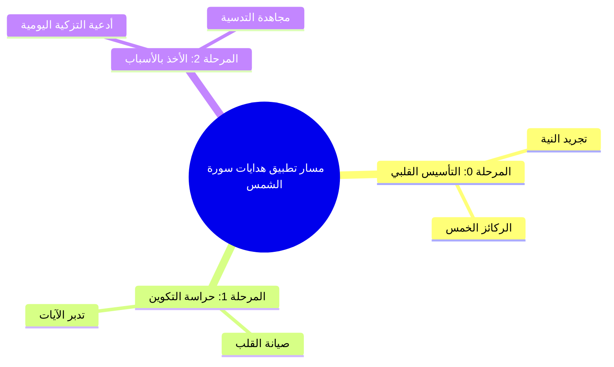

# أمثلة الخرائط الذهنية في الملخص المطوّل

## خريطة مناسبة لمراحل مترابطة

في المشروع، ملف [07 - خطة تطبيق الدروس](../../../main_obsidian/دين/تفسير/سورة الشمس/ملخص سورة الشمس علوان/07 - خطة تطبيق الدروس.md) يعرض خطة تطبيق هدايات سورة الشمس على مراحل متتابعة؛ لذلك تلائم الخريطة جزء المراحل، مع بقاء الشرح التفصيلي في متن الملخص.

````markdown

````

هذا مقتطف توضيحي من بنية الملف، وليس بديلًا عن نقاط الخطة وتفاصيلها.

## متى لا نضيف خريطة؟

إذا كان المقطع يشرح تعريفًا واحدًا أو نتيجة قصيرة بلا فروع أو علاقات متشعبة، اكتفِ بنقطة أو فقرة واضحة. لا تضف خريطة منفصلة لمجرد تنويع شكل الملخص.

## مراعاة الوضع الداكن والفاتح

- اترك الخلفية وألوان العقد والخطوط على سمة Mermaid في Obsidian، وتجنب تثبيت خلفية بيضاء أو سوداء.
- لا تستخدم لونًا مخصصًا إلا إذا ظل النص والخطوط واضحين عند معاينة الرسم في Dark mode وLight mode.
- إذا لم تتوفر معاينة الوضعين، استخدم التنسيق الافتراضي بلا ألوان أو خلفية مخصصة.
