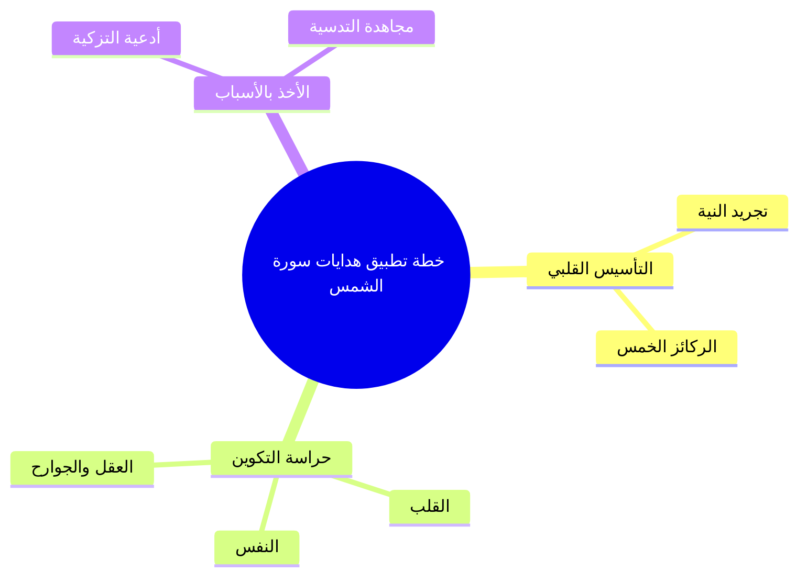

# أمثلة الخرائط الذهنية في الملخص المختصر

## خريطة موجزة عندما توضح علاقة المراحل

في [خطة تطبيق دروس سورة الشمس](../../../main_obsidian/دين/تفسير/سورة الشمس/ملخص سورة الشمس علوان/07 - خطة تطبيق الدروس.md) تظهر مراحل متتابعة وفروع لكل مرحلة؛ هذا النوع يستفيد من خريطة موجزة، مع إبقاء التفاصيل العملية في النقاط أسفل الرسم.

````markdown

````

المقصود إظهار الهيكل والعلاقات، لا ضغط كامل الشرح داخل الرسم.

## مثال لا يحتاج خريطة

إذا لخّص الدرس فكرة واحدة وشرحها بمثال واحد، فاكتبها في نقطة مع شرح المثال. لا تنشئ فروعًا شكلية حولها.

## اللون والخلفية

اترك Mermaid يستخدم ألوانًا مناسبة لسمة Obsidian. لا تثبّت لون خلفية فاتحًا أو داكنًا ولا لون نص، وتحقق من التباين في الوضعين عند إضافة تنسيق خاص. عند تعذر المعاينة، استخدم الإعداد الافتراضي.
