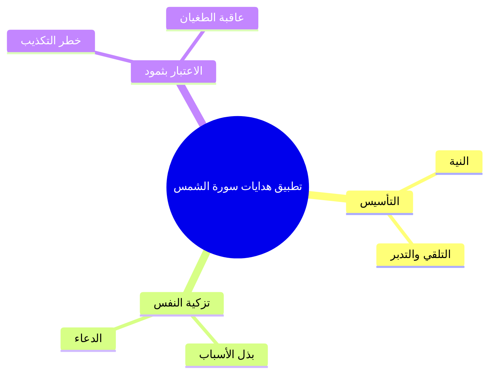

# أمثلة الخرائط الذهنية في الملخص الديني المختصر

## استخدمها عندما توضح مراحل مترابطة

في ملف [خطة تطبيق دروس سورة الشمس](../../../main_obsidian/دين/تفسير/سورة الشمس/ملخص سورة الشمس علوان/07 - خطة تطبيق الدروس.md)، تعرض المراحل المتتابعة أصلًا وفروعًا عملية؛ لذا يصلح رسم الهيكل بخريطة موجزة، مع بقاء تفاصيل الدرس في الملخص.

````markdown

````

## اتركها عندما لا تضيف وضوحًا

إذا عرض الدرس فائدة واحدة مرتبطة بآية واحدة، فاذكر الآية ووجه الاستدلال في نقطة مباشرة؛ لا تحوّلها إلى خريطة ذات فروع مصطنعة.

## اجعلها مقروءة في الوضعين

استخدم خلفية وألوان Mermaid الافتراضية التي تتبع سمة Obsidian. تجنب تثبيت خلفية بيضاء أو سوداء أو لون نص لا يظهر في أحد الوضعين، وعاين Dark mode وLight mode عند إضافة ألوان خاصة.
