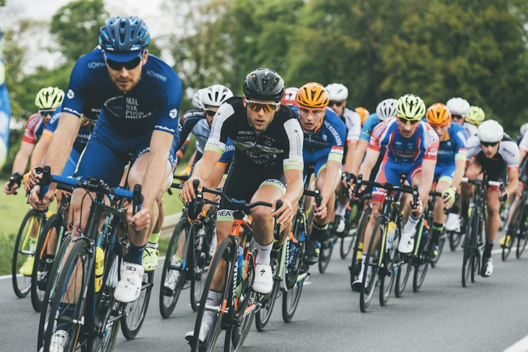

# 22 — CSS Grid Photo Gallery

> [!question] السؤال الرسمي
> اعمل الشكل كما في الصورة، ويمكن استخدام أي صور.
>
> ![[vibe_coding/Elzero Frontend/CSS/CSS All Course Assignments/assets/assignment-22-reference.jpg]]

> [!success]- الإجابة وشرح الحل — اضغط لفتحه
> ```html
> <div class="gallery">
>   
>   
>   
>   
>   
>   
>   
>   
> </div>
> ```
>
> ```css
> .gallery {
>   width: 950px;
>   height: 715px;
>   display: grid;
>   grid-template-columns: repeat(4, minmax(0, 1fr));
>   grid-template-rows: repeat(3, minmax(0, 1fr));
>   gap: 20px;
> }
>
> .gallery img {
>   width: 100%;
>   height: 100%;
>   object-fit: cover;
>   border-radius: 10px;
> }
>
> .gallery img:nth-child(1) { grid-column: 1; grid-row: 1 / span 2; }
> .gallery img:nth-child(2) { grid-column: 2; grid-row: 1; }
> .gallery img:nth-child(3) { grid-column: 3 / span 2; grid-row: 1; }
> .gallery img:nth-child(4) { grid-column: 2; grid-row: 2 / span 2; }
> .gallery img:nth-child(5) { grid-column: 3; grid-row: 2; }
> .gallery img:nth-child(6) { grid-column: 4; grid-row: 2; }
> .gallery img:nth-child(7) { grid-column: 1; grid-row: 3; }
> .gallery img:nth-child(8) { grid-column: 3 / span 2; grid-row: 3; }
> ```
>
> تحدد `grid-template-columns` أربعة أعمدة متساوية. تستخدم `grid-column` و`grid-row` لتكبير الصور الطويلة والعريضة لتطابق توزيع الصورة.
>
> تجعل `object-fit: cover` الصورة تملأ الخانة مع قص الحواف الزائدة، وتحافظ الزوايا المستديرة على الشكل العام.
>
> ![[vibe_coding/Elzero Frontend/CSS/CSS All Course Assignments/assets/solution-task-22.png]]
>
> [افتح صفحة معاينة الأسئلة 17–25](CSS All Course Assignments 17-25.html)

> [!info] مصدر صور المعاينة
> اختيرت الصور من Unsplash وحُفظت محليًا داخل `assets` حتى تعمل صفحة المعاينة دون طلب الصور من الإنترنت.
>
> يذكر ترخيص Unsplash الرسمي أن الصور متاحة للاستخدام المجاني التجاري وغير التجاري، ولا يشترط نسبة المصدر؛ أرفقت روابط الصور تقديرًا للمصورين.
>
> [ترخيص Unsplash الرسمي](https://unsplash.com/license)
>
> - [صورة 1](https://images.unsplash.com/photo-1493711662062-fa541adb3fc8)
> - [صورة 2](https://images.unsplash.com/photo-1542751371-adc38448a05e)
> - [صورة 3](https://images.unsplash.com/photo-1503376780353-7e6692767b70)
> - [صورة 4](https://images.unsplash.com/photo-1511512578047-dfb367046420)
> - [صورة 5](https://images.unsplash.com/photo-1546519638-68e109498ffc)
> - [صورة 6](https://images.unsplash.com/photo-1517649763962-0c623066013b)
> - [صورة 7](https://images.unsplash.com/photo-1535223289827-42f1e9919769)
> - [صورة 8](https://images.unsplash.com/photo-1446776811953-b23d57bd21aa)

## المصدر

[تكليفات CSS على جميع الدروس — أكاديمية الزيرو](https://elzero.org/css-assignments-lesson-from-1-to-88/)
