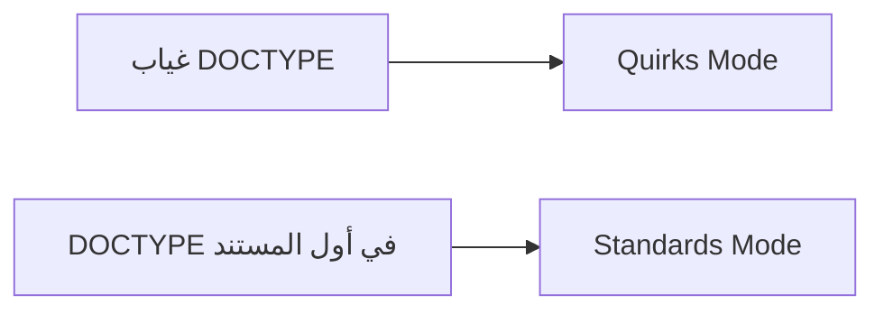

# ملخص مختصر: DOCTYPE وأوضاع العرض

## الفكرة الأساسية

إعلان `DOCTYPE` يحدد للمتصفح طريقة عرض مستند HTML. في HTML5، كتابته في بداية الصفحة يفعّل **Standards Mode** (الوضع القياسي)، ويساعد على تجنّب مشكلات التوافق القديمة.

## الصيغة والاستخدام

الصيغة التي يشرحها الدرس، وتظهر في [صفحة الدرس الرسمية](https://elzero.org/html-doctype-and-standard-and-quirks-mode/)، هي:

```html
<!doctype html>
```

- توضع في أول المستند قبل عناصر الصفحة.
- لا تتأثر بحالة الأحرف؛ يمكن كتابة `doctype` بأحرف صغيرة أو كبيرة.

## وضعا العرض

- الوضع القياسي — **Standards Mode**: يعرض المتصفح الصفحة وفق معايير HTML الحديثة.
- وضع المراوغة — **Quirks Mode**: قد يستخدمه المتصفح عند غياب `DOCTYPE`، فيعرض بعض العناصر أو الخصائص بسلوك قديم أو غير متوقع.

يوضح المخطط أثر وجود التعليمة، وهو رسم توضيحي مستمد من الشرح وليس لقطة من الفيديو:



## التجربة في الفيديو

يعرض المدرّس في Firefox طريقة ملاحظة وضع الصفحة من قائمة النقر بزر الفأرة الأيمن ومعلومات الصفحة، ثم يقارن الحالة من دون `DOCTYPE` بالحالة بعد إضافته: تنتقل الصفحة من `Quirks Mode` إلى `Standards Mode`. لذلك اجعل `<!doctype html>` أول سطر في كل صفحة HTML.

## تقدّم قائمة التشغيل

مجموع مدد الفيديوهات المدرجة في [خطة HTML الرسمية](https://elzero.org/study/html-2021-study-plan/) **4 ساعات و12 دقيقة و53 ثانية**؛ وحتى نهاية الدرس 06 حسب ترتيبها **40 دقيقة و46 ثانية**، والمتبقي بعده **3 ساعات و32 دقيقة و7 ثوانٍ**.

> [!info] المصدر
> [الفيديو على YouTube](https://www.youtube.com/watch?v=sBFemL2Mfj4&list=PLDoPjvoNmBAw_t_XWUFbBX-c9MafPk9ji&index=6) · [صفحة الدرس على أكاديمية الزيرو](https://elzero.org/html-doctype-and-standard-and-quirks-mode/). نص التفريغ من NotebookLM.
