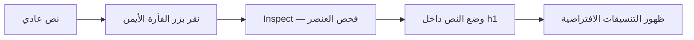

# ملخص مختصر: العناوين واستخداماتها

## الفكرة الأساسية

العناوين في HTML (لغة ترميز صفحات الويب) تختلف عن عنصر `<head>` الذي يحتوي معلومات الصفحة. للعناوين ستة مستويات من `h1` إلى `h6`؛ يبدأ التسلسل بعنوان الصفحة الأهم، ثم يتدرج إلى العناوين الأقل رتبة. تبدو أحجامها الافتراضية متدرجة. **[00:13–00:40، 02:52–03:27]**

## تجربة التنسيقات الافتراضية

يعرض المدرّس نصًا عاديًا، ثم يفتحه بزر الفأرة الأيمن ويختار **Inspect** (فحص العنصر). يوضح الفحص أن النص العادي لا يأخذ مظهر العنوان؛ وعند وضعه داخل `<h1>` يطبّق المتصفح **User Agent Stylesheet** (ورقة التنسيقات الافتراضية للمتصفح)، مثل تكبير خط العنوان. يمكن تغيير هذه التنسيقات لاحقًا باستخدام **CSS** (لغة تنسيق صفحات الويب). **[00:50–02:00]**

المخطط التالي يوضح تسلسل التجربة بحسب شرح الفيديو، وليس لقطة شاشة منه:



## ترتيب العناوين

يشبّه المدرّس الصفحة بكتاب: `h1` لعنوان الكتاب أو الصفحة، و`h2` لعنوان الفصل، و`h3` لعنوان قصة داخل الفصل. استخدم المستوى التالي للعناوين المتداخلة، ولا تقفز مثلًا من `h1` إلى `h3` ثم تضع `h2` تحته؛ لذا اختر المستوى بحسب بنية المحتوى لا حجم الخط المرغوب. ويوصي المدرّس بعنوان رئيس واحد من المستوى `h1` للصفحة. **[03:28–05:05]**

المثال الآتي مقتطف توضيحي من [صفحة الدرس الرسمية](https://elzero.org/html-headings-and-use-cases/)؛ وهو مثال من الموقع، لا نقل حرفي من الترجمة النصية للفيديو:

```html
<h1>Book Store</h1>
<h2>Chapter Title Inside Book</h2>
<h3>Story Title Inside Chapter</h3>
```

## تقدّم قائمة التشغيل

بحساب مدد الفيديوهات الـ37 في [خطة HTML الرسمية](https://elzero.org/study/html-2021-study-plan/)، يبلغ مجموع القائمة **4 ساعات و12 دقيقة و53 ثانية**. وحتى نهاية الدرس 07، المدة المتراكمة **46 دقيقة و52 ثانية**، والمتبقي ابتداءً من الدرس التالي **3 ساعات و26 دقيقة وثانية واحدة**. هذا حساب بحسب ترتيب القائمة، وليس سجلًا لمدة مشاهدة المستخدم.

> [!info] المصدر
> [الفيديو على YouTube](https://www.youtube.com/watch?v=XxkX8wnRq3s&list=PLDoPjvoNmBAw_t_XWUFbBX-c9MafPk9ji&index=7) · [صفحة الدرس الرسمية](https://elzero.org/html-headings-and-use-cases/) · [خطة دراسة HTML 2021](https://elzero.org/study/html-2021-study-plan/). مصدر الترجمة النصية: YouTube.
