# 00 - الفهرس والخطة: القرآن الكريم وحقيقة التغيير

> [!info] عن هذا المجلس والتفريغ
> مجلس إيماني وتزكوي رفيع يربط بين ختام شهر رمضان ومسؤولية الأمة تجاه كتاب ربها، طارحاً السؤال الجوهري الذي يمثل مؤشر الإيمان: **«أَيُّنا زادته هذه الآيات إيماناً وتغيراً؟»**. يحلل المجلس حقيقة «حق التلاوة»، ومواقف القلوب (المؤمنة والمنافقة) تجاه نزول الآيات، ومكمن الخطورة في قسوة القلوب ورفع العلم بترك العمل، ومَثَل التائهين في الصحراء مع الخريطة، واضعاً خارطة طريق واضحة لنقل القرآن من مجرد أصوات تتلى إلى منهاج حي يغير البيوت والمجتمعات.

---

## 📚 معلومات المصدر

| البند | البيان |
|:---|:---|
| **المصدر الأصلي** | `main_obsidian/دين/التزكية/خطبة جمعة/القرءان/تفريخ خطبة جمعه القرءان.md` |
| **المادة** | موعظة منبرية وخطبة جمعة في التزكية والتدبر القرآني |
| **الموضوع الرئيسي** | حقيقة التغيير بالقرآن، خطر الهجران بعد رمضان، ومثل خريطة النجاة |
| **حجم التفريغ** | تفريغ صوتي كامل (41.4 كيلوبايت) |
| **التوقيت** | ختام شهر رمضان المبارك والتواصي بالاستقامة بعده |

> [!note] تنبيه بخصوص المخرجات
> تتضمن هذه الحزمة تحليلاً وتلخيصاً علمياً مفصلاً للمجلس عبر ملفات مترابطة، بالإضافة إلى خطبة الجمعة المنبرية المستقلة الجاهزة للإلقاء في المجلد الرئيسي: [[خطبة الجمعة عن القرآن الكريم وحقيقة التغيير]].

---

## 🗺️ خطة الأجزاء وعناوينها

| # | الملف | المحور والموضوع الأساسي |
|:---:|:---|:---|
| 00 | [[00 - الفهرس والخطة]] | الفهرس وخطة المعالجة الشاملة وخريطة المفاهيم التربوية |
| 01 | [[01 - حق تلاوته والتغيير العملي ومؤشر الإيمان]] | مؤشر التغيير بعد رمضان، فقه حق التلاوة عند السلف، وأثر السور في المجتمع |
| 02 | [[02 - مواقف القلوب من نزول الآيات وسر فزع المنافقين]] | فزع المنافقين من الفضيحة، جهاد الكفر لصد القرآن، واستبشار المؤمنين وطمأنينتهم |
| 03 | [[03 - عظمة تأثير القرآن وقسوة القلوب ومثل التائهين في الصحراء]] | سطوة القرآن على الجبال، أثر القلوب المريضة، ومَثَل قارئ الخريطة في الصحراء |
| 04 | [[04 - رفع العلم وإقامة الكتاب وخطورة الهجران بعد رمضان]] | حديث زياد بن لبيد في رفع العلم، بكاء وحنين الجذع للذكر، ومقام الشوق لكلام الله |
| 05 | [[05 - ملخص المراجعة السريعة]] | تفريغ واستخلاص المجلس في جداول جامعة ومقارنات قلبية مركزة |
| 06 | [[06 - أسئلة المراجعة والاختبار الذاتي]] | بنك أسئلة موضوعية ومقالية وتدبرية لترسيخ المعاني وتحريك القلوب |
| 07 | [[07 - خطة تطبيق الدروس والتغيير بالقرآن في البيوت]] | خطة عمل تنفيذية بمهام تطبيقية `- [ ]` لورد التدبر وجلسات الأسرة القرآنية |
| — | [[القرآن_ملف_مجمع]] | الملف التجميعي الشامل لكافة الأجزاء للقراءة المتصلة |
| ⭐️ | [[خطبة الجمعة عن القرآن الكريم وحقيقة التغيير]] | نص خطبة الجمعة المنبرية من خطبتين كاملتين جاهزة للإلقاء على المنبر |

---

## 📐 منهجية المعالجة المعتمدة

- **التكامل الإيماني والمنهجي:** الجمع بين فقه الآيات، ونقول المفسرين، والبعد السلوكي التزكوي.
- **تطبيق معايير أوبسيديان (Obsidian Flavored Markdown):** استخدام خواص Frontmatter، ووسوم التنبيه Callouts، والروابط الداخلية `[[Wikilinks]]` لكل المعاني المركزية.
- **عدم تكرار المعلومة:** إيراد كل فكرة وشاهد في موضعها الأوفى تحليلياً واستنباط ثمرتها التربوية.
- **التنسيق اللوني الهادف:**
  - النصوص الشرعية (القرآن، الحديث، الآثار، الأدعية): باللون الذهبي الدافئ.
  - المفاهيم التربوية وقواعد التغيير والبصائر: باللون التركوازي الهادئ.
  - التحذيرات من آفات النفاق والغفلة وقسوة القلوب: باللون المرجاني/الأحمر التنبيهي.

---

## 🧭 خريطة المفاهيم التربوية للمجلس

```mermaid
graph TD
    Q[القرآن الكريم وحقيقة التغيير] --> A[حقيقة التلاوة]
    Q --> B[مواقف القلوب]
    Q --> C[قسوة القلوب والتيه]
    Q --> D[إقامة الكتاب في الواقع]

    A --> A1[رمضان شهر القرآن]
    A --> A2[مؤشر الإيمان: أيكم زادته هذه إيمانا]
    A --> A3[حق التلاوة: العمل والاتباع عند السلف]
    A --> A4[لم يخروا عليها صما وعميانا]

    B --> B1[المنافقون: الخوف من الفضيحة والتواصي بالإعراض]
    B --> B2[الكفار: صد الناس بالكرسف واللغو]
    B --> B3[المؤمنون: الاستبشار والطمأنينة واليقين]

    C --> C1[عظمة القرآن لو نزل على جبل]
    C --> C2[طال عليهم الأمد فقست قلوبهم]
    C --> C3[مَثَل الخريطة في صحراء التيه]

    D --> D1[رفع العلم بترك العمل: حديث زياد بن لبيد]
    D --> D2[إقامة التوراة والإنجيل والقرآن]
    D --> D3[حنين الجذع للذكر وعتاب القلوب الهاجرة]
    D --> D4[مشروع التغيير الأسري: القرآن يمشي على الأرض]
```

---

## 📊 إحصائيات سريعة للحزمة

| البند | البيان |
|:---|:---|
| **عدد ملفات الشرح التفصيلي** | 4 ملفات موضوعية رئيسية |
| **ملفات المساندة والمراجعة** | 3 ملفات (ملخص سريع + اختبار ذاتي + خطة تطبيقية) |
| **الملفات التجميعية والمنبرية** | ملف مجمع شامل + خطبة جمعة من خطبتين |
| **عدد الآيات المركزية المحللة** | 18 آية كريمة |
| **الأحاديث والآثار النبوية الشريفة** | 7 أحاديث وآثار سلفية |
