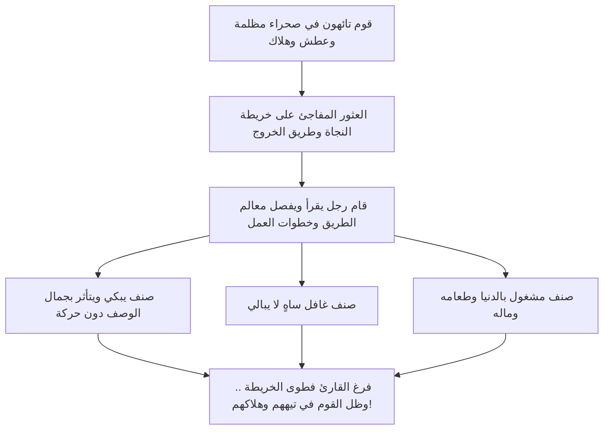

# 03 - عظمة تأثير القرآن وقسوة القلوب ومثل التائهين في الصحراء

> [!abstract] الفكرة المركزية
> يمتلك القرآن الكريم من الجلال والسطوة ما يصدع الجبال الشم الراسيات؛ غير أن طول الأمد والغفلة تورث القلوب قسوة تحجبها عن التأثر؛ حتى صار حال كثير من المسلمين كحال تائهين في صحراء يملكون خريطة النجاة لكنهم يكتفون بالبكاء عند قراءتها دون أن يخطوا خطوة واحدة للخروج من التيه.

---

## 1. سطوة القرآن على الجمادات وعتاب القلوب القاسية

أخبر الله عز وجل عن كمال قوة خطابه القرآني وتأثيره المهيب:
- ﴿لَوْ أَنزَلْنَا هَٰذَا الْقُرْآنَ عَلَىٰ جَبَلٍ لَّرَأَيْتَهُ خَاشِعًا مُّتَصَدِّعًا مِّنْ خَشْيَةِ اللَّهِ ۚ وَتِلْكَ الْأَمْثَالُ نَضْرِبُهَا لِلنَّاسِ لَعَلَّهُمْ يَتَفَكَّرُونَ﴾ [الحشر:21].
- ﴿وَلَوْ أَنَّ قُرْآنًا سُيِّرَتْ بِهِ الْجِبَالُ أَوْ قُطِّعَتْ بِهِ الْأَرْضُ أَوْ كُلِّمَ بِهِ الْمَوْتَىٰ ۗ بَل لِّلَّهِ الْأَمْرُ جَمِيعًا﴾ [الرعد:31].

> [!quote] المعنى الإيماني
> لو قَدَّر الله لكلام في الوجود أن يحرك الجمادات الصم، أو يقطع الأرض، أو يحيي الموتى، لكان هذا القرآن لما أودع الله فيه من الجلال والسلطان والبرهان؛ فإذا كانت الصخور الشامخة تتصدع وتتفجر منها الأنهار خشية لله، فما بال قلوبنا تسمع آيات الجنة والنار وأوصاف الرب الجليل ثم لا تخشع؟!

لقد وجه الله العتاب الصادع لأهل الإيمان:
﴿أَلَمْ يَأْنِ لِلَّذِينَ آمَنُوا أَن تَخْشَعَ قُلُوبُهُمْ لِذِكْرِ اللَّهِ وَمَا نَزَلَ مِنَ الْحَقِّ وَلَا يَكُونُوا كَالَّذِينَ أُوتُوا الْكِتَابَ مِن قَبْلُ فَطَالَ عَلَيْهِمُ الْأَمَدُ فَقَسَتْ قُلُوبُهُمْ ۖ وَكَثِيرٌ مِّنْهُمْ فَاسِقُونَ﴾ [الحديد:16].

إن «طول الأمد» — أي هجران القرآن ومفارقة تدبره أياما وشهوراً وسنين — هو المصدر الأول لقسوة القلب؛ حتى يصير سماع آيات الوعيد كأنه أمر عادي لا يثير دمعة ولا يوقظ غافلاً.

---

## 2. مَثَل الجسد المريض والقلب المريض

لماذا يستثقل بعض الناس سماع بعض آيات القرآن وأحكامه؟
- **الجسد الصحيح السليم:** ينتفع بالطعام الطيب، والماء العذب، والهواء النقي؛ فيزداد صحة ونشاطاً وقوة.
- **الجسد المريض السقيم:** إذا قُدم له الطعام الطيب عافه ولفظه، وتألم منه، وقد يزيده علة ومغصاً لفساد معدته لا لفساد الطعام.

> [!important] تطبيق المثل على القلوب
> - **القلب السليم:** يجد في آيات حقارة الدنيا، وتذكر الموت، وأحكام الشريعة، وغض البصر، وحرمة الربا، والحدود، غذاءً وشفاءً وطهارة.
> - **القلب المريض بالشهوات والشبهات:** يتألم حين يسمع أن الدنيا متاع الغرور، ويضيق ذرعاً بآيات الحدود وحرمة الزنا والشبهات، ولا يريد أن يُذكر بفناء اللذات؛ فينفر وينصرف!

لهذا قال سبحانه منبهاً على عدم انتفاعهم بالعبر:
﴿أَوَلَا يَرَوْنَ أَنَّهُمْ يُفْتَنُونَ فِي كُلِّ عَامٍ مَّرَّةً أَوْ مَرَّتَيْنِ ثُمَّ لَا يَتُوبُونَ وَلَا هُمْ يَذَّكَّرُونَ﴾ [التوبة:126].
فطوال العام ابتلاءات وأمراض وخوف وفقر وأزمات ليتضرعوا ويعودوا، وفي رمضان آيات تتلى؛ فإذا لم يتغير بالقرآن ولم يتعظ بالبلاء، فمتى يفيق؟!

---

## 3. مَثَل التائهين في الصحراء وقارئ الخريطة

ضرب المتحدث مثلاً تصويرياً بديعاً يكشف حقيقة أزمة الأمة مع كتاب ربها:

### الإسقاط الواقعي للمثل:
- **الصحراء والتيه:** هي ظلمات الغفلة والجهل والذنوب والفتن في هذا العالم.
- **الخريطة الربانية:** هي القرآن الكريم، بصائر وهدى من رب العالمين تدلنا بدقة على طريق النجاة في الدنيا والآخرة.
- **موقفنا في رمضان:** نجلس في المحاريب فنسمع قراءة الخريطة، وأحسننا حالاً من يبكي ويتأثر بصوت القارئ ونغمته!
- **المأساة الكبرى:** ما إن ينتهي رمضان وتُطوى المصاحف، حتى نعود إلى أعمالنا ولهونا وأخلاقنا السابقة، ونستمر في تيهنا المعنوي والعملي دون أن نطبق خطوة واحدة من خريطة النجاة!

> [!tip] النتيجة
> البكاء عند قراءة الخريطة لا يُنجي من الصحراء؛ النجاة في السير على هداها خطوة بخطوة.
