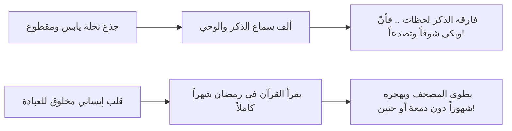

# 04 - رفع العلم وإقامة الكتاب وخطورة الهجران بعد رمضان

> [!abstract] الفكرة المركزية
> رفع العلم الحقيقي ليس بضياع المصاحف من الرفوف، بل بزوال العمل بها وترك إقامة حدودها كما حدث لأهل الكتاب من قبلنا؛ وأعظم جريمة يرتكبها العبد في حق قلبه أن يهجر القرآن بعد رمضان فيكسو المصاحف الغبار، بينما حنّ الجذع اليابس وبكى شوقاً لسماع الذكر!

---

## 1. رفع العلم باختلاس العمل: حديث زياد بن لبيد

حذر المصطفى ﷺ من فتنة غفلة الأمة وتجريد القرآن من روحه العملية في الحديث المهيب:
> عَنْ زِيَادِ بْنِ لَبِيدٍ رَضِيَ اللَّهُ عَنْهُ قَالَ: ذَكَرَ النَّبِيُّ ﷺ شَيْئًا فَقَالَ: «وَذَاكَ عِنْدَ أَوَانِ ذَهَابِ الْعِلْمِ»، قُلْتُ: يَا رَسُولَ اللَّهِ، وَكَيْفَ يَذْهَبُ الْعِلْمُ وَنَحْنُ نَقْرَأُ الْقُرْآنَ وَنُقْرِئُهُ أَبْنَاءَنَا، وَيُقْرِئُهُ أَبْنَاؤُنَا أَبْنَاءَهُمْ إِلَى يَوْمِ الْقِيَامَةِ؟! فَقَالَ ﷺ: «ثَكِلَتْكَ أُمُّكَ يَا ابْنَ لَبِيدٍ! إِنْ كُنْتُ لَأَرَاكَ مِنْ أَفْقَهِ رَجُلٍ بِالْمَدِينَةِ، أَوَلَيْسَ هَذِهِ الْيَهُودُ وَالنَّصَارَى يَقْرَءُونَ التَّوْرَاةَ وَالْإِنْجِيلَ لَا يَعْمَلُونَ بِشَيْءٍ مِمَّا فِيهِمَا؟!».

### التحليل العقدي والمنهجي:
1. **الفرق بين الحفظ والإقامة:** تعجب زياد ظناً منه أن استمرار التلاوة وتوارث المصاحف يحفظ العلم تلقائياً.
2. **تصحيح المفهوم النبوي:** بين النبي ﷺ أن مجرد حفظ الحروف مع تضييع الأوامر هو عين ذهاب العلم؛ كما قال تعالى:
   ﴿وَلَوْ أَنَّهُمْ أَقَامُوا التَّوْرَاةَ وَالْإِنجِيلَ وَمَا أُنزِلَ إِلَيْهِم مِّن رَّبِّهِمْ لَأَكَلُوا مِن فَوْقِهِمْ وَمِن تَحْتِ أَرْجُلِهِم﴾ [المائدة:66].
   قال سبحانه: «أقاموا» ولم يقل «قرؤوا» أو «حفظوا»؛ فالإقامة هي تحكيم الحلال والحرام في شؤون الحياة.

---

## 2. حنين الجذع اليابس: عتاب الجماد للقلوب الغافلة

كان النبي ﷺ يخطب أول أمره مستنداً إلى جذع نخلة في مسجده الشريف، فلما صُنع له المنبر وتحول إليه ليخطب عليه:
> حَنَّ الجذع حنيناً شديداً، وصاح كما يصيح الصبي، وسمع أهل المسجد جميعاً بكاءه وأنينه شوقاً إلى ما كان يسمع من ذكر الله وتلاوة رسوله ﷺ، حتى نزل النبي ﷺ واحتضنه وسكنه كما يسكن الصبي!

> [!danger] تأمل وتحذير
> كيف يطيق قلب مؤمن أن يعيد القرآن إلى الرفوف ليعلوه التراب؟! إذا كان الخشب الصلد اليابس يبكي لفوات سماع الذكر، فأي قسوة رانت على قلوب بني آدم حتى يهجروا كلام فاطر السماوات والأرض؟!

---

## 3. مقامات التفاعل مع آيات التنزيل

### أ. شوق كليم الله موسى عليه السلام:
لما سمع موسى عليه السلام كلام ربه مباشرة عند الميقات، لم يملك نفسه من عظيم الشوق وجلال المتكلم، فقال:
﴿قَالَ رَبِّ أَرِنِي أَنظُرْ إِلَيْكَ﴾ [الأعراف:143]؛ وقال في مبادرته: ﴿وَعَجِلْتُ إِلَيْكَ رَبِّ لِتَرْضَىٰ﴾ [طه:84].
فكيف نسمع نحن كلام الله في كل ليلة ولا يزداد شوقنا إلى رضوانه ورؤية وجهه الكريم في جنات النعيم؟!

### ب. تفاعل الجن مع سورة الرحمن:
قَرَأَ رسول الله ﷺ سورة الرحمن على الصحابة فسكتوا، فقال:
> «لَقَدْ قَرَأْتُهَا عَلَى الْجِنِّ لَيْلَةَ الْجِنِّ فَكَانُوا أَحْسَنَ مَرْدُودًا مِنْكُمْ؛ كُنْتُ كُلَّمَا أَتَيْتُ عَلَى قَوْلِهِ: ﴿فَبِأَيِّ آلَاءِ رَبِّكُمَا تُكَذِّبَانِ﴾ قَالُوا: لَا بِشَيْءٍ مِنْ نِعَمِكَ رَبَّنَا نُكَذِّبُ، فَلَكَ الْحَمْدُ».

### ج. تأثر الصحابة الكرام:
- **جبير بن مطعم رضي الله عنه:** لما سمع النبي ﷺ يقرأ في صلاة المغرب بسورة الطور: ﴿أَمْ خُلِقُوا مِنْ غَيْرِ شَيْءٍ أَمْ هُمُ الْخَالِقُونَ﴾، قال: **«كاد قلبي أن يطير، وذلك أول ما وقر الإيمان في قلبي»**.
- **عمر بن الخطاب رضي الله عنه:** كان يمر بالآية في ورده بالليل فيغشى عليه حتى يُعاد أياماً كأنه مريض من شدة وجله.

---

## 4. عهد الهجرة الصادقة إلى القرآن

الحل ليس في اليأس من التقصير الماضي، بل في عقد النية الجازمة والميثاق الغليظ مع الله تعالى:
﴿وَكَذَٰلِكَ أَوْحَيْنَا إِلَيْكَ رُوحًا مِّنْ أَمْرِنَا ۚ مَا كُنتَ تَدْرِي مَا الْكِتَابُ وَلَا الْإِيمَانُ وَلَٰكِن جَعَلْنَاهُ نُورًا نَّهْدِي بِهِ مَن نَّشَاءُ مِنْ عِبَادِنَا ۚ وَإِنَّكَ لَتَهْدِي إِلَىٰ صِرَاطٍ مُّسْتَقِيمٍ﴾ [الشورى:52].

> [!tip] البشارة لمن صدق في البداية
> لو عزم المسلم على أن يكون من أهل القرآن العاملين به، وجاهد نفسه على فهمه وتطبيقه، ثم أدركته المنية وهو في بداية الطريق؛ فقد كمل أجره عند الله:
> ﴿وَمَن يَخْرُجْ مِن بَيْتِهِ مُهَاجِرًا إِلَى اللَّهِ وَرَسُولِهِ ثُمَّ يُدْرِكْهُ الْمَوْتُ فَقَدْ وَقَعَ أَجْرُهُ عَلَى اللَّهِ ۗ وَكَانَ اللَّهُ غَفُورًا رَّحِيمًا﴾ [النساء:100].
