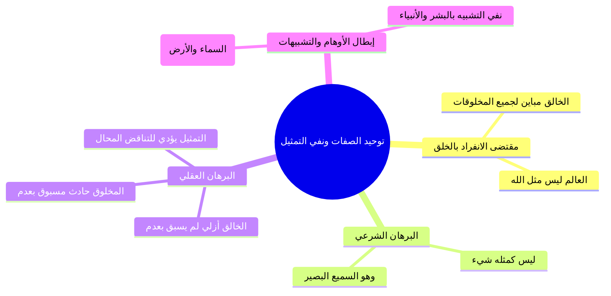
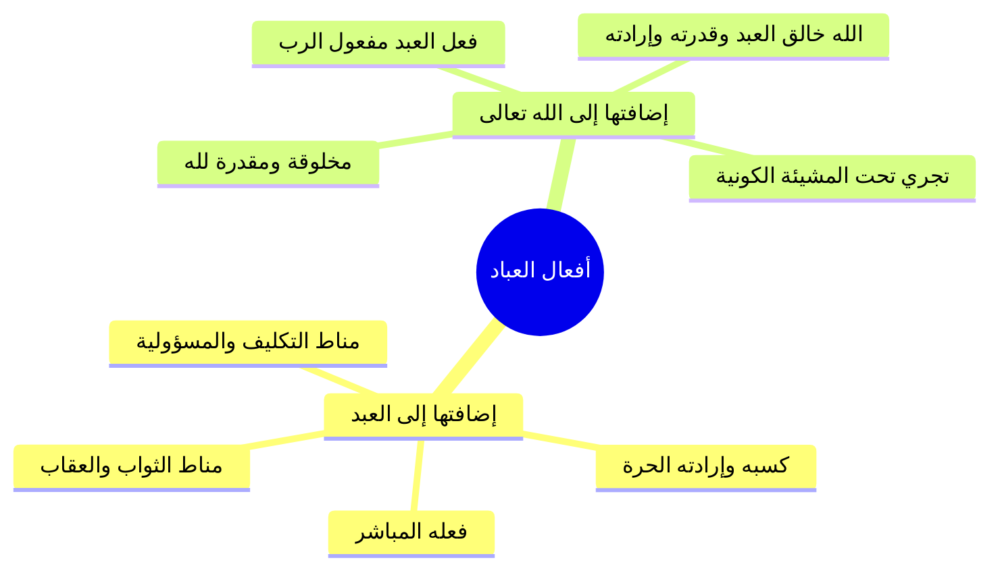
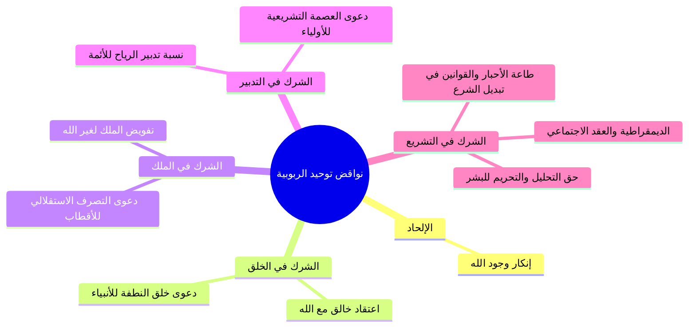

# المحاضرة 14: مقتضيات توحيد الربوبية وثمراته ونواقضه (نسخة مجمعة للطباعة)

---

## 📑 فهرس موضوعات الملف المجمع

1. [[#الجزء 00: مقدمة وخطة الأجزاء وعناصر المحاضرة]]
2. [[#الجزء 01: مقتضيات توحيد الربوبية في الأسماء والصفات ونفي المماثلة]]
3. [[#الجزء 02: مقتضيات توحيد الربوبية في التشريع والعبادة وحوار النصراني]]
4. [[#الجزء 03: فاصل اسم الله التواب وفقه التوبة وشروطها]]
5. [[#الجزء 04: مقتضيات توحيد الربوبية في القضاء والقدر وخلق أفعال العباد]]
6. [[#الجزء 05: ثمرات توحيد الربوبية في الرضا وحلاوة الإيمان ومواجهة المصائب]]
7. [[#الجزء 06: فاصل اسم الله الحسيب وثمار الإيمان به ومحاسبة النفس]]
8. [[#الجزء 07: نواقض توحيد الربوبية ودعوى الشريك في الخلق والملك]]
9. [[#الجزء 08: نواقض توحيد الربوبية في التدبير والتشريع ونقد الديمقراطية]]

---

## الجزء 00: مقدمة وخطة الأجزاء وعناصر المحاضرة

### 📝 الملخص العلمي المنظم

#### 1. الافتتاح والأدعية المأثورة
افتتح المحاضر بحمد الله والصلاة والسلام على رسول الله محمد ﷺ، والدعاء المأثور:
- «اللهم إنا نسألك علماً نافعاً، وعملاً صالحاً، وقلباً خاشعاً، ولساناً ذاكراً».
- «اللهم علمنا ما ينفعنا، وانفعنا بما علمتنا، واجعله حجة لنا ولا تجعله حجة علينا يا رب العالمين».

#### 2. مراجعة وتأصيل لتوحيد الربوبية
- **تعريف توحيد الربوبية:** اعتقاد انفراد الله بربوبيته لهذا العالم؛ فهو خالقه، ومالكه، ومدبره، والمشرع لعباده شريعة يسيرون عليها.
- **التدبير ونوعاه:**
  1. **التدبير الكوني:** تصريف شؤون الخلق والأفلاك والأرزاق.
  2. **التدبير الشرعي:** وضع الشريعة والأحكام والتحليل والتحريم.
- **علة التنصيص على التشريع:** مع أن التشريع داخل في مسمى التدبير، إلا أن العلماء ينصون عليه استقلالاً لدفع توهم من يظن أن التدبير الكوني لله وحده بينما يسوغ للمخلوق التدخل في التشريع؛ قال تعالى: ﴿أَمْ لَهُمْ شُرَكَاءُ شَرَعُوا لَهُم مِّنَ الدِّينِ مَا لَمْ يَأْذَن بِهِ اللَّهُ﴾.

#### 3. محاور المحاضرة الرابعة عشرة
1. **مقتضيات توحيد الربوبية:** ما يلزم من أقر بالربوبية.
2. **ثمرات توحيد الربوبية:** الآثار الإيمانية والنفسية لرسوخ هذا التوحيد.
3. **نواقض توحيد الربوبية:** الاعتقادات والشركيات التي تنقض هذا التوحيد.

### 📋 استخراج المعلومات العلمية

| المحور | المفهوم والمضمون العلمي | الشاهد والغاية |
|:---|:---|:---|
| **مقتضيات توحيد الربوبية** | لوازم الإقرار بربوبية الله (في الصفات، والتشريع، والعبادة، والقدر) | إثبات أن الإقرار بالربوبية يوجب التوحيد الشامل |
| **ثمرات توحيد الربوبية** | انشراح الصدر، حلاوة الإيمان، الشجاعة، والسكينة عند المصائب | تحويل المعتقد إلى طمأنينة وراحة نفسية وسلوكية |
| **نواقض توحيد الربوبية** | إنكار وجود الله، ودعوى الشريك في الخلق أو الملك أو التدبير أو التشريع | الحذر من مزالق الشرك الأكبر والضلالات المعاصرة |

---

## الجزء 01: مقتضيات توحيد الربوبية في الأسماء والصفات ونفي المماثلة

### 📝 الملخص العلمي المنظم

#### 1. المقتضى الأول: توحيد الله في ذاته وأسمائه وصفاته
اعتقاد انفراد الله بالخلق والملك يقتضي استحالة مماثلة المخلوقات له سبحانه؛ فالخالق مباين لخلقه، والعالم ليس مثل الله ولا شيء من العالم مثل الله.

#### 2. البرهان العقلي على امتناع التمثيل والتناقض الناشئ عنه
- **المخلوق:** حادث مسبوق بعدم ويلحقه الفناء.
- **الخالق:** أزلي واجب الوجود لم يُسبق بعدم ولا يلحقه عدم، وكذلك صفاته العلى.
- **التناقض العقلي الممتنع:** القول بالتماثل (كمثال اليد) يقتضي إما وصف يد المخلوق بأنها لم تُسبق بعدم أو وصف يد الخالق بأنها مسبوقة بعدم؛ وكلاهما جمع بين النقيضين ومحال عقلاً.
- **الدليل الشرعي:** ﴿لَيْسَ كَمِثْلِهِ شَيْءٌ ۖ وَهُوَ السَّمِيعُ الْبَصِيرُ﴾ [الشورى: 11].
- **الرد على أوهام التشبيه:** نقد من يمثل الله بالسماء أو الأرض أو الأنبياء كآدم وعيسى ومحمد ﷺ؛ وتأكيد أسمائه الحسنى: الأول، والآخر، والظاهر، والباطن.

### 📋 استخراج المعلومات العلمية

| وجه المقارنة | الخالق جل جلاله | المخلوق | النتيجة عند فرض التماثل |
|:---|:---|:---|:---|
| **الأولية والسبق بالعدم** | أزلي لم يُسبق بعدم قط | حادث مسبوق بعدم حتماً | تناقض محال (إما جعل الحادث أزلياً أو الأزلي حادثاً) |
| **البقاء والعدم اللاحق** | باقٍ دائم لا يلحقه عدم ولا فناء | طارئ يلحقه الفناء والزوال | تناقض ممتنع في العقل |

---

## الجزء 02: مقتضيات توحيد الربوبية في التشريع والعبادة وحوار النصراني

### 📝 الملخص العلمي المنظم

#### 1. المقتضى الثاني: توحيد الله في التشريع
إفراد الله بوضع الشريعة والتحليل والتحريم؛ فلا حق لأمير أو وزير أو عالم أو عابد في سن الأحكام مع الله؛ قال تعالى: ﴿أَمْ لَهُمْ شُرَكَاءُ شَرَعُوا لَهُم مِّنَ الدِّينِ مَا لَمْ يَأْذَن بِهِ اللَّهُ﴾، وقال يوسف: ﴿إِنِ الْحُكْمُ إِلَّا لِلَّهِ ۚ أَمَرَ أَلَّا تَعْبُدُوا إِلَّا إِيَّاهُ﴾.

#### 2. المقتضى الثالث: توحيد الله في العبادة والشكر
العبودية الخالصة لله وإفراده بالطلب والقصد والنسك؛ قال تعالى: ﴿يَا أَيُّهَا النَّاسُ اعْبُدُوا رَبَّكُمُ الَّذِي خَلَقَكُمْ... فَلَا تَجْعَلُوا لِلَّهِ أَندَادًا وَأَنتُمْ تَعْلَمُونَ﴾.

#### 3. حوار النصراني عند البحر ومثل الجوال الهدية
- تأمل حركة الأمواج ووقوفها عند حد معلوم دال على مدبر واحد للبحر والكون.
- إثبات أن المدبر لا يشبه البحر ولا الأسماك ولا البشر ولا عيسى عليه السلام.
- ضرب مثل الجوال الهدية: شكر عابر السبيل على هدية أهداها لك غيره يعد جنوناً وسفهاً؛ فصرف العبادة والشكر لغير الخالق المنعم هو أعظم الظلم وأقبح القبيح وأعظم الجنون؛ وترتب على الحوار إسلام النصراني.

### 📋 استخراج المعلومات العلمية

| الباب       | مقتضى توحيد الربوبية                       | الوجه الباطل المناقض له                           | الشاهد القرآني                                                             |
| :---------- | :----------------------------------------- | :------------------------------------------------ | :------------------------------------------------------------------------- |
| **التشريع** | انفراد الله بالتحليل والتحريم ووضع الأحكام | جعل سلطة التشريع للبشر أو المجالس أو الكهنة       | ﴿إِنِ الْحُكْمُ إِلَّا لِلَّهِ ۚ أَمَرَ أَلَّا تَعْبُدُوا إِلَّا إِيَّاهُ﴾ |
| **العبادة** | إفراد الخالق الرازق بالدعاء والرجاء والشكر | صرف الشكر والعبادة للأموات أو الأصنام أو الأنبياء | ﴿فَلَا تَجْعَلُوا لِلَّهِ أَندَادًا وَأَنتُمْ تَعْلَمُونَ﴾                 |

---

## الجزء 03: فاصل اسم الله التواب وفقه التوبة وشروطها

### 📝 الملخص العلمي المنظم

#### 1. حقيقة اسم الله «التواب»
التوبة هي الرجوع إلى الطاعة وترك المعصية والندم؛ و«التواب» هو قابل التوب الذي يتوب على من يشاء من عباده ويقبل توبتهم، وكلما تكررت التوبة تكرر القبول فالجزاء من جنس العمل.

#### 2. فرح الله بتوبة عبده
فرح الله بتوبة عبده أشد من فرح واجد ناقته وطعامه في الصحراء المهلكة بعدما أيس واستسلم للموت؛ فقال من شدة الفرح: «اللهم أنت عبدي وأنا ربك».

#### 3. ثمرات الإيمان بالتواب
- المبادرة بالتوبة وعدم الإصرار على الذنوب.
- الطمع في سعة المغفرة وعدم القنوط واليأس؛ ﴿وَهُوَ الَّذِي يَقْبَلُ التَّوْبَةَ عَنْ عِبَادِهِ﴾.
- حاجة جميع العباد بما فيهم المؤمن المطيع للتوبة المستمرة؛ ﴿وَتُوبُوا إِلَى اللَّهِ جَمِيعًا أَيُّهَ الْمُؤْمِنُونَ لَعَلَّكُمْ تُفْلِحُونَ﴾.

### 📋 استخراج المعلومات العلمية

| البند | البيان الشرعي من المحاضرة |
|:---|:---|
| **الحد الشرعي للتوبة** | الرجوع إلى الطاعة والإنابة وترك المعصية والندم عليها |
| **قاعدة قبول التوبة** | كلما تكررت التوبة الصادقة من العبد تكرر القبول من الله بلا حصر |
| **دلالة فرح الله بالتائب** | أشد فرحاً من الواجد لراحلته وطعامه في الصحراء بعد يقين الهلاك |
| **المشمولون بالأمر بالتوبة** | عامة الخلق بما فيهم المؤمنون الصالحون المطيعون؛ ﴿وتوبوا إلى الله جميعاً أيه المؤمنون﴾ |

---

## الجزء 04: مقتضيات توحيد الربوبية في القضاء والقدر وخلق أفعال العباد

### 📝 الملخص العلمي المنظم

#### 1. المقتضى الرابع: توحيد الله في قضائه وقدره
إفراد الله بالقدر بمراتبه الأربع: العلم الأزلي السابق المحيط بكل شيء، الكتابة في اللوح المحفوظ، المشيئة العامة النافذة، والخلق الشامل.

#### 2. الفرق بين الإرادة الكونية والإرادة الشرعية
- **الإرادة الكونية القدرية:** مرادفة للمشيئة، يلزم وقوعها حتماً، ولا يلزم أن يحبها الله (كالشرور والمعاصي).
- **الإرادة الشرعية الدينية:** مرادفة للمحبة والرضا والأمر، يحبها الله، ولا يلزم وقوعها من كل أحد (كالطاعات والإيمان).
- **الخلاصة:** المعاصي أرادها الله كونا ولم يردها شرعا، والطاعات أرادها كونا وشرعا.

#### 3. التحقيق في أفعال العباد (فعل العبد مفعول الرب)
أفعال العباد هي فعل للعبد حقيقة واختياراً وكسباً فبذلك يُثاب ويُعاقب، وهي مفعول ومخلوق لله سبحانه لأن الله هو خالق العبد وقدرته وإرادته وجوارحه؛ ولو شاء لسلبه القدرة فلم يستطع حراكاً (﴿وَلَوْ نَشَاءُ لَطَمَسْنَا عَلَىٰ أَعْيُنِهِمْ...﴾).

### 📋 استخراج المعلومات العلمية

---

## الجزء 05: ثمرات توحيد الربوبية في الرضا وحلاوة الإيمان ومواجهة المصائب

### 📝 الملخص العلمي المنظم

#### 1. فك إشكال المشقة بالرضا بربوبية الله
القيام بالتكاليف الشرعية ومجاهدة الشهوات فيه مشقة بدنية، ولكن تحقيق توحيد الربوبية يولد الرضا بالله رباً وسيداً ومشرعاً؛ فينقلب التعب إلى حلاوة ولذة وانشراح صدر يغمر المشقة؛ لقوله ﷺ: «ذاق طعم الإيمان من رضي بالله رباً وبالإسلام ديناً وبمحمد رسولاً».

#### 2. طهارة القلب وامتلاؤه بالشجاعة
اليقين بأن الموت والحياة والرزق والنفع والضر بيد الله يطهر القلب من الخوف من المخلوقين ويملأه بالشجاعة والإقدام.

#### 3. الطمأنينة عند المصائب والوقاية من الانهيار
عند فوات المطالب الدنيوية وخسارة التجارة وفقد الأحبة يسترجع الموحد ويقول: «قدر الله وما شاء فعل»، ويشهد ضعفه واحتساب الأجر وتكفير السيئات، مما يمنحه راحة نفسية تمنع القلق واليأس والتفكير في الانتحار.

### 📋 استخراج المعلومات العلمية

| مظهر التكليف أو الابتلاء | المشهد الطبيعي المجرد | التحول الإيماني بثمرة توحيد الربوبية |
|:---|:---|:---|
| **القيام بالطاعات وترك الشهوات** | تعب جسدي ومجاهدة ومشقة | حلاوة ولذة وانشراح صدر يغمر المشقة بنور الرضا |
| **مواجهة بطش الخلق والتهديد بالرزق** | خوف وقلق ورعب وخضوع للناس | شجاعة وإقدام ويقين بأن النفع والضر والأرزاق بيد الله وحده |
| **نزول المصائب وخسارة التجارة وفقد الأحبة** | سخط وجزع ويأس وانهيار نفسي | طمأنينة وتسليم وقول: «قدر الله وما شاء فعل» واحتساب للأجر |

---

## الجزء 06: فاصل اسم الله الحسيب وثمار الإيمان به ومحاسبة النفس

### 📝 الملخص العلمي المنظم

#### 1. معاني اسم الله «الحسيب»
- **المحاسب والمجازي:** الحافظ لأعمال العباد والمحاسب عليها بالعدل والفضل؛ ﴿وَكَفَىٰ بِاللَّهِ حَسِيبًا﴾.
- **العالم والرقيب:** العالم بظلم الظالم ومجازيه عليه («حسيبك الله»).
- **الكافي:** الكافي لعباده حاجاتهم ومنافعهم، والكفاية الخاصة لأهل التوكل؛ ﴿وَمَن يَتَوَكَّلْ عَلَى اللَّهِ فَهُوَ حَسْبُهُ﴾.

#### 2. ثمار الإيمان بالحسيب
- التوكل التام وقول «حسبنا الله ونعم الوكيل» (موقف إبراهيم ومحمد ﷺ).
- محاسبة النفس قبل العرض الأكبر (أثر عمر: «حاسبوا أنفسكم قبل أن تحاسبوا»).
- اجتناب ظلم العباد خشية الموازين القسط يوم القيامة (﴿وَكَفَىٰ بِنَا حَاسِبِينَ﴾).

### 📋 استخراج المعلومات العلمية

| البُعد والمعنى | الآية الدالة | الثمرة السلوكية |
|:---|:---|:---|
| **المحاسب والشهيد** | ﴿وَكَفَىٰ بِاللَّهِ حَسِيبًا﴾ | حفظ الأمانات والمراقبة في تولي أموال الضعفاء |
| **الكافي للمتوكلين** | ﴿وَمَن يَتَوَكَّلْ عَلَى اللَّهِ فَهُوَ حَسْبُهُ﴾ | التوكل التام واللهج بـ: «حسبنا الله ونعم الوكيل» |
| **الوزن والقسطاس** | ﴿وَإِن كَانَ مِثْقَالَ حَبَّةٍ مِّنْ خَرْدَلٍ... وَكَفَىٰ بِنَا حَاسِبِينَ﴾ | محاسبة النفس واجتناب ظلم العباد في درهم أو حبة |

---

## الجزء 07: نواقض توحيد الربوبية ودعوى الشريك في الخلق والملك

### 📝 الملخص العلمي المنظم

#### 1. ضابط نواقض توحيد الربوبية
يقع الناقض إما بإنكار وجود الله بالكلية (الإلحاد)، أو باعتقاد الشريك مع الله في الخلق أو الملك أو التدبير أو التشريع.

#### 2. الناقض الأول: الشرك في الخلق ونقد قصر التوحيد على نفي الخالق
- لم تدّعِ أمة وجود خالق مكافئ لله عبر التاريخ.
- نقد حصر معنى «لا إله إلا الله» في «لا خالق إلا الله» الذي سوّغ للقبوريين صرف الذبح والنذر والاستغاثة للأموات بدعوى أنهم لا يخلقون، وهو عين شرك الجاهلية.
- إبطال شبهة قياس الله على ملوك الدنيا في اتخاذ الشفعاء؛ لأن ملوك الدنيا عاجزون جهال فقراء للشفعاء، والله غني عليم محيط قريب.

#### 3. الناقض الثاني: الشرك في الملك
انحراف غلاة الصوفية في دعوى تفويض الملك والتصرف للأولياء، وزعم خلق النبي ﷺ للنطفة، وتفنيد شبهة معجزات الأنبياء (كإحياء عيسى للموتى بإذن الله).

### 📋 استخراج المعلومات العلمية

| وجه المقارنة | الله جل جلاله (ملك الملوك) | ملوك الدنيا وأمراء البشر |
|:---|:---|:---|
| **العلم بحاجات الناس** | محيط بكل شيء علماً يسمع السر وأخفى | جاهل بحقيقة أحوال الناس وصدقهم من كذبهم |
| **الحاجة إلى الشفيع** | غني حميد، لا يشفع عنده أحد إلا بإذنه ورضاه | فقير إلى الشفعاء يداريهم ويكسب ودهم لضعفه |
| **القرب والرحمة** | أقرب إلى العبد من حبل الوريد، يجيب دعوة المضطر | محجوب بالأبواب والحراس، قاسي القلب غالباً |

---

## الجزء 08: نواقض توحيد الربوبية في التدبير والتشريع ونقد الديمقراطية

### 📝 الملخص العلمي المنظم

#### 1. الناقض الثالث: الشرك في التدبير
انحراف الرافضة في نسبة التدبير الكوني والشرعي لأئمتهم بدعوى تصريف الرياح وعصمة أقوالهم كوحي وتشريع استقلالي.

#### 2. الناقض الرابع: الشرك في التشريع ونقد الديمقراطية
- جعل سلطة التحليل والتحريم للشعب أو البرلمان بالأغلبية والتصويت شرك في الربوبية.
- تفكيك الديمقراطية القائمة على نظرية «العقد الاجتماعي» والعلمانية التي عزلت الدين وجعلت البشر يشرعون لأنفسهم.
- استشهاد بحديث عدي بن حاتم في تفسير قوله تعالى: ﴿اتَّخَذُوا أَحْبَارَهُمْ وَرُهْبَانَهُمْ أَرْبَابًا مِّن دُونِ اللَّهِ﴾؛ بأن طاعتهم في التحليل والتحريم هي عين عبادتهم.
- خلاصة النواقض: إنكار وجود الله، أو اعتقاد الشريك في الخلق أو الملك أو التدبير أو التشريع.

### 📋 استخراج المعلومات العلمية

| وجه المقارنة | الشريعة الإسلامية الربانية | الديمقراطية الغربية الوضعية |
|:---|:---|:---|
| **المرجعية وسلطة التشريع** | حق خالص لله تعالى بالوحي؛ ﴿إِنِ الْحُكْمُ إِلَّا لِلَّهِ﴾ | للشعب والمجالس النيابية عبر التصويت والأغلبية |
| **موقع الحلال والحرام** | ثابت بأمر الله لا يتبدل بأهواء الناس | متغير خاضع للتصويت؛ يحللون الزنا أو الخمر بالرغبة |
| **الأساس الفلسفي** | التسليم لرب العالمين العليم بمصالح خلقه | نظرية العقد الاجتماعي والعلمانية وعزل الدين عن الحياة |
| **الحكم العقدي** | توحيد الربوبية وتحقيق العبودية لله | شرك في الربوبية واتخاذ البشر أرباباً من دون الله |

---

> [!info] توصيف النسخة المخصصة للطباعة
> يضم هذا الملف المحتوى العلمي الكامل المنظم للمحاضرة 14 من مادة العقيدة (برنامج زاد المستوى الأول)، شاملاً الجداول، والرسومات البيانية والمقارنات، والخرائط المفاهيمية، مجردة من نصوص التفريغ الصوتي، ومُعدّة خصيصاً للقراءة المركزة والمذاكرة والطباعة الأنيقة.
