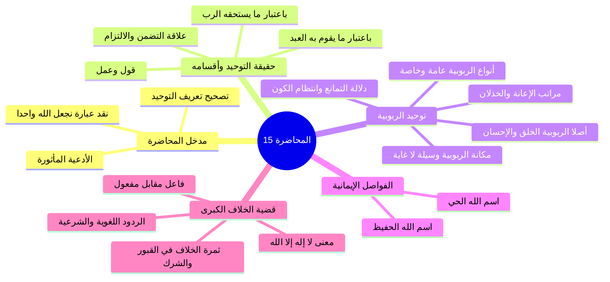
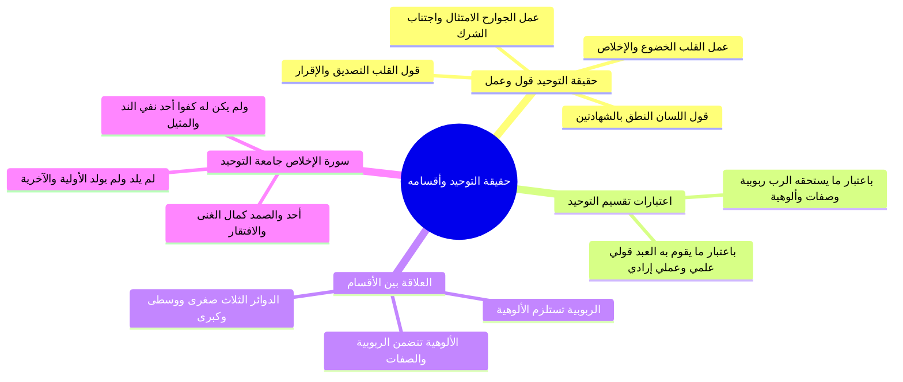
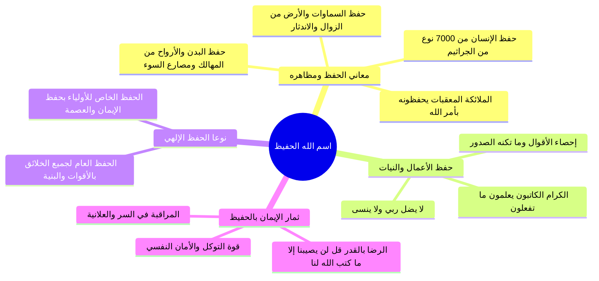
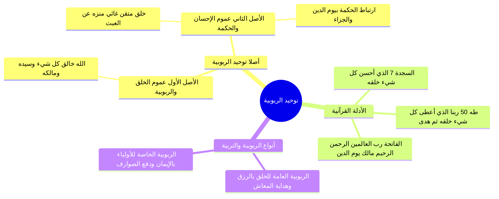
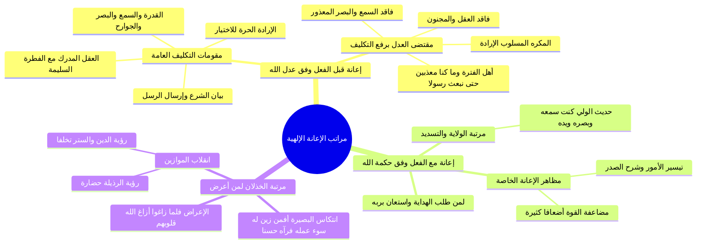
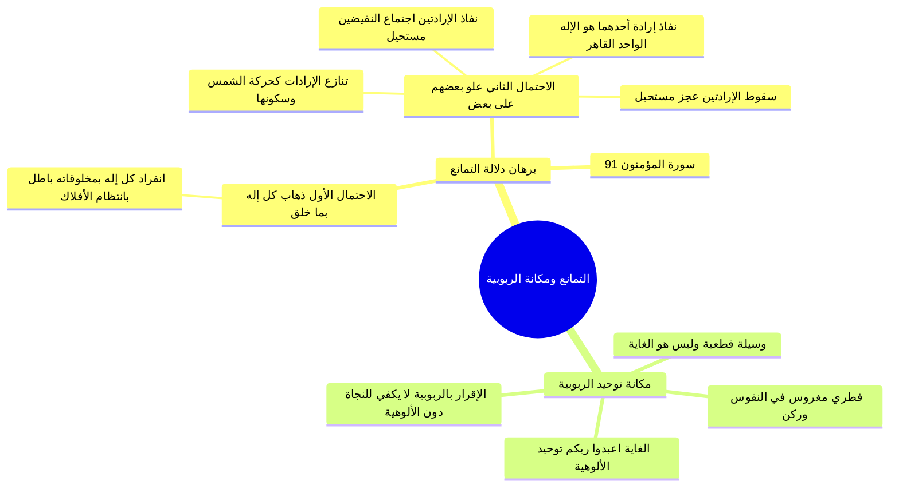
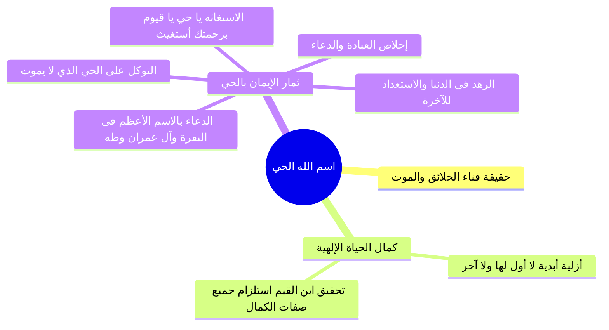
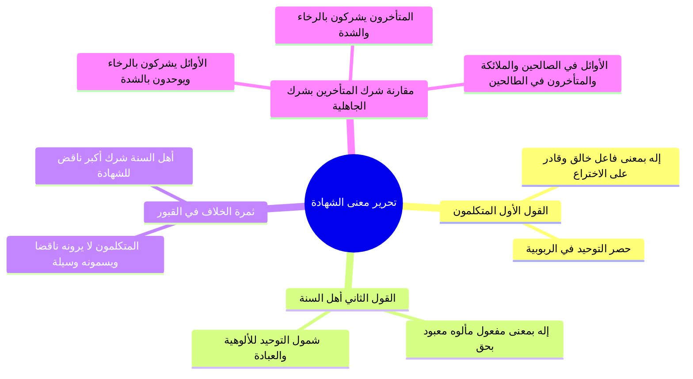
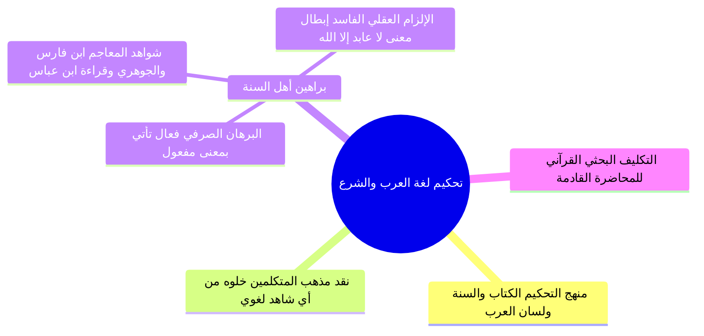

# المحاضرة 15: حقيقة التوحيد ومعنى لا إله إلا الله (نسخة مجمعة للطباعة)

---

## 📑 فهرس موضوعات الملف المجمع

1. [[#الجزء 00: مقدمة وخطة الأجزاء وعناصر المحاضرة]]
2. [[#الجزء 01: حقيقة التوحيد وأقسامه وعلاقة التضمن والالتزام]]
3. [[#الجزء 02: فاصل اسم الله الحفيظ وحفظه العام والخاص]]
4. [[#الجزء 03: أصلا توحيد الربوبية وأنواع ربوبية الله لخلقه]]
5. [[#الجزء 04: مراتب إعانة الله للمكلفين قبل الفعل ومعه والخذلان]]
6. [[#الجزء 05: دلالة التمانع وانتظام الكون ومكانة توحيد الربوبية]]
7. [[#الجزء 06: فاصل اسم الله الحي وثمار الإيمان به والدعاء بالاسم الأعظم]]
8. [[#الجزء 07: تحرير معنى لا إله إلا الله وثمرة الخلاف بين الطائفتين]]
9. [[#الجزء 08: الأدلة اللغوية والشرعية على أن الإله هو المألوه المعبود]]

---

## الجزء 00: مقدمة وخطة الأجزاء وعناصر المحاضرة

### 📝 الملخص العلمي المنظم

#### 1. الافتتاح والأدعية المأثورة
- افتتح المحاضر بحمد الله والصلاة والسلام على رسول الله محمد ﷺ، والدعاء المأثور:
  ا - «اللهم إنا نسألك علماً نافعاً، وعملاً صالحاً، وقلباً خاشعاً، ولساناً ذاكراً».
  ا - «اللهم علمنا ما ينفعنا، وانفعنا بما علمتنا، واجعله حجة لنا ولا تجعله حجة علينا يا رب العالمين».

#### 2. مراجعة تعريف التوحيد لغة وشرعاً وتصحيح العبارات الخاطئة
- **التوحيد لغة:** يدور معناه حول الإفراد والانفراد وعدم وجود المثل والنظير.
- **التنبيه العقدي الحاسم:**
  - هل يصح أن نقول في تعريف التوحيد شرعاً: «هو أن نجعل الله واحداً فيما هو واحد فيه»؟
  - **الجواب:** هذا تعبير خاطئ باطل؛ لأن وحدانية الله عز وجل ثابتة له بذاته أزلاً وأبداً، وليست بجعل جاعل، فليست الآلهة متعددة حتى نأتي نحن البشر فنجعل الإله واحداً، بل التوحيد شرعاً هو الإقرار والاعتقاد والعلم والإيمان بأن الله واحد في ربوبيته وألوهيته وأسمائه وصفاته.

#### 3. إعلان محاور المحاضرة الخامسة عشرة
- ربط توحيد الربوبية بكلمة الشهادة: «لا إله إلا الله».
- طرح الإشكالية الكبرى التي ستعالجها المحاضرة: هل معنى كلمة الشهادة: «لا خالق إلا الله» أو «لا رازق إلا الله»، أم معناها: «لا معبود بحق إلا الله»؟ وما هي الثمرة المترتبة على هذا الخلاف بين طوائف الأمة؟

### 🧭 خريطة المفاهيم الذهنية (Mindmap)

---

## الجزء 01: حقيقة التوحيد وأقسامه وعلاقة التضمن والالتزام

### 📝 الملخص العلمي المنظم

#### 1. حقيقة التوحيد: قول وعمل
التوحيد عند أهل السنة والجماعة ليس مجرد فكرة عقلية، بل هو «قول وعمل» ينتظم أربعة أركان:
1. **قول القلب:** التصديق الجازم والإقرار بأن الله واحد في ربوبيته وألوهيته وأسمائه وصفاته؛ ﴿يَا أَيُّهَا الرَّسُولُ لَا يَحْزُنكَ الَّذِينَ يُسَارِعُونَ فِي الْكُفْرِ مِنَ الَّذِينَ قَالُوا آمَنَّا بِأَفْوَاهِهِمْ وَلَمْ تُؤْمِن قُلُوبُهُمْ﴾.
2. **عمل القلب:** خضوعه لله سبحانه وانقياده له حباً وتعظيماً وخوفاً ورجاءً وتوكلاً ورضا وإخلاصاً تاماً.
3. **قول اللسان:** النطق بكلمة التوحيد: «أشهد أن لا إله إلا الله»، متضمنة ركني النفي والإثبات.
4. **عمل الجوارح:** الامتثال التام لأمر الله تعالى بترك عبادة ما سوى الله والتوجه بالأعمال المشروعة لله وحده.

#### 2. اعتبارات تقسيم التوحيد المقارنة

| وجه التقسيم | الأقسام المندرجة | دور وموقف المكلف |
|:---|:---|:---|
| **باعتبار ما يستحقه الرب جل وعلا** | 1. **توحيد الربوبية:** إفراد الله بأفعاله (خلق، ملك، تدبير). 2. **توحيد الأسماء والصفات:** إفراده بنعوت كماله ونفي الشبيه. 3. **توحيد الألوهية:** إفراده بجميع أفعال العباد التعبدية. | **العلم والاعتقاد والإقرار الجازم** بأن الله واحد ومستحق للعبادة وحده لا شريك له. |
| **باعتبار ما يقوم به العبد المكلف** | 1. **التوحيد القولي العلمي:** العلم بأن الله واحد في ربوبيته وأسمائه وصفاته وقول ذلك باللسان والقلب. 2. **التوحيد العملي الإرادي:** إرادة وقصد الله وحده بالعبادة والعمل الصالح وترك ما سواه. | **المعرفة والقول** في الأول، و**القصد والإرادة والعمل الامتثالي** في الثاني. |

#### 3. التمثيل الهندسي (الدوائر الثلاث) وقاعدة التضمن والالتزام
- **الدوائر الثلاث:**
  - الدائرة الصغرى: توحيد الربوبية (المركز).
  - الدائرة الوسطى: توحيد الأسماء والصفات.
  - الدائرة الكبرى: توحيد الألوهية (المحيطة الشاملة).
- **قاعدة الالتزام:** توحيد الربوبية يستلزم توحيد الأسماء والصفات، وتوحيد الربوبية والصفات يستلزم توحيد الألوهية.
- **قاعدة التضمن:** توحيد الألوهية يتضمن توحيد الأسماء والصفات وتوحيد الربوبية.
- **تنبيه عقدي:** توحيد الربوبية يستلزم الألوهية ولا يتضمنها؛ فمن أقر بالربوبية وحدها لم ينفعه ذلك حتى يلتزم بتوحيد الألوهية.

#### 4. معالم التوحيد في سورة الإخلاص
- ﴿قُلْ هُوَ اللَّهُ أَحَدٌ﴾: أحدٌ في ربوبيته، وألوهيته، وأسمائه وصفاته.
- ﴿اللَّهُ الصَّمَدُ﴾: الذي تصمد إليه الخلائق في قضاء حوائجها لغناه المطلق.
- ﴿لَمْ يَلِدْ﴾: استغناء تام عن الولد، فهو الآخِر الذي ليس بعده شيء.
- ﴿وَلَمْ يُولَدْ﴾: استغناء تام عن الوالد، فهو الأوَّل الذي ليس قبله شيء.
- ﴿وَلَمْ يَكُن لَّهُ كُفُوًا أَحَدٌ﴾: نفي مطلق للمثيل والنظير والكفء في الذات والصفات والأفعال.

### 🧭 خريطة المفاهيم الذهنية (Mindmap)

---

## الجزء 02: فاصل اسم الله الحفيظ وحفظه العام والخاص

### 📝 الملخص العلمي المنظم

#### 1. معاني اسم الله «الحفيظ» ومظاهر حفظه
- الحفيظ هو الذي يقيم مصارع السوء ويحفظ عباده من المعاطب والمهالك:
  - **حفظ الأبدان بالمعقبات:** ﴿لَهُ مُعَقِّبَاتٌ مِّن بَيْنِ يَدَيْهِ وَمِنْ خَلْفِهِ يَحْفَظُونَهُ مِنْ أَمْرِ اللَّهِ﴾.
  - **حفظ السماوات والأرض:** ﴿وَلَا يَئُودُهُ حِفْظُهُمَا ۚ وَهُوَ الْعَلِيُّ الْعَظِيمُ﴾.
  - **حفظ الصحة والحياة:** يعيش الإنسان مع نحو (7,000) نوع من الجراثيم في مسكنه، والله يكلؤه ويعافيه منها؛ ﴿قُلْ مَن يَكْلَؤُكُم بِاللَّيْلِ وَالنَّهَارِ مِنَ الرَّحْمَٰنِ﴾.
  - **حفظ الأعمال والأقوال والنيات:** ﴿وَإِنَّ عَلَيْكُمْ لَحَافِظِينَ * كِرَامًا كَاتِبِينَ * يَعْلَمُونَ مَا تَفْعَلُونَ﴾.

#### 2. نوعا حفظ الله تعالى

| وجه المقارنة | الحفظ العام | الحفظ الخاص |
|:---|:---|:---|
| **المشمولون به** | جميع الخلائق والمخلوقات (المؤمن والكافر، والبر والفاجر، والمكلف وغير المكلف). | أولياء الله وعباده المؤمنون المتقون خاصة. |
| **مجال الحفظ** | تيسير الأقوات وسلامة البنية ودفع الهلاك الدنيوي لحين الأجل. | حفظ الدين والإيمان واليقين، وحفظ القلوب من الشبهات والشهوات. |
| **كيفية إجرائه** | وفق القوانين والسنن الكونية ورعاية الأبدان. | بعصمتهم من المعاصي، وتوفيقهم للتوبة، وحراستهم من مكائد الشيطان. |

#### 3. ثمرات الإيمان باسم الله الحفيظ
1. دوام مراقبة الله في السر والعلانية.
2. عظم التوكل والشعور بالأمان والسكينة.
3. الرضا بالقضاء والقدر: ﴿قُل لَّن يُصِيبَنَا إِلَّا مَا كَتَبَ اللَّهُ لَنَا هُوَ مَوْلَانَا ۚ وَعَلَى اللَّهِ فَلْيَتَوَكَّلِ الْمُؤْمِنُونَ﴾.

### 🧭 خريطة المفاهيم الذهنية (Mindmap)

---

## الجزء 03: أصلا توحيد الربوبية وأنواع ربوبية الله لخلقه

### 📝 الملخص العلمي المنظم

#### 1. أصلا توحيد الربوبية
يرتكز توحيد الربوبية على أصلين قطعيين:
1. **عموم خلقه وربوبيته جل جلاله:** كل ما في هذا الكون مخلوق مربوب، والله خالق كل شيء وربه ومليكه ومدبره.
2. **عموم إحسانه وحكمته في خلقه:** خلقه للكون متقن مشتمل على الرحمة والحكمة ومنزه عن العبث؛ واستدل المحاضر بـ:
   - ﴿قَالَ رَبُّنَا الَّذِي أَعْطَىٰ كُلَّ شَيْءٍ خَلْقَهُ ثُمَّ هَدَىٰ﴾ [طه: 50].
   - ﴿الَّذِي أَحْسَنَ كُلَّ شَيْءٍ خَلَقَهُ﴾ [السجدة: 7].
   - سورة الفاتحة: ﴿الْحَمْدُ لِلَّهِ رَبِّ الْعَالَمِينَ * الرَّحْمَٰنِ الرَّحِيمِ * مَالِكِ يَوْمِ الدِّينِ﴾؛ فجمع بين الربوبية والرحمة والحكمة المقتضية ليوم الدين والجزاء العادل.

#### 2. أنواع ربوبية وتربية الله لخلقه

| وجه المقارنة | الربوبية (التربية) العامة | الربوبية (التربية) الخاصة |
|:---|:---|:---|
| **الشمول** | عامة لجميع المخلوقات (مكلفها وغير مكلفها). | خاصة بعباد الله المؤمنين وأوليائه الصالحين. |
| **المضمون** | الإيجاد من العدم، الرزق، والهداية لمصالح المعاش واستخدام الخلقة مدة الحياة. | التربية على الإيمان واليقين، وتكميله في النفوس، وتوفيقهم لكل خير. |
| **دفع الموانع** | دفع ما يهلك الجسد قبل انقضاء الأجل. | دفع الصوارف والشبهات والشهوات الحائلة بين العبد وبين الإيمان. |

### 🧭 خريطة المفاهيم الذهنية (Mindmap)

---

## الجزء 04: مراتب إعانة الله للمكلفين قبل الفعل ومعه والخذلان

### 📝 الملخص العلمي المنظم

#### 1. الإعانة السابقة للفعل (وفق عدل الله)
- منح الله المكلفين مقومات الاستطاعة والتمكن عدلاً منه:
  1. القدرة البدنية (الجوارح من السمع والبصر واللسان والأطراف).
  2. الإرادة والمشيئة الحرة ليقصد الفعل أو يتركه.
  3. العقل المميز والفطرة السليمة.
  4. بيان الشرع عبر الرسل؛ ﴿وَمَا كُنَّا مُعَذِّبِينَ حَتَّىٰ نَبْعَثَ رَسُولًا﴾.
- وسقوط التكليف عدلاً عند فقدان أحد هذه المقومات (فاقد السمع والبصر، المكره، المجنون، أهل الفترة).

#### 2. الإعانة المصاحبة للفعل (وفق حكمة الله وفضله)
- تختص بالمقبلين على الله المستعينين به؛ ﴿وَالَّذِينَ اهْتَدَوْا زَادَهُمْ هُدًى وَآتَاهُمْ تَقْوَاهُمْ﴾، ﴿وَالَّذِينَ جَاهَدُوا فِينَا لَنَهْدِيَنَّهُمْ سُبُلَنَا﴾.
- مظاهرها: تيسير العسير، انشراح الصدر، ومضاعفة القوة أضعافاً كثيرة، وبلوغ منزلة الولاية والتسديد («كنت سمعه وبصره ويده ورجله»).

#### 3. مرتبة الخذلان وانتكاس المفاهيم المعاصرة
- الخذلان لمن رفض طريق الهداية وتولى عنها مدبراً؛ ﴿فَلَمَّا زَاغُوا أَزَاغَ اللَّهُ قُلُوبَهُمْ﴾.
- انتكاس البصيرة: ﴿أَفَمَن زُيِّنَ لَهُ سُوءُ عَمَلِهِ فَرَآهُ حَسَنًا﴾؛ فيرى الرذيلة والانحلال حضارة، ويرى العفاف والدين تخلفاً، ويهبط إلى عيش البهائم.

### 🧭 خريطة المفاهيم الذهنية (Mindmap)

---

## الجزء 05: دلالة التمانع وانتظام الكون ومكانة توحيد الربوبية

### 📝 الملخص العلمي المنظم

#### 1. دلالة التمانع القرآنية
- قال تعالى: ﴿مَا اتَّخَذَ اللَّهُ مِن وَلَدٍ وَمَا كَانَ مَعَهُ مِنْ إِلَٰهٍ ۚ إِذًا لَّذَهَبَ كُلُّ إِلَٰهٍ بِمَا خَلَقَ وَلَعَلَا بَعْضُهُمْ عَلَىٰ بَعْضٍ ۚ سُبْحَانَ اللَّهِ عَمَّا يَصِفُونَ﴾ [المؤمنون: 91].
- **إبطال التعدد:**
  1. *لذهب كل إله بما خلق:* يستلزم تصادم الأفلاك واضطراب العالم، وهو باطل لاتساق الكون ونظامه الدائم.
  2. *ولعلا بعضهم على بعض:* تنازع الإرادات؛ فنفاذ الإرادتين محال (اجتماع النقيضين)، وعدم نفاذهما محال (عجز مستحيل)، ونفاذ إرادة أحدهما يثبت أنه الإله القاهر الحق وحده والآخر مقهور عاجز لا يصلح للألوهية.

#### 2. مكانة توحيد الربوبية: وسيلة لا غاية
- توحيد الربوبية ركن وفطري في النفوس، زود الله الإنسان بالقوة العلمية التي تقر بوجوده ووحدانيته.
- الخلل يقع في القوة الإرادية والعملية بجعل الشركاء والشفعاء.
- توحيد الربوبية وسيلة وحجة ملزمة وليس هو الغاية؛ الغاية هي توحيد الألوهية: ﴿يَا أَيُّهَا النَّاسُ اعْبُدُوا رَبَّكُمُ﴾ [غاية] ﴿الَّذِي خَلَقَكُمْ وَالَّذِينَ مِن قَبْلِكُمْ...﴾ [وسيلة].
- الإقرار بالربوبية وحده لا يكفي للنجاة في الدنيا ولا في الآخرة دون توحيد الألوهية.

### 🧭 خريطة المفاهيم الذهنية (Mindmap)

---

## الجزء 06: فاصل اسم الله الحي وثمار الإيمان به والدعاء بالاسم الأعظم

### 📝 الملخص العلمي المنظم

#### 1. معاني اسم الله الحي وتحقيق ابن القيم
- الموت هو الحقيقة التي لا ينكرها أحد؛ فكل شيء هالك إلا وجهه.
- كمال حياة الله: أزلية أبدية لا بداية لها ولا نهاية، منزهة عن العدم والموت والسنة والنوم.
- **قاعدة ابن القيم:** «وحياته سبحانه أكمل الحياة وأتمها، وهي حياة تستلزم جميع صفات الكمال (كالسمع، والبصر، والقدرة، والإرادة، والعلم)، وتنفي أضدادها من جميع الوجوه».

#### 2. ثمار الإيمان باسم الله الحي
1. **إخلاص الدعاء والعبادة:** ﴿هُوَ الْحَيُّ لَا إِلَٰهَ إِلَّا هُوَ فَادْعُوهُ مُخْلِصِينَ لَهُ الدِّينَ﴾.
2. **الاستغاثة الدائمة:** وصية النبي ﷺ لفاطمة رضي الله عنها: «يَا حَيُّ يَا قَيُّومُ بِرَحْمَتِكَ أَسْتَغِيثُ، أَصْلِحْ لِي شَأْنِي كُلَّهُ، وَلَا تَكِلْنِي إِلَىٰ نَفْسِي طَرْفَةَ عَيْنٍ».
3. **صدق التوكل:** ﴿وَتَوَكَّلْ عَلَى الْحَيِّ الَّذِي لَا يَمُوتُ﴾؛ فغير الله يموت ويفوت ويضمحل شأنه.
4. **التوسل بالاسم الأعظم:** في البقرة (آية الكرسي)، وآل عمران (مطلعها)، وطه (﴿وَعَنَتِ الْوُجُوهُ لِلْحَيِّ الْقَيُّومِ﴾).
5. **الزهد في الدنيا والإقبال على الآخرة:** ﴿كُلُّ مَنْ عَلَيْهَا فَانٍ * وَيَبْقَىٰ وَجْهُ رَبِّكَ ذُو الْجَلَالِ وَالْإِكْرَامِ﴾.

### 🧭 خريطة المفاهيم الذهنية (Mindmap)

---

## الجزء 07: تحرير معنى لا إله إلا الله وثمرة الخلاف بين الطائفتين

### 📝 الملخص العلمي المنظم

#### 1. تحرير معنى «لا إله إلا الله» بين الطائفتين
- **مذهب المتكلمين:** زعموا أن «إله» على وزن (فِعَال) تأتي بمعنى (فاعِل)؛ فمعناها: لا خالق، ولا قادر على الاختراع إلا الله (حصر التوحيد في الربوبية).
- **مذهب أهل السنة والجماعة:** «إله» على وزن (فِعَال) تأتي بمعنى (مفعول)، أي: مألوه (معبود بحق)؛ فمعناها: لا معبود يستحق العبادة بحق إلا الله.

#### 2. ثمرة الخلاف الواقعية في القبور
- لو ذهب شخص إلى ضريح، وهو يعتقد أن المقبور لا يخلق ولا يرزق، ثم ذبح ونذر ودعا واستغاث بالمقبور:
  - **طائفة المتكلمين والقبوريين:** لا يرون فعله ناقضاً لـ «لا إله إلا الله»؛ لعدم اعتقاده الخلق في الميت، ويسمونه وسيلة وشفاعة كحاشية ملوك الدنيا، ويرمون أهل السنة بالتكفير والخوارج!
  - **أهل السنة والجماعة:** يقررون أن الذبح والدعاء والنذر صلب العبادة؛ وصرفها للمقبور شرك أكبر مخرج من الملة وناقض لـ «لا إله إلا الله».

#### 3. مقارنة تاريخية بين نوعي الشرك
- **شرك المتأخرين أغلظ لوجهين:**
  1. *حال الشدة والرخاء:* المشركون الأوائل يشركون في الرخاء ويوحدون في الشدة (﴿فَإِذَا رَكِبُوا فِي الْفُلْكِ دَعَوُا اللَّهَ مُخْلِصِينَ﴾)، بينما المتأخرون يشركون في الرخاء وتشتد استغاثتهم بالموتى في الشدائد!
  2. *طبيعة المعبودين:* الأوائل عبدوا الأنبياء والصالحين والملائكة، والمتأخرون عبدوا الصالحين والطالحين والملاحدة.

### 🧭 خريطة المفاهيم الذهنية (Mindmap)

---

## الجزء 08: الأدلة اللغوية والشرعية على أن الإله هو المألوه المعبود

### 📝 الملخص العلمي المنظم

#### 1. منهج التحكيم
- التحكيم إلى الكتاب والسنة ولسان العرب الفصيح.
- تعريف أهل السنة (لا معبود بحق إلا الله) يتضمن توحيد الربوبية، بينما تعريف المتكلمين قاصر على الربوبية ولا يتضمن الألوهية.

#### 2. الردود اللغوية والعقلية على دعوى «إله بمعنى فاعل»
1. **النظائر الصرفية:** وزن «فِعَال» يأتي بمعنى «مَفْعُول» باطراد:
   - كتاب = مكتوب، حساب = محسوب، فراش = مفروش، إمام = مأموم.
   - وكذلك: إله = مألوه (معبود).
2. **نصوص أئمة المعاجم:**
   - *ابن فارس في مقاييس اللغة:* «أَلَهَ: الهمزة واللام والهاء أصل واحد، وهو التعبد؛ فالله تعالى سُمي بذلك لأنه معبود».
   - *الجوهري في الصحاح:* «أَلَهَ: أي عَبَدَ؛ ومنه قراءة ابن عباس ﴿وَيَذَرَكَ وَإِلَاهَتَكَ﴾ قال: وعبادتك. وأصله إله على فِعال بمعنى مفعول لأنه مألوه أي معبود».
3. **الإلزام العقلي بالمحال الفاسد:** لو كان «إله» بمعنى «فاعل» (عابد) لصار معنى الشهادة «لا عابد إلا الله»؛ وجعل الخالق سبحانه عابداً لخلقه! تعالى الله عن ذلك علواً كبيراً.

#### 3. التكليف البحثي للمحاضرة القادمة
- جمع آيات نفي الآلهة في القرآن (﴿مَا لَكُم مِّنْ إِلَٰهٍ غَيْرُهُ﴾، ﴿إِنَّمَا هُوَ إِلَٰهٌ وَاحِدٌ﴾) وتدبر سياقاتها ليحكم الطلاب حكماً فاصلاً بين الطائفتين.

### 🧭 خريطة المفاهيم الذهنية (Mindmap)

---

> [!info] توصيف النسخة المخصصة للطباعة
> يضم هذا الملف المحتوى العلمي الكامل المنظم للمحاضرة 15 من مادة العقيدة (برنامج زاد المستوى الأول)، شاملاً الجداول، والرسومات البيانية والمقارنات، والخرائط المفاهيمية، مجردة من نصوص التفريغ الصوتي، ومُعدّة خصيصاً للقراءة المركزة والمذاكرة والطباعة الأنيقة.
