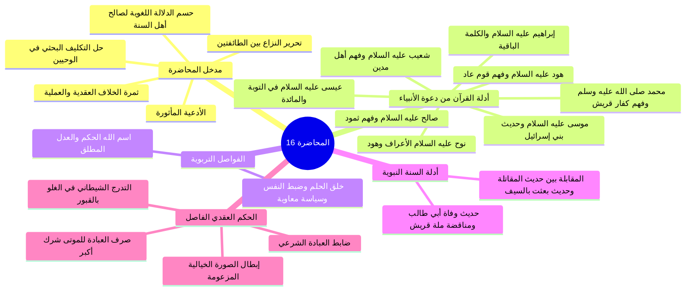

# خطة المحاضرة السادسة عشرة - الأدلة الشرعية على معنى لا إله إلا الله وحكم دعاء المقبورين

> [!info] الهدف
> تلخيص وشرح تفريغ «المحاضرة 16 زاد عقيدة» في مادة العقيدة (المستوى الأول) وفق بروتوكول التلخيص الشامل، وعرضها في ملفات أجزاء مستقلة ومترابطة، مع ملف مجمع نهائي، وملخص مراجعة سريعة، وأسئلة مراجعة واختبار ذاتي، وخطة تطبيقية للدروس.

---

## 🗺️ خريطة الأجزاء والعناوين

| # | العنوان والملف | المدى المرجعي بالتفريغ | المحتوى العلمي الرئيسي |
|:---:|:---|:---:|:---|
| 00 | [[00 - مقدمة وخطة الأجزاء وعناصر المحاضرة]] | الأسطر 1–16 | الافتتاح والأدعية، متابعة الواجب التكليفي، تحرير الخلاف الجذري بين الطائفتين في معنى «لا إله إلا الله» وثمرته، مراجعة النتيجة اللغوية القاطعة، وإعلان منهج التحكيم لنصوص الكتاب والسنة. |
| 01 | [[01 - دعوة نوح وهود وصالح وشعيب وفهم أقوامهم لمعنى لا إله إلا الله]] | الأسطر 17–65 | استقراء دعوة نوح (المقابلة بين الأعراف وهود)، وهود وفهم عاد (أجئتنا لنعبد الله وحده)، وصالح وفهم ثمود (أتنهانا أن نعبد ما يعبد آباؤنا)، وشعيب وفهم مدين (أصلاتك تأمرك أن نترك ما يعبد آباؤنا). |
| 02 | [[02 - دعوة إبراهيم والكلمة الباقية في عقبه]] | الأسطر 66–70 | آيات الزخرف، ركنا التوحيد (النفي في ﴿بَرَاءٌ مِّمَّا تَعْبُدُونَ﴾ والإثبات في ﴿إِلَّا الَّذِي فَطَرَنِي﴾)، والاستدلال بالربوبية والفطرة على استحقاق الألوهية، والكلمة الباقية في عقبه. |
| 03 | [[03 - فاصل اسم الله الحكم والعدل الإلهي في التشريع والجزاء]] | الأسطر 71–82 | اسم الله «الحَكَم»، معنى التحاكم إلى شرع الله، كمال العدل والقسط في الدنيا والآخرة، تفسير قتادة لقوله تعالى ﴿وَتَمَّتْ كَلِمَتُ رَبِّكَ صِدْقًا وَعَدْلًا﴾، وثمار الإيمان به في الرضا والعدل واليقين بيوم الفصل. |
| 04 | [[04 - دعوة موسى وعيسى عليهما السلام ونصوص القرآن في كفر من اتخذهما آلهة]] | الأسطر 83–109 | طلب بني إسرائيل معبوداً حياً بعد مجاوزة البحر ورد موسى، الوحي لموسى بالعبادة في طه، دعوة عيسى في التوبة والمائدة، استجواب عيسى يوم القيامة، وقطع القرآن بأن «اتخاذ الآلهة» هو صرف العبادة. |
| 05 | [[05 - دعوة خاتم المرسلين ونصوص القرآن المحكمة وفهم مشركي قريش]] | الأسطر 110–130 | خاتمة سورة الكهف، استكبار مشركي قريش (أئنا لتاركو آلهتنا لشاعر مجنون)، تعجبهم من إفراد المعبود (أجعل الآلهة إلهاً واحداً)، نداء الكلمة السواء لأهل الكتاب، وحقيقة العروة الوثقى. |
| 06 | [[06 - حديث وفاة أبي طالب ومناقضة لا إله إلا الله لملة عبد المطلب]] | الأسطر 131–154 | حديث احتضار أبي طالب المتفق عليه، حوار النبي ﷺ مع أبي جهل، التضاد الجذري بين لا إله إلا الله وملة عبد المطلب المقرة بالربوبية، وبطلان تفسير لا إله إلا الله بـ «لا خالق إلا الله». |
| 07 | [[07 - فاصل خلق الحلم وضبط النفس وآثاره الإيمانية والاجتماعية]] | الأسطر 155–163 | فضيلة الحلم والأناة، كلام رجاء بن أبي سلمة، حلم الأنبياء وموقف النبي ﷺ العظيم يوم الطائف، معونة الله للحليم، وأثر الحلم في تدبير العلاقات وتأليف القلوب (شعرة معاوية). |
| 08 | [[08 - دلالة أحاديث الجهاد الصريحة وتفسير النبي لمعنى لا إله إلا الله]] | الأسطر 164–179 | المقابلة اللفظية القطعية بين حديث أبي هريرة «أمرت أن أقاتل الناس حتى يقولوا لا إله إلا الله» وحديث ابن عمرو «بعثت بالسيف بين يدي الساعة حتى يعبد الله وحده لا شريك له»، وتفسير التوحيد بالعبادة. |
| 09 | [[09 - الحكم الفاصل في دعاء المقبورين والتدرج الشيطاني في الغلو وتفنيد الشبهات]] | الأسطر 180–208 | الحكم العقدي الفاصل في صرف الدعاء والذبح والنذر للموتى وأنه شرك أكبر مناقض للتوحيد، ضابط العبادة الشامل، خطوات التدرج الشيطاني في الغلو بالقبور، ونقض الصورة الخيالية المزعومة. |

---

## 📚 الملفات الإضافية الملحقة بالحزمة

- [[ملخص المراجعة السريعة]] — بطاقة استذكار ومراجعة مكثفة ومركزة لكافة القواعد والضوابط العقدية واللغوية ومقارنات الأدلة للمذاكرة السريعة قبل الاختبارات.
- [[أسئلة المراجعة والاختبار الذاتي]] — بنك أسئلة تدريبية واختبارات ذاتية شاملة بنظام الإخفاء والإظهار (`details`).
- [[المحاضرة 16 - الأدلة الشرعية على معنى لا إله إلا الله وحكم دعاء المقبورين - ملف مجمع]] — الملف المجمع الشامل الذي يضم كامل محتوى الأجزاء ونصوص المتحدث كاملة بالنص دون أسئلة أو ملخص سريع.
- [[10 - خطة تطبيق الدروس]] — خطة تنفيذية مرتبة في مراحل ومربعات اختيار لتحويل المعارف العقدية إلى مسار سلوكي وتعبدي وتطبيقي.

---

> [!note] إحصائيات الحزمة
> - **إجمالي ملفات الأجزاء:** 10 أجزاء (من الجزء 00 حتى 09).
> - **الملفات الإضافية:** 4 ملفات (ملخص، اختبار، مجمع، خطة تطبيق).
> - **إجمالي ملفات العمل المنجزة:** 14 ملفاً مستقلاً.

---

## 📝 الملخص العلمي المنظم للجزء 00

### 1. الافتتاح والأدعية المأثورة
- افتتح المحاضر بالحمد لله والصلاة والسلام على رسول الله محمد ﷺ، والدعاء المأثور:
  ا - «اللهم إنا نسألك علماً نافعاً، وعملاً صالحاً، وقلباً خاشعاً، ولساناً ذاكراً».
  ا - «اللهم علمنا ما ينفعنا، وانفعنا بما علمتنا، واجعله حجة لنا ولا تجعله حجة علينا يا رب العالمين».

### 2. متابعة التكليف العلمي وتحرير محل النزاع العقدي
- تابع المحاضر الواجب الذي كلف به الطلاب في ختام المحاضرة السابقة: وهو البحث والاستقراء في نصوص القرآن الكريم والسنة النبوية عن المعنى الحقيقي لكلمة التوحيد: «لا إله إلا الله».
- بيّن المحاضر أن هذا البحث يأتي لحل مشكلة عقدية كبرى وخطيرة بين طائفتين عظيمتين من المنتسبين للإسلام:
  1. **الطائفة الأولى (المتكلمون ومن وافقهم):** زعموا أن معنى لا إله إلا الله هو: «لا خالق إلا الله» أو «لا قادر على الاختراع إلا الله» أو «لا رازق ولا مدبر إلا الله»؛ وبنوا ذلك على دعوى لغوية باطلة بأن «إله» في العربية مشتق من فِعال بمعنى فاعل.
  2. **الطائفة الثانية (أهل السنة والجماعة وأئمة السلف):** قرروا أن معنى لا إله إلا الله هو: «لا معبود بحق إلا الله»؛ لأن «إله» في لسان العرب صيغة فِعال بمعنى مفعول (أي مألوه معبود).

### 3. ثمرة الخلاف العقدية والعملية
- أوضح المحاضر أن هذا الخلاف ليس ترفاً كلامياً، بل تنبني عليه أحكام الدين العظمى وتحديد حقيقة الإيمان والشرك:
  - **موقف الطائفة الأولى:** لما حصروا معنى الشهادة في نفي الخالقية والرازقية والتدبير عن غير الله، رأوا أن التوجه إلى القبور والأولياء والموتى بالدعاء والذبح والنذر والاستغاثة لا ينقض التوحيد ما دام الفاعل يعتقد أن الله هو الخالق الرازق وحده، واعتبروا ذلك مجرد توسل أو تشفع أو بدعة، ورموا أهل السنة المكفرين لهذا الشرك بأنهم خوارج وتكفيريون يستحلون دماء المسلمين!
  - **موقف أهل السنة والجماعة:** يقررون أن صرف أي نوع من أنواع العبادة المحضة (كالدعاء والذبح والنذر والاستغاثة) للموتى والغائبين هو شرك أكبر مخرج من ملة الإسلام، ومناقض مناقضة تامة لأصل شهادة «لا إله إلا الله»، وأن شرك هؤلاء المقبورين أغلظ من شرك الجاهلية الأولى لأن مشركي مكة أشركوا في الرخاء وأخلصوا في الشدة، بينما هؤلاء يشركون في الرخاء والشدة معاً.

### 4. حسم الجانب اللغوي والانتقال إلى التحكيم الشرعي
- أكد المحاضر أن التحكيم اللغوي تم حسمه في المحاضرة السابقة بالرجوع لأئمة المعاجم واللغة (كابن فارس والجوهري)، وتبيّن:
  1. إجماع علماء اللغة على أن «أَلَهَ» أصلها التعبد والتأله، وأن «الإله» هو المعبود والمألوه (فِعال بمعنى مفعول كفراش بمعنى مفروش، وكتاب بمعنى مكتوب).
  2. بطلان دعوى كون «إله» بمعنى «فاعل»؛ إذ لو كان كذلك لصار الإله عابداً متألهاً بمخلوقاته، وتعالى الله عن ذلك علواً كبيراً.
- بناءً على ذلك، تعين الانتقال إلى الأصلين المعصومين: **الكتاب والسنة**؛ لاستقراء دعوة الأنبياء والمرسلين جميعاً، ومعرفة ما دعوا إليه أقوامهم وما فهمه الأقوام من كلمة التوحيد، لتكون الحجة واضحة لا تقبل الشك ولا تحتاج إلى تكلف التأويل.

---

## 🧭 خريطة المفاهيم الذهنية (Mindmap)

---

## 🗣️ نص المتحدث الكامل (الأسطر 1–16)

> ويتقدم تقنياته ومجالات طوروا ادواتنا في تقديم العلم الشرعي علمك الاساس في الاسلام
> السلام عليكم ورحمه الله وبركاته
> الحمد لله رب العالمين والصلاه والسلام على اشرف المرسلين محمد وعلى اله وصحبه اجمعين اللهم انا نسالك علما نافعا وعملا صالحا و قلبا خاشعا ولسانا ذاكرا اللهم علمنا ما ينفعنا وانفعنا بما علمتنا و اجعله حجه لنا ولا تجعله حجه علينا يا رب العالمين
> ايها الاحبه في الامن ارحب بكم في ماده العقيده في اكاديميه زاد و اسال الله سبحانه و تعالى ان تكونوا حال تم الواجب الذي كلفت كم به هو ان تبحثوا في القران والسنه على معنى لا اله الا الله
> لنحل هذه المشكله الكبرى بين الطائفتين عظيمتين من المسلمين طائفه تقول معنى لا اله الا الله و لا خالق الا الله
> وطائفه تقول معنى لا اله الا الله
> ولا معبود بحق الا الله
> استدلت الطائفه الاولى لا خالق الا الله
> كما يقولون باللغه وان اله في اللغه العربيه فعال
> بمعنى فاعل اي خالق رازق مالك مدبر وهؤلاء قالوا لا اله في اللغه العربيه
> بمعنى فعال بمعنى مالوه بمعنى مفعول اي مالوه فلا معبود يستحق العباده الى الله ذكرنا في الحلقه الماضيه ان الخلاف له ثمره عظيمه وينبني عليه كل يعني اه اشياء يعني الطائفه الاولى التي تقول لا خالق الا الله تتهم الطائفه الثانيه بانهم خوارج وانهم اه تكفيريين وان هم يكفرون المسلمين بغير حق وهذه الطائفه الثانيه تتهم الطائفه الاولى اه اذا اذا صرفوا نوع من انواع العباده لهؤلاء المقبولين الموتى
> وهم لا يعتقد انه انه خالق مع الكرازه مدبر يقول هذا شرك اكبر مخرج من المله
> وهؤلاء قبوريه
> الضمير للقبور هؤلاء مشركون بافعال هذه واشركهم اعظم من شركه السابقين
> وهكذا اذن عندنا اشكاليه كبرى قلنا مرجع هذا الخلاف ان نرجع الكتاب والسنه في المرمى يتكلم عن اللغه وقلنا ان علماء اللغه كانوا مع الفريق الثاني فلا يوجد عالم من علماء اللغه يقول اله بمعنى انه ما في احد من علماء اللغه يقول هذا امر ثاني قالوا لو قلنا ال اه بمعنى انه صار عابد لانه الله يعني متالف متعلق اذا يقولون لا اصبح العكس ان اصبح الخالق هو المتعلق بمخلوقاته فمن ناحيه اللغه خرجنا انه لا يسند اصحاب القول الاول
> ووصلنا اننا سنبحث في يعني الكتاب والسنه على هذا المعاني

---

## 🔗 روابط التنقل
- السابق: لا يوجد (هذا أول ملف في خطة المحاضرة)
- التالي: [[01 - دعوة نوح وهود وصالح وشعيب وفهم أقوامهم لمعنى لا إله إلا الله]]
