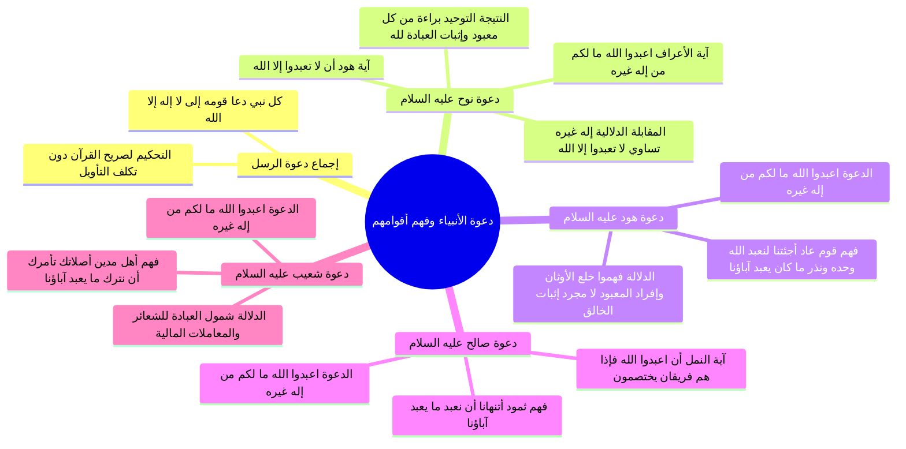

# دعوة نوح وهود وصالح وشعيب وفهم أقوامهم لمعنى لا إله إلا الله

> [!abstract] بطاقة الجزء
> - **المحاضرة:** 16 من مادة العقيدة (المستوى الأول - أكاديمية زاد).
> - **المدى بالتفريغ:** من السطر 17 إلى السطر 65.
> - **المحاور المركزية:** استقراء دعوة نوح عليه السلام والمقابلة بين آيتي الأعراف وهود، ودعوة هود وفهم قوم عاد، ودعوة صالح وفهم ثمود، ودعوة شعيب وفهم أهل مدين، وإثبات أن الأمم السابقة فهمت قطعاً أن الإله هو المعبود وأن التوحيد إفراد الله بالعبادة.

---

## 🧭 خريطة المفاهيم الذهنية (Mindmap)

---

## 📝 الملخص العلمي المنظم للجزء 01

### 1. إجماع دعوة الأنبياء والمرسلين والمنهج الاستدلالي
- أكد المحاضر قاعدة قرآنية متفقاً عليها بين جميع المسلمين:
  - «لا يوجد نبي ولا رسول أُرسل في تاريخ البشرية إلا وبدأ دعوته بكلمة: لا إله إلا الله».
- اعتمد المحاضر على منهج محكم: الاحتجاج **بصريح نصوص القرآن المجردة** وفهم سياقاتها الداخلية دون الحاجة للاستناد إلى أقوال مفسرين من مدرسة معينة (حنابلة أو صوفية أو غيرهم)، ليكون البرهان قاطعاً ملزماً لكل طائفة.

---

### 2. دعوة نوح عليه السلام: برهان المقابلة القرآنية القطعية
عرض المحاضر آيتين صريحتين في دعوة نوح عليه السلام تثبتان معنى كلمة التوحيد بالمقابلة التامة:

| موضع الآية | نص الآية الكريمة | موضع الشاهد والاستدلال |
|:---|:---|:---|
| **سورة الأعراف (الآية 59)** | ﴿لَقَدْ أَرْسَلْنَا نُوحًا إِلَىٰ قَوْمِهِ فَقَالَ يَا قَوْمِ اعْبُدُوا اللَّهَ مَا لَكُم مِّنْ إِلَٰهٍ غَيْرُهُ إِنِّي أَخَافُ عَلَيْكُمْ عَذَابَ يَوْمٍ عَظِيمٍ﴾ | 1. ﴿مَا لَكُم مِّنْ إِلَٰهٍ﴾ = لا إله (نفي). 2. ﴿غَيْرُهُ﴾ = إلا الله (إثبات). 3. الأمر بالعبادة ﴿اعْبُدُوا اللَّهَ﴾ هو العلة والنتيجة؛ لأن الإله معناه: المعبود. |
| **سورة هود (الآيتان 25-26)** | ﴿وَلَقَدْ أَرْسَلْنَا نُوحًا إِلَىٰ قَوْمِهِ إِنِّي لَكُمْ نَذِيرٌ مُّبِينٌ * أَن لَّا تَعْبُدُوا إِلَّا اللَّهَ إِنِّي أَخَافُ عَلَيْكُمْ عَذَابَ يَوْمٍ أَلِيمٍ﴾ | صرح نوح بنفس الدعوة ولكن بلفظ: ﴿أَن لَّا تَعْبُدُوا إِلَّا اللَّهَ﴾؛ فدل بالضرورة على أن معنى ﴿مَا لَكُم مِّنْ إِلَٰهٍ غَيْرُهُ﴾ هو عينه ﴿أَن لَّا تَعْبُدُوا إِلَّا اللَّهَ﴾. |

> [!important] النتيجة العقدية
> دل القرآن على أن «لا إله إلا الله» لا تعني «لا خالق إلا الله»، بل تعني: **البراءة من عبادة كل المعبودات الباطلة، وإثبات العبادة الخالصة لله وحده لا شريك له**.

---

### 3. دعوة هود عليه السلام: ماذا فهم قوم عاد من «لا إله إلا الله»؟
- **نص الدعوة:** قال الله تعالى:
  ا - ﴿وَإِلَىٰ عَادٍ أَخَاهُمْ هُودًا قَالَ يَا قَوْمِ اعْبُدُوا اللَّهَ مَا لَكُم مِّنْ إِلَٰهٍ غَيْرُهُ أَفَلَا تَتَّقُونَ﴾ [الأعراف: 65].
- **فهم قوم عاد وهم عرب فصحاء (الأعراف: 70):**
  ا - ﴿قَالُوا أَجِئْتَنَا لِنَعْبُدَ اللَّهَ وَحْدَهُ وَنَذَرَ مَا كَانَ يَعْبُدُ آبَاؤُنَا﴾.
- **وجه الدلالة الحاسم:**
  - لم يفهم قوم هود من قوله ﴿مَا لَكُم مِّنْ إِلَٰهٍ غَيْرُهُ﴾ أنه يطلب منهم الإقرار بأن الله هو الخالق الرازق؛ لأنهم كانوا يقرون بذلك ولا ينازعون فيه.
  - بل فهموا فوراً أن المطلوب هو: «نعبد الله وحده ونذر ما كان يعبد آباؤنا»؛ أي ترك جميع المعبودات والأصنام والتوجه بكامل العبادة لله وحده.
  - فدل صريح فهم الكفار أن «الإله» لغة وشرعاً هو المعبود، لا مجرد الخالق والمدبر.

---

### 4. دعوة صالح عليه السلام: فهم ثمود المماثل
- **نص الدعوة في هود (الآية 61):**
  ا - ﴿وَإِلَىٰ ثَمُودَ أَخَاهُمْ صَالِحًا قَالَ يَا قَوْمِ اعْبُدُوا اللَّهَ مَا لَكُم مِّنْ إِلَٰهٍ غَيْرُهُ هُوَ أَنشَأَكُم مِّنَ الْأَرْضِ وَاسْتَعْمَرَكُمْ فِيهَا فَاسْتَغْفِرُوهُ ثُمَّ تُوبُوا إِلَيْهِ إِنَّ رَبِّي قَرِيبٌ مُّجِيبٌ﴾.
- **فهم قوم ثمود (هود: 62):**
  ا - ﴿قَالُوا يَا صَالِحُ قَدْ كُنتَ فِينَا مَرْجُوًّا قَبْلَ هَٰذَا أَتَنْهَانَا أَن نَّعْبُدَ مَا يَعْبُدُ آبَاؤُنَا وَإِنَّنَا لَفِي شَكٍّ مِّمَّا تَدْعُونَا إِلَيْهِ مُرِيبٍ﴾.
- **التأكيد في سورة النمل (الآية 45):**
  ا - ﴿وَلَقَدْ أَرْسَلْنَا إِلَىٰ ثَمُودَ أَخَاهُمْ صَالِحًا أَنِ اعْبُدُوا اللَّهَ فَإِذَا هُمْ فَرِيقَانِ يَخْتَصِمُونَ﴾.
- **الدلالة:** الخصومة والافتراق إنما وقعا بسبب دعوة صالح إلى «اعبدوا الله وحده وترك عبادة الآباء»، وهو معنى «ما لكم من إله غيره».

---

### 5. دعوة شعيب عليه السلام: فهم أهل مدين وشمول العبادة
- **نص الدعوة في الأعراف (الآية 85):**
  ا - ﴿وَإِلَىٰ مَدْيَنَ أَخَاهُمْ شُعَيْبًا قَالَ يَا قَوْمِ اعْبُدُوا اللَّهَ مَا لَكُم مِّنْ إِلَٰهٍ غَيْرُهُ﴾.
- **فهم قوم شعيب (هود: 87):**
  ا - ﴿قَالُوا يَا شُعَيْبُ أَصَلَاتُكَ تَأْمُرُكَ أَن نَّتْرُكَ مَا يَعْبُدُ آبَاؤُنَا أَوْ أَن نَّفْعَلَ فِي أَمْوَالِنَا مَا نَشَاءُ إِنَّكَ لَأَنتَ الْحَلِيمُ الرَّشِيدُ﴾.
- **الدلالة:** فهم أهل مدين بوضوح تام أن توحيد الإله يقتضي:
  1. ترك معبودات الآباء الشركية.
  2. إفراد الله تعالى بالعبادة والانقياد في الشعائر وفي تصريف الأموال وفق شرعه وأمره.

---

## 📊 جدول مقارن: دعوة الأنبياء الأربعة وفهم أقوامهم للتوحيد

| النبي عليه السلام | لفظ دعوته لقومه | جواب قومه وفهمهم لمعنى الدعوة | الدلالة العقدية المقطوع بها |
|:---|:---|:---|:---|
| **نوح** | ﴿اعْبُدُوا اللَّهَ مَا لَكُم مِّنْ إِلَٰهٍ غَيْرُهُ﴾ وفي هود: ﴿أَن لَّا تَعْبُدُوا إِلَّا اللَّهَ﴾ | التكذيب والإصرار على آلهتهم (ود وسواع ويغوث...) | لا إله إلا الله = لا نعبد إلا الله ولا نصرف العبادة لغيره. |
| **هود** | ﴿يَا قَوْمِ اعْبُدُوا اللَّهَ مَا لَكُم مِّنْ إِلَٰهٍ غَيْرُهُ﴾ | ﴿أَجِئْتَنَا لِنَعْبُدَ اللَّهَ وَحْدَهُ وَنَذَرَ مَا كَانَ يَعْبُدُ آبَاؤُنَا﴾ | فهموا إفراد العبادة لله وخلع ما سوى الله. |
| **صالح** | ﴿يَا قَوْمِ اعْبُدُوا اللَّهَ مَا لَكُم مِّنْ إِلَٰهٍ غَيْرُهُ﴾ | ﴿أَتَنْهَانَا أَن نَّعْبُدَ مَا يَعْبُدُ آبَاؤُنَا﴾ | صريح قولهم أن التوحيد نهي عن عبادة ما سوى الله. |
| **شعيب** | ﴿يَا قَوْمِ اعْبُدُوا اللَّهَ مَا لَكُم مِّنْ إِلَٰهٍ غَيْرُهُ﴾ | ﴿أَصَلَاتُكَ تَأْمُرُكَ أَن نَّتْرُكَ مَا يَعْبُدُ آبَاؤُنَا﴾ | الإله هو المعبود المطاع في الشعائر والمعاملات. |

---

## 🗣️ نص المتحدث الكامل (الأسطر 17–65)

> تعالوا يا اخوان اذا اردنا نبحث في الكتاب والسنه نبحث عن ناتي الى الانبياء والرسل الذين دعوا اقوامهم الى لا اله الا الله وهذا امر متفق عليه لا يوجد النبي ولا رسول ال او دعا قومه الى لا اله الا الله
> يا اخوان يعني ننظر الى دعوه الانبياء والرسل
> نبدا بنوح عليه السلام
> ماذا قال نوح عليه السلام لقومه قال الله عز وجل
> لقد ارسلنا نوحا انا اريد منكم ان تتاملوا الايات لان لنذكر اقال المفسرين قد يقول هذا الشخص هؤلاء حنابله قد يكون يقول الشخص لهؤلاء يعني صوفيه ناتي من خلال الايه الواضحه قال الله عز وجل
> لقد ارسلنا نوحا الى قومه فقال يا قوم اعبدوا الله ما لكم من اله غيره اني اخاف عليكم عذاب يوم عظيم يا قوم هذا نوح واللقاء يا قوم اعبدوا الله
> ما لكم من اله غيره اني اخاف عليكم عذاب يوم عظيم
> اي لا اله الا الله في هذه الايه نريد لا اله الا الله في الايه و معناها من خلال الايه قال ما لكم من الى هاشم انها لا اله غيره الضمير عندما على الله مالكم من اله لا اله الا الله
> اذن لا اله الا الله في هذه الايه ما لكم من اله غيره ما معناها من خلال الايه ا عبد الله يا قوم اعبدوا الله السبب لانه لا معبود يستحق العباده الا الله ما لكم من اله غيره
> فمعنى هنا اله معبود ا عبد الله لانه لا معبود يستحق العباده الا الله اني اخاف عليكم عذاب يوم عظيم
> قد يقول شخص يعني ما هي واضحه جدا ناخذ ايه اخرى تتعلق بمنح قال الله سبحانه وتعالى ولقد ارسلنا نوحا الى قومه اني لكم نذير مبين ان لا تعبدوا الا الله اني اخاف عليكم عذاب يوم اليم هنا لقد ولقد ولقد ارسلنا نوحا الى قومه
> ولقد ارسلنا نوحا الى قومه اني لكم نذير الا تعبدوا الا الله هنا قال يا قوم اعبدوا الله ما لكم من اله غيره هنا ما تفسير ما لكم من اله غيره الا تعبدوا ان الله جمعنا بين الايتين اعبدوا الله ما لكم من اله غيره في هذه الايه الايه الثانيه قال لهم هي نفس الايه ونفس المعنى
> ولقد ارسلنا نوحا الى قومه اني لكم نذير الا تعبدوا الا الله هنا قال يا قوم اعبدوا الله ما لكم من اله غيره
> ونقل الا تعبدوا الا الله
> فما معنى ما
> لكم من اله غيره الا تعبدوا الا الله
> فما معنى لا اله الا الله
> التي دعا اليها نوح عليه السلام معناها الا تعبدوا ان الله لا اله الا الله لا معبود يستحق العباده الا الله
> البراءه من عباده كل المعبودات واثبات العباده لله سبحانه وتعالى
> هذا واضح دعوه يقول قائل اعطينا ادله اخرى ناخذ هود عليه السلام
> طيب ماذا قال قال الله عز وجل والى عاد اخاهم هودا قال ياقوم الله ما لكم من اله غيره افلا تتقون
> مالكم من اله لا اله غيره ان الله معنا عبد الله
> سيقول قائل طيب اعطينا دليل اوضح الدليل الاوضح ماذا فهمت من معنى لا اله الا الله ما لكم من اله غيره هذه لا اله الا الله مالكم من اله لا اله غيره الا الله
> ماذا فهم او موجود عندما قال الامور ما لكم من اله غيره دعاهم الى لا اله الا الله
> قالوا اجئتنا لنعبد الله وحده ونذر ما كان يعبد اباؤنا والله اكبر
> ماذا فهم قوم من لا اله الا الله عندما دعاهم هودي لا اله الا الله
> فهموا ترك عباده كل ما سوى الله والتوجه بالعباده لله وحده اجئتنا لنعبد الله وحده
> اذن لا اله الا الله
> اعبدوا الله وحده وترك عباده كل ما كل المعبودات ترك ما كان يعبده الاباء غير الله سبحانه وتعالى
> ونظر ما كان يعبد اباؤنا قويه واضحه واضحه ما معنى لا اله
> عباده الله وحده لا شريك له
> وترك عباده كلنا سوى الله
> ما معنى الاله المعبود
> لا اله الا الله لا معبود يستحق العباده الا الله
> لا اظن هذه تحتاج الى ان نعود الى كتب التفسير او نحو ذلك
> ناخذ صالح
> ماذا قال صالح عليه السلام الى قومه قال الله عز وجل والى ثمود اخاهم صالحا قال يا قوم اعبدوا الله ما لكم من اله غيره هو انشاكم من الارض واستعمركم فيها فاستغفروه ثم توبوا اليه ان ربي قريب مجيب
> هذا دعوته اعبدوا الله ما لكم من اله غيره
> مالكم من اله لا اله غيره ان الله
> ما معنى من خلال الا عبد الله لانه لا معبود يستحق العباده الا الله
> لكن سيقول قائل اعطينا اوضح ماذا فهم قوم صالح من دعوه صالح لهم الى لا اله الا الله
> قالوا يا صالح قد كنت فينا مرجوا قبل هذا اتنهانا ان نعبد ما يعبد اباؤنا واننا لفي شك مما تدعونا مما تدعونا اليه مريب ماذا فهم قول قوم صالح من دعوه صالح لهم الى لا اله الا الله
> قالوا اتنهانا ان نعبد ما يعبد اباؤنا يعني عبد الله وحده لا شريك له
> و نترك ما يعبد اباؤنا فهموا من معنى لا اله الا الله
> ترك جميع المعبودات التي يعبدها الاباء والتوجه الى عباده الله وحده لا شريك له في ايه ثالثه ايضا ماذا قال الله عز وجل ولقد ارسلنا الى ثمود اخاهم صالحا ما هي دعوته ان يعملوا الله فاذا هم فريقان يختصمون اذا كانت الدعوه الى عباده الله وحده لا شريك له
> وهذا معنى مالكم ناخذ شعيب مثلا
> قال الله سبحانه و تعالى والى مدين اخاهم شعيبا قال يا قوم اعبدوا الله ما لكم من اله غيره نفس المعنى ما لكم من اله غيره لا اله معناها اعبدوا الله وحده لا شريك له
> اذن هذا معنى سيقول اعطينا شيء اوضح ماذا فهم قوم شعيب من دعوه شعيب لهم الى لا اله الا الله
> قالوا يا شعيب اصلاتك تامرك ان نترك اصلاتك تامرك ان نترك ما يعبد اباؤنا او ان نفعل في اموالنا ما نشاء انك لانت الحليم الرشيد فهموا من دعوه شعيب لهم الى لا اله الا الله
> ان يتركوا عباده ما يع مده ابائهم والتوجه بالعباده لله وحده لا شريك له واضحه و لا تحتاج كتب تفسير ولا تحت الشيء من هذا

---

## 🔗 روابط التنقل
- السابق: [[00 - مقدمة وخطة الأجزاء وعناصر المحاضرة]]
- التالي: [[02 - دعوة إبراهيم والكلمة الباقية في عقبه]]
