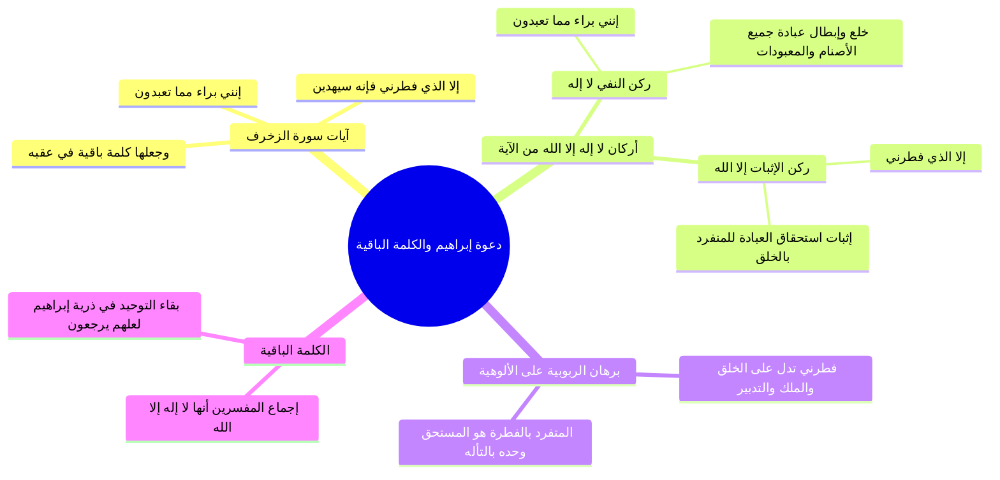

# دعوة إبراهيم والكلمة الباقية في عقبه

> [!abstract] بطاقة الجزء
> - **المحاضرة:** 16 من مادة العقيدة (المستوى الأول - أكاديمية زاد).
> - **المدى بالتفريغ:** من السطر 66 إلى السطر 70.
> - **المحاور المركزية:** استقراء آيات سورة الزخرف في دعوة إبراهيم الخليل عليه السلام، بيان ركني كلمة التوحيد (النفي في ﴿بَرَاءٌ مِّمَّا تَعْبُدُونَ﴾ والإثبات في ﴿إِلَّا الَّذِي فَطَرَنِي﴾)، والاستدلال ببرهان الفطرة والربوبية على حتمية توحيد الألوهية، وبيان «الكلمة الباقية في عقبه».

---

## 🧭 خريطة المفاهيم الذهنية (Mindmap)



---

## 📝 الملخص العلمي المنظم للجزء 02

### 1. نص الآيات الكريمة من سورة الزخرف
استدل المحاضر بقول الله تبارك وتعالى عن خليل الرحمن إبراهيم عليه السلام:
ا - <span style="color:#D97706; font-weight:bold;">﴿وَإِذْ قَالَ إِبْرَاهِيمُ لِأَبِيهِ وَقَوْمِهِ إِنَّنِي بَرَاءٌ مِّمَّا تَعْبُدُونَ * إِلَّا الَّذِي فَطَرَنِي فَإِنَّهُ سَيَهْدِينِ * وَجَعَلَهَا كَلِمَةً بَاقِيَةً فِي عَقِبِهِ لَعَلَّهُمْ يَرْجِعُونَ﴾</span> [الزخرف: 26-28].

---

### 2. مطابقة الآية لأركان «لا إله إلا الله»
أوضح المحاضر أن هذه الآية تُعد من أصرح وأعظم الآيات في القرآن الكريم في تفكيك معنى كلمة الشهادة، حيث قسّم إبراهيم عليه السلام العبارة إلى ركنين متطابقين لفظاً ومعنى مع كلمة الإخلاص:

```
    ┌──────────────────────────────────────────────────────────────┐
    │                      لا إله إلا الله                         │
    └──────────────┬───────────────────────────────┬───────────────┘
                   │                               │
            (ركن النفي العام)               (ركن الإثبات الخاص)
                   ▼                               ▼
     «لا إله» = ﴿بَرَاءٌ مِّمَّا تَعْبُدُونَ﴾     «إلا الله» = ﴿إِلَّا الَّذِي فَطَرَنِي﴾
  (البراءة من كل معبود عبد من دون الله)    (إثبات العبادة للخالق الفاطر وحده)
```

1. **ركن النفي (البراءة العامة):** في قوله: <span style="color:#0D9488; font-weight:bold;">﴿إِنَّنِي بَرَاءٌ مِّمَّا تَعْبُدُونَ﴾</span>؛ وهو المطابق تماماً لقولنا: **«لا إله»**؛ أي أتبرأ من عبادة كل ما يُعبد من دون الله من الأوثان، والأشجار، والأحجار، والملائكة، والبشر، والأولياء، والمقبورين.
2. **ركن الإثبات (التخصيص المطلق):** في قوله: <span style="color:#0D9488; font-weight:bold;">﴿إِلَّا الَّذِي فَطَرَنِي﴾</span>؛ وهو المطابق لقولنا: **«إلا الله»**؛ أي أثبت العبادة والخضوع والتأله للذي خلقني وابتدع خلقي وحده لا شريك له.

---

### 3. دلالة الاحتجاج بالربوبية على استحقاق الألوهية
- بيّن المحاضر نكتة بلاغية وعقدية دقيقة في عدول إبراهيم عليه السلام عن لفظ الجلالة «الله» إلى الوصف الفعلي <span style="color:#0D9488; font-weight:bold;">﴿الَّذِي فَطَرَنِي﴾</span>:
  - إبراهيم عليه السلام يحتج على قومه بـ **توحيد الربوبية** (الخلق والفطرة) لإلزامهم بـ **توحيد الألوهية** (العبادة والبراءة).
  - المعنى: كيف تعبدون آلهة لم تخلقكم ولا تملك لكم شيئاً، وتتركون المنفرد بخلقكم وفطرتكم وتدبير أموركم؟! فالمنفرد بالخلق هو وحده المستحق للعبادة.

---

### 4. حقيقة «الكلمة الباقية في عقبه»
- بالإجماع التام بين أئمة التفسير، الكلمة التي جعلها إبراهيم باقية في ذريته وعقبه هي: <span style="color:#0D9488; font-weight:bold;">«لا إله إلا الله»</span>.
- فسرها القرآن في نفس السياق بأنها: **البراءة من المعبودات الباطلة، والتوجه بالعبادة لله وحده**؛ ولم يفسرها أحد من الأنبياء ولا أتباعهم بأنها مجرد الإقرار بأن الله هو الفاطر والخالق؛ لأن الإقرار بالخلق كان وسيلة وبرهاناً، والمقصود والغاية هو إفراد الفاطر بالعبادة.

---

## 🗣️ نص المتحدث الكامل (الأسطر 66–70)

> ناتي الى ابراهيم عليه السلم قال الله عز وجل واذ قال ابراهيم لابيه وقومه انني براء مما تعبدون الا الذي فطرني فانه سيهدين وجعلها كلمه باقيه في عقبه لعلهم يرجعون
> ما هي الكلمه التي جعلها ابراهيم عليه السلام باقيه في عقد الكلمه بامان يفسر لا اله الا الله
> اين معناها في خلال ال ايه معناها انني براء مما تعبدون هذا لا لا اله انني براء مما تعبدون الا الذي فطرني ان الله المنفرد بالخلق والملك والرزق والتدبير فهو المستحق للعباده
> اذا ما هي ما معنى الكلمه التي هي لا اله الله من خلال هذه الان معناها المراه من عباده كل المعبودات واثبات استحقاق
> بعده الله وحده لا شريك له

---

## 🔗 روابط التنقل
- السابق: [[01 - دعوة نوح وهود وصالح وشعيب وفهم أقوامهم لمعنى لا إله إلا الله]]
- التالي: [[03 - فاصل اسم الله الحكم والعدل الإلهي في التشريع والجزاء]]
