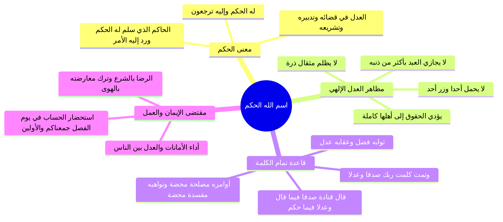

# فاصل اسم الله الحكم والعدل الإلهي في التشريع والجزاء

> [!abstract] بطاقة الجزء
> - **المحاضرة:** 16 من مادة العقيدة (المستوى الأول - أكاديمية زاد).
> - **المدى بالتفريغ:** من السطر 71 إلى السطر 82.
> - **المحاور المركزية:** اسم الله «الحَكَم»، كمال العدل والقسط في الدنيا والآخرة، تفسير قتادة لقوله تعالى ﴿وَتَمَّتْ كَلِمَتُ رَبِّكَ صِدْقًا وَعَدْلًا﴾، ضوابط التحاكم لشرع الله ورفض معارضته بالهوى، وثمار الإيمان بالحكم في العدل بين الناس واستحضار يوم الفصل.

---

## 🧭 خريطة المفاهيم الذهنية (Mindmap)

---

## 📝 الملخص العلمي المنظم للجزء 03

### 1. حاجة البشرية إلى حكم الله العادل
- يقع بين الناس على مدار الساعة نزاعات، ومشكلات، وخصومات، واعتداء على الدماء والأموال والحقوق.
- الحل الوحيد العادل والمنصف الذي يحفظ كرامة البشر وحقوقهم هو: «الرجوع إلى حكم الله وشرعه»؛ قال تعالى:
  ا - ﴿لَهُ الْحُكْمُ وَإِلَيْهِ تُرْجَعُونَ﴾ [القصص: 88].

---

### 2. دلالات اسم الله «الحَكَم» وصفة العدل
- **«الحَكَم»:** هو الحاكم المطلق الذي سُلِّم له الحكم وقُضِيَ له بالأمر؛ وهو الحكم العدل الذي يحكم بين عباده في الدنيا بشرعه وفي الآخرة بقسطه.
- من كمال عدل الله سبحانه:
  1. لا يظلم مثقال ذرة: ﴿إِنَّ اللَّهَ لَا يَظْلِمُ مِثْقَالَ ذَرَّةٍ﴾.
  2. لا يحمل نفساً وزر نفس أخرى: ﴿وَلَا تَزِرُ وَازِرَةٌ وِزْرَ أُخْرَىٰ﴾.
  3. لا يعاقب أحداً بأكثر من ذنبه.
  4. يؤدي الحقوق كاملة غير منقوصة إلى أهلها.
- قال الله تعالى مقرراً كمال حكمه وحسن تشريعه:
  ا - ﴿أَفَحُكْمَ الْجَاهِلِيَّةِ يَبْغُونَ وَمَنْ أَحْسَنُ مِنَ اللَّهِ حُكْمًا لِّقَوْمٍ يُوقِنُونَ﴾ [المائدة: 50].

---

### 3. قاعدة تمام الكلمة: الصدق في الأخبار والعدل في الأحكام
استشهد الفاصل بالآية العظيمة من سورة الأنعام:
ا - ﴿وَتَمَّتْ كَلِمَتُ رَبِّكَ صِدْقًا وَعَدْلًا لَّا مُبَدِّلَ لِكَلِمَاتِهِ وَهُوَ السَّمِيعُ الْعَلِيمُ﴾ [الأنعام: 115].
- **أثر قتادة رحمه الله:**
  - قال قتادة: «صدقاً فيما قال، وعدلاً فيما حكم».
- تفصيل هذه القاعدة العقدية الجليلة:

| الوصف الإلهي | تعلقه بالشريعة والكون | البيان والتطبيق الإيماني |
|:---|:---|:---|
| **صدقاً** | متعلق بالأخبار والغيبيات والوعد والوعيد | كل خبر أخبر الله به في كتابه فهو حق وصدق لا يتطرق إليه شك أو خطأ. |
| **عدلاً** | متعلق بالأحكام والشرائع والحدود والأقدار | كل قضاء قضاه فهو عدل، وكل أمر أمر به فهو مصلحة وخير، وكل نهي نهى عنه فهو مفسدة وشر، وثوابه فضل، وعقابه عدل. |

---

### 4. ثمرات الإيمان باسم الله «الحَكَم»
1. **الرضا التام بشرع الله:** التسليم والانقياد لحكمه وعدم معارضته بالهوى أو الرأي أو القوانين الوضعية؛ قال تعالى:
   ا - ﴿أَفَغَيْرَ اللَّهِ أَبْتَغِي حَكَمًا وَهُوَ الَّذِي أَنزَلَ إِلَيْكُمُ الْكِتَابَ مُفَصَّلًا﴾ [الأنعام: 114].
2. **الخوف من المظالم ومراقبة الحساب:** من علم أن الله هو الحكم الذي يقضي بين الخلائق يوم القيامة، امتنع عن ظلم العباد خشية الحساب في يوم الفصل:
   ا - ﴿هَٰذَا يَوْمُ الْفَصْلِ جَمَعْنَاكُمْ وَالْأَوَّلِينَ﴾ [المرسلات: 38].
3. **إقامة العدل بين الناس وأداء الأمانات:**
   ا - ﴿إِنَّ اللَّهَ يَأْمُرُكُمْ أَن تُؤَدُّوا الْأَمَانَاتِ إِلَىٰ أَهْلِهَا وَإِذَا حَكَمْتُم بَيْنَ النَّاسِ أَن تَحْكُمُوا بِالْعَدْلِ إِنَّ اللَّهَ نِعِمَّا يَعِظُكُم بِهِ إِنَّ اللَّهَ كَانَ سَمِيعًا بَصِيرًا﴾ [النساء: 58].

---

## 🗣️ نص المتحدث الكامل (الأسطر 71–82)

> ناخذ فاصل ثم نواصل بمشيئه الله
> على مدار ساعه يقع بين الناس نزاعات وخلافات وتقوم بينهم قضايا ومشكلات ويعتدي على الارواح والاموال والحل العادل لذلك ان يرجعوا الى حكم الله الحكم الحكم هو الحاكم الذي سلم له الحكم ورد اليه فيه الامن قال تعالى له الحكم واليه ترجعون
> وهو الحكم العدل الذي يحكم بين عباده في الدنيا والاخره بعدله وقسطه فلا يظلم مثقال ذره ولا يحمل احدا وزر احد ولا يجازي العبد باكثر من ذنبه
> ويؤدي الحقوق الى اهلها وهو العدل في تدبيره وتقديره فيحكم بسرعه ويبين لعباده جميع الطرق التي يحكم بها بين المتخاصمين من الطرق العادله الحكيمه قال تعالى ومن احسن من الله حكما لقوم يوقنون
> فمن امن بان الله هو الحكم رضى بحكمه وشرعه
> ولم يعارضه برايه وهواه قال تعالى افغير الله ابتغي حكما وهو الذي انزل اليكم الكتاب مفصلا اي كل فليس لي انا تعدي حكمه وا تجاوزها في انه لاح كما علمنا ولا قائل اصدق منه
> فمن امن بان الله هو الحكم على ما نحكمه وشرعه مشتمل على الحكمه والمصلحه والخير قال تعالى وتمت كلمه ربك صدقا وعدلا قال قتاده صدقا فيما قال وعد لا في ما حكم وخبره كله صدق وقضائه كله عدل و امره كله مصلحه والذي نهى عنه كله مفسده وثوابه لمن يستحق الثواب
> بفضله ورحمته اعقابه لمن يستحق العقاب بعدله وحكمته ومن علم ان الله سيحكم بين العباد يوم القيامه لم يظلم احدا خشيه الحساب
> قال تعالى
> هذا يوم الفصل جمعناكم والاولين اي لن فصل بينكم ونحكم بين الخلائق
> ومن امن بان الله هو الحكم الذي يحكم بالعدل عدل بين الناس
> قال تعالى ان الله يامركم ان تؤدوا الامانات الى اهلها واذا حكمتم بين الناس ان تحكموا بالعدل ان الله نعما يعظكم به ان الله كان سميعا بصيرا

---

## 🔗 روابط التنقل
- السابق: [[02 - دعوة إبراهيم والكلمة الباقية في عقبه]]
- التالي: [[04 - دعوة موسى وعيسى عليهما السلام ونصوص القرآن في كفر من اتخذهما آلهة]]
