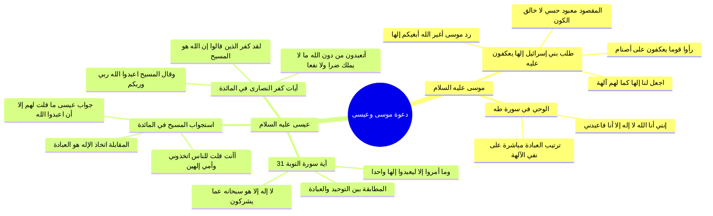

# دعوة موسى وعيسى عليهما السلام ونصوص القرآن في كفر من اتخذهما آلهة

> [!abstract] بطاقة الجزء
> - **المحاضرة:** 16 من مادة العقيدة (المستوى الأول - أكاديمية زاد).
> - **المدى بالتفريغ:** من السطر 83 إلى السطر 109.
> - **المحاور المركزية:** قصة بني إسرائيل بعد مجاوزة البحر وطلبهم إلهاً يعكفون عليه، نصوص الوحي لموسى في سورة طه، دعوة عيسى في سورة التوبة والمقابلة بين «يعبدوا إلهاً واحداً» و«لا إله إلا هو»، استجواب عيسى يوم القيامة في سورة المائدة، وتصريح القرآن بأن اتخاذ الإله هو صرف العبادة له.

---

## 🧭 خريطة المفاهيم الذهنية (Mindmap)



---

## 📝 الملخص العلمي المنظم للجزء 04

### 1. دعوة موسى عليه السلام وحادثة بني إسرائيل الكاشفة
استدل المحاضر بحدث تاريخي وقرآني فاصل وقع لبني إسرائيل فور نجاتهم من فرعون ومجاوزتهم البحر:
- **نص الآيات في سورة الأعراف (138-140):**
  ا - <span style="color:#D97706; font-weight:bold;">﴿وَجَاوَزْنَا بِبَنِي إِسْرَائِيلَ الْبَحْرَ فَأَتَوْا عَلَىٰ قَوْمٍ يَعْكُفُونَ عَلَىٰ أَصْنَامٍ لَّهُمْ قَالُوا يَا مُوسَى اجْعَل لَّنَا إِلَٰهًا كَمَا لَهُمْ آلِهَةٌ قَالَ إِنَّكُمْ قَوْمٌ تَجْهَلُونَ * إِنَّ هَٰؤُلَاءِ مُتَبَّرٌ مَّا هُمْ فِيهِ وَبَاطِلٌ مَّا كَانُوا يَعْمَلُونَ * قَالَ أَغَيْرَ اللَّهِ أَبْغِيكُمْ إِلَٰهًا وَهُوَ فَضَّلَكُمْ عَلَى الْعَالَمِينَ﴾</span>.

#### وجه الاستدلال العقدي الحاسم:
1. **معنى طلبهم:** بنو إسرائيل كانوا مؤمنين بأن الله هو ربهم وخالقهم الذي فلق لهم البحر وأغرق فرعون؛ فلم يطلبوا من موسى أن يجعل لهم رباً يخلق ويرزق، بل طلبوا صنماً ومعبوداً حسياً يتوجهون إليه بالعكوف والعبادة كما يفعل أولئك المشركون: <span style="color:#0D9488; font-weight:bold;">«اجعل لنا إلهاً = اجعل لنا معبوداً»</span>.
2. **تسمية القرآن:** سمى الله هذا المعبود الذي يُعكف عليه: <span style="color:#0D9488; font-weight:bold;">«إلهاً»</span>، وأنكر موسى عليهم ذلك أشد الإنكار مبيناً أن التوجه بالعبادة لغير الله شرك وبطلان.
3. **آية طه (الآية 14):** قال الله تعالى مخاطباً موسى:
   ا - <span style="color:#D97706; font-weight:bold;">﴿إِنَّنِي أَنَا اللَّهُ لَا إِلَٰهَ إِلَّا أَنَا فَاعْبُدْنِي وَأَقِمِ الصَّلَاةَ لِذِكْرِي﴾</span>؛ حيث رتّب الأمر بالعبادة <span style="color:#0D9488; font-weight:bold;">﴿فَاعْبُدْنِي﴾</span> بالفاء مباشرة على تقرير التوحيد <span style="color:#0D9488; font-weight:bold;">﴿لَا إِلَٰهَ إِلَّا أَنَا﴾</span>.

---

### 2. دعوة عيسى عليه السلام: نصوص قطعية في معنى «الإله»
استعرض المحاضر نصوصاً متعددة من سورتي التوبة والمائدة تقطع كل تأويل باطل لمعنى كلمة التوحيد:

#### أ) التطابق في سورة التوبة (الآية 31):
- قال الله تعالى:
  ا - <span style="color:#D97706; font-weight:bold;">﴿اتَّخَذُوا أَحْبَارَهُمْ وَرُهْبَانَهُمْ أَرْبَابًا مِّن دُونِ اللَّهِ وَالْمَسِيحَ ابْنَ مَرْيَمَ وَمَا أُمِرُوا إِلَّا لِيَعْبُدُوا إِلَٰهًا وَاحِدًا لَّا إِلَٰهَ إِلَّا هُوَ سُبْحَانَهُ عَمَّا يُشْرِكُونَ﴾</span>.
- **التفسير القرآني الداخلي:**
  - جملة: <span style="color:#0D9488; font-weight:bold;">﴿لَّا إِلَٰهَ إِلَّا هُوَ﴾</span> هي التفسير المباشر لقوله: <span style="color:#0D9488; font-weight:bold;">﴿وَمَا أُمِرُوا إِلَّا لِيَعْبُدُوا إِلَٰهًا وَاحِدًا﴾</span>.
  - المعنى: لا معبود بحق إلا الله، فعبادة غيره شرك يستحق التنزيه عنه ﴿سُبْحَانَهُ عَمَّا يُشْرِكُونَ﴾.

#### ب) استجواب عيسى عليه السلام يوم القيامة (المائدة: 116-117):
- قال الله تعالى:
  ا - <span style="color:#D97706; font-weight:bold;">﴿وَإِذْ قَالَ اللَّهُ يَا عِيسَى ابْنَ مَرْيَمَ أَأَنتَ قُلْتَ لِلنَّاسِ اتَّخِذُونِي وَأُمِّيَ إِلَٰهَيْنِ مِن دُونِ اللَّهِ قَالَ سُبْحَانَكَ مَا يَكُونُ لِي أَنْ أَقُولَ مَا لَيْسَ لِي بِحَقٍّ إِن كُنتُ قُلْتُهُ فَقَدْ عَلِمْتَهُ تَعْلَمُ مَا فِي نَفْسِي وَلَا أَعْلَمُ مَا فِي نَفْسِكَ إِنَّكَ أَنتَ عَلَّامُ الْغُيُوبِ * مَا قُلْتُ لَهُمْ إِلَّا مَا أَمَرْتَنِي بِهِ أَنِ اعْبُدُوا اللَّهَ رَبِّي وَرَبَّكُمْ﴾</span>.

```
       السؤال الإلهي: ﴿أَأَنتَ قُلْتَ لِلنَّاسِ اتَّخِذُونِي وَأُمِّيَ إِلَٰهَيْنِ﴾
                                       │
                                       ▼ (المقابلة الدلالية)
       الجواب النبوي: ﴿مَا قُلْتُ لَهُمْ إِلَّا... أَنِ اعْبُدُوا اللَّهَ﴾
```

- **وجه البرهان:**
  - سأله ربه: هل قلت لهم اتخذوني وأمي <span style="color:#E11D48; font-weight:bold;">إلهين</span>؟
  - فأجاب عيسى: ما قلت لهم إلا: <span style="color:#0D9488; font-weight:bold;">﴿اعْبُدُوا اللَّهَ﴾</span>!
  - إذن: اتخاذ الإله في لغة القرآن هو **صرف العبادة**، والإله هو **المعبود**. ولم يقل أحد من النصارى إن مريم عليها السلام خلقت السماوات والأرض، ومع ذلك حكم الله بكفرهم لأنهم اتخذوها «إلهاً» بعبادتها والتوجه إليها بالدعاء والشفاعة!

#### ج) آيات كفر من أشرك بالمسيح (المائدة: 72-76):
- <span style="color:#D97706; font-weight:bold;">﴿لَقَدْ كَفَرَ الَّذِينَ قَالُوا إِنَّ اللَّهَ هُوَ الْمَسِيحُ ابْنُ مَرْيَمَ وَقَالَ الْمَسِيحُ يَا بَنِي إِسْرَائِيلَ اعْبُدُوا اللَّهَ رَبِّي وَرَبَّكُمْ إِنَّهُ مَن يُشْرِكْ بِاللَّهِ فَقَدْ حَرَّمَ اللَّهُ عَلَيْهِ الْجَنَّةَ وَمَأْوَاهُ النَّارُ وَمَا لِلظَّالِمِينَ مِنْ أَنصَارٍ﴾</span>.
- ثم قال في ختام السياق ناعياً عليهم عبادة المخلوق:
  ا - <span style="color:#D97706; font-weight:bold;">﴿قُلْ أَتَعْبُدُونَ مِن دُونِ اللَّهِ مَا لَا يَمْلِكُ لَكُمْ ضَرًّا وَلَا نَفْعًا وَاللَّهُ هُوَ السَّمِيعُ الْعَلِيمُ﴾</span> [المائدة: 76].
- فدل السياق كله على أن مناط الشرك والكفر هو صرف العبادة لمن لا يملك نفعاً ولا ضراً.

---

## 🗣️ نص المتحدث الكامل (الأسطر 83–109)

> حياكم الله والمحبه نكمل تداعت براهيم عليه وسلم فيها كلام كثير لانها واضحه جدا انه يدعو الى البراءه من عباده كل المعبودات اثبات استحقاق العباده لله وان هذا هو معنى لا اله الا الله
> ناخذ موسى عليه السلام قال الله عز وجل
> وجاوزنا ببني اسرائيل البحر فاتوا على قوم يعكفون على اصنام لهم يعني كفور يعني يعمدون قد عكفوا على تلك الاسلام يتوجه اليه بالعباده ماذا قال بنو اسرائيل لموسى قال امس اجعل لنا الها كما لهم الهه اجعل لنا معبودات يعني هم لا يقصدون ان يجعلنا يعرفون سبحانه اجعل لنا الها كما لهم الهه قال انكم قوم تجهلون ان هؤلاء متبر ما هم فيه وباطل ما كانوا يعملون
> قال اغير الله ابغيكم الها وهو فضلكم على العالمين
> اذا التوجه بالعباده لهؤلاء هو من اه انه له دعوه موسى عليه السلام الى لا اله الا الله
> ماذا قال قال الله عز وجل وانا اخترتك فاستمع لما يوحى انني انا الله لا اله الا انا فاعبدني واقم الصلاه لذكري في دعوه موسى الى لا اله الا الله
> بمعنى انه لا يستحق العباده الا الله
> خذوا عيسى عليه السلام قال الله سبحانه وتعالى
> اتخذوا احبارهم ورهبانهم اربابا من دون الله والمسيح ابن مريم وما امروا الا ليعبدوا الها واحدا لا اله الا هو سبحانه عما يشركون
> لا اله الا الله لا اله الا الله في هذه الايه قال الله سبحانه وتعالى
> واضح
> لا اله الا هو
> هذه لا اله الا الله في الايه اين معناها من خلال الايه قال الله
> الا ليعبدوا الها واحدا
> ما معنى لا اله الا هو يعبد اله واحد ويطرح جميع المعبودات معنى لا اله الا هو لا معبود الا الله الا واحد وهو الله سبحانه وتعالى صريحه ايه صريحه في معنى لا اله الا هو
> يعني ان يعبدوا اله واحد سبحانه وتعالى ودعوه عيسى عليه السلام واضحه جدا
> قال الله عز وجل قال الله يا عيسى ابن مريم اانت قلت للناس اتخذوني وامي الهين
> واذ قال الله يا عيسى ابن مريم اانت قلت للناس اتخذوني وامي الهين من دون الله قال سبحانك ما يكون لي ان اقول ما ليس لي بحق ان كنت قلته فقد علمته تعلم ما في نفسي ولا اعلم ما في نفسك انك انت علام الغيوب ما قلت لهم الا ما امرتني به لحين قال له انت قلت للناس اتخذوني وامي الهين من دون الله
> اله عندنا معنى اله قال ماذا قلت لهم ما قلت لهم الا ما امرتني به ان اعبدوا الله ربي وربكم اذا ما معنى الاله المعبود انتقلت الناس بدون اله يعني جعلوني معبود معنى الاله المعمول قال لا ما قلت لهم ذلك لو كنت قلت انت تعلم ذلك قلت لهم ان يعبدوا الله ربي وربكم اذا ما معنى العلاقه والمعبود من خلال هذه الايه وهذه صريحه قال الله سبحانه وتعالى ايضا في دعوه عيسى عليه السلام
> لقد كفر الذين قالوا ان الله هو المسيح ابن مريم وقال المسيح يا بني اسرائيل اعبدوا الله ربي وربكم عبد الله رمى ربكم هذه دعوه لا اله الا الله
> انهم من يشرك بالله فقد حرم الله عليه الجنه وماواه النار وما للظالمين من انصار
> لقد كفر الذين قالوا ان الله ثالث ثلاثه وما من
> اله الا اله واحد وان لم ينتهوا عما يقولون ليمسن الذين كفروا منهم عذاب نا لم افلا يتوبون الى الله ويستغفرونه والله غفور رحيم
> ما المسيح ابن مريم الا رسول قد خلت من قبله الرسل وامه صديقه كانا ياكلان الطعام انظر كيف نبين لهم الايات ثم انظر انى يؤفكون
> كل هذا معنى الاله اتعبدون من دون الله ما لا يملك لكم ضرا ولا نفعا والله هو السميع العليم
> فما معنى الاله معنى الاله المعبود اتعبدون من دون الله ان الله ثالث ثلاثه
> هذا هو انه من يشرك بالله
> اذن معنى الالهي يا اخوان هو المعبود في دعوه عيسى عليه السلام واضحه

---

## 🔗 روابط التنقل
- السابق: [[03 - فاصل اسم الله الحكم والعدل الإلهي في التشريع والجزاء]]
- التالي: [[05 - دعوة خاتم المرسلين ونصوص القرآن المحكمة وفهم مشركي قريش]]
