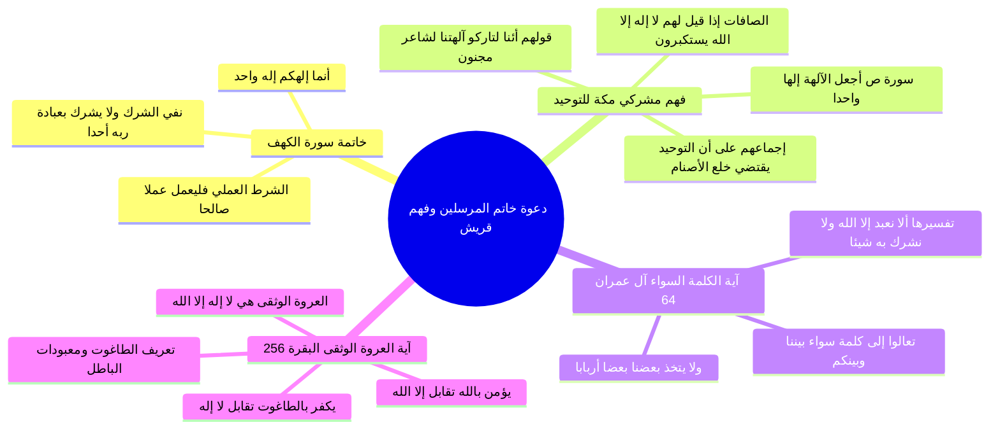

# دعوة خاتم المرسلين ونصوص القرآن المحكمة وفهم مشركي قريش

> [!abstract] بطاقة الجزء
> - **المحاضرة:** 16 من مادة العقيدة (المستوى الأول - أكاديمية زاد).
> - **المدى بالتفريغ:** من السطر 110 إلى السطر 130.
> - **المحاور المركزية:** خاتمة سورة الكهف واقتران التوحيد بالعمل الصالح، نصوص القرآن في استكبار مشركي مكة وتكذيبهم عند سماع «لا إله إلا الله»، تعجبهم من جمع المعبودات في معبود واحد (سورة ص)، نداء الكلمة السواء لأهل الكتاب في آل عمران، وتفسير العروة الوثقى في سورة البقرة بالكفر بالطاغوت والإيمان بالله.

---

## 🧭 خريطة المفاهيم الذهنية (Mindmap)

---

## 📝 الملخص العلمي المنظم للجزء 05

### 1. خاتمة سورة الكهف: تحقيق الوحدانية بالعبادة الخالصة
استهل المحاضر الاستدلال من دعوة النبي محمد ﷺ بقول الله تعالى:
ا - ﴿قُلْ إِنَّمَا أَنَا بَشَرٌ مِّثْلُكُمْ يُوحَىٰ إِلَيَّ أَنَّمَا إِلَٰهُكُمْ إِلَٰهٌ وَاحِدٌ فَمَن كَانَ يَرْجُو لِقَاءَ رَبِّهِ فَلْيَعْمَلْ عَمَلًا صَالِحًا وَلَا يُشْرِكْ بِعِبَادَةِ رَبِّهِ أَحَدًا﴾ [الكهف: 110].
- **وجه الدلالة:** قرر الله أن مقتضى وتفسير كون ﴿إِلَٰهُكُمْ إِلَٰهٌ وَاحِدٌ﴾ هو ألا يُشرك العبد في عبادة ربه أحداً، وأن يعمل صالحاً مخلصاً، فدل على أن ألوهية الله تعني استحقاقه المطلق للعبادة وحده دون سواه.

---

### 2. فهم مشركي قريش للفظ «لا إله إلا الله» وردود أفعالهم
أكد المحاضر أن كفار قريش ومشركي العرب كانوا أصحاب اللسان العربي الفصيح، ولم يخفَ عليهم المعنى الدقيق لكلمة التوحيد:

#### أ) الاستكبار عن نطقها لعلمهم بلوازمها (سورة الصافات: 35-36):
- قال الله تعالى:
  ا - ﴿إِنَّهُمْ كَانُوا إِذَا قِيلَ لَهُمُ لَا إِلَٰهَ إِلَّا اللَّهُ يَسْتَكْبِرُونَ * وَيَقُولُونَ أَئِنَّا لَتَارِكُو آلِهَتِنَا لِشَاعِرٍ مَّجْنُونٍ﴾.
- **التأمل العقدي:**
  - لم يستكبروا لأنهم يعتقدون أن أصنامهم خلقت السماوات والأرض؛ فهم يعترفون بأن الله وحده هو الخالق.
  - بل استكبروا لأنهم علموا أن قول «لا إله إلا الله» يُلزمهم حتماً بـ **«ترك آلهتهم»** المعبودة من دون الله والتوقف عن دعائها والذبح لها والنذر لها.

#### ب) تعجبهم من إبطال التعدد في المعبودات (سورة ص: 4-6):
- قال الله تعالى:
  ا - ﴿وَعَجِبُوا أَن جَاءَهُم مُّنذِرٌ مِّنْهُمْ وَقَالَ الْكَافِرُونَ هَٰذَا سَاحِرٌ كَذَّابٌ * أَجَعَلَ الْآلِهَةَ إِلَٰهًا وَاحِدًا إِنَّ هَٰذَا لَشَيْءٌ عُجَابٌ * وَانطَلَقَ الْمَلَأُ مِنْهُمْ أَنِ امْشُوا وَاصْبِرُوا عَلَىٰ آلِهَتِكُمْ إِنَّ هَٰذَا لَشَيْءٌ يُرَادُ﴾.
- **البرهان:** لو كان معنى لا إله إلا الله عندهم هو «لا خالق إلا الله» لما عجبوا ولما قالوا ﴿أَجَعَلَ الْآلِهَةَ إِلَٰهًا وَاحِدًا﴾؛ لأنهم أصلاً يقرون بأن الخالق واحد! ولكن تعجبهم نبع من دعوته إياهم إلى إفراد العبادة لإله واحد وترك سائر المعبودات.

---

### 3. آية «الكلمة السواء» في سورة آل عمران
- قال الله تعالى آمراً نبيه بدعوة أهل الكتاب:
  ا - ﴿قُلْ يَا أَهْلَ الْكِتَابِ تَعَالَوْا إِلَىٰ كَلِمَةٍ سَوَاءٍ بَيْنَنَا وَبَيْنَكُمْ أَلَّا نَعْبُدَ إِلَّا اللَّهَ وَلَا نُشْرِكَ بِهِ شَيْئًا وَلَا يَتَّخِذَ بَعْضُنَا بَعْضًا أَرْبَابًا مِّن دُونِ اللَّهِ فَإِن تَوَلَّوْا فَقُولُوا اشْهَدُوا بِأَنَّا مُسْلِمُونَ﴾ [آل عمران: 64].
- **التفسير النبوي والقرآني:**
  - «الكلمة السواء» بإجماع المفسرين هي كلمة التوحيد: **«لا إله إلا الله»**.
  - فسرها القرآن في نفس النص بقوله: ﴿أَلَّا نَعْبُدَ إِلَّا اللَّهَ وَلَا نُشْرِكَ بِهِ شَيْئًا﴾؛ فكان هذا نصاً قاطعاً يفسر التوحيد بنفي الشرك في العبادة.

---

### 4. آية «العروة الوثقى» وتفكيك الطاغوت
- قال الله تعالى في سورة البقرة:
  ا - ﴿لَا إِكْرَاهَ فِي الدِّينِ قَد تَّبَيَّنَ الرُّشْدُ مِنَ الْغَيِّ فَمَن يَكْفُرْ بِالطَّاغُوتِ وَيُؤْمِن بِاللَّهِ فَقَدِ اسْتَمْسَكَ بِالْعُرْوَةِ الْوُثْقَىٰ لَا انفِصَامَ لَهَا وَاللَّهُ سَمِيعٌ عَلِيمٌ﴾ [البقرة: 256].
- **بيان معنى العروة الوثقى وأركانها:**
  1. «العروة الوثقى» هي كلمة: «لا إله إلا الله».
  2. «فَمَن يَكْفُرْ بِالطَّاغُوتِ»: هو ركن النفي **«لا إله»**؛ والكفر بالطاغوت هو البراءة من جميع المعبودات التي عُبدت من دون الله ورضي أصحابها بالعبادة أو تجاوز الناس بهم حدهم فصرفوا لهم العبادة والتعظيم.
  3. «وَيُؤْمِن بِاللَّهِ»: هو ركن الإثبات **«إلا الله»**؛ وهو الإيمان بأن الله وحده هو المستحق لجميع أنواع العبادة والتعظيم.

---

## 🗣️ نص المتحدث الكامل (الأسطر 110–130)

> تعالوا ناتي الى نبينا محمد صلى الله عليه وسلم قال الله عز وجل لنبيه محمد صلى الله عليه وسلم قل انما انا بشر مثلكم يوحى الي انما الهكم اله واحد الهكم اله واحد لا اله الا الله
> ما معناها
> فمن كان يرجو لقاء ربه يحقق معنا لكم مائه واحد كيف كيف يحقق الحكم الواحد فليعمل عملا صالحا ولا يشرك بعباده ربه احدا
> فما معنى الهكم اله واحد من خلال ال ايه ما نخرج عنها الهكم اله واحد يعمل عملا صالحا ولا يشرك بعباده ربه احدا
> فما معنى لا اله الا الله
> ما معنى الهكم اله واحد الان شرط ان نتوجه بالعباده لله وحده ولا نصرف اين من انواع العباده لغير الله واضحه جدا
> طبعا نحنا قلنا في هذا الامر لاهميته لاهميتها قال الله سبحانه وتعالى عن دعوه محمد صلى الله عليه وسلم انهم كانوا اذا قيل لهم لا اله
> اذن الله يستكبرون ويقولون ائنا لتاركوا الهتنا لشاعر مجنون
> هل هم كانوا يعتقدون ان هناك كثر خلقوا السماوات والارض لا لكن كانوا يصرفون العباده لمعبوداتهم الارضيه مع الله سبحانه وتعالى قال ناس لمن ام لا اله الا الله لا اله الا الله ماذا فهمها المشركون مكه انه يتركون جميع المعبودات ويتوجه العباده والتاله الله وحده لا شريك له
> شاعر مجنون هذه الايه وعجبوا ان جاءهم منذر منهم وقال الكافرون هذا ساحر كذاب اجعل الالهه الها واحدا هذه دعوته دعوته لا اله الا الله
> ان هذا لشيء عجاب وانطلق الملا منهم ان امشوا واصبروا على الهتكم هل المقصود الارباب على الهتكم ان هذا لشيء يراد واضحه تماما لدعوه رسولنا صلى الله عليه وسلم قال الله عز وجل قل يا اهل الكتاب قل يا اهل الكتاب تعالوا الى كلمه سواء بيننا وبينكم الكلمه السراء هي لا اله الا الله
> هذه معروفه للجميع المفسرين تعالى الى كلمه سواء بيننا وبينكم
> ما معنى لا اله الا الله من خلال هذه الايه الا نعبد الا الله ولا نشرك به شيئا ولا يتخذ بعضنا بعضا اربابا من دون الله فان تولوا فقولوا اشهدوا بانا مسلمون
> ما معنى لا اله الا الله في هذا الامر لا ال ها الكلمه السؤال ما معناه ان لا نعبد الا الله ولا نشرك به شيئا
> فما معنى لا اله الا الله
> في القران دعوه نبينا محمد صلى الله عليه وسلم الا نعبد الا
> الله ولا نشرك به شيئا خذوا ايضا هذه الايه قال الله سبحانه وتعالى لا اكراه في الدين
> لا اكراه في الدين قد تبين الرشد من الغي فمن يكفر بالطاغوت ويؤمن بالله فقد استمسك بالعروه الوثقى لا انفصام لها والله سميع عليم
> اين لا اله الا الله في هذه الايه لا اله الا الله في هذه الايه العمل واثقا لا اله الا الله هي العروض الاتقان
> طيب
> ما معنى العروه الوثقى لا اله الا الله في الان يكفر بالطاغوت ويؤمن بالله يكفر بالطاغوت لا اله الكفر بجميع المعبودات التي طلبها اصحابه او هم في انفسهم يتجاوزوا حدود المخلوق الى حد الخالق بان جلاله ويريدون من الناس ان يصرف لهم العباده او الناس تجاوزوا بهم حدود هم ما بدهم من دون الله يكفر بالطاغوت يكفر بجميع المعبودات التي عبدت من دون الله ويؤمن بالله يؤمن بان الله سبحانه وتعالى والمستحق وحده للعباد هذا ما ان الامر الا ثقه وهذا معنى لا اله الا الله

---

## 🔗 روابط التنقل
- السابق: [[04 - دعوة موسى وعيسى عليهما السلام ونصوص القرآن في كفر من اتخذهما آلهة]]
- التالي: [[06 - حديث وفاة أبي طالب ومناقضة لا إله إلا الله لملة عبد المطلب]]
