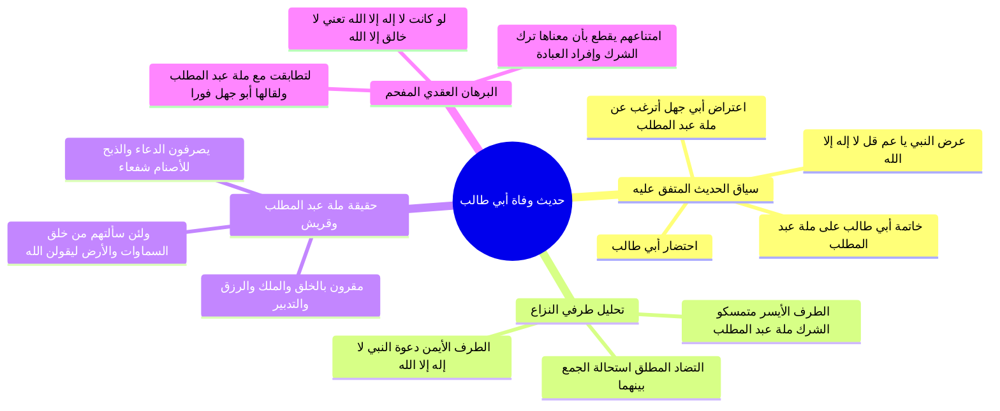

# حديث وفاة أبي طالب ومناقضة لا إله إلا الله لملة عبد المطلب

> [!abstract] بطاقة الجزء
> - **المحاضرة:** 16 من مادة العقيدة (المستوى الأول - أكاديمية زاد).
> - **المدى بالتفريغ:** من السطر 131 إلى السطر 154.
> - **المحاور المركزية:** دراسة حديث وفاة أبي طالب المتفق عليه، تحليل المقابلة والمضادة بين «لا إله إلا الله» وبين «ملة عبد المطلب»، إثبات إقرار كفار قريش بالربوبية والخلق والتدبير بنص القرآن، وبطلان تفسير لا إله إلا الله بـ «لا خالق إلا الله» بالبرهان النبوي الحاسم.

---

## 🧭 خريطة المفاهيم الذهنية (Mindmap)



---

## 📝 الملخص العلمي المنظم للجزء 06

### 1. تخريج الحديث وسياقه التاريخي
استدل المحاضر بحديث صحيح صريح متفق عليه بين البخاري ومسلم، رواه الصحابي الجليل سعيد بن المسيب عن أبيه رضي الله عنهما:
- لما حضرت أبا طالب الوفاة، دخل عليه رسول الله ﷺ فوجد عنده أبا جهل بن هشام وعبد الله بن أبي أمية بن المغيرة.
- فقال له رسول الله ﷺ ناصحاً مشفقاً:
  ا - <span style="color:#D97706; font-weight:bold;">«يا عم، قل: لا إله إلا الله، كلمةً أشهد لك بها عند الله»</span>.
- فبادر أبو جهل وعبد الله بن أبي أمية وقالا له محذرين:
  ا - <span style="color:#E11D48; font-weight:bold;">«يا أبا طالب، أترغب عن ملة عبد المطلب؟!»</span>.
- فلم يزل رسول الله ﷺ يعيدها عليه ويعيدان تلك المقالة، حتى قال أبو طالب آخر ما كلمهم:
  ا - <span style="color:#E11D48; font-weight:bold;">«هو على ملة عبد المطلب، وأبى أن يقول: لا إله إلا الله»</span>.

---

### 2. التحليل العقدي لمنظومة المقابلة بين الألفاظ
قام المحاضر بتحليل طرفي الميزان في الحادثة:

```
            ┌───────────────────────────────────────────────┐
            │                  لحظة الاحتضار                │
            └───────┬───────────────────────────────┬───────┘
                    │                               │
            (دعوة الرسول ﷺ)                 (دعوة أبي جهل وقريش)
                    ▼                               ▼
            «لا إله إلا الله»              «ملة عبد المطلب»
                    │                               │
                    └───► [تضاد وتناقض قطعي تام] ◄───┘
```

- هناك **تضاد كلي ومناقضة تامة** بين دعوة النبي ﷺ «لا إله إلا الله» وبين «ملة عبد المطلب».
- لا يمكن للعبد أن يكون على ملة عبد المطلب وفي الوقت نفسه قائلاً محققاً لـ «لا إله إلا الله».

---

### 3. ما هي «ملة عبد المطلب»؟ وإقرار قريش بتوحيد الربوبية
طرح المحاضر السؤال الجوهري: ما هي العقيدة التي كان عليها عبد المطلب وأبو طالب وأبو جهل وسائر مشركي مكة؟
- هل كانوا يعتقدون أن أصنامهم خلقت السماوات أو الأرض أو تسير الأفلاك أو ترزق العباد؟!
- القرآن الكريم يجيب بالنفي القاطع في مواضع عديدة:
  ا - <span style="color:#D97706; font-weight:bold;">﴿وَلَئِن سَأَلْتَهُم مَّنْ خَلَقَ السَّمَاوَاتِ وَالْأَرْضَ وَسَخَّرَ الشَّمْسَ وَالْقَمَرَ لَيَقُولُنَّ اللَّهُ﴾</span> [العنكبوت: 61].
  ا - <span style="color:#D97706; font-weight:bold;">﴿وَلَئِن سَأَلْتَهُم مَّنْ خَلَقَهُمْ لَيَقُولُنَّ اللَّهُ﴾</span> [الزخرف: 87].
- إذن: **توحيد الربوبية** (أن الله هو الخالق الرازق المالك المدبر المنفرد بصنع الكون) كان أمراً مستقراً معلوماً مسلماً به عند مشركي مكة وفي ملة عبد المطلب.

---

### 4. الإلزام العقدي وبطلان مذهب المتكلمين
بنى المحاضر على هذه الحقيقة برهاناً عقلياً قاطعاً يُسقط تأويل الطائفة الأولى التي فجّرت الخلاف:

| الفرضية التفسيرية | مدى مطابقتها لواقع الحادثة والحديث | النتيجة العقدية واللازم العقلي |
|:---|:---|:---|
| **لو كان معنى لا إله إلا الله = «لا خالق ولا رازق إلا الله»** | متوافقة تماماً مع ملة عبد المطلب ولا تعارضها البتة! | لكان أبو جهل وأبو طالب أول من يبادر لقولها، ولقالوا: «نحن نشهد أن لا خالق إلا الله ونحن على ملة عبد المطلب معاً»؛ ولم يكن ليحدث أي نزاع أو حرب أو خصومة! |
| **الحقيقة القطعية: معنى لا إله إلا الله = «لا معبود بحق إلا الله»** | مناقضة ومضادة تماماً لملة عبد المطلب الشركية. | علم أبو جهل وأبو طالب أن قولها يقتضي خلع اللات والعزى ومناة، وترك الاستغاثة بالقبور والأصنام وإفراد الله وحده بالعبادة، ولذلك أصر أبو طالب على الشرك ومات عليه. |

> [!important] الخلاصة النبوية
> أثبت هذا الحديث أن «لا إله إلا الله» معناها إفراد الله تعالى بجميع أنواع العبادة، وأن الإقرار المجرد بالخلق والرزق (توحيد الربوبية) متضمن في التوحيد لكنه **لا يكفي أبداً** لدخول الإسلام والنجاة من عذاب الله.

---

## 🗣️ نص المتحدث الكامل (الأسطر 131–154)

> خذ هذا الحديث من احاديث النبي صلى الله عليه و سلم هذا الحديث اه متفق عليه سعيد بن المسيب عن ابيه انه اخبره قال لما حضرت ابا طالب الوفاه
> تعالوا يا اخوان نتامل هذا الحديث حديث ان جاءه رسول الله صلى الله عليه وسلم فوجد عنده ابا جهل بن هشام وعبد الله بن ابي اميه بن المغيره
> قال رسول الله صلى الله عليه وسلم رسولا يحدث
> اما طالب
> قال رسول الله وسلم طالب يا عم قل لا اله الا
> هنا الكلمه موجوده لا اله الا الله كلمه اشهد لك بها عند ال هذا ال كلمه لا اله الا الله
> قال ابو جهل وعبد الله بن ابي اميه قال يا ابا طالب اترغب عن مله عبد المطلب
> عندنا لا اله الا الله في اليمين وعندنا منه عبد المطلق اليسار ما يمكن اما ان تختار منه عبد المطلب او لا اله الا الله
> وسلم عليه قلنا اعاد عليهم من انت عبد المطلب فلم يزل بتلك المقال الملك عبد المطلب حتى قال ابو طالب اخر ما كلمه على مله عبد المطلب وابى ان يقول لا اله الا الله
> الى اخر الحديث
> تعالى الان المله عبد المطلب الان لا اله الا الله
> هل هي متوافقه نعمل تعد المطالب ومناقضه عبد المطلب مناقضه تماما مضاده تماما تضاد هناك تضاد بين لا اله الا الله
> بين الملك عبد المطلب ان ناخذ في مله عبد المطلب
> لا اله الا الله
> معناها لا معبود يستحق العباده الا الله ولا لا خالق الا الله
> هم مله عبد المطلب ولئن سالتهم من خلق السماوات والارض وسخر الشمس والقمر ليقولن الله الله من خلق السماوات والارض وسخر الشمس والقمر الله هذا الله على ان سالتهم من خلق السماوات والارض ليقولن الله اذا عندهم ان الله المنفرد بالخلق والملك والتدبير هذا عندهم اذا لو كان معنى لا لا خالق الا الله
> لان هذا متفق عليه عبد المطلق
> لكن ان تترك جميع المعبودات وتوجه بالعباده لله
> فيكون معنى لا لا يستحق العباده الا الله
> هذا تتضاد مع مله عبد المطلب
> هذا الحديث واضح دلاله واضحه على ان معنى لا اله
> الا الله
> التي جاء بها رسولنا صلى الله عليه وسلم معناها لا معبود يستحق العباده الا الله وان معناها لا خالق الا الله لا رزق الله م تضمن ذلك ضمن ذلك لكنه لا يكفي حتى يتوجه الانسان في العباده لله وحده لا شريك له

---

## 🔗 روابط التنقل
- السابق: [[05 - دعوة خاتم المرسلين ونصوص القرآن المحكمة وفهم مشركي قريش]]
- التالي: [[07 - فاصل خلق الحلم وضبط النفس وآثاره الإيمانية والاجتماعية]]
