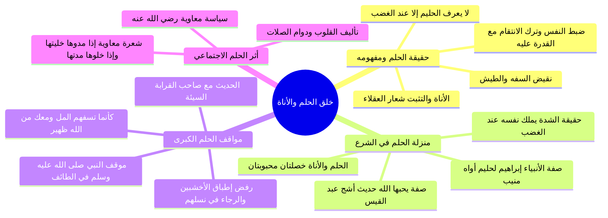

# فاصل خلق الحلم وضبط النفس وآثاره الإيمانية والاجتماعية

> [!abstract] بطاقة الجزء
> - **المحاضرة:** 16 من مادة العقيدة (المستوى الأول - أكاديمية زاد).
> - **المدى بالتفريغ:** من السطر 155 إلى السطر 163.
> - **المحاور المركزية:** حقيقة خُلق الحلم ونفي كونه ضعفاً أو خوراً، كلام رجاء بن أبي سلمة في ضوابط الحلم، حب الله لخصلتي الحلم والأناة (حديث أشج عبد القيس)، حلم الخليل إبراهيم وموقف النبي ﷺ التاريخي في الطائف، استجلاب المعونة الإلهية بالحلم، وفن إدارة العلاقات الإنسانية (شعرة معاوية).

---

## 🧭 خريطة المفاهيم الذهنية (Mindmap)

---

## 📝 الملخص العلمي المنظم للجزء 07

### 1. حقيقة الحلم وموقعه بين الأخلاق
- **تعريف الحلم:** هو نقيض السَّفَهِ والطيش؛ وهو التثبت والأناة وضبط النفس عند هيجان الغضب، وعدم تمكين المستفز من تحقيق مراده.
- **كلام رجاء بن أبي سلمة رحمه الله:**
  ا - «الحلم خصلة من خصال العقل، وهو ضبط النفس والطبع، وترك الانتقام عند الغضب مع القدرة على ذلك».
- ولذلك قيل حكمةً: **«لا يُعرف الحليم إلا عند الغضب»**؛ فالقوة الحقيقية تكمن في التحكم في الانفعال والسيطرة على ردود الأفعال، وليست في الاستسلام لنزغات الشيطان.

---

### 2. الأدلة الشرعية على فضل الحلم ومنزلته
1. **حب الله تعالى للحلم والأناة:**
   - قال رسول الله ﷺ لأشج عبد القيس رضي الله عنه:
     ا - «إن فيك خصلتين يحبهما الله: الحلم، والأناة» [رواه مسلم].
2. **وصف القرآن للأنبياء بالحلم:**
   - أثنى الله على خليله إبراهيم عليه السلام حين جادل ملائكة العذاب في قوم لوط:
     ا - ﴿فَلَمَّا ذَهَبَ عَنْ إِبْرَاهِيمَ الرَّوْعُ وَجَاءَتْهُ الْبُشْرَىٰ يُجَادِلُنَا فِي قَوْمِ لُوطٍ * إِنَّ إِبْرَاهِيمَ لَحَلِيمٌ أَوَّاهٌ مُّنِيبٌ﴾ [هود: 74-75].
3. **تصحيح المفهوم النبوي للقوة والشجاعة:**
   - قال النبي ﷺ مبيناً أن الشدة ليست عضلية بل نفسية إيمانية:
     ا - «ليس الشديد بالصُّرَعَة، إنما الشديد الذي يملك نفسه عند الغضب» [متفق عليه].

---

### 3. شواهد تطبيقية من السيرة والواقع
- **موقف النبي ﷺ يوم الطائف (قمة الحلم النبوي):**
  - لما رد أهل الطائف دعوته وأغروا به سفهاءهم ورجموه بالحجارة حتى سالت الدماء من قدميه الشريفتين، نزل إليه جبريل ومعه ملك الجبال يطلب إذنه ليُطبق عليهم الأَخْشَبَيْن (جبلي مكة).
  - فماذا كان جوابه الرحيم الحليم؟
    ا - «بل أرجو أن يُخرج الله من أصلابهم من يعبد الله وحده لا يشرك به شيئاً».
- **استحقاق المعونة والتأييد الإلهي بالحلم:**
  - شكى رجل للنبي ﷺ قطيعة أرحامه وإساءتهم: «يا رسول الله، إن لي قرابةً أصِلُهم ويقطعوني، وأحسن إليهم ويسيئون إليّ، وأحلم عنهم ويجهلون عليّ»، فقال له ﷺ:
    ا - «لئن كنت كما قلت، فكأنما تُسِفُّهُمُ المَلَّ (تطعمهم الرماد الحار)، ولا يزال معك من الله ظهيرٌ (معين وناصر) عليهم ما دمت على ذلك» [رواه مسلم].

---

### 4. الحلم في سياسة الناس وتأليف القلوب (شعرة معاوية)
- بالحلم تُستدام العلاقات الإنسانية وتُدرأ المفاسد الكبرى في السياسة الشرعية والمجتمع.
- **من حكم معاوية بن أبي سفيان رضي الله عنه:**
  ا - «إني لا أضع سيفي حيث يكفيني سوطي، ولا أضع سوطي حيث يكفيني لساني، ولو أن بيني وبين الناس شعرة ما انقطعت! قيل: وكيف ذلك؟ قال: إذا مدّوها خليتها، وإذا خلوها مددتها».

---

## 🗣️ نص المتحدث الكامل (الأسطر 155–163)

> اكد على هذه القضيه اكثر
> اذا قابلت انسان المستفزه وحاول ان يثير كا وغضبه فلا تناوله مراده وتجمل بالحل والحلم نقيض السفه والطيش
> وهو الان اه والتثبت في الامور وذلك من شعار العقلاء قال رجاء بن ابي سلمه الحلم خصله من خصال العقد وهو ضبط النفس والطبع وترك الانتقام عند الغضب مع القدره على ذلك
> ولذا يقال لا يعرف الحليم الا عند الغضب والحلم صفه يحبها الله تعالى قال النبي صلى الله عليه وسلم لاشج عبد القيس ان فيك خصلتين يحبهما الله الحلم والاناه وهو من صفات الامنيه قال تعالى فلما ذهب عن ابراهيم الروع وجاءته البشرى يجادلنا في قوم لوط ان ابراهيم لحليم اواه منيب والحلم قوه وعقل وليس ضعفا كما قد يظن نظام قال النبي صلى الله عليه وسلم ليس الشديد بالصرعه انما الشديد الذي يملك نفسه عند الغضب
> والحل محمود العاقبه فقد هذا اهل الطائف رسول الله صلى الله عليه وسلم فاستاذنه ملك الجبال في اهلاكهم فقال عليه الصلاه والسلام بل ارجو ان يخرج الله من اصلابهم من يعبد الله وحده لا يشرك به شيئا و بالحلم تستحق المعونه من الله تعالى قال رجل يا رسول الله ان لي قرابه اصلهم ويقطعوني واحسن اليهم ويسيئون الي واحلم عنهم ويجهلون علي فقال لئن كنت كما قلت فكانما تسفهم المل كانما تطعمهم الرماد الحار
> ولا يزال معك من الله ظهير عليهم ما دمت على ذلك
> و بالحلم تتالف القلوب
> وتدوم العلاقات قال معاويه رضي الله عنه لا اضع سيفي حيث يكفيني سوطي ولا اضع سوطي حيث يكفيني لساني و لو ان بيني وبين الناس شعره ما انقطعت قيل وكيف ذلك قال اذا مدوها خليتها واذا خلوها مدتها

---

## 🔗 روابط التنقل
- السابق: [[06 - حديث وفاة أبي طالب ومناقضة لا إله إلا الله لملة عبد المطلب]]
- التالي: [[08 - دلالة أحاديث الجهاد الصريحة وتفسير النبي لمعنى لا إله إلا الله]]
