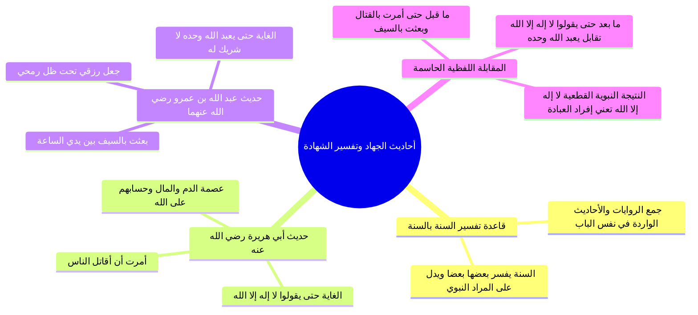

# دلالة أحاديث الجهاد الصريحة وتفسير النبي لمعنى لا إله إلا الله

> [!abstract] بطاقة الجزء
> - **المحاضرة:** 16 من مادة العقيدة (المستوى الأول - أكاديمية زاد).
> - **المدى بالتفريغ:** من السطر 164 إلى السطر 179.
> - **المحاور المركزية:** قاعدة تفسير الحديث بالحديث، المقابلة الدلالية واللفظية بين حديث أبي هريرة «أمرت أن أقاتل الناس حتى يقولوا لا إله إلا الله» وحديث عبد الله بن عمرو «بعثت بالسيف حتى يعبد الله وحده»، وإثبات أن غاية الجهاد والبعثة هي تحقيق العبادة لا مجرد الإقرار بالربوبية.

---

## 🧭 خريطة المفاهيم الذهنية (Mindmap)



---

## 📝 الملخص العلمي المنظم للجزء 08

### 1. منهج تفسير النصوص: تفسير الحديث بالحديث
- بيّن المحاضر أصلاً علمياً رصيناً: كما أن القرآن يُفسَّر بعضه ببعض، فإن **السنة النبوية الصحيحة يفسر بعضها بعضاً**، ولا يجوز لطالب العلم أن يقتطع حديثاً مجملاً فيبني عليه مذهباً دون النظر في سائر الأحاديث والسنن التي تشرحه وتبين مراد النبي ﷺ.

---

### 2. نص الحديثين النبويين موضع المقابلة
عقد المحاضر موازنة دقيقة بين حديثين صحيحين وردا في بيان غاية البعثة النبوية ومشروعية القتال:

| رقم الحديث | راوي الحديث | نص الحديث النبوي الشريف | موضع الشاهد الدلالي |
|:---:|:---|:---|:---|
| **الحديث الأول** | أبو هريرة رضي الله عنه (متفق عليه) | <span style="color:#D97706; font-weight:bold;">«أُمِرْتُ أن أُقاتلَ الناسَ حتى يقولوا: لا إله إلا الله، فإذا قالوها عصموا مني دماءهم وأموالهم إلا بحقها، وحسابهم على الله»</span>. | حدد الغاية بلفظ: <span style="color:#0D9488; font-weight:bold;">«حتى يقولوا لا إله إلا الله»</span>. |
| **الحديث الثاني** | عبد الله بن عمرو بن العاص رضي الله عنهما (رواه أحمد وصححه الأئمة) | <span style="color:#D97706; font-weight:bold;">«بُعِثْتُ بالسيفِ بين يديِ الساعةِ حتى يُعْبَدَ اللهُ وحده لا شريكَ له، وجُعِلَ رِزْقي تحتَ ظلِّ رُمْحي، وجُعِلَ الذِّلَّةُ والصَّغارُ على مَن خالفَ أمري، ومَن تشبَّهَ بقومٍ فهو منهم»</span>. | حدد الغاية بلفظ: <span style="color:#0D9488; font-weight:bold;">«حتى يُعْبَدَ اللهُ وحده لا شريكَ له»</span>. |

---

### 3. المقابلة الرياضية واللفظية بين النصين
حلل المحاضر التركيب البلاغي للجملتين النبويتين:

```
    [أمرت أن أقاتل الناس]           حتى       [يقولوا: لا إله إلا الله]
              ▲                      │                    ▲
              │ (تطابق الفعل والغاية) │                    │ (تفسير قطعي ومطابقة تامة)
              ▼                      │                    ▼
    [بعثت بالسيف بين يدي الساعة]     حتى       [يُعْبَدَ اللهُ وحده لا شريكَ له]
```

1. **ما قبل «حتى»:**
   - قوله: «أمرت أن أقاتل الناس» هو عين قوله: «بعثت بالسيف بين يدي الساعة». فالوسيلة والتشريع واحد وهو الجهاد بالسيف.
2. **ما بعد «حتى»:**
   - قوله: «حتى يقولوا لا إله إلا الله» يقابله نصاً قوله: «حتى يُعبد الله وحده لا شريك له».
   - إذن: **تفسير «لا إله إلا الله» على لسان رسول الله ﷺ هو: «أن يُعبد الله وحده لا شريك له»**.

---

### 4. الإلزام العقدي في مشروعية الجهاد وعصمة الدماء
- لو كان معنى «لا إله إلا الله» هو مجرد الإقرار بأن الله هو الخالق المالك الرازق المدبر:
  - لما شُرِعَ للنبي ﷺ أن يقاتل مشركي العرب وأهل مكة؛ لأنهم كانوا يقرون بذلك أجمعون بنص القرآن الكريم!
  - ولما كان للجهاد معنى؛ إذ كيف يقاتل قوماً ليقروا بما هم مقرون به ومعترفون به أصلاً في أنديتهم وشعرهم؟!
- فثبت قطعاً أن الجهاد شُرع لإلزام الناس بإفراد العبادة لله، وترك عبادة الأنداد والأولياء والقبور والأشجار والأحجار، وأن هذا هو المعنى الحصري للشهادة الذي تعصم به الدماء والأموال.

---

## 🗣️ نص المتحدث الكامل (الأسطر 164–179)

> ان معنى لا اله الا الله
> التي فهمها ابو جهل وعبد الله بن اميه وفهمها مشركو مكه وهي التي جاء بها رسولنا صلى الله عليه وسلم ان معنى لا اله الا الله لا معبود يستحق العباده الا الله
> وليس معناه لا خالق لا مالك الارز ولا يدبر الا الله وان كان هذا الامر تضمن فيها لكن الذين قالوا لا الاه الا الله معناه لا خالق ولا رازق لا مدبر الا الله اكتفوا بذلك نقول لك ان هذا الامر لو كان هذا الامر كافيا لك في مشركي مكه
> ولما حدثت العداوه والخصام بين النبي صلى الله عليه وسلم
> وبين قومهم تعالوا ايضا ناخذ هذا الحديث
> وهذا حديث عجيب يروي هنا ابو هريره رضي الله تعالى عنه قال قال رسول الله صلى الله عليه وسلم
> وتاملوا مع هذا الحديث قال صلى الله عليه وسلم امرت ان اقاتل الناس حتى يقولوا لا اله الا الله فاذا قالوها عصموا مني دماءهم واموالهم الا بحقها وحسابهم على الله عز وجل ان لا اله الا الله في الحديث حتى يقولوا لا اله الا الله
> طيب اريد معنى هذه الايه الا الله في هذا الحديث ناخذ حديث اخر يرويه الصحابي اخر وهو عبد الله بن عمرو قال قال رسول الله صلى الله عليه وسلم بعثت بالسيف بين يدي الساعه حتى يعبد الله وحده لا شريك له وجعل رزقي تحت ظل رمحي وجعل الذله والصغار على من خالف امري ومن تشبه بقوم فهو منهم فعلوا ناخذ الشاهد هنا قال امرت ان اقاتل الناس حتى
> هناك قال بعد بين ايدي الساعه بعثت بين يدي الساعه بالسيف حتى حتى نفس المعنى مع هذه امرت ان اقاتل الناس حتى بعثت بين يدي الساعه بالسيف حتى حتى ما قبل حتى مسحوها وهنا ما قبل حتى بسحبها هنا يقول لا اله الا الله
> هنا قال يعبد الله وحده لا شريك له
> فما معنى لا اله الا الله
> الحديث الثاني مفسر لا هنا في الحديث الاول قال لا اله في الحديث الثانيه من معنى لا اله الا الله
> يعبد الله وحده لا شريك له معنى لا اله الا الله
> التي بعث بها النبي صلى الله عليه وسلم وقاتل الناس من اجل ان يقولوها
> وشرع له صلى الله عليه وسلم الجهاد حتى يتحقق تتحقق لا اله الا الله في الارض معناها يعبد الله وحده لا شريك له وليس حتى يقر بان الله هو الخالق المالكي الرازق المدبر وحده لا شريك له
> فهذا امر في غايه الاهميه

---

## 🔗 روابط التنقل
- السابق: [[07 - فاصل خلق الحلم وضبط النفس وآثاره الإيمانية والاجتماعية]]
- التالي: [[09 - الحكم الفاصل في دعاء المقبورين والتدرج الشيطاني في الغلو وتفنيد الشبهات]]
