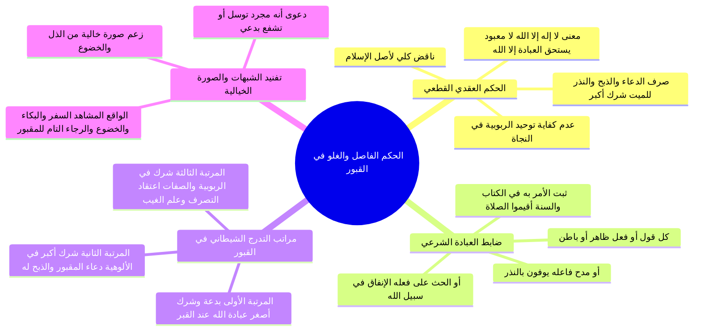

# الحكم الفاصل في دعاء المقبورين والتدرج الشيطاني في الغلو وتفنيد الشبهات

> [!abstract] بطاقة الجزء
> - **المحاضرة:** 16 من مادة العقيدة (المستوى الأول - أكاديمية زاد).
> - **المدى بالتفريغ:** من السطر 180 إلى السطر 208.
> - **المحاور المركزية:** الحكم العقدي الفاصل في ضوء أدلة الوحيين، حكم صرف الدعاء والذبح والنذر للموتى وأنه شرك أكبر مخرج من الملة، الضابط الشرعي الدقيق للعبادة، كشف خطوات التدرج الشيطاني من البدعة إلى الشرك الأكبر إلى شرك الربوبية والصفات، وتفنيد الصورة الخيالية المزعومة في دعاء القبور.

---

## 🧭 خريطة المفاهيم الذهنية (Mindmap)



---

## 📝 الملخص العلمي المنظم للجزء 09

### 1. الحكم العقدي الفاصل بين الطائفتين
- بعد استقراء دلالات لسان العرب ونصوص القرآن الكريم وسيرة الأنبياء وسنة المصطفى ﷺ، أعلن المحاضر الحكم الشرعي الحاسم الذي لا مرية فيه:
  - <span style="color:#0D9488; font-weight:bold;">«معنى لا إله إلا الله هو: لا معبود يستحق العبادة إلا الله جل جلاله»</span>.
- **تطبيق الحكم على واقع دعاء الموتى والمقبورين:**
  - من جاء إلى ميت في قبره (ولياً كان أو نبياً أو صالحاً) وهو **لا يعتقد** فيه أنه خالق ولا رازق ولا مالك ولا مدبر، بل يعتقد جازماً أن الله وحده هو الخالق الرازق، لكنه:
    - **دعاه، أو استعاذ به، أو استغاث به، أو ذبح له، أو نذر له، أو سجد لعتبته:**
  - **الحكم الصريح:** <span style="color:#E11D48; font-weight:bold;">«هذا شرك أكبر مخرج من ملة الإسلام بالكلية، وهو ناقض لأصل لا إله إلا الله»</span>.
- **السبب والعلة العقدية:**
  - هذا الإنسان بقي محبوساً في **الدائرة الصغرى** (توحيد الربوبية)، ولم ينتقل إلى دائرة الأسماء والصفات، ولم يدخل في **الدائرة الكبرى** (توحيد الألوهية)؛ وتوحيد الربوبية وحده لم يدخل مشركي مكة في الإسلام، ولا ينجي صاحبه من الخلود في النار في الآخرة.

---

### 2. الضابط الشرعي المحكم للعبادة
وضع المحاضر معياراً دقيقاً مستمداً من نصوص الكتاب والسنة لتمييز ما هو عبادة عما ليس بعبادة:

> [!important] تعريف وضابط العبادة
> **«العبادة هي: كل قول أو فعل، ظاهر أو باطن، ثبت في الكتاب والسنة أن الله أمر به، أو حث على فعله، أو مدح فاعله»**.

| معيار الدليل الشرعي | الشاهد القرآني | التكييف العقدي |
|:---|:---|:---|
| **الأمر الجازم به** | <span style="color:#D97706; font-weight:bold;">﴿وَأَقِيمُوا الصَّلَاةَ وَآتُوا الزَّكَاةَ﴾</span> | إقامة الصلاة عبادة محضة لا تصرف إلا لله. |
| **الحث والترغيب فيه** | <span style="color:#D97706; font-weight:bold;">﴿مَّثَلُ الَّذِينَ يُنفِقُونَ أَمْوَالَهُمْ فِي سَبِيلِ اللَّهِ كَمَثَلِ حَبَّةٍ أَنبَتَتْ سَبْعَ سَنَابِلَ﴾</span> | الإنفاق والصدقة عبادة وقربة لله. |
| **الثناء والمدح لفاعله** | <span style="color:#D97706; font-weight:bold;">﴿يُوفُونَ بِالنَّذْرِ وَيَخَافُونَ يَوْمًا كَانَ شَرُّهُ مُسْتَطِيرًا﴾</span> | النذر عبادة وقربة، وصرفه لمقبور شرك وتنديد. |

- **القاعدة الذهبية:** التوجه بهذه الأقوال والأفعال لله وحده هو **التوحيد**، وتوجيهها أو شيء منها لميت أو مقبور أو غائب هو **الشرك والتنديد الأكبر**.

---

### 3. مراتب التدرج الشيطاني في الغلو بالقبور
كشف المحاضر عن المخطط الإبليسي التاريخي للتدرج بالمسلمين من السنة إلى البدعة، ثم إلى الشرك الأكبر، ثم إلى الإلحاد في الربوبية:

```
    [المرتبة 1: البدعة والشرك الأصغر]
    عبادة الله وحده والصلاة له عند القبور ظناً أنها بقعة مباركة
                  │
                  ▼
    [المرتبة 2: الشرك الأكبر في الألوهية]
    دعاء المقبور نفسه والذبح والنذر والاستغاثة به كواسطة وشفيع
                  │
                  ▼
    [المرتبة 3: الشرك في الربوبية والصفات]
    اعتقاد تصرف الأولياء في الكون، وادعاء علمهم للغيب، وخلق الأجنة
```

1. **المرتبة الأولى (البدعة والشرك الأصغر):** قصد القبر لعبادة الله عنده (يصلي لله ويدعو الله عند القبر) ظناً أن الدعاء هناك مستجاب؛ هذا محرم، وبدعة منكرة، وشرك أصغر، وسد الشارع ذريعته بلعن من اتخذ القبور مساجد؛ لأنه الجسر الحتمي المفضي للشرك الأكبر.
2. **المرتبة الثانية (الشرك الأكبر في الألوهية):** التوجه بالدعاء والطلب والذبح والنذر للمقبور مباشرة لقضاء الحوائج وكشف الكربات.
3. **المرتبة الثالثة (الغلو في الربوبية والصفات):** تطور الغلو عند غلاة المتصوفة والرافضة إلى اعتقاد أن الموتى يتصرفون في ملكوت السماوات والأرض بإذن مفوض، وأنهم يعلمون الغيب، بل زعم غلاتهم أن النبي ﷺ أو الولي قادر على خلق النطفة بشراً في الأرحام!

---

### 4. تفنيد الشبهات ونقض الصورة الخيالية المزعومة
- **الشبهة الأولى (دعوى أنه مجرد توسل بدعي):**
  - زعم بعض الملبسين أن دعاء الموتى ليس شركاً بل هو توسل بدعي!
  - **الرد:** هذا تلبيس باطل؛ لأن التوسل البدعي هو التوسل بذات المخلوق أو جاهه عند دعاء الله («اللهم إني أسألك بجاه فلان»)، أما دعاء الميت والاستغاثة به ونداؤه مباشرة («يا فلان انصرني واشفني») فهو عبادة صريحة للمخلوق وشرك أكبر بإجماع أهل العلم.
- **الشبهة الثانية (افتراض صورة باردة خالية من العبادة):**
  - يصور بعض المدافعين صورة خيالية لا واقع لها: يقولون: يذهب الرجل للميت فيقول له مجرد «ادع الله لي» كما يطلب من الحي دون ذبح ولا خضوع!
  - **الرد المفحم:** هذه صورة وهمية غير موجودة؛ فالواقع المشاهد أن من يسافر مئات الأميال إلى الأضرحة والقبور يأتي وهو يرتجف خيفةً، ويبكي تذللاً، ويخشع خضوعاً، ويقدم النذور والأموال، ويذبح الذبائح، ويتعلق قلبه بالمقبور رجاءً وخوفاً؛ وهذا هو عين التأله والعبادة التي كان يقدمها مشركو قريش للأصنام والأولياء كود وسواع واللات والعزى!

---

## 🗣️ نص المتحدث الكامل (الأسطر 180–208)

> اذا تبين لنا ايها الاحبه في الله من خلال اللغه ومن خلال القران والسنه وهذا الاهم عندنا القران والسنه دلالتهما واضحه على ان معنى لا اله الا الله
> هو لا معبود يستحق العباده الا الله جل جلاله
> اذا كيف نحكم الان بين الطائفتين نحكم بين الطائفتين ان معنى لا اله الا الله لا معبود يستحق العباده الا الله
> فمن اتى الى ميت في قبره وهو لا يعتقد فيه انه خالق مالك راس مدبر انما جاء اليه فدعاه استعاده ب استغاثه ننظر له او صرف شيء من هذه الامور اليه هذا بشكل عام المطلق نتحدث عن نطلق هذا صرف نوعا من انواع العباده
> غير الله
> هذا شرك اكبر مخرج من مله الاسلام هذا شرك مناطق لا اله الا الله
> هذا شرك مناقضه لا اله الا الله
> هذا الانسان عنده الدائره الصغرى توحيد الربوبيه لكنه اكتفى بها ولم يات يخرج منها لدائره التوحيد الصفات لم يخرج منها الى دائره التوحيد الاولى يحقق الاسلام لا تكفي لا يكفيه توحيد الربوبيه في السعاده والنجاه في الدنيا وفي الاخره
> وهذا الانسان للاسف الشديد ان كان قد فهم معنى لا اله الا الله
> وانه يتوجه بالعباده لله وحده لا شريك له وان محمدا رسول الله فيتوجه بالعباده التي شرعها الله وارسل الله بها رسوله محمد صلى الله عليه وسلم فيتو جواب العباده له وحده لا شريك له ان كان قد فهم هذا المعنى ودخل في الاسلام بيقين فان هذا الانسان قد وقع في الشرك الاكبر وقع في ناقض من نواقض لا اله الا الله
> ناقض من نواقض الاسلام في ناقض من نواقض الايمان يجب عليه ان يعرف هذا ويجب على الناس ان يبلغوا جميع المسلمين بان هذا التوجه بالدعاء بالذبح والنذر بالاستعاذه بالاستغاثه لهؤلاء المقبولين هذا ناقض من نواقض لا اله الله بل هو اعظم ما ينقض لا اله الا الله اعظم ما ينقض الاسلام اعظم ما ينقض الايمان هو صرف نوع من انواع العباده لغير الله وهذا واضح جدا تستغرب ان هناك من يلبس على طائفه كبيره من المسلمين ويمين لهم ان هذا التوسل والتشفع او هذا على اقصى ال الاحوال ان يكون بدعه لا هذا ليس البدا هذا ليس ببدعه يعني بمعنى بدقه
> هذا هذا هذا خروج عن
> التي الاسلام لا ياتي شخص
> ويحاول ان يلبس على الناس في معنى العباده في معنى الشرك بمعنى التوحيد هذه القضايا بالنسبه لنا واضحه
> والان القران راجعنا كما ذكرنا سويا وضوح دعوه الانبياء انهم يدعون الى انه لا معبود يستحق العباده الا الله وان هذا من لالها العباده ما معناها كل قول او فعل ظاهر او باطن ثبت في الكتاب والسنه ان الله امر به او حث على فعله او مدحا فاعله امر به قال لا قيم الصلاه او حث على فعله قالوا انفقوا مثلا مثل الذين ينفقون اموالهم في سبيل الله كمثل حبه الانباء السبعه او مدح فاعله يوفون بالنذر كل قول او فعل ثبت في الكتاب والسنه الامر به والحث على فعلهم عليه التوجه به لله وحده لا شريك له
> هذا هو التوحيد التوجه به الى الموت التوجه الى غير الله يصرف اليهم ادعاء الذبح النذر تصرف عليهم هذه العبادات هذا هو الشرق والتنديد
> يجب ان يعرف هذا حتى لو كان هذا الشخص عنده توحيد الربوبيه وهذا ما يتعلق بدرس حتى لو كان هذا الشخص يعني كما يزعم هو انه قام في نفسه نقول انت لم تات بلا اله الا الله
> كما وردت في الكتاب والسنه وكما طلبها الله سبحانه وتعالى من ان هناك قضيه اخرى يا اخوان ان بعض الناس الذين نقول نحن عندنا توحيد الربوبيه وهو لا اله الا الله عندهم وسيصل بهم الامر بعد فتره وهم يتوجهون لهؤلاء المقبولين بالذبح والنذر الدعاء والاستعاذه والاستغاثه يصل بهم الامر كما وصل بغيرهم ان يعتقدون ان اولئك لهم شرك في الملك شرك في التربيه
> ويقولون هذا الله واعطاهم ذلك الله جعلهم يملكون الله جعلهم يدبرون الله جعلهم يشرعون كما حدث ذلك عند غلاه الصوفيه كما حدث ذلك عن دول اه الرافضه حدث هذا الامر
> فايضا يعني اعتقد فيهم الربو بين بل يعني يا اخوان سيصل الامر عند هؤلاء القوم وهم يتوجهون في بدايه الامر بمثل هذه الامور الى هؤلاء ان يصلوا بهم ان يجعلهم ان يجعل وهم شركاء لله سبحانه وتعالى في صفاته كذلك من علم الغيب بل قال بعضهم يعني انه شريك في اعظم من صفه من صفات الله سبحانه وتعالى وصفه الخلق وان رسولنا صلى الله عليه وسلم قادر على ان يخلق النطفه بشرا اذا ما هذا الضلال يا اخوان الموضوع يعني متدرج بعض الناس يقول نحن نذهب الى القبور ون عبد الله سبحانه وتعالى عندها مخلصين نقول هذا شرك اصغر
> هذه هي البدع هذا محرم السبب انه سيجري في مستقبل الامور ان لم تصل الى ذلك كما وصل بغيركم
> انت توجهوا بالدعاء والذبح والصلاه لهؤلاء المقبلين وهذه المصيبه ننتبه الى مثل هذه الاشياء بعض الناس يصور صوره ثانيه وهي غير موجوده البته ويحاول ان يثير الخلاف فيها وهو وهي ان ياتي انسان الميت
> ويقول له يا سيدي فلان عند على الله عليه ما يمكن هذه حاله خياليه هذه حاله خيانيه ان وجدت مثل هذه الحاله نقول هذا الامر بدعه من شرك الاسباب
> وهذا الامر غير جاز لكنها صوره خاليه لا يحاول احد ان يبين ان هذا هو الواقع هذه صوره خاليه متخيله لا يمكن ان ياتي شخص ياتي بمسافه يسافر الى هذا القبر ثم ياتي له فقط هكذا من غير ذبح ولا ننكر على استعاده والاستغاثه ولازم ولا خضوع والخوف والرجاء لا يمكن ان يكون هذا ياتي الى يقول انا ادعو الله
> كما تقول
> الله لا يمكن ذلك لا بد ان يظهر لهذا المقبور
> يعني حاجته يظهر له ويبكي ويخضع واذن ويكون معظمهم فيصرف له شيء من العباده ان ننتبه الى هذه القضايا
> نكتفي في هذه الحلقه بهذا القدر ونسال الله سبحانه وتعالى ان يوفقنا للقاء اخر نستكمل فيه ما بقى وصلى الله وسلم وبارك على محمد
> ام

---

## 🔗 روابط التنقل
- السابق: [[08 - دلالة أحاديث الجهاد الصريحة وتفسير النبي لمعنى لا إله إلا الله]]
- التالي: [[10 - خطة تطبيق الدروس]]
