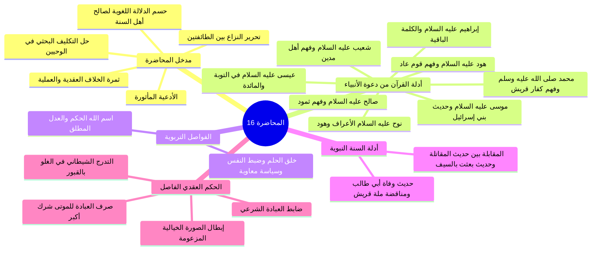
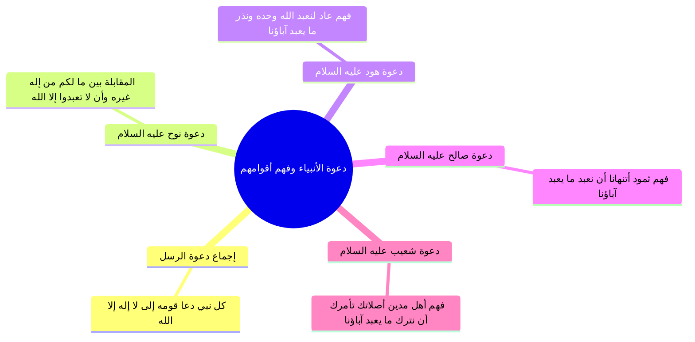
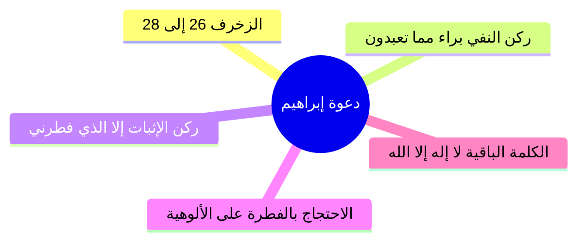
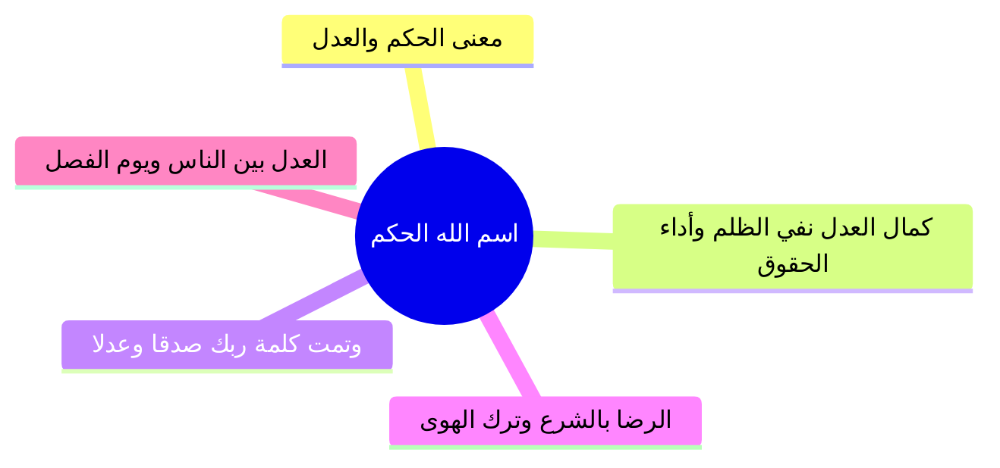
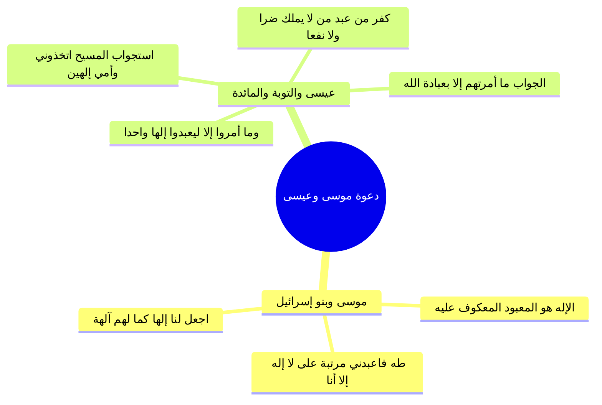
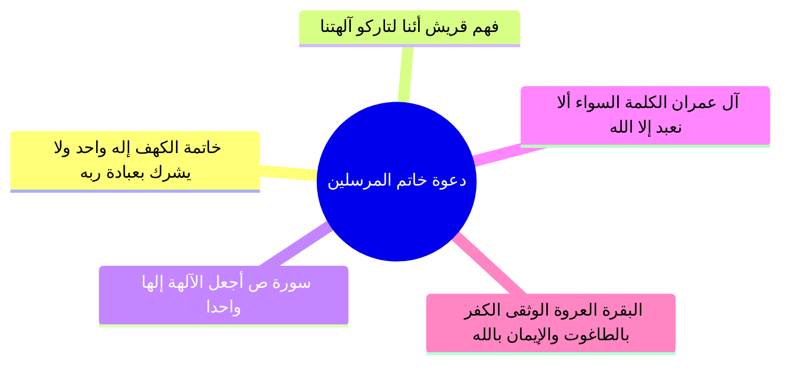
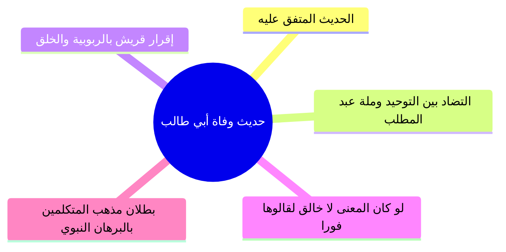
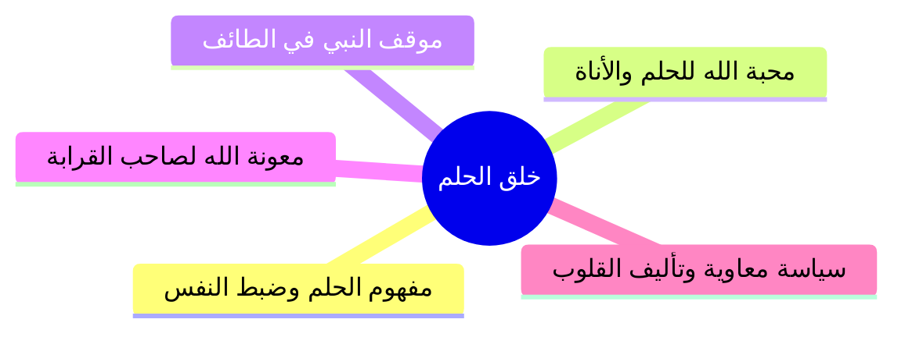
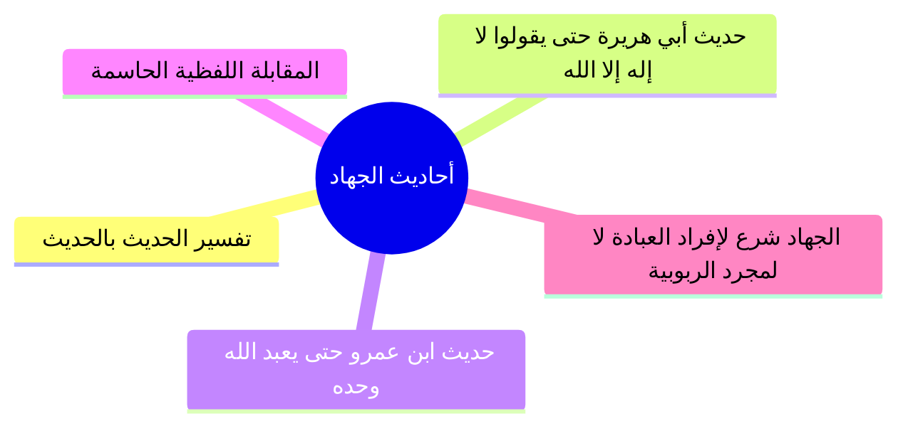
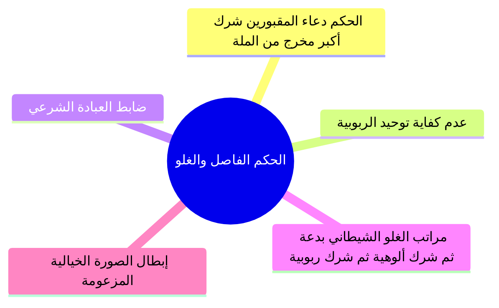

# المحاضرة 16: الأدلة الشرعية على معنى لا إله إلا الله وحكم دعاء المقبورين (ملف مجمع شامل)

> [!info] توصيف الملف المجمع
> يضم هذا الملف المجمع المحتوى العلمي الكامل والمنظم للمحاضرة السادسة عشرة من مادة العقيدة (برنامج زاد المستوى الأول)، شاملاً الجداول، والرسومات البيانية والمقارنات، وتفكيك الأدلة القرآنية والحديثية، والمناقشات العقدية واللغوية، ونصوص المتحدث الكاملة حرفياً دون اجتزاء أو حذف، مرتبة بالتتابع المنهجي لجميع أجزاء المحاضرة من الجزء 00 حتى الجزء 09.

---

## 📑 فهرس موضوعات الملف المجمع

1. [[#الجزء 00: مقدمة وخطة الأجزاء وعناصر المحاضرة]]
2. [[#الجزء 01: دعوة نوح وهود وصالح وشعيب وفهم أقوامهم لمعنى لا إله إلا الله]]
3. [[#الجزء 02: دعوة إبراهيم والكلمة الباقية في عقبه]]
4. [[#الجزء 03: فاصل اسم الله الحكم والعدل الإلهي في التشريع والجزاء]]
5. [[#الجزء 04: دعوة موسى وعيسى عليهما السلام ونصوص القرآن في كفر من اتخذهما آلهة]]
6. [[#الجزء 05: دعوة خاتم المرسلين ونصوص القرآن المحكمة وفهم مشركي قريش]]
7. [[#الجزء 06: حديث وفاة أبي طالب ومناقضة لا إله إلا الله لملة عبد المطلب]]
8. [[#الجزء 07: فاصل خلق الحلم وضبط النفس وآثاره الإيمانية والاجتماعية]]
9. [[#الجزء 08: دلالة أحاديث الجهاد الصريحة وتفسير النبي لمعنى لا إله إلا الله]]
10. [[#الجزء 09: الحكم الفاصل في دعاء المقبورين والتدرج الشيطاني في الغلو وتفنيد الشبهات]]

---

## الجزء 00: مقدمة وخطة الأجزاء وعناصر المحاضرة

### 📝 الملخص العلمي المنظم

#### 1. الافتتاح والأدعية المأثورة
- افتتح المحاضر بالحمد لله والصلاة والسلام على رسول الله محمد ﷺ، والدعاء المأثور:
  ا - «اللهم إنا نسألك علماً نافعاً، وعملاً صالحاً، وقلباً خاشعاً، ولساناً ذاكراً».
  ا - «اللهم علمنا ما ينفعنا، وانفعنا بما علمتنا، واجعله حجة لنا ولا تجعله حجة علينا يا رب العالمين».

#### 2. متابعة التكليف العلمي وتحرير محل النزاع العقدي
- تابع المحاضر الواجب الذي كلف به الطلاب في ختام المحاضرة السابقة: وهو البحث والاستقراء في نصوص القرآن الكريم والسنة النبوية عن المعنى الحقيقي لكلمة التوحيد: «لا إله إلا الله».
- بيّن المحاضر أن هذا البحث يأتي لحل مشكلة عقدية كبرى وخطيرة بين طائفتين عظيمتين من المنتسبين للإسلام:
  1. **الطائفة الأولى (المتكلمون ومن وافقهم):** زعموا أن معنى لا إله إلا الله هو: «لا خالق إلا الله» أو «لا قادر على الاختراع إلا الله» أو «لا رازق ولا مدبر إلا الله»؛ وبنوا ذلك على دعوى لغوية باطلة بأن «إله» في العربية مشتق من فِعال بمعنى فاعل.
  2. **الطائفة الثانية (أهل السنة والجماعة وأئمة السلف):** قرروا أن معنى لا إله إلا الله هو: «لا معبود بحق إلا الله»؛ لأن «إله» في لسان العرب صيغة فِعال بمعنى مفعول (أي مألوه معبود).

#### 3. ثمرة الخلاف العقدية والعملية
- أوضح المحاضر أن هذا الخلاف ليس ترفاً كلامياً، بل تنبني عليه أحكام الدين العظمى وتحديد حقيقة الإيمان والشرك:
  - **موقف الطائفة الأولى:** لما حصروا معنى الشهادة في نفي الخالقية والرازقية والتدبير عن غير الله، رأوا أن التوجه إلى القبور والأولياء والموتى بالدعاء والذبح والنذر والاستغاثة لا ينقض التوحيد ما دام الفاعل يعتقد أن الله هو الخالق الرازق وحده، واعتبروا ذلك مجرد توسل أو تشفع أو بدعة، ورموا أهل السنة المكفرين لهذا الشرك بأنهم خوارج وتكفيريون يستحلون دماء المسلمين!
  - **موقف أهل السنة والجماعة:** يقررون أن صرف أي نوع من أنواع العبادة المحضة (كالدعاء والذبح والنذر والاستغاثة) للموتى والغائبين هو شرك أكبر مخرج من ملة الإسلام، ومناقض مناقضة تامة لأصل شهادة «لا إله إلا الله»، وأن شرك هؤلاء المقبورين أغلظ من شرك الجاهلية الأولى لأن مشركي مكة أشركوا في الرخاء وأخلصوا في الشدة، بينما هؤلاء يشركون في الرخاء والشدة معاً.

#### 4. حسم الجانب اللغوي والانتقال إلى التحكيم الشرعي
- أكد المحاضر أن التحكيم اللغوي تم حسمه في المحاضرة السابقة بالرجوع لأئمة المعاجم واللغة (كابن فارس والجوهري)، وتبيّن إجماع علماء اللغة على أن «أَلَهَ» أصلها التعبد والتأله، وأن «الإله» هو المعبود والمألوه. وبناءً على ذلك، تعين الانتقال إلى الأصلين المعصومين: **الكتاب والسنة**؛ لاستقراء دعوة الأنبياء والمرسلين جميعاً.

### 🧭 خريطة المفاهيم الذهنية (Mindmap)

### 🗣️ نص المتحدث الكامل (الأسطر 1–16)
> ويتقدم تقنياته ومجالات طوروا ادواتنا في تقديم العلم الشرعي علمك الاساس في الاسلام
> السلام عليكم ورحمه الله وبركاته
> الحمد لله رب العالمين والصلاه والسلام على اشرف المرسلين محمد وعلى اله وصحبه اجمعين اللهم انا نسالك علما نافعا وعملا صالحا و قلبا خاشعا ولسانا ذاكرا اللهم علمنا ما ينفعنا وانفعنا بما علمتنا و اجعله حجه لنا ولا تجعله حجه علينا يا رب العالمين
> ايها الاحبه في الامن ارحب بكم في ماده العقيده في اكاديميه زاد و اسال الله سبحانه و تعالى ان تكونوا حال تم الواجب الذي كلفت كم به هو ان تبحثوا في القران والسنه على معنى لا اله الا الله
> لنحل هذه المشكله الكبرى بين الطائفتين عظيمتين من المسلمين طائفه تقول معنى لا اله الا الله و لا خالق الا الله
> وطائفه تقول معنى لا اله الا الله
> ولا معبود بحق الا الله
> استدلت الطائفه الاولى لا خالق الا الله
> كما يقولون باللغه وان اله في اللغه العربيه فعال
> بمعنى فاعل اي خالق رازق مالك مدبر وهؤلاء قالوا لا اله في اللغه العربيه
> بمعنى فعال بمعنى مالوه بمعنى مفعول اي مالوه فلا معبود يستحق العباده الى الله ذكرنا في الحلقه الماضيه ان الخلاف له ثمره عظيمه وينبني عليه كل يعني اه اشياء يعني الطائفه الاولى التي تقول لا خالق الا الله تتهم الطائفه الثانيه بانهم خوارج وانهم اه تكفيريين وان هم يكفرون المسلمين بغير حق وهذه الطائفه الثانيه تتهم الطائفه الاولى اه اذا اذا صرفوا نوع من انواع العباده لهؤلاء المقبولين الموتى
> وهم لا يعتقد انه انه خالق مع الكرازه مدبر يقول هذا شرك اكبر مخرج من المله
> وهؤلاء قبوريه
> الضمير للقبور هؤلاء مشركون بافعال هذه واشركهم اعظم من شركه السابقين
> وهكذا اذن عندنا اشكاليه كبرى قلنا مرجع هذا الخلاف ان نرجع الكتاب والسنه في المرمى يتكلم عن اللغه وقلنا ان علماء اللغه كانوا مع الفريق الثاني فلا يوجد عالم من علماء اللغه يقول اله بمعنى انه ما في احد من علماء اللغه يقول هذا امر ثاني قالوا لو قلنا ال اه بمعنى انه صار عابد لانه الله يعني متالف متعلق اذا يقولون لا اصبح العكس ان اصبح الخالق هو المتعلق بمخلوقاته فمن ناحيه اللغه خرجنا انه لا يسند اصحاب القول الاول
> ووصلنا اننا سنبحث في يعني الكتاب والسنه على هذا المعاني

---

## الجزء 01: دعوة نوح وهود وصالح وشعيب وفهم أقوامهم لمعنى لا إله إلا الله

### 📝 الملخص العلمي المنظم

#### 1. إجماع دعوة الأنبياء والمرسلين والمنهج الاستدلالي
- قرر المحاضر أن كل نبي دعا قومه أول ما دعاهم إلى كلمة: «لا إله إلا الله»، مستدلاً بصريح القرآن دون الحاجة للتأويلات المذهبية.

#### 2. دعوة نوح عليه السلام والمقابلة اللفظية
- في سورة الأعراف (59): ﴿اعْبُدُوا اللَّهَ مَا لَكُم مِّنْ إِلَٰهٍ غَيْرُهُ﴾.
- في سورة هود (25-26): ﴿أَن لَّا تَعْبُدُوا إِلَّا اللَّهَ﴾.
- **البرهان:** جملة ﴿أَن لَّا تَعْبُدُوا إِلَّا اللَّهَ﴾ تطابق وتفسر تماماً ﴿مَا لَكُم مِّنْ إِلَٰهٍ غَيْرُهُ﴾، فالإله هو المعبود بحق.

#### 3. فهم أقوام الأنبياء (عاد، ثمود، مدين)
- **قوم عاد (الأعراف: 70):** لما قال لهم هود «ما لكم من إله غيره»، أجابوا: ﴿أَجِئْتَنَا لِنَعْبُدَ اللَّهَ وَحْدَهُ وَنَذَرَ مَا كَانَ يَعْبُدُ آبَاؤُنَا﴾، ففهموا خلع معبودات الآباء وإفراد العبادة لله وحده.
- **قوم ثمود (هود: 62):** قالوا لصالح: ﴿أَتَنْهَانَا أَن نَّعْبُدَ مَا يَعْبُدُ آبَاؤُنَا﴾، وفي النمل: ﴿أَنِ اعْبُدُوا اللَّهَ فَإِذَا هُمْ فَرِيقَانِ يَخْتَصِمُونَ﴾.
- **قوم مدين (هود: 87):** قالوا لشعيب: ﴿أَصَلَاتُكَ تَأْمُرُكَ أَن نَّتْرُكَ مَا يَعْبُدُ آبَاؤُنَا أَوْ أَن نَّفْعَلَ فِي أَمْوَالِنَا مَا نَشَاءُ﴾.

### 🧭 خريطة المفاهيم الذهنية (Mindmap)

### 🗣️ نص المتحدث الكامل (الأسطر 17–65)
> تعالوا يا اخوان اذا اردنا نبحث في الكتاب والسنه نبحث عن ناتي الى الانبياء والرسل الذين دعوا اقوامهم الى لا اله الا الله وهذا امر متفق عليه لا يوجد النبي ولا رسول ال او دعا قومه الى لا اله الا الله
> يا اخوان يعني ننظر الى دعوه الانبياء والرسل
> نبدا بنوح عليه السلام
> ماذا قال نوح عليه السلام لقومه قال الله عز وجل
> لقد ارسلنا نوحا انا اريد منكم ان تتاملوا الايات لان لنذكر اقال المفسرين قد يقول هذا الشخص هؤلاء حنابله قد يكون يقول الشخص لهؤلاء يعني صوفيه ناتي من خلال الايه الواضحه قال الله عز وجل
> لقد ارسلنا نوحا الى قومه فقال يا قوم اعبدوا الله ما لكم من اله غيره اني اخاف عليكم عذاب يوم عظيم يا قوم هذا نوح واللقاء يا قوم اعبدوا الله
> ما لكم من اله غيره اني اخاف عليكم عذاب يوم عظيم
> اي لا اله الا الله في هذه الايه نريد لا اله الا الله في الايه و معناها من خلال الايه قال ما لكم من الى هاشم انها لا اله غيره الضمير عندما على الله مالكم من اله لا اله الا الله
> اذن لا اله الا الله في هذه الايه ما لكم من اله غيره ما معناها من خلال الايه ا عبد الله يا قوم اعبدوا الله السبب لانه لا معبود يستحق العباده الا الله ما لكم من اله غيره
> فمعنى هنا اله معبود ا عبد الله لانه لا معبود يستحق العباده الا الله اني اخاف عليكم عذاب يوم عظيم
> قد يقول شخص يعني ما هي واضحه جدا ناخذ ايه اخرى تتعلق بمنح قال الله سبحانه وتعالى ولقد ارسلنا نوحا الى قومه اني لكم نذير مبين ان لا تعبدوا الا الله اني اخاف عليكم عذاب يوم اليم هنا لقد ولقد ولقد ارسلنا نوحا الى قومه
> ولقد ارسلنا نوحا الى قومه اني لكم نذير الا تعبدوا الا الله هنا قال يا قوم اعبدوا الله ما لكم من اله غيره هنا ما تفسير ما لكم من اله غيره الا تعبدوا ان الله جمعنا بين الايتين اعبدوا الله ما لكم من اله غيره في هذه الايه الايه الثانيه قال لهم هي نفس الايه ونفس المعنى
> ولقد ارسلنا نوحا الى قومه اني لكم نذير الا تعبدوا الا الله هنا قال يا قوم اعبدوا الله ما لكم من اله غيره
> ونقل الا تعبدوا الا الله
> فما معنى ما
> لكم من اله غيره الا تعبدوا الا الله
> فما معنى لا اله الا الله
> التي دعا اليها نوح عليه السلام معناها الا تعبدوا ان الله لا اله الا الله لا معبود يستحق العباده الا الله
> البراءه من عباده كل المعبودات واثبات العباده لله سبحانه وتعالى
> هذا واضح دعوه يقول قائل اعطينا ادله اخرى ناخذ هود عليه السلام
> طيب ماذا قال قال الله عز وجل والى عاد اخاهم هودا قال ياقوم الله ما لكم من اله غيره افلا تتقون
> مالكم من اله لا اله غيره ان الله معنا عبد الله
> سيقول قائل طيب اعطينا دليل اوضح الدليل الاوضح ماذا فهمت من معنى لا اله الا الله ما لكم من اله غيره هذه لا اله الا الله مالكم من اله لا اله غيره الا الله
> ماذا فهم او موجود عندما قال الامور ما لكم من اله غيره دعاهم الى لا اله الا الله
> قالوا اجئتنا لنعبد الله وحده ونذر ما كان يعبد اباؤنا والله اكبر
> ماذا فهم قوم من لا اله الا الله عندما دعاهم هودي لا اله الا الله
> فهموا ترك عباده كل ما سوى الله والتوجه بالعباده لله وحده اجئتنا لنعبد الله وحده
> اذن لا اله الا الله
> اعبدوا الله وحده وترك عباده كل ما كل المعبودات ترك ما كان يعبده الاباء غير الله سبحانه وتعالى
> ونظر ما كان يعبد اباؤنا قويه واضحه واضحه ما معنى لا اله
> عباده الله وحده لا شريك له
> وترك عباده كلنا سوى الله
> ما معنى الاله المعبود
> لا اله الا الله لا معبود يستحق العباده الا الله
> لا اظن هذه تحتاج الى ان نعود الى كتب التفسير او نحو ذلك
> ناخذ صالح
> ماذا قال صالح عليه السلام الى قومه قال الله عز وجل والى ثمود اخاهم صالحا قال يا قوم اعبدوا الله ما لكم من اله غيره هو انشاكم من الارض واستعمركم فيها فاستغفروه ثم توبوا اليه ان ربي قريب مجيب
> هذا دعوته اعبدوا الله ما لكم من اله غيره
> مالكم من اله لا اله غيره ان الله
> ما معنى من خلال الا عبد الله لانه لا معبود يستحق العباده الا الله
> لكن سيقول قائل اعطينا اوضح ماذا فهم قوم صالح من دعوه صالح لهم الى لا اله الا الله
> قالوا يا صالح قد كنت فينا مرجوا قبل هذا اتنهانا ان نعبد ما يعبد اباؤنا واننا لفي شك مما تدعونا مما تدعونا اليه مريب ماذا فهم قول قوم صالح من دعوه صالح لهم الى لا اله الا الله
> قالوا اتنهانا ان نعبد ما يعبد اباؤنا يعني عبد الله وحده لا شريك له
> و نترك ما يعبد اباؤنا فهموا من معنى لا اله الا الله
> ترك جميع المعبودات التي يعبدها الاباء والتوجه الى عباده الله وحده لا شريك له في ايه ثالثه ايضا ماذا قال الله عز وجل ولقد ارسلنا الى ثمود اخاهم صالحا ما هي دعوته ان يعملوا الله فاذا هم فريقان يختصمون اذا كانت الدعوه الى عباده الله وحده لا شريك له
> وهذا معنى مالكم ناخذ شعيب مثلا
> قال الله سبحانه و تعالى والى مدين اخاهم شعيبا قال يا قوم اعبدوا الله ما لكم من اله غيره نفس المعنى ما لكم من اله غيره لا اله معناها اعبدوا الله وحده لا شريك له
> اذن هذا معنى سيقول اعطينا شيء اوضح ماذا فهم قوم شعيب من دعوه شعيب لهم الى لا اله الا الله
> قالوا يا شعيب اصلاتك تامرك ان نترك اصلاتك تامرك ان نترك ما يعبد اباؤنا او ان نفعل في اموالنا ما نشاء انك لانت الحليم الرشيد فهموا من دعوه شعيب لهم الى لا اله الا الله
> ان يتركوا عباده ما يع مده ابائهم والتوجه بالعباده لله وحده لا شريك له واضحه و لا تحتاج كتب تفسير ولا تحت الشيء من هذا

---

## الجزء 02: دعوة إبراهيم والكلمة الباقية في عقبه

### 📝 الملخص العلمي المنظم
- آيات سورة الزخرف (26-28): ﴿وَإِذْ قَالَ إِبْرَاهِيمُ لِأَبِيهِ وَقَوْمِهِ إِنَّنِي بَرَاءٌ مِّمَّا تَعْبُدُونَ * إِلَّا الَّذِي فَطَرَنِي فَإِنَّهُ سَيَهْدِينِ * وَجَعَلَهَا كَلِمَةً بَاقِيَةً فِي عَقِبِهِ لَعَلَّهُمْ يَرْجِعُونَ﴾.
- **تفكيك ركني كلمة التوحيد:**
  - ﴿إِنَّنِي بَرَاءٌ مِّمَّا تَعْبُدُونَ﴾ = «لا إله» (ركن النفي والبراءة من كل معبود).
  - ﴿إِلَّا الَّذِي فَطَرَنِي﴾ = «إلا الله» (ركن الإثبات وتخصيص الفاطر بالعبادة).
- **الاستدلال بالربوبية على الألوهية:** احتج إبراهيم بانفراد ربه بالخلق والفطرة لإلزامهم بإفراده بالعبادة ونفي الشركاء.
- «الكلمة الباقية» بإجماع المفسرين هي كلمة التوحيد «لا إله إلا الله».

### 🧭 خريطة المفاهيم الذهنية (Mindmap)

### 🗣️ نص المتحدث الكامل (الأسطر 66–70)
> ناتي الى ابراهيم عليه السلم قال الله عز وجل واذ قال ابراهيم لابيه وقومه انني براء مما تعبدون الا الذي فطرني فانه سيهدين وجعلها كلمه باقيه في عقبه لعلهم يرجعون
> ما هي الكلمه التي جعلها ابراهيم عليه السلام باقيه في عقد الكلمه بامان يفسر لا اله الا الله
> اين معناها في خلال ال ايه معناها انني براء مما تعبدون هذا لا لا اله انني براء مما تعبدون الا الذي فطرني ان الله المنفرد بالخلق والملك والرزق والتدبير فهو المستحق للعباده
> اذا ما هي ما معنى الكلمه التي هي لا اله الله من خلال هذه الان معناها المراه من عباده كل المعبودات واثبات استحقاق
> بعده الله وحده لا شريك له

---

## الجزء 03: فاصل اسم الله الحكم والعدل الإلهي في التشريع والجزاء

### 📝 الملخص العلمي المنظم
- **الحاجة لحكم الله:** النزاعات والخصومات بين البشر حلها العادل هو الرجوع لحكم الله: ﴿لَهُ الْحُكْمُ وَإِلَيْهِ تُرْجَعُونَ﴾.
- **اسم الله «الحَكَم»:** الحاكم العدل المقسط الذي لا يظلم مثقال ذرة، ولا يحمل أحداً وزر غيره، ولا يجازي بأكثر من الذنب، ويؤدي الحقوق لأهلها.
- **أثر قتادة في قوله تعالى ﴿وَتَمَّتْ كَلِمَتُ رَبِّكَ صِدْقًا وَعَدْلًا﴾:** صدقاً فيما قال (الأخبار)، وعدلاً فيما حكم (الأحكام والشرائع والجزاء).
- **ثمار الإيمان:** الرضا بشرع الله، ترك معارضته بالهوى والرأي، العدل بين الناس وأداء الأمانات، واليقين بيوم الفصل: ﴿هَٰذَا يَوْمُ الْفَصْلِ جَمَعْنَاكُمْ وَالْأَوَّلِينَ﴾.

### 🧭 خريطة المفاهيم الذهنية (Mindmap)

### 🗣️ نص المتحدث الكامل (الأسطر 71–82)
> ناخذ فاصل ثم نواصل بمشيئه الله
> على مدار ساعه يقع بين الناس نزاعات وخلافات وتقوم بينهم قضايا ومشكلات ويعتدي على الارواح والاموال والحل العادل لذلك ان يرجعوا الى حكم الله الحكم الحكم هو الحاكم الذي سلم له الحكم ورد اليه فيه الامن قال تعالى له الحكم واليه ترجعون
> وهو الحكم العدل الذي يحكم بين عباده في الدنيا والاخره بعدله وقسطه فلا يظلم مثقال ذره ولا يحمل احدا وزر احد ولا يجازي العبد باكثر من ذنبه
> ويؤدي الحقوق الى اهلها وهو العدل في تدبيره وتقديره فيحكم بسرعه ويبين لعباده جميع الطرق التي يحكم بها بين المتخاصمين من الطرق العادله الحكيمه قال تعالى ومن احسن من الله حكما لقوم يوقنون
> فمن امن بان الله هو الحكم رضى بحكمه وشرعه
> ولم يعارضه برايه وهواه قال تعالى افغير الله ابتغي حكما وهو الذي انزل اليكم الكتاب مفصلا اي كل فليس لي انا تعدي حكمه وا تجاوزها في انه لاح كما علمنا ولا قائل اصدق منه
> فمن امن بان الله هو الحكم على ما نحكمه وشرعه مشتمل على الحكمه والمصلحه والخير قال تعالى وتمت كلمه ربك صدقا وعدلا قال قتاده صدقا فيما قال وعد لا في ما حكم وخبره كله صدق وقضائه كله عدل و امره كله مصلحه والذي نهى عنه كله مفسده وثوابه لمن يستحق الثواب
> بفضله ورحمته اعقابه لمن يستحق العقاب بعدله وحكمته ومن علم ان الله سيحكم بين العباد يوم القيامه لم يظلم احدا خشيه الحساب
> قال تعالى
> هذا يوم الفصل جمعناكم والاولين اي لن فصل بينكم ونحكم بين الخلائق
> ومن امن بان الله هو الحكم الذي يحكم بالعدل عدل بين الناس
> قال تعالى ان الله يامركم ان تؤدوا الامانات الى اهلها واذا حكمتم بين الناس ان تحكموا بالعدل ان الله نعما يعظكم به ان الله كان سميعا بصيرا

---

## الجزء 04: دعوة موسى وعيسى عليهما السلام ونصوص القرآن في كفر من اتخذهما آلهة

### 📝 الملخص العلمي المنظم
- **موسى وبنو إسرائيل (الأعراف: 138):** لما قالوا ﴿اجْعَل لَّنَا إِلَٰهًا كَمَا لَهُمْ آلِهَةٌ﴾ طلبوا معبوداً حسياً يعكفون عليه، فسماه القرآن إلهاً، وأنكر موسى: ﴿أَغَيْرَ اللَّهِ أَبْغِيكُمْ إِلَٰهًا﴾.
- **الوحي في طه (14):** ﴿إِنَّنِي أَنَا اللَّهُ لَا إِلَٰهَ إِلَّا أَنَا فَاعْبُدْنِي﴾؛ رتب العبادة بالفاء على نفي الآلهة.
- **عيسى في سورة التوبة (31):** ﴿وَمَا أُمِرُوا إِلَّا لِيَعْبُدُوا إِلَٰهًا وَاحِدًا لَّا إِلَٰهَ إِلَّا هُوَ سُبْحَانَهُ عَمَّا يُشْرِكُونَ﴾؛ فالمعبود الواحد هو تفسير لا إله إلا هو.
- **استجواب عيسى يوم القيامة (المائدة: 116-117):** لما سُئل ﴿أَأَنتَ قُلْتَ لِلنَّاسِ اتَّخِذُونِي وَأُمِّيَ إِلَٰهَيْنِ﴾ أجاب: ﴿مَا قُلْتُ لَهُمْ إِلَّا مَا أَمَرْتَنِي بِهِ أَنِ اعْبُدُوا اللَّهَ رَبِّي وَرَبَّكُمْ﴾؛ فقطع بأن «اتخاذ الإله» هو «صرف العبادة»، وأن الإله هو المعبود.
- **المائدة (72-76):** كفر من جعل المسيح إلهاً وصرف له العبادة وهو لا يملك ضراً ولا نفعاً.

### 🧭 خريطة المفاهيم الذهنية (Mindmap)

### 🗣️ نص المتحدث الكامل (الأسطر 83–109)
> حياكم الله والمحبه نكمل تداعت براهيم عليه وسلم فيها كلام كثير لانها واضحه جدا انه يدعو الى البراءه من عباده كل المعبودات اثبات استحقاق العباده لله وان هذا هو معنى لا اله الا الله
> ناخذ موسى عليه السلام قال الله عز وجل
> وجاوزنا ببني اسرائيل البحر فاتوا على قوم يعكفون على اصنام لهم يعني كفور يعني يعمدون قد عكفوا على تلك الاسلام يتوجه اليه بالعباده ماذا قال بنو اسرائيل لموسى قال امس اجعل لنا الها كما لهم الهه اجعل لنا معبودات يعني هم لا يقصدون ان يجعلنا يعرفون سبحانه اجعل لنا الها كما لهم الهه قال انكم قوم تجهلون ان هؤلاء متبر ما هم فيه وباطل ما كانوا يعملون
> قال اغير الله ابغيكم الها وهو فضلكم على العالمين
> اذا التوجه بالعباده لهؤلاء هو من اه انه له دعوه موسى عليه السلام الى لا اله الا الله
> ماذا قال قال الله عز وجل وانا اخترتك فاستمع لما يوحى انني انا الله لا اله الا انا فاعبدني واقم الصلاه لذكري في دعوه موسى الى لا اله الا الله
> بمعنى انه لا يستحق العباده الا الله
> خذوا عيسى عليه السلام قال الله سبحانه وتعالى
> اتخذوا احبارهم ورهبانهم اربابا من دون الله والمسيح ابن مريم وما امروا الا ليعبدوا الها واحدا لا اله الا هو سبحانه عما يشركون
> لا اله الا الله لا اله الا الله في هذه الايه قال الله سبحانه وتعالى
> واضح
> لا اله الا هو
> هذه لا اله الا الله في الايه اين معناها من خلال الايه قال الله
> الا ليعبدوا الها واحدا
> ما معنى لا اله الا هو يعبد اله واحد ويطرح جميع المعبودات معنى لا اله الا هو لا معبود الا الله الا واحد وهو الله سبحانه وتعالى صريحه ايه صريحه في معنى لا اله الا هو
> يعني ان يعبدوا اله واحد سبحانه وتعالى ودعوه عيسى عليه السلام واضحه جدا
> قال الله عز وجل قال الله يا عيسى ابن مريم اانت قلت للناس اتخذوني وامي الهين
> واذ قال الله يا عيسى ابن مريم اانت قلت للناس اتخذوني وامي الهين من دون الله قال سبحانك ما يكون لي ان اقول ما ليس لي بحق ان كنت قلته فقد علمته تعلم ما في نفسي ولا اعلم ما في نفسك انك انت علام الغيوب ما قلت لهم الا ما امرتني به لحين قال له انت قلت للناس اتخذوني وامي الهين من دون الله
> اله عندنا معنى اله قال ماذا قلت لهم ما قلت لهم الا ما امرتني به ان اعبدوا الله ربي وربكم اذا ما معنى الاله المعبود انتقلت الناس بدون اله يعني جعلوني معبود معنى الاله المعمول قال لا ما قلت لهم ذلك لو كنت قلت انت تعلم ذلك قلت لهم ان يعبدوا الله ربي وربكم اذا ما معنى العلاقه والمعبود من خلال هذه الايه وهذه صريحه قال الله سبحانه وتعالى ايضا في دعوه عيسى عليه السلام
> لقد كفر الذين قالوا ان الله هو المسيح ابن مريم وقال المسيح يا بني اسرائيل اعبدوا الله ربي وربكم عبد الله رمى ربكم هذه دعوه لا اله الا الله
> انهم من يشرك بالله فقد حرم الله عليه الجنه وماواه النار وما للظالمين من انصار
> لقد كفر الذين قالوا ان الله ثالث ثلاثه وما من
> اله الا اله واحد وان لم ينتهوا عما يقولون ليمسن الذين كفروا منهم عذاب نا لم افلا يتوبون الى الله ويستغفرونه والله غفور رحيم
> ما المسيح ابن مريم الا رسول قد خلت من قبله الرسل وامه صديقه كانا ياكلان الطعام انظر كيف نبين لهم الايات ثم انظر انى يؤفكون
> كل هذا معنى الاله اتعبدون من دون الله ما لا يملك لكم ضرا ولا نفعا والله هو السميع العليم
> فما معنى الاله معنى الاله المعبود اتعبدون من دون الله ان الله ثالث ثلاثه
> هذا هو انه من يشرك بالله
> اذن معنى الالهي يا اخوان هو المعبود في دعوه عيسى عليه السلام واضحه

---

## الجزء 05: دعوة خاتم المرسلين ونصوص القرآن المحكمة وفهم مشركي قريش

### 📝 الملخص العلمي المنظم
- **خاتمة الكهف (110):** ﴿أَنَّمَا إِلَٰهُكُمْ إِلَٰهٌ وَاحِدٌ فَمَن كَانَ يَرْجُو لِقَاءَ رَبِّهِ فَلْيَعْمَلْ عَمَلًا صَالِحًا وَلَا يُشْرِكْ بِعِبَادَةِ رَبِّهِ أَحَدًا﴾؛ تحقيق الإله الواحد بالعبادة الخالصة.
- **استكبار مشركي مكة (الصافات: 35-36):** ﴿إِنَّهُمْ كَانُوا إِذَا قِيلَ لَهُمُ لَا إِلَٰهَ إِلَّا اللَّهُ يَسْتَكْبِرُونَ * وَيَقُولُونَ أَئِنَّا لَتَارِكُو آلِهَتِنَا لِشَاعِرٍ مَّجْنُونٍ﴾؛ علموا أن الشهادة تلزمهم بترك آلهتهم ومعبوداتهم.
- **سورة ص (4-6):** ﴿أَجَعَلَ الْآلِهَةَ إِلَٰهًا وَاحِدًا إِنَّ هَٰذَا لَشَيْءٌ عُجَابٌ﴾؛ لم يعجبوا من الخالق بل عجبوا من إفراد المعبود.
- **الكلمة السواء (آل عمران: 64):** ﴿أَلَّا نَعْبُدَ إِلَّا اللَّهَ وَلَا نُشْرِكَ بِهِ شَيْئًا﴾ مفسرة لكلمة التوحيد.
- **العروة الوثقى (البقرة: 256):** ﴿فَمَن يَكْفُرْ بِالطَّاغُوتِ وَيُؤْمِن بِاللَّهِ﴾؛ الكفر بالطاغوت (لا إله) والإيمان بالله (إلا الله).

### 🧭 خريطة المفاهيم الذهنية (Mindmap)

### 🗣️ نص المتحدث الكامل (الأسطر 110–130)
> تعالوا ناتي الى نبينا محمد صلى الله عليه وسلم قال الله عز وجل لنبيه محمد صلى الله عليه وسلم قل انما انا بشر مثلكم يوحى الي انما الهكم اله واحد الهكم اله واحد لا اله الا الله
> ما معناها
> فمن كان يرجو لقاء ربه يحقق معنا لكم مائه واحد كيف كيف يحقق الحكم الواحد فليعمل عملا صالحا ولا يشرك بعباده ربه احدا
> فما معنى الهكم اله واحد من خلال ال ايه ما نخرج عنها الهكم اله واحد يعمل عملا صالحا ولا يشرك بعباده ربه احدا
> فما معنى لا اله الا الله
> ما معنى الهكم اله واحد الان شرط ان نتوجه بالعباده لله وحده ولا نصرف اين من انواع العباده لغير الله واضحه جدا
> طبعا نحنا قلنا في هذا الامر لاهميته لاهميتها قال الله سبحانه وتعالى عن دعوه محمد صلى الله عليه وسلم انهم كانوا اذا قيل لهم لا اله
> اذن الله يستكبرون ويقولون ائنا لتاركوا الهتنا لشاعر مجنون
> هل هم كانوا يعتقدون ان هناك كثر خلقوا السماوات والارض لا لكن كانوا يصرفون العباده لمعبوداتهم الارضيه مع الله سبحانه وتعالى قال ناس لمن ام لا اله الا الله لا اله الا الله ماذا فهمها المشركون مكه انه يتركون جميع المعبودات ويتوجه العباده والتاله الله وحده لا شريك له
> شاعر مجنون هذه الايه وعجبوا ان جاءهم منذر منهم وقال الكافرون هذا ساحر كذاب اجعل الالهه الها واحدا هذه دعوته دعوته لا اله الا الله
> ان هذا لشيء عجاب وانطلق الملا منهم ان امشوا واصبروا على الهتكم هل المقصود الارباب على الهتكم ان هذا لشيء يراد واضحه تماما لدعوه رسولنا صلى الله عليه وسلم قال الله عز وجل قل يا اهل الكتاب قل يا اهل الكتاب تعالوا الى كلمه سواء بيننا وبينكم الكلمه السراء هي لا اله الا الله
> هذه معروفه للجميع المفسرين تعالى الى كلمه سواء بيننا وبينكم
> ما معنى لا اله الا الله من خلال هذه الايه الا نعبد الا الله ولا نشرك به شيئا ولا يتخذ بعضنا بعضا اربابا من دون الله فان تولوا فقولوا اشهدوا بانا مسلمون
> ما معنى لا اله الا الله في هذا الامر لا ال ها الكلمه السؤال ما معناه ان لا نعبد الا الله ولا نشرك به شيئا
> فما معنى لا اله الا الله
> في القران دعوه نبينا محمد صلى الله عليه وسلم الا نعبد الا
> الله ولا نشرك به شيئا خذوا ايضا هذه الايه قال الله سبحانه وتعالى لا اكراه في الدين
> لا اكراه في الدين قد تبين الرشد من الغي فمن يكفر بالطاغوت ويؤمن بالله فقد استمسك بالعروه الوثقى لا انفصام لها والله سميع عليم
> اين لا اله الا الله في هذه الايه لا اله الا الله في هذه الايه العمل واثقا لا اله الا الله هي العروض الاتقان
> طيب
> ما معنى العروه الوثقى لا اله الا الله في الان يكفر بالطاغوت ويؤمن بالله يكفر بالطاغوت لا اله الكفر بجميع المعبودات التي طلبها اصحابه او هم في انفسهم يتجاوزوا حدود المخلوق الى حد الخالق بان جلاله ويريدون من الناس ان يصرف لهم العباده او الناس تجاوزوا بهم حدود هم ما بدهم من دون الله يكفر بالطاغوت يكفر بجميع المعبودات التي عبدت من دون الله ويؤمن بالله يؤمن بان الله سبحانه وتعالى والمستحق وحده للعباد هذا ما ان الامر الا ثقه وهذا معنى لا اله الا الله

---

## الجزء 06: حديث وفاة أبي طالب ومناقضة لا إله إلا الله لملة عبد المطلب

### 📝 الملخص العلمي المنظم
- حديث الصحيحين: النبي ﷺ يقول لأبي طالب: «قل لا إله إلا الله كلمة أشهد لك بها عند الله»، وأبو جهل يقول: «أترغب عن ملة عبد المطلب؟».
- **التضاد القطعي:** بين كلمة التوحيد وملة عبد المطلب الشركية.
- **إقرار قريش بالربوبية:** ﴿وَلَئِن سَأَلْتَهُم مَّنْ خَلَقَ السَّمَاوَاتِ وَالْأَرْضَ وَسَخَّرَ الشَّمْسَ وَالْقَمَرَ لَيَقُولُنَّ اللَّهُ﴾.
- **الإلزام العقدي:** لو كان معنى لا إله إلا الله «لا خالق إلا الله» لقالها أبو جهل فوراً لأن قريشاً تقر بالخلق؛ لكن امتناعهم دل على أنها توجب خلع المعبودات والأصنام وإفراد الله بالعبادة.

### 🧭 خريطة المفاهيم الذهنية (Mindmap)

### 🗣️ نص المتحدث الكامل (الأسطر 131–154)
> خذ هذا الحديث من احاديث النبي صلى الله عليه و سلم هذا الحديث اه متفق عليه سعيد بن المسيب عن ابيه انه اخبره قال لما حضرت ابا طالب الوفاه
> تعالوا يا اخوان نتامل هذا الحديث حديث ان جاءه رسول الله صلى الله عليه وسلم فوجد عنده ابا جهل بن هشام وعبد الله بن ابي اميه بن المغيره
> قال رسول الله صلى الله عليه وسلم رسولا يحدث
> اما طالب
> قال رسول الله وسلم طالب يا عم قل لا اله الا
> هنا الكلمه موجوده لا اله الا الله كلمه اشهد لك بها عند ال هذا ال كلمه لا اله الا الله
> قال ابو جهل وعبد الله بن ابي اميه قال يا ابا طالب اترغب عن مله عبد المطلب
> عندنا لا اله الا الله في اليمين وعندنا منه عبد المطلق اليسار ما يمكن اما ان تختار منه عبد المطلب او لا اله الا الله
> وسلم عليه قلنا اعاد عليهم من انت عبد المطلب فلم يزل بتلك المقال الملك عبد المطلب حتى قال ابو طالب اخر ما كلمه على مله عبد المطلب وابى ان يقول لا اله الا الله
> الى اخر الحديث
> تعالى الان المله عبد المطلب الان لا اله الا الله
> هل هي متوافقه نعمل تعد المطالب ومناقضه عبد المطلب مناقضه تماما مضاده تماما تضاد هناك تضاد بين لا اله الا الله
> بين الملك عبد المطلب ان ناخذ في مله عبد المطلب
> لا اله الا الله
> معناها لا معبود يستحق العباده الا الله ولا لا خالق الا الله
> هم مله عبد المطلب ولئن سالتهم من خلق السماوات والارض وسخر الشمس والقمر ليقولن الله الله من خلق السماوات والارض وسخر الشمس والقمر الله هذا الله على ان سالتهم من خلق السماوات والارض ليقولن الله اذا عندهم ان الله المنفرد بالخلق والملك والتدبير هذا عندهم اذا لو كان معنى لا لا خالق الا الله
> لان هذا متفق عليه عبد المطلق
> لكن ان تترك جميع المعبودات وتوجه بالعباده لله
> فيكون معنى لا لا يستحق العباده الا الله
> هذا تتضاد مع مله عبد المطلب
> هذا الحديث واضح دلاله واضحه على ان معنى لا اله
> الا الله
> التي جاء بها رسولنا صلى الله عليه وسلم معناها لا معبود يستحق العباده الا الله وان معناها لا خالق الا الله لا رزق الله م تضمن ذلك ضمن ذلك لكنه لا يكفي حتى يتوجه الانسان في العباده لله وحده لا شريك له

---

## الجزء 07: فاصل خلق الحلم وضبط النفس وآثاره الإيمانية والاجتماعية

### 📝 الملخص العلمي المنظم
- **مفهوم الحلم:** نقيض السفه والطيش، والتثبت في الأمور.
- **كلام رجاء بن أبي سلمة:** ضبط النفس وترك الانتقام عند الغضب مع القدرة عليه.
- **أدلة الفضل:** حديث أشج عبد القيس: «إن فيك خصلتين يحبهما الله: الحلم والأناة»، وصف إبراهيم: ﴿إِنَّ إِبْرَاهِيمَ لَحَلِيمٌ أَوَّاهٌ مُّنِيبٌ﴾، حديث «ليس الشديد بالصرعة».
- **موقف الطائف:** رفض إطباق الأخشبين ورجاء إيمان أصلابهم.
- **معونة الله:** حديث ذي القرابة السيئة «ولا يزال معك من الله ظهير عليهم».
- **تأليف القلوب:** حكمة معاوية في شعرة الصلة: «إذا مدوها خليتها وإذا خلوها مددتها».

### 🧭 خريطة المفاهيم الذهنية (Mindmap)

### 🗣️ نص المتحدث الكامل (الأسطر 155–163)
> اكد على هذه القضيه اكثر
> اذا قابلت انسان المستفزه وحاول ان يثير كا وغضبه فلا تناوله مراده وتجمل بالحل والحلم نقيض السفه والطيش
> وهو الان اه والتثبت في الامور وذلك من شعار العقلاء قال رجاء بن ابي سلمه الحلم خصله من خصال العقد وهو ضبط النفس والطبع وترك الانتقام عند الغضب مع القدره على ذلك
> ولذا يقال لا يعرف الحليم الا عند الغضب والحلم صفه يحبها الله تعالى قال النبي صلى الله عليه وسلم لاشج عبد القيس ان فيك خصلتين يحبهما الله الحلم والاناه وهو من صفات الامنيه قال تعالى فلما ذهب عن ابراهيم الروع وجاءته البشرى يجادلنا في قوم لوط ان ابراهيم لحليم اواه منيب والحلم قوه وعقل وليس ضعفا كما قد يظن نظام قال النبي صلى الله عليه وسلم ليس الشديد بالصرعه انما الشديد الذي يملك نفسه عند الغضب
> والحل محمود العاقبه فقد هذا اهل الطائف رسول الله صلى الله عليه وسلم فاستاذنه ملك الجبال في اهلاكهم فقال عليه الصلاه والسلام بل ارجو ان يخرج الله من اصلابهم من يعبد الله وحده لا يشرك به شيئا و بالحلم تستحق المعونه من الله تعالى قال رجل يا رسول الله ان لي قرابه اصلهم ويقطعوني واحسن اليهم ويسيئون الي واحلم عنهم ويجهلون علي فقال لئن كنت كما قلت فكانما تسفهم المل كانما تطعمهم الرماد الحار
> ولا يزال معك من الله ظهير عليهم ما دمت على ذلك
> و بالحلم تتالف القلوب
> وتدوم العلاقات قال معاويه رضي الله عنه لا اضع سيفي حيث يكفيني سوطي ولا اضع سوطي حيث يكفيني لساني و لو ان بيني وبين الناس شعره ما انقطعت قيل وكيف ذلك قال اذا مدوها خليتها واذا خلوها مدتها

---

## الجزء 08: دلالة أحاديث الجهاد الصريحة وتفسير النبي لمعنى لا إله إلا الله

### 📝 الملخص العلمي المنظم
- **تفسير السنة بالسنة:** الجمع بين حديث أبي هريرة «أمرت أن أقاتل الناس حتى يقولوا لا إله إلا الله» وحديث عبد الله بن عمرو «بعثت بالسيف بين يدي الساعة حتى يعبد الله وحده لا شريك له».
- **المقابلة الصريحة:**
  - ما قبل «حتى»: «أمرت أن أقاتل» = «بعثت بالسيف».
  - ما بعد «حتى»: «يقولوا لا إله إلا الله» = «يُعبد الله وحده لا شريك له».
- **النتيجة النبوية:** تفسير النبي للشهادة هو إفراد العبادة لله، ومشروعية الجهاد جاءت لأجل ذلك، وليس لمجرد الإقرار بالخلق والرزق المعترف به عندهم.

### 🧭 خريطة المفاهيم الذهنية (Mindmap)

### 🗣️ نص المتحدث الكامل (الأسطر 164–179)
> ان معنى لا اله الا الله
> التي فهمها ابو جهل وعبد الله بن اميه وفهمها مشركو مكه وهي التي جاء بها رسولنا صلى الله عليه وسلم ان معنى لا اله الا الله لا معبود يستحق العباده الا الله
> وليس معناه لا خالق لا مالك الارز ولا يدبر الا الله وان كان هذا الامر تضمن فيها لكن الذين قالوا لا الاه الا الله معناه لا خالق ولا رازق لا مدبر الا الله اكتفوا بذلك نقول لك ان هذا الامر لو كان هذا الامر كافيا لك في مشركي مكه
> ولما حدثت العداوه والخصام بين النبي صلى الله عليه وسلم
> وبين قومهم تعالوا ايضا ناخذ هذا الحديث
> وهذا حديث عجيب يروي هنا ابو هريره رضي الله تعالى عنه قال قال رسول الله صلى الله عليه وسلم
> وتاملوا مع هذا الحديث قال صلى الله عليه وسلم امرت ان اقاتل الناس حتى يقولوا لا اله الا الله فاذا قالوها عصموا مني دماءهم واموالهم الا بحقها وحسابهم على الله عز وجل ان لا اله الا الله في الحديث حتى يقولوا لا اله الا الله
> طيب اريد معنى هذه الايه الا الله في هذا الحديث ناخذ حديث اخر يرويه الصحابي اخر وهو عبد الله بن عمرو قال قال رسول الله صلى الله عليه وسلم بعثت بالسيف بين يدي الساعه حتى يعبد الله وحده لا شريك له وجعل رزقي تحت ظل رمحي وجعل الذله والصغار على من خالف امري ومن تشبه بقوم فهو منهم فعلوا ناخذ الشاهد هنا قال امرت ان اقاتل الناس حتى
> هناك قال بعد بين ايدي الساعه بعثت بين يدي الساعه بالسيف حتى حتى نفس المعنى مع هذه امرت ان اقاتل الناس حتى بعثت بين يدي الساعه بالسيف حتى حتى ما قبل حتى مسحوها وهنا ما قبل حتى بسحبها هنا يقول لا اله الا الله
> هنا قال يعبد الله وحده لا شريك له
> فما معنى لا اله الا الله
> الحديث الثاني مفسر لا هنا في الحديث الاول قال لا اله في الحديث الثانيه من معنى لا اله الا الله
> يعبد الله وحده لا شريك له معنى لا اله الا الله
> التي بعث بها النبي صلى الله عليه وسلم وقاتل الناس من اجل ان يقولوها
> وشرع له صلى الله عليه وسلم الجهاد حتى يتحقق تتحقق لا اله الا الله في الارض معناها يعبد الله وحده لا شريك له وليس حتى يقر بان الله هو الخالق المالكي الرازق المدبر وحده لا شريك له
> فهذا امر في غايه الاهميه

---

## الجزء 09: الحكم الفاصل في دعاء المقبورين والتدرج الشيطاني في الغلو وتفنيد الشبهات

### 📝 الملخص العلمي المنظم
- **الحكم العقدي الصريح:** من أتى إلى ميت في قبره فدعاه أو استغاث به أو ذبح له أو نذر له، ولو اعتقد أن الله هو الخالق الرازق وحده، فقد صرف العبادة لغير الله، وهذا شرك أكبر مخرج من الملة وناقض للشهادة، وتوحيد الربوبية وحده لا ينجي صاحبه.
- **ضابط العبادة الشامل:** كل قول أو فعل ظاهر أو باطن ثبت الأمر به (الصلاة)، أو الحث على فعله (الإنفاق)، أو مدح فاعله (الوفاء بالنذر).
- **مراتب الغلو بالقبور:**
  1. البدعة والشرك الأصغر (عبادة الله عند القبور).
  2. الشرك الأكبر في الألوهية (دعاء المقبورين والذبح لهم).
  3. شرك الربوبية والصفات (اعتقاد تصرفهم في الكون وعلمهم الغيب وخلق الأجنة).
- **نقض الصورة الخيالية المزعومة:** إبطال دعوى أن الزائر يذهب ليقول فقط مجرد «ادع الله لي» بلا خضوع، وبيان أن الواقع المشاهد هو السفر والبكاء والخضوع والرجاء والتأله للمقبور.

### 🧭 خريطة المفاهيم الذهنية (Mindmap)

### 🗣️ نص المتحدث الكامل (الأسطر 180–208)
> اذا تبين لنا ايها الاحبه في الله من خلال اللغه ومن خلال القران والسنه وهذا الاهم عندنا القران والسنه دلالتهما واضحه على ان معنى لا اله الا الله
> هو لا معبود يستحق العباده الا الله جل جلاله
> اذا كيف نحكم الان بين الطائفتين نحكم بين الطائفتين ان معنى لا اله الا الله لا معبود يستحق العباده الا الله
> فمن اتى الى ميت في قبره وهو لا يعتقد فيه انه خالق مالك راس مدبر انما جاء اليه فدعاه استعاده ب استغاثه ننظر له او صرف شيء من هذه الامور اليه هذا بشكل عام المطلق نتحدث عن نطلق هذا صرف نوعا من انواع العباده
> غير الله
> هذا شرك اكبر مخرج من مله الاسلام هذا شرك مناطق لا اله الا الله
> هذا شرك مناقضه لا اله الا الله
> هذا الانسان عنده الدائره الصغرى توحيد الربوبيه لكنه اكتفى بها ولم يات يخرج منها لدائره التوحيد الصفات لم يخرج منها الى دائره التوحيد الاولى يحقق الاسلام لا تكفي لا يكفيه توحيد الربوبيه في السعاده والنجاه في الدنيا وفي الاخره
> وهذا الانسان للاسف الشديد ان كان قد فهم معنى لا اله الا الله
> وانه يتوجه بالعباده لله وحده لا شريك له وان محمدا رسول الله فيتوجه بالعباده التي شرعها الله وارسل الله بها رسوله محمد صلى الله عليه وسلم فيتو جواب العباده له وحده لا شريك له ان كان قد فهم هذا المعنى ودخل في الاسلام بيقين فان هذا الانسان قد وقع في الشرك الاكبر وقع في ناقض من نواقض لا اله الا الله
> ناقض من نواقض الاسلام في ناقض من نواقض الايمان يجب عليه ان يعرف هذا ويجب على الناس ان يبلغوا جميع المسلمين بان هذا التوجه بالدعاء بالذبح والنذر بالاستعاذه بالاستغاثه لهؤلاء المقبولين هذا ناقض من نواقض لا اله الله بل هو اعظم ما ينقض لا اله الا الله اعظم ما ينقض الاسلام اعظم ما ينقض الايمان هو صرف نوع من انواع العباده لغير الله وهذا واضح جدا تستغرب ان هناك من يلبس على طائفه كبيره من المسلمين ويمين لهم ان هذا التوسل والتشفع او هذا على اقصى ال الاحوال ان يكون بدعه لا هذا ليس البدا هذا ليس ببدعه يعني بمعنى بدقه
> هذا هذا هذا خروج عن
> التي الاسلام لا ياتي شخص
> ويحاول ان يلبس على الناس في معنى العباده في معنى الشرك بمعنى التوحيد هذه القضايا بالنسبه لنا واضحه
> والان القران راجعنا كما ذكرنا سويا وضوح دعوه الانبياء انهم يدعون الى انه لا معبود يستحق العباده الا الله وان هذا من لالها العباده ما معناها كل قول او فعل ظاهر او باطن ثبت في الكتاب والسنه ان الله امر به او حث على فعله او مدحا فاعله امر به قال لا قيم الصلاه او حث على فعله قالوا انفقوا مثلا مثل الذين ينفقون اموالهم في سبيل الله كمثل حبه الانباء السبعه او مدح فاعله يوفون بالنذر كل قول او فعل ثبت في الكتاب والسنه الامر به والحث على فعلهم عليه التوجه به لله وحده لا شريك له
> هذا هو التوحيد التوجه به الى الموت التوجه الى غير الله يصرف اليهم ادعاء الذبح النذر تصرف عليهم هذه العبادات هذا هو الشرق والتنديد
> يجب ان يعرف هذا حتى لو كان هذا الشخص عنده توحيد الربوبيه وهذا ما يتعلق بدرس حتى لو كان هذا الشخص يعني كما يزعم هو انه قام في نفسه نقول انت لم تات بلا اله الا الله
> كما وردت في الكتاب والسنه وكما طلبها الله سبحانه وتعالى من ان هناك قضيه اخرى يا اخوان ان بعض الناس الذين نقول نحن عندنا توحيد الربوبيه وهو لا اله الا الله عندهم وسيصل بهم الامر بعد فتره وهم يتوجهون لهؤلاء المقبولين بالذبح والنذر الدعاء والاستعاذه والاستغاثه يصل بهم الامر كما وصل بغيرهم ان يعتقدون ان اولئك لهم شرك في الملك شرك في التربيه
> ويقولون هذا الله واعطاهم ذلك الله جعلهم يملكون الله جعلهم يدبرون الله جعلهم يشرعون كما حدث ذلك عند غلاه الصوفيه كما حدث ذلك عن دول اه الرافضه حدث هذا الامر
> فايضا يعني اعتقد فيهم الربو بين بل يعني يا اخوان سيصل الامر عند هؤلاء القوم وهم يتوجهون في بدايه الامر بمثل هذه الامور الى هؤلاء ان يصلوا بهم ان يجعلهم ان يجعل وهم شركاء لله سبحانه وتعالى في صفاته كذلك من علم الغيب بل قال بعضهم يعني انه شريك في اعظم من صفه من صفات الله سبحانه وتعالى وصفه الخلق وان رسولنا صلى الله عليه وسلم قادر على ان يخلق النطفه بشرا اذا ما هذا الضلال يا اخوان الموضوع يعني متدرج بعض الناس يقول نحن نذهب الى القبور ون عبد الله سبحانه وتعالى عندها مخلصين نقول هذا شرك اصغر
> هذه هي البدع هذا محرم السبب انه سيجري في مستقبل الامور ان لم تصل الى ذلك كما وصل بغيركم
> انت توجهوا بالدعاء والذبح والصلاه لهؤلاء المقبلين وهذه المصيبه ننتبه الى مثل هذه الاشياء بعض الناس يصور صوره ثانيه وهي غير موجوده البته ويحاول ان يثير الخلاف فيها وهو وهي ان ياتي انسان الميت
> ويقول له يا سيدي فلان عند على الله عليه ما يمكن هذه حاله خياليه هذه حاله خيانيه ان وجدت مثل هذه الحاله نقول هذا الامر بدعه من شرك الاسباب
> وهذا الامر غير جاز لكنها صوره خاليه لا يحاول احد ان يبين ان هذا هو الواقع هذه صوره خاليه متخيله لا يمكن ان ياتي شخص ياتي بمسافه يسافر الى هذا القبر ثم ياتي له فقط هكذا من غير ذبح ولا ننكر على استعاده والاستغاثه ولازم ولا خضوع والخوف والرجاء لا يمكن ان يكون هذا ياتي الى يقول انا ادعو الله
> كما تقول
> الله لا يمكن ذلك لا بد ان يظهر لهذا المقبور
> يعني حاجته يظهر له ويبكي ويخضع واذن ويكون معظمهم فيصرف له شيء من العباده ان ننتبه الى هذه القضايا
> نكتفي في هذه الحلقه بهذا القدر ونسال الله سبحانه وتعالى ان يوفقنا للقاء اخر نستكمل فيه ما بقى وصلى الله وسلم وبارك على محمد
> ام

---

## 🔗 روابط المحاضرة والملحقات
- [[00 - مقدمة وخطة الأجزاء وعناصر المحاضرة]]
- [[10 - خطة تطبيق الدروس]]
- [[أسئلة المراجعة والاختبار الذاتي]]
- [[ملخص المراجعة السريعة]]
- [[تفريغ المحاضرة 16]]
