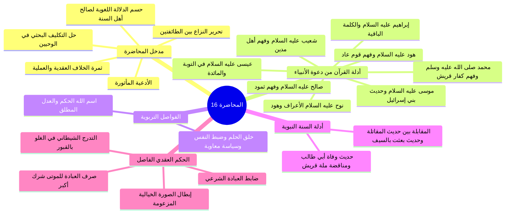
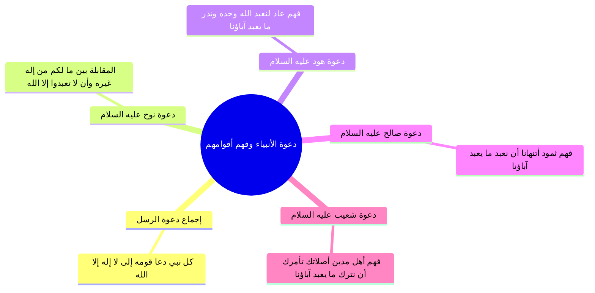
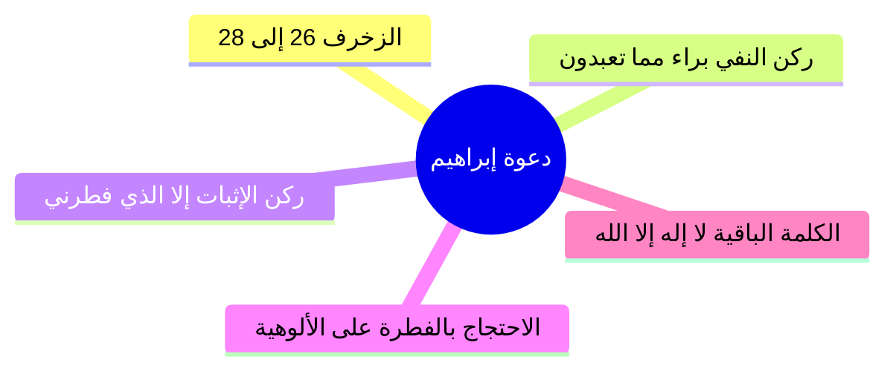
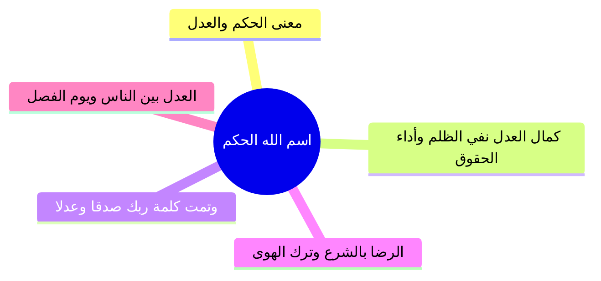
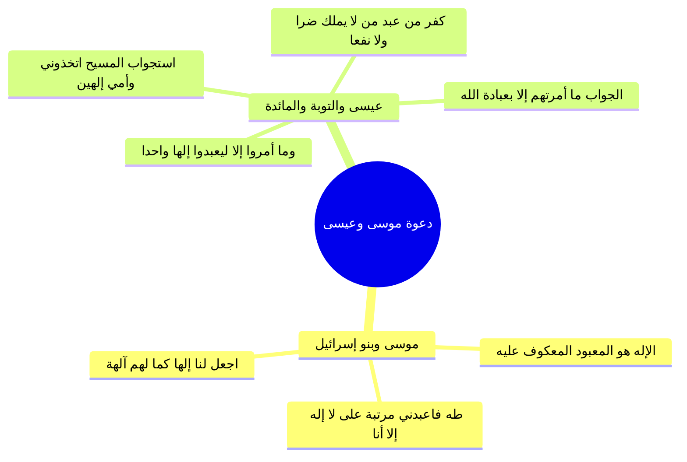
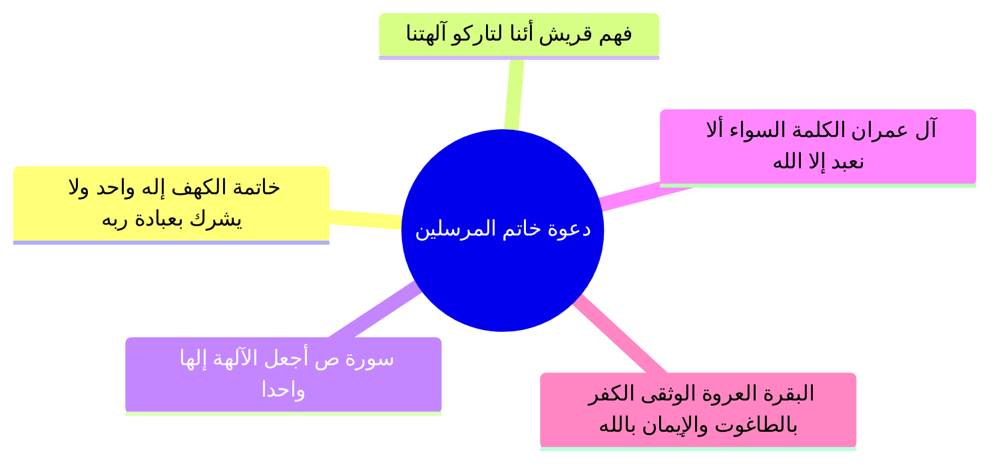
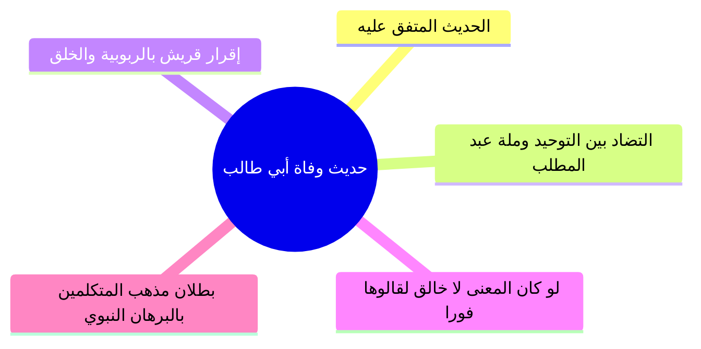
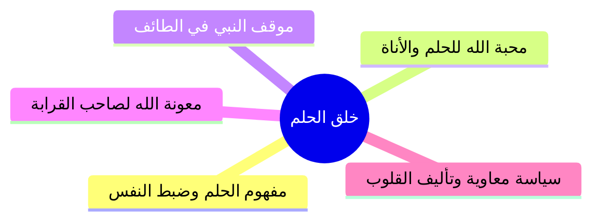
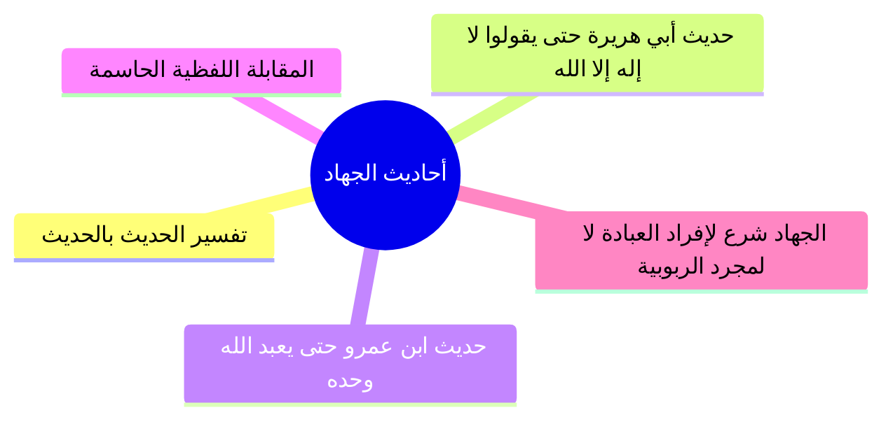
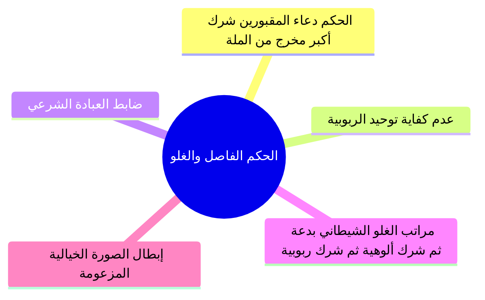

# المحاضرة 16: الأدلة الشرعية على معنى لا إله إلا الله وحكم دعاء المقبورين (نسخة مجمعة للطباعة)

---

## 📑 فهرس موضوعات الملف المجمع

1. [[#الجزء 00: مقدمة وخطة الأجزاء وعناصر المحاضرة]]
2. [[#الجزء 01: دعوة نوح وهود وصالح وشعيب وفهم أقوامهم لمعنى لا إله إلا الله]]
3. [[#الجزء 02: دعوة إبراهيم والكلمة الباقية في عقبه]]
4. [[#الجزء 03: فاصل اسم الله الحكم والعدل الإلهي في التشريع والجزاء]]
5. [[#الجزء 04: دعوة موسى وعيسى عليهما السلام ونصوص القرآن في كفر من اتخذهما آلهة]]
6. [[#الجزء 05: دعوة خاتم المرسلين ونصوص القرآن المحكمة وفهم مشركي قريش]]
7. [[#الجزء 06: حديث وفاة أبي طالب ومناقضة لا إله إلا الله لملة عبد المطلب]]
8. [[#الجزء 07: فاصل خلق الحلم وضبط النفس وآثاره الإيمانية والاجتماعية]]
9. [[#الجزء 08: دلالة أحاديث الجهاد الصريحة وتفسير النبي لمعنى لا إله إلا الله]]
10. [[#الجزء 09: الحكم الفاصل في دعاء المقبورين والتدرج الشيطاني في الغلو وتفنيد الشبهات]]

---

## الجزء 00: مقدمة وخطة الأجزاء وعناصر المحاضرة

### 📝 الملخص العلمي المنظم

#### 1. الافتتاح والأدعية المأثورة
- افتتح المحاضر بالحمد لله والصلاة والسلام على رسول الله محمد ﷺ، والدعاء المأثور:
  ا - «اللهم إنا نسألك علماً نافعاً، وعملاً صالحاً، وقلباً خاشعاً، ولساناً ذاكراً».
  ا - «اللهم علمنا ما ينفعنا، وانفعنا بما علمتنا، واجعله حجة لنا ولا تجعله حجة علينا يا رب العالمين».

#### 2. متابعة التكليف العلمي وتحرير محل النزاع العقدي
- تابع المحاضر الواجب الذي كلف به الطلاب في ختام المحاضرة السابقة: وهو البحث والاستقراء في نصوص القرآن الكريم والسنة النبوية عن المعنى الحقيقي لكلمة التوحيد: «لا إله إلا الله».
- بيّن المحاضر أن هذا البحث يأتي لحل مشكلة عقدية كبرى وخطيرة بين طائفتين عظيمتين من المنتسبين للإسلام:
  1. **الطائفة الأولى (المتكلمون ومن وافقهم):** زعموا أن معنى لا إله إلا الله هو: «لا خالق إلا الله» أو «لا قادر على الاختراع إلا الله» أو «لا رازق ولا مدبر إلا الله»؛ وبنوا ذلك على دعوى لغوية باطلة بأن «إله» في العربية مشتق من فِعال بمعنى فاعل.
  2. **الطائفة الثانية (أهل السنة والجماعة وأئمة السلف):** قرروا أن معنى لا إله إلا الله هو: «لا معبود بحق إلا الله»؛ لأن «إله» في لسان العرب صيغة فِعال بمعنى مفعول (أي مألوه معبود).

#### 3. ثمرة الخلاف العقدية والعملية
- أوضح المحاضر أن هذا الخلاف ليس ترفاً كلامياً، بل تنبني عليه أحكام الدين العظمى وتحديد حقيقة الإيمان والشرك:
  - **موقف الطائفة الأولى:** لما حصروا معنى الشهادة في نفي الخالقية والرازقية والتدبير عن غير الله، رأوا أن التوجه إلى القبور والأولياء والموتى بالدعاء والذبح والنذر والاستغاثة لا ينقض التوحيد ما دام الفاعل يعتقد أن الله هو الخالق الرازق وحده، واعتبروا ذلك مجرد توسل أو تشفع أو بدعة، ورموا أهل السنة المكفرين لهذا الشرك بأنهم خوارج وتكفيريون يستحلون دماء المسلمين!
  - **موقف أهل السنة والجماعة:** يقررون أن صرف أي نوع من أنواع العبادة المحضة (كالدعاء والذبح والنذر والاستغاثة) للموتى والغائبين هو شرك أكبر مخرج من ملة الإسلام، ومناقض مناقضة تامة لأصل شهادة «لا إله إلا الله»، وأن شرك هؤلاء المقبورين أغلظ من شرك الجاهلية الأولى لأن مشركي مكة أشركوا في الرخاء وأخلصوا في الشدة، بينما هؤلاء يشركون في الرخاء والشدة معاً.

#### 4. حسم الجانب اللغوي والانتقال إلى التحكيم الشرعي
- أكد المحاضر أن التحكيم اللغوي تم حسمه في المحاضرة السابقة بالرجوع لأئمة المعاجم واللغة (كابن فارس والجوهري)، وتبيّن إجماع علماء اللغة على أن «أَلَهَ» أصلها التعبد والتأله، وأن «الإله» هو المعبود والمألوه. وبناءً على ذلك، تعين الانتقال إلى الأصلين المعصومين: **الكتاب والسنة**؛ لاستقراء دعوة الأنبياء والمرسلين جميعاً.

### 🧭 خريطة المفاهيم الذهنية (Mindmap)

---

## الجزء 01: دعوة نوح وهود وصالح وشعيب وفهم أقوامهم لمعنى لا إله إلا الله

### 📝 الملخص العلمي المنظم

#### 1. إجماع دعوة الأنبياء والمرسلين والمنهج الاستدلالي
- قرر المحاضر أن كل نبي دعا قومه أول ما دعاهم إلى كلمة: «لا إله إلا الله»، مستدلاً بصريح القرآن دون الحاجة للتأويلات المذهبية.

#### 2. دعوة نوح عليه السلام والمقابلة اللفظية
- في سورة الأعراف (59): ﴿اعْبُدُوا اللَّهَ مَا لَكُم مِّنْ إِلَٰهٍ غَيْرُهُ﴾.
- في سورة هود (25-26): ﴿أَن لَّا تَعْبُدُوا إِلَّا اللَّهَ﴾.
- **البرهان:** جملة ﴿أَن لَّا تَعْبُدُوا إِلَّا اللَّهَ﴾ تطابق وتفسر تماماً ﴿مَا لَكُم مِّنْ إِلَٰهٍ غَيْرُهُ﴾، فالإله هو المعبود بحق.

#### 3. فهم أقوام الأنبياء (عاد، ثمود، مدين)
- **قوم عاد (الأعراف: 70):** لما قال لهم هود «ما لكم من إله غيره»، أجابوا: ﴿أَجِئْتَنَا لِنَعْبُدَ اللَّهَ وَحْدَهُ وَنَذَرَ مَا كَانَ يَعْبُدُ آبَاؤُنَا﴾، ففهموا خلع معبودات الآباء وإفراد العبادة لله وحده.
- **قوم ثمود (هود: 62):** قالوا لصالح: ﴿أَتَنْهَانَا أَن نَّعْبُدَ مَا يَعْبُدُ آبَاؤُنَا﴾، وفي النمل: ﴿أَنِ اعْبُدُوا اللَّهَ فَإِذَا هُمْ فَرِيقَانِ يَخْتَصِمُونَ﴾.
- **قوم مدين (هود: 87):** قالوا لشعيب: ﴿أَصَلَاتُكَ تَأْمُرُكَ أَن نَّتْرُكَ مَا يَعْبُدُ آبَاؤُنَا أَوْ أَن نَّفْعَلَ فِي أَمْوَالِنَا مَا نَشَاءُ﴾.

### 🧭 خريطة المفاهيم الذهنية (Mindmap)

---

## الجزء 02: دعوة إبراهيم والكلمة الباقية في عقبه

### 📝 الملخص العلمي المنظم
- آيات سورة الزخرف (26-28): ﴿وَإِذْ قَالَ إِبْرَاهِيمُ لِأَبِيهِ وَقَوْمِهِ إِنَّنِي بَرَاءٌ مِّمَّا تَعْبُدُونَ * إِلَّا الَّذِي فَطَرَنِي فَإِنَّهُ سَيَهْدِينِ * وَجَعَلَهَا كَلِمَةً بَاقِيَةً فِي عَقِبِهِ لَعَلَّهُمْ يَرْجِعُونَ﴾.
- **تفكيك ركني كلمة التوحيد:**
  - ﴿إِنَّنِي بَرَاءٌ مِّمَّا تَعْبُدُونَ﴾ = «لا إله» (ركن النفي والبراءة من كل معبود).
  - ﴿إِلَّا الَّذِي فَطَرَنِي﴾ = «إلا الله» (ركن الإثبات وتخصيص الفاطر بالعبادة).
- **الاستدلال بالربوبية على الألوهية:** احتج إبراهيم بانفراد ربه بالخلق والفطرة لإلزامهم بإفراده بالعبادة ونفي الشركاء.
- «الكلمة الباقية» بإجماع المفسرين هي كلمة التوحيد «لا إله إلا الله».

### 🧭 خريطة المفاهيم الذهنية (Mindmap)

---

## الجزء 03: فاصل اسم الله الحكم والعدل الإلهي في التشريع والجزاء

### 📝 الملخص العلمي المنظم
- **الحاجة لحكم الله:** النزاعات والخصومات بين البشر حلها العادل هو الرجوع لحكم الله: ﴿لَهُ الْحُكْمُ وَإِلَيْهِ تُرْجَعُونَ﴾.
- **اسم الله «الحَكَم»:** الحاكم العدل المقسط الذي لا يظلم مثقال ذرة، ولا يحمل أحداً وزر غيره، ولا يجازي بأكثر من الذنب، ويؤدي الحقوق لأهلها.
- **أثر قتادة في قوله تعالى ﴿وَتَمَّتْ كَلِمَتُ رَبِّكَ صِدْقًا وَعَدْلًا﴾:** صدقاً فيما قال (الأخبار)، وعدلاً فيما حكم (الأحكام والشرائع والجزاء).
- **ثمار الإيمان:** الرضا بشرع الله، ترك معارضته بالهوى والرأي، العدل بين الناس وأداء الأمانات، واليقين بيوم الفصل: ﴿هَٰذَا يَوْمُ الْفَصْلِ جَمَعْنَاكُمْ وَالْأَوَّلِينَ﴾.

### 🧭 خريطة المفاهيم الذهنية (Mindmap)

---

## الجزء 04: دعوة موسى وعيسى عليهما السلام ونصوص القرآن في كفر من اتخذهما آلهة

### 📝 الملخص العلمي المنظم
- **موسى وبنو إسرائيل (الأعراف: 138):** لما قالوا ﴿اجْعَل لَّنَا إِلَٰهًا كَمَا لَهُمْ آلِهَةٌ﴾ طلبوا معبوداً حسياً يعكفون عليه، فسماه القرآن إلهاً، وأنكر موسى: ﴿أَغَيْرَ اللَّهِ أَبْغِيكُمْ إِلَٰهًا﴾.
- **الوحي في طه (14):** ﴿إِنَّنِي أَنَا اللَّهُ لَا إِلَٰهَ إِلَّا أَنَا فَاعْبُدْنِي﴾؛ رتب العبادة بالفاء على نفي الآلهة.
- **عيسى في سورة التوبة (31):** ﴿وَمَا أُمِرُوا إِلَّا لِيَعْبُدُوا إِلَٰهًا وَاحِدًا لَّا إِلَٰهَ إِلَّا هُوَ سُبْحَانَهُ عَمَّا يُشْرِكُونَ﴾؛ فالمعبود الواحد هو تفسير لا إله إلا هو.
- **استجواب عيسى يوم القيامة (المائدة: 116-117):** لما سُئل ﴿أَأَنتَ قُلْتَ لِلنَّاسِ اتَّخِذُونِي وَأُمِّيَ إِلَٰهَيْنِ﴾ أجاب: ﴿مَا قُلْتُ لَهُمْ إِلَّا مَا أَمَرْتَنِي بِهِ أَنِ اعْبُدُوا اللَّهَ رَبِّي وَرَبَّكُمْ﴾؛ فقطع بأن «اتخاذ الإله» هو «صرف العبادة»، وأن الإله هو المعبود.
- **المائدة (72-76):** كفر من جعل المسيح إلهاً وصرف له العبادة وهو لا يملك ضراً ولا نفعاً.

### 🧭 خريطة المفاهيم الذهنية (Mindmap)

---

## الجزء 05: دعوة خاتم المرسلين ونصوص القرآن المحكمة وفهم مشركي قريش

### 📝 الملخص العلمي المنظم
- **خاتمة الكهف (110):** ﴿أَنَّمَا إِلَٰهُكُمْ إِلَٰهٌ وَاحِدٌ فَمَن كَانَ يَرْجُو لِقَاءَ رَبِّهِ فَلْيَعْمَلْ عَمَلًا صَالِحًا وَلَا يُشْرِكْ بِعِبَادَةِ رَبِّهِ أَحَدًا﴾؛ تحقيق الإله الواحد بالعبادة الخالصة.
- **استكبار مشركي مكة (الصافات: 35-36):** ﴿إِنَّهُمْ كَانُوا إِذَا قِيلَ لَهُمُ لَا إِلَٰهَ إِلَّا اللَّهُ يَسْتَكْبِرُونَ * وَيَقُولُونَ أَئِنَّا لَتَارِكُو آلِهَتِنَا لِشَاعِرٍ مَّجْنُونٍ﴾؛ علموا أن الشهادة تلزمهم بترك آلهتهم ومعبوداتهم.
- **سورة ص (4-6):** ﴿أَجَعَلَ الْآلِهَةَ إِلَٰهًا وَاحِدًا إِنَّ هَٰذَا لَشَيْءٌ عُجَابٌ﴾؛ لم يعجبوا من الخالق بل عجبوا من إفراد المعبود.
- **الكلمة السواء (آل عمران: 64):** ﴿أَلَّا نَعْبُدَ إِلَّا اللَّهَ وَلَا نُشْرِكَ بِهِ شَيْئًا﴾ مفسرة لكلمة التوحيد.
- **العروة الوثقى (البقرة: 256):** ﴿فَمَن يَكْفُرْ بِالطَّاغُوتِ وَيُؤْمِن بِاللَّهِ﴾؛ الكفر بالطاغوت (لا إله) والإيمان بالله (إلا الله).

### 🧭 خريطة المفاهيم الذهنية (Mindmap)

---

## الجزء 06: حديث وفاة أبي طالب ومناقضة لا إله إلا الله لملة عبد المطلب

### 📝 الملخص العلمي المنظم
- حديث الصحيحين: النبي ﷺ يقول لأبي طالب: «قل لا إله إلا الله كلمة أشهد لك بها عند الله»، وأبو جهل يقول: «أترغب عن ملة عبد المطلب؟».
- **التضاد القطعي:** بين كلمة التوحيد وملة عبد المطلب الشركية.
- **إقرار قريش بالربوبية:** ﴿وَلَئِن سَأَلْتَهُم مَّنْ خَلَقَ السَّمَاوَاتِ وَالْأَرْضَ وَسَخَّرَ الشَّمْسَ وَالْقَمَرَ لَيَقُولُنَّ اللَّهُ﴾.
- **الإلزام العقدي:** لو كان معنى لا إله إلا الله «لا خالق إلا الله» لقالها أبو جهل فوراً لأن قريشاً تقر بالخلق؛ لكن امتناعهم دل على أنها توجب خلع المعبودات والأصنام وإفراد الله بالعبادة.

### 🧭 خريطة المفاهيم الذهنية (Mindmap)

---

## الجزء 07: فاصل خلق الحلم وضبط النفس وآثاره الإيمانية والاجتماعية

### 📝 الملخص العلمي المنظم
- **مفهوم الحلم:** نقيض السفه والطيش، والتثبت في الأمور.
- **كلام رجاء بن أبي سلمة:** ضبط النفس وترك الانتقام عند الغضب مع القدرة عليه.
- **أدلة الفضل:** حديث أشج عبد القيس: «إن فيك خصلتين يحبهما الله: الحلم والأناة»، وصف إبراهيم: ﴿إِنَّ إِبْرَاهِيمَ لَحَلِيمٌ أَوَّاهٌ مُّنِيبٌ﴾، حديث «ليس الشديد بالصرعة».
- **موقف الطائف:** رفض إطباق الأخشبين ورجاء إيمان أصلابهم.
- **معونة الله:** حديث ذي القرابة السيئة «ولا يزال معك من الله ظهير عليهم».
- **تأليف القلوب:** حكمة معاوية في شعرة الصلة: «إذا مدوها خليتها وإذا خلوها مددتها».

### 🧭 خريطة المفاهيم الذهنية (Mindmap)

---

## الجزء 08: دلالة أحاديث الجهاد الصريحة وتفسير النبي لمعنى لا إله إلا الله

### 📝 الملخص العلمي المنظم
- **تفسير السنة بالسنة:** الجمع بين حديث أبي هريرة «أمرت أن أقاتل الناس حتى يقولوا لا إله إلا الله» وحديث عبد الله بن عمرو «بعثت بالسيف بين يدي الساعة حتى يعبد الله وحده لا شريك له».
- **المقابلة الصريحة:**
  - ما قبل «حتى»: «أمرت أن أقاتل» = «بعثت بالسيف».
  - ما بعد «حتى»: «يقولوا لا إله إلا الله» = «يُعبد الله وحده لا شريك له».
- **النتيجة النبوية:** تفسير النبي للشهادة هو إفراد العبادة لله، ومشروعية الجهاد جاءت لأجل ذلك، وليس لمجرد الإقرار بالخلق والرزق المعترف به عندهم.

### 🧭 خريطة المفاهيم الذهنية (Mindmap)

---

## الجزء 09: الحكم الفاصل في دعاء المقبورين والتدرج الشيطاني في الغلو وتفنيد الشبهات

### 📝 الملخص العلمي المنظم
- **الحكم العقدي الصريح:** من أتى إلى ميت في قبره فدعاه أو استغاث به أو ذبح له أو نذر له، ولو اعتقد أن الله هو الخالق الرازق وحده، فقد صرف العبادة لغير الله، وهذا شرك أكبر مخرج من الملة وناقض للشهادة، وتوحيد الربوبية وحده لا ينجي صاحبه.
- **ضابط العبادة الشامل:** كل قول أو فعل ظاهر أو باطن ثبت الأمر به (الصلاة)، أو الحث على فعله (الإنفاق)، أو مدح فاعله (الوفاء بالنذر).
- **مراتب الغلو بالقبور:**
  1. البدعة والشرك الأصغر (عبادة الله عند القبور).
  2. الشرك الأكبر في الألوهية (دعاء المقبورين والذبح لهم).
  3. شرك الربوبية والصفات (اعتقاد تصرفهم في الكون وعلمهم الغيب وخلق الأجنة).
- **نقض الصورة الخيالية المزعومة:** إبطال دعوى أن الزائر يذهب ليقول فقط مجرد «ادع الله لي» بلا خضوع، وبيان أن الواقع المشاهد هو السفر والبكاء والخضوع والرجاء والتأله للمقبور.

### 🧭 خريطة المفاهيم الذهنية (Mindmap)

---

## 🔗 روابط المحاضرة والملحقات
- [[00 - مقدمة وخطة الأجزاء وعناصر المحاضرة]]
- [[10 - خطة تطبيق الدروس]]
- [[أسئلة المراجعة والاختبار الذاتي]]
- [[ملخص المراجعة السريعة]]
- [[تفريغ المحاضرة 16]]

---

> [!info] توصيف النسخة المخصصة للطباعة
> يضم هذا الملف المحتوى العلمي الكامل المنظم للمحاضرة 16 من مادة العقيدة (برنامج زاد المستوى الأول)، شاملاً الجداول، والرسومات البيانية والمقارنات، والخرائط المفاهيمية، مجردة من نصوص التفريغ الصوتي، ومُعدّة خصيصاً للقراءة المركزة والمذاكرة والطباعة الأنيقة.
