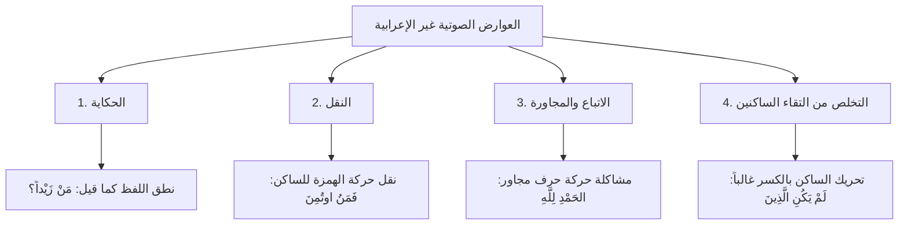

# 03 - حقيقة البناء لفظا ومعنى والعوارض الصوتية غير الإعرابية

## 📝 الملخص العلمي المنظم

### 1. تعريف البناء على المذهبين (المعنوي واللفظي)

- ت تحرير حد البناء في اصطلاح أهل الفن: اختلف النحويون في حقيقة البناء هل هو أمر معنوي (حكم مجرد) أم أمر لفظي (الحركة أو السكون ذاته):

| المذهب النحوي | تعريف البناء وحده الاصطلاحي | تفكيك قيود التعريف وأمثلته |
|:---|:---|:---|
| **البناء على القول بأنه معنوي** | **«هو لزوم آخر الكلمة حالة واحدة لغير عامل»** | - **اللزوم:** الثبوت والاستمرار في سائر التراكيب. - **حالة واحدة:** من سكون أو حركة محددة. - **لغير عامل:** احتراز من لزوم الكلمة حالة واحدة لعامل ثابت؛ كلزوم كلمة «سبحان» للنصب لكونها مفعولاً مطلقاً ملازماً للنصب بالعامل. - **الأمثلة:** لزوم «كَمْ» للسكون، ولزوم «أَيْنَ» للفتح، ولزوم «هَؤُلاءِ» للكسر، ولزوم «حَيْثُ» للضم. |
| **البناء على القول بأنه لفظي** | **«هو ما جيء به لا لبيان مقتضى العامل من شبه الإعراب، وليس حكاية ولا نقلاً ولا اتباعاً ولا تخلصاً من ساكنين»** | - **ما جيء به:** أي السكون أو الحركة المتصلة بآخر الكلمة. - **لا لبيان مقتضى العامل:** ليخرج الإعراب، فالإعراب هو ما جيء به لبيان أثر العامل. - **من شبه الإعراب:** بيان لجنس الحركة أو السكون الواقع في آخر الكلمة. - **القيود الأربعة الاحترازية:** إخراج الحركات الطارئة لعلل صوتية عارضة وليست بناءً حقيقياً. |

---

### 2. العوارض الصوتية الأربعة الخارجة عن حد البناء

- ب بيان محترزات التعريف اللفظي للبناء: قد يتغير آخر الكلمة بحركة تلزمها في سياق معين، لكن هذه الحركة لا تعد إعراباً ولا بناءً أصلياً، بل هي حركة عارضة لسبب من **أربعة أسباب صوتية**:

| العارض الصوتي | ضابطه وتعريفه النحوي | الأمثلة التطبيقية والشواهد | التوجيه الإعرابي الدقيق |
|:---|:---|:---|:---|
| **1. الحكاية** | إيراد اللفظ على صورته التي نُطق بها سابقاً دون إخضاعه للعوامل التركيبية الحالية. | - قولك: «مَنْ زَيْداً؟» لمن قال لك: «رأيتُ زيداً». - تسمية سورة: «سورة المؤمنون» بحكاية لفظ الآية، والأصل النحوي المضاف إليه: «سورة المؤمنين». | الكلمة محكية على لفظها، وإعرابها يجري على التقدير؛ فـ«زيداً» في «من زيداً؟» مفعول به لفعل محذوف يفسره السابق على الحكاية، أو مبتدأ مؤخر بحركة مقدرة منع من ظهورها حركة الحكاية. |
| **2. النقل** | نقل حركة الهمزة أو الحرف التالي إلى الحرف الساكن قبله تيسيراً للنطق. | قراءة قوله تعالى: {فَمَنُ اوتُمِنَ} بضم النون. | أصل النون في «فَمَنْ» السكون، والهمزة في «اوتُمِنَ» مضمومة، فنُقلت ضمة الهمزة إلى النون الساكنة؛ فالضمة هنا حركة نقل وليست ضمة بناء ولا ضمة إعراب. |
| **3. الاتباع (المجاورة)** | إعطاء حرف حركة حرف آخر يجاوره للمناسبة الصوتية وخفة الانتقال بين الأصوات. | قراءة بعض القراء: «الحَمْدِ لِلَّهِ» بكسر الدال اتباعاً لكسرة لام الجلالة بعدها. | ليست كسرة «الحمدِ» كسرة جر بعامل، ولا كسرة بناء؛ وإنما هي كسرة عارضة للاتباع، والكلمة مبتدأ مرفوع بضمة مقدرة منع من ظهورها اشتغال المحل بحركة الاتباع. |
| **4. التخلص من التقاء الساكنين** | تحريك الحرف الساكن بحركة (غالباً الكسر) عند ملاقاة ساكن آخر بعده؛ لامتناع التقاء الساكنين في الوصل. | قوله تعالى: {لَمْ يَكُنِ الَّذِينَ كَفَرُوا} بكسر نون «يكن». | «يَكُنْ» فعل مضارع مجزوم بلم وعلامة جزمه السكون، وكُسرت النون عارضاً للتخلص من التقاء الساكنين (النون الساكنة ولام التعريف الساكنة)، فالكسر هنا ليس علامة إعراب ولا بناء. |

---

### 3. التطبيق الإعرابي الدقيق لقراءة الاتباع وتصحيح مفاهيم العوامل

- ن نموذج إعراب «الحَمْدِ لِلَّهِ» بكسر الدال:
  - **الحَمْدِ:** مبتدأ مرفوع بـ**الابتداء**، وعلامة رفعه **ضمة مقدرة على آخره منع من ظهورها اشتغال المحل بحركة الاتباع** (المجاورة لكسرة اللام في لفظ الجلالة).
  - **لِلَّهِ:**
    - **اللام:** حرف جر مبني على الكسر لا محل له من الإعراب.
    - **لفظ الجلالة (الله):** اسم جليل مجرور باللام وعلامة جره الكسرة الظاهرة على آخره.
    - **شبه الجملة (الجار والمجرور):** متعلق بمحذوف خبر المبتدأ تقديره: «كائنٌ» أو «مستقرٌّ» لله.
- ت تنبيه منهجي في تصحيح عبارات الإعراب الدارجة:
  - شاع عند المبتدئين قولهم: «مرفوع بالضمة، ومنصوب بالفتحة، ومجرور بالكسرة»؛ وهذا تساهل مجازي.
  - **التحقيق النحوي الرصين:** الضمة لا ترفع، والكسرة لا تجر؛ بل الضمة **علامة** على الرفع، والذي أحدث الرفع هو **العامل** (مثل: الابتداء في المبتدأ، والفاعلية في الفاعل، والناصب في المفعول). فالعامل هو المؤثر المعنوي أو اللفظي، والحركة أثر ظاهر دال على ذلك المقتضى.
  - علق الشيخ بأن هذا التدقيق يربي في الطالب الفهم الدقيق لآلية عمل اللغة وقوة العوامل في التراكيب العربية.

---

## 💡 فوائد وتنبيهات علمية مستفادة

1. ت تعلق الجار والمجرور بالمعنى المحذوف: الجار والمجرور والظرف لا يستقلان بأنفسهما في الإسناد؛ بل هما دائماً محتاجان إلى ما يتعلقان به من فعل أو شبه فعل (اسم فاعل، اسم مفعول، مصدر)، أو بمحذوف تقديره مستقر أو كائن إذا وقعا خبراً أو صفة أو صلة أو حالاً.
2. ف فرق بين الاتباع والخطأ اللغوي: الاتباع لهجة عربية فصيحة ومقروء بها في بعض القراءات الشاذة أو المتواترة في غير القرآن، وتُفسر حركته بالتقدير؛ ولا يجوز للكاتب في النثر المعياري كسر المبتدأ اختياراً لمجرد المجاورة خروجاً عن الأصل.
3. ق قاعدة الحكاية توسع دلالي: كل لفظ يُقصد به حكاية كلام متكلم سابق أو عنوان كتاب أو سورة يظل على نطقه المسموع، ويُعرب تقديراً على الحكاية بحسب موقعه من الجملة الحاضرة.

---

> [!info] الفترة المرجعية
> الأسطر: 434 – 663 من [[تفريغ المحاضرة 6]] في شرح «المقدمة الأزهرية» للشيخ خالد الأزهري رحمه الله.

---

### 🔗 روابط التنقل بين أجزاء المحاضرة

- ➡️ **الجزء السابق:** [[02 - علة بناء الحروف وأقسام بنائها الأربعة]]
- **الجزء التالي:** [[04 - حقيقة الإعراب لفظا ومعنى والورشة الإعرابية والتطبيقات]] ⬅️
