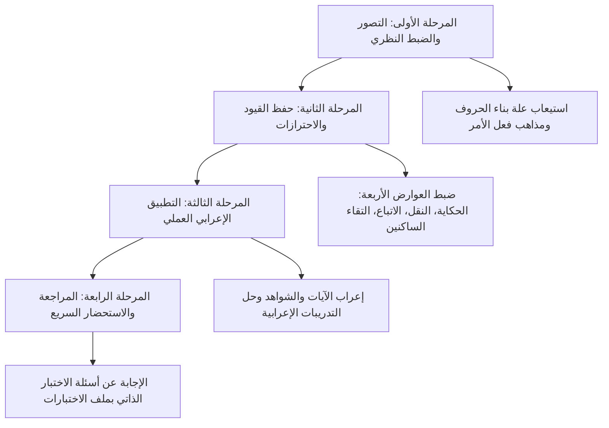

# 05 - خطة المذاكرة والتطبيق

## 📝 الخطة المنهجية لمذاكرة المحاضرة وتثبيت الملكة

---

### 1. المسار الزمني المقترح لدراسة المادة

1. **اليوم الأول (الاستيعاب النظري لبناء الأفعال والحروف):**
   - قراءة الجزء الأول: مدارسة الخلاف في بناء فعل الأمر بين البصريين والكوفيين.
   - تفكيك إعراب المضارع المؤكد بالنون المتصل بالضمائر (واو الجماعة، ياء المخاطبة، ألف الاثنين) وفهم علة تقدير النون وحذف حروف اللين.
   - قراءة الجزء الثاني: حفظ علة بناء الحروف وضبط أقسام بنائها الأربعة مع الشواهد.
2. **اليوم الثاني (إتقان محترزات البناء ومفهوم الإعراب):**
   - قراءة الجزء الثالث: ضبط حدي البناء المعنوي واللفظي.
   - حفظ الفروق الدقيقة بين العوارض الصوتية الأربعة (الحكاية، النقل، الاتباع والمجاورة، التقاء الساكنين).
   - إتقان إعراب «الحَمْدِ لِلَّهِ» على قراءة الاتباع وتصحيح مفهوم العامل والعلة.
3. **اليوم الثالث (الورشة الإعرابية والتطبيقات والتقييم):**
   - قراءة الجزء الرابع: تدبر إعراب جملة {لَمْ يَكُنِ الَّذِينَ كَفَرُوا}.
   - حل التدريبات التطبيقية على العامل الملفوظ والمقدر، والتغيير اللفظي والتقديري في الأسماء والأفعال.
   - فتح ملف [[أسئلة المراجعة والاختبار الذاتي]] واختبار الحفظ والفهم الذاتي.

---

### 2. جداول المقارنة الجامعة لضوابط الباب

#### أ. جدول المقارنة بين العوارض الصوتية الأربعة

| العارض الصوتي | سبب التحريك | المثال التوضيحي | حكم حركة الآخر الإعرابية |
|:---|:---|:---|:---|
| **الحكاية** | نقل الكلام بنصه وصوته كما تلفظ به المتكلم أو كما ورد في النص. | «مَنْ زَيْداً؟»، وسورة «المؤمنون». | حركة حكاية عارضة، وتعرب الكلمة بحركة مقدرة منع من ظهورها حركة الحكاية. |
| **النقل** | التخلص من ثقل الابتداء بالهمزة المتحركة بنقل حركتها للساكن قبلها. | {فَمَنُ اوتُمِنَ} بنقل ضمة همزة اوتمن إلى نون فَمَنْ. | حركة نقل عارضة، وليست إعراباً ولا بناءً أصلياً. |
| **الاتباع (المجاورة)** | مشاكلة حركة الحرف لحركة حرف مجاور له في الكلمة التالية للخفة الصوتية. | قراءة «الحَمْدِ لِلَّهِ» بكسر دال الحمد اتباعاً لكسرة لام الجلالة. | حركة اتباع عارضة، ويعرب مبتدأ بضمة مقدرة منع من ظهورها حركة الاتباع. |
| **التقاء الساكنين** | امتناع توالي ساكنين متتاليين في درج الكلام العربي فيُحرك الأول غالباً بالكسر. | {لَمْ يَكُنِ الَّذِينَ كَفَرُوا} بتحريك نون يكن بالكسر. | كسر عارض دفعاً لالتقاء الساكنين، والفعل مجزوم بالسكون المقدر منع من ظهوره كسر التقاء الساكنين. |

---

#### ب. جدول المقارنة بين الإعراب اللفظي والإعراب المعنوي

| وجه المقارنة | الإعراب اللفظي | الإعراب المعنوي |
|:---|:---|:---|
| **حقيقة الإعراب** | الإعراب هو **نفس الأثر الملفوظ** أو المقدر (الحركة أو الحرف أو السكون أو الحذف). | الإعراب هو **معنى اعتباري وتغيير نسبي** يطرأ على أواخر الكلم باختلاف العوامل. |
| **موقع الحركة أو الحرف** | هي الإعراب عينه. | هي دليل وعلامة على الإعراب الحاصل في النفس. |
| **ثمرة الخلاف** | خلاف اصطلاحي لا يترتب عليه اختلاف في الحكم الإعرابي الظاهر ولا في صحة المعنى. | يساعد في تصور الفارق بين المؤثر (العامل) والوظيفة (الإعراب) والعلامة (الحركة). |

---

### 3. تدريبات عملية غير محلولة للاختبار الذاتي

1. **التدريب الأول:** بين الموقع الإعرابي ونوع الإعراب (لفظي أو تقديري والمانع منه) فيما تحته خط:
   - قال تعالى: {وَلَا يَصُدَّنَّكَ عَنْ آيَاتِ اللَّهِ}.
   - قال تعالى: {فَتَرَى الْقَوْمَ فِيهَا صَرْعَىٰ}.
   - قال تعالى: {إِذَا السَّمَاءُ انشَقَّتْ}.
2. **التدريب الثاني:** بيّن العارض الصوتي الذي أوجب تحريك الحرف الأخير في الجمل الآتية:
   - قول القائل: «أُحِبُّ سُورَةَ الكَافِرُونَ».
   - قراءة ورش عن نافع في قوله تعالى: {قُلِ اوحِيَ إِلَيَّ} بضم لام «قُلْ».
   - قولك: «لَمْ يَقُمْ أَمْسِ رَجُلٌ».

---

> [!info] الفترة المرجعية
> مستفاد من مباحث [[تفريغ المحاضرة 6]] في شرح «المقدمة الأزهرية» للشيخ خالد الأزهري رحمه الله.

---

### 🔗 روابط التنقل بين أجزاء المحاضرة

- ➡️ **الجزء السابق:** [[04 - حقيقة الإعراب لفظا ومعنى والورشة الإعرابية والتطبيقات]]
- **ملخص المراجعة السريعة:** [[ملخص المراجعة السريعة]] ⬅️
