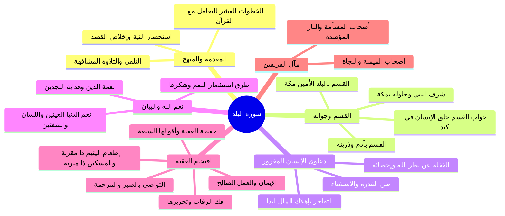

# 00 - الفهرس والخطة: تفسير سورة البلد وحقيقة مكابدة الإنسان واقتحام العقبة

> [!info] عن هذه المحاضرة
> مجلس علمي وتفسيري وتربوي مبارك يتناول **[[سورة البلد]]**، انطلاقاً من **استحضار النية الصالحة في طلب العلم** وأثرها في الحفظ والفهم والبركة، و**الخطوات العشر للتعامل مع القرآن الكريم** (الخمس الأساسية والخمس التكميلية)، ثم التلقي والتلاوة الجماعية، وتفسير آيات السورة الكريمة: **القسم بمكة المكرمة البلد الأمين وشرف حلول النبي ﷺ فيها**، و**القسم بآدم وذريته**، وبيان حقيقة خلقة الإنسان في **كبد** ومكابدته لمشاق الدنيا والبرزخ والآخرة أو خلقه في أحسن تقويم، ومظاهر **طغيان الإنسان واستعلائه بالمال** وإنفاقه في الشهوات {أهلكت مالاً لبداً}، وترسيخ **كمال مراقبة الله وإحصاء الأقوال والأعمال**، ثم التذكير بـ **نعم الدنيا (العينين واللسان والشفتين) ونعمة الدين (الهداية للنجدين)** وسبل شكرها، وصولاً إلى بيان **العقبة وأقوال المفسرين السبعة في حقيقتها**، والمنهاج العملي لاقتحامها عبر **الأعمال الأربعة الكبرى: فك الرقاب، وإطعام الطعام في المسغبة لليتيم والمسكين، والإيمان الصالح، والتواصي بالصبر والمرحمة**، ثم بيان **جزاء الفريقين (أصحاب الميمنة وأصحاب المشأمة)** وختام المجلس بـ **الفوائد الإيمانية والتربوية السبع الكبرى** والدعاء الجامع.

## 📚 معلومات المصدر

| البند | البيان |
|:---|:---|
| **المصدر الأصلي** | `main_obsidian/دين/تفسير/سورة البلد/تفريغ سورة البلد.md` |
| **المادة** | مجلس تفسير كلام الله تعالى وهدايات تربوية وتزكية إيمانية |
| **الموضوع الرئيسي** | تفسير سورة البلد، حقيقة كبد الدنيا، مراقبة الله، وشروط اقتحام العقبة |
| **عدد أسطر التفريغ** | 853 سطراً |
| **التوقيت المرجعي** | غير متوفر في المصدر الأصلي — استُخدم ترقيم الأسطر كمرجع موثق دقيق التزاماً بالأمانة العلمية وقواعد البروتوكول |

> [!warning] تنبيه بخصوص التوقيت المرجعي
> التفريغ المصدر **لا يتضمن توقيتات زمنية مسجلة**؛ والتزاماً صارماً بالأمانة العلمية وقواعد البروتوكول المعتمد، **لم تُختلق أي توقيتات زمنية زيفية**، بل استُخدم **ترقيم أسطر التفريغ الأصلي** كمرجع موضعي دقيق في جميع ملفات هذه الحزمة.

---

## 🗺️ خطة الأجزاء وعناوينها الشاملة

| # | الملف | المحور والموضوع الرئيسي | نطاق الأسطر |
|:---:|:---|:---|:---:|
| 00 | [[00 - الفهرس والخطة]] | الفهرس العام وخطة المعالجة الشاملة ومنهجية التلخيص وخريطة المفاهيم | — |
| 01 | [[01 - المقدمة واستحضار النية وتلقي السورة وخطوات التعامل مع القرآن]] | استحضار النية في طلب العلم، الخطوات العشر للتعامل مع القرآن، والتلقي والتلاوة الجماعية | 1–171 |
| 02 | [[02 - تفسير الآيات 1 إلى 4 - شرف البلد الأمين وحقيقة المكابدة في الدنيا]] | القسم بمكة وشرف النبي ﷺ، معاني حلول النبي، القسم بآدم وذريته، وخلق الإنسان في كبد | 172–344 |
| 03 | [[03 - تفسير الآيات 5 إلى 7 - طغيان المال وكمال مراقبة الله وسنن إحصاء العمل]] | طغيان الإنسان واستعلاؤه بالمال، تبديد المال لبداً، استشعار مراقبة الله، وإحصاء الأعمال | 345–475 |
| 04 | [[04 - تفسير الآيات 8 إلى 10 - نعم الدنيا والدين وطرق شكر النعم وحديث العابد]] | الامتنان بنعم الدنيا (العين واللسان والشفتين) ونعمة الدين (النجدين)، وسبل شكر النعم | 476–636 |
| 05 | [[05 - تفسير الآيات 11 إلى 16 - حقيقة العقبة وأقوالها السبعة وفك الرقاب وإطعام الطعام]] | حقيقة اقتحام العقبة وأقوال المفسرين السبعة، فك الرقاب، وإطعام اليتيم والمسكين ذي المتربة | 637–740 |
| 06 | [[06 - تفسير الآيات 17 إلى 20 - الإيمان والتواصي وجزاء الفريقين والفوائد الإيمانية السبع]] | الإيمان والتواصي بالصبر والمرحمة، أصحاب الميمنة والمشأمة، والفوائد السبع والدعاء الجامع | 741–853 |
| 07 | [[07 - ملخص المراجعة السريعة]] | ملخص شامل ومكثف لجميع محاور السورة في جداول جامعة للمذاكرة السريعة | 1–853 |
| 08 | [[08 - أسئلة المراجعة والاختبار الذاتي]] | بنك أسئلة واختبار ذاتي مقالي وموضوعي مع الإجابات النموذجية لضبط الفهم | 1–853 |
| 09 | [[09 - خطة تطبيق الدروس]] | خطة عمل تنفيذية بمراحل عملية ومهام بمربعات اختيار `- [ ]` وعلاج المشكلات عند التعطل | — |
| — | [[سورة_البلد_ملف_مجمع]] | الملف المجمع النهائي الشامل لجميع الأجزاء بنصوصها الكاملة دون مراجعة أو اختبارات | 1–853 |

---

## 🧭 خريطة المفاهيم الهيكلية للسورة

---

## 📐 منهجية المعالجة المعتمدة

1. **التطبيق المدمج الشامل:**
   - تطبيق عناصر التلخيص العلمي المنظم، واستخراج الجداول والتصنيفات والتعريفات، وتحديد نطاق الأسطر المرجعية، والتنسيق بالألوان الهادئة، والروابط الداخلية `[[WikiLinks]]`، مع إدراج قسم **نص المتحدث الكامل** لكل جزء حرفياً دون نقصان.
2. **مبدأ عدم تكرار المعلومة:**
   - عرض كل معلومة في أقسام الملخص مرة واحدة فقط في الوعاء الأنسب لها، وعدم تكرارها بين الفوائد والجداول والتنبيهات.
3. **دليل التنسيق بالألوان وقاعدة محاذاة النص العربي (RTL):**
   - اللون الذهبي الدافئ (`#D97706`): الآيات القرآنية والأحاديث الشريفة والأدعية والقواعد الثابتة.
   - اللون التركوازي الهادئ (`#0D9488`): المصطلحات والمفاهيم والتعريفات والفوائد الرئيسية.
   - اللون المرجاني الهادئ (`#E11D48`): التحذيرات والتنبيهات والآفات المنهية عنها.
   - التزام صارم ببدء كل سطر وفقرة وعنصر قائمة بكلمة عربية لضمان سلامة اتجاه القراءة من اليمين إلى اليسار (RTL).
4. **المراجعة الداخلية الدقيقة:**
   - تنفيذ 5 نقاط مراجعة عشوائية موزعة على كل جزء (البداية، منتصف البداية، المنتصف، منتصف النهاية، النهاية) للتحقق التام من مطابقة المتن للأصل.
