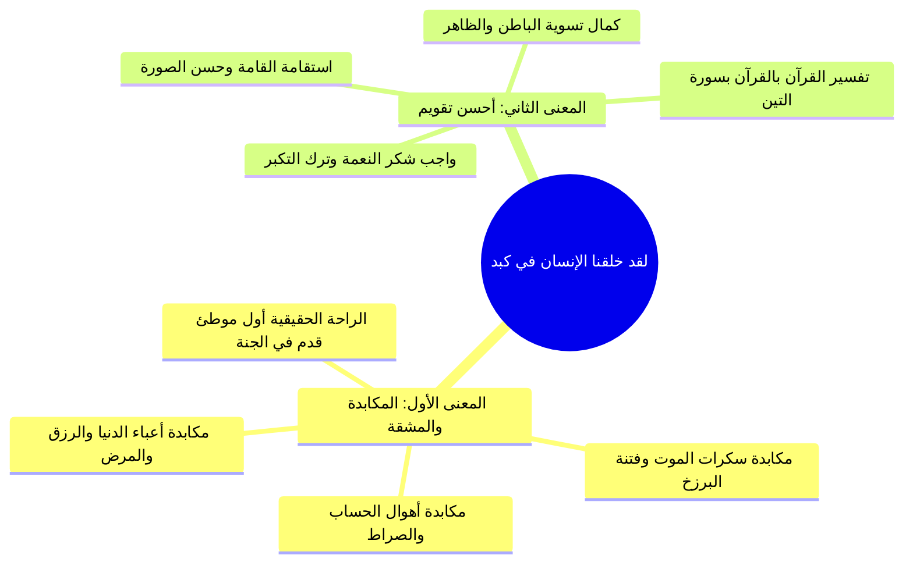

# 02 - تفسير الآيات 1 إلى 4 - شرف البلد الأمين وحقيقة المكابدة في الدنيا

## 📝 الملخص العلمي المنظم

### 1. تفسير آيات القسم وشرف البلد الحرام

- قوله تعالى: {لَا أُقْسِمُ بِهَذَا الْبَلَدِ}:
  - «لا» في فواتح القسم دخلت لـ **توكيد القسم** وإبراز عظمة المقسَم به، لا لنفيه.
  - البلد المقسَم به هو **مكة المكرمة**، وهي أشرف البقاع وأحب بلاد الله إلى الله وإلى رسوله ﷺ، ونظير هذا القسم تكرر في سورة التين: {وَهَذَا الْبَلَدِ الْأَمِينِ}.
  - استشهد المحاضر بحديث النبي ﷺ عند خروجه مهاجراً: «والله إنكِ لخير أرض الله، وأحب أرض الله إلى الله، ولولا أني أُخرِجتُ منكِ ما خرجتُ».

---

### 2. معاني قوله تعالى: {وَأَنتَ حِلٌّ بِهَذَا الْبَلَدِ}

استعرض المحاضر ثلاثة أقوال جامعة للمفسرين في بيان معنى حلول النبي ﷺ بالبلد الحرام:

| م | القول التفسيري | المعنى والبيان | الترجيح والمصدر |
|:---:|:---|:---|:---|
| **1** | **شرف الحلول والإقامة** | أن المراد حلول الرسول ﷺ وإقامته فيها، فيزداد شرف مكة شرفاً وعظمة بوجود النبي ﷺ ومقامه بها. | اختيار الإمام السعدي رحمه الله. |
| **2** | **إحلال القتال ساعة الفتح** | وعد إلهي بإحلال مكة لرسوله ﷺ ساعة من نهار عام الفتح؛ إذ لم تحل لأحد قبله ولا بعده، فتطهرت من الشرك (حديث قتل ابن خطل ولو تعلق بأستار الكعبة). | قول محقق مشهور في التفسير. |
| **3** | **استحلال المشركين لأذاه** | توبيخ لكفار قريش؛ إذ يستحلون إخراج النبي ﷺ وقتله، وهم يعظمون حرمة الصيد وقطع الشجر في الحرم! | قول معتبر لجمع من أئمة التفسير. |

---

### 3. تفسير: {وَوَالِدٍ وَمَا وَلَدَ}

- يقسم الله تعالى بـ **آدم عليه السلام وذريته** الصالحين من الأنبياء والأولياء، أو بعموم الوالد وما تناسل منه؛ لما في تناسل الإنسان وتكوينه من عجائب قدرة الله ودلائل ربوبيته.

---

### 4. جواب القسم: {لَقَدْ خَلَقْنَا الْإِنسَانَ فِي كَبَدٍ}

بيّن المحاضر أن للمفسرين في معنى «كبد» وجهين متكاملين من وجوه الإعجاز القرآني:

1. **الوجه الأول — مكابدة المشاق والشدائد:**
   - الإنسان مجبول على المشقة؛ يكابد شدائد الدنيا ومصائبها من ولادته إلى وفاته، ثم يكابد ما في البرزخ، ثم أهوال يوم القيامة والصراط.
   - الراحة التامة ليست في الدنيا؛ سئل الإمام أحمد: متى الراحة؟ فقال: «عندما أضع أول قدم في الجنة».
   - الدنيا دار تكليف وجهاد؛ قالت السيدة خديجة رضي الله عنها للنبي ﷺ: ألا تنام؟ فقال لها: «مضى عهد النوم يا خديجة».
   - قاعدة الموازنة الإيمانية: «على قدر تعب العبد في الدنيا لله عز وجل، على قدر راحته وخفة حسابه في الآخرة»؛ فمن أطال القيام في الدنيا خف قيامه يوم القيامة، ومن أكثر الصيام شرب من حوض النبي ﷺ شربة لا يظمأ بعدها أبداً.

2. **الوجه الثاني — خلق الإنسان في أحسن تقويم:**
   - تفسير القرآن بالقرآن: نظير قوله تعالى في سورة التين: {لَقَدْ خَلَقْنَا الْإِنسَانَ فِي أَحْسَنِ تَقْوِيمٍ}، أي في خلقة سوية معتدلة قادرة على التصرف والنهوض بالأعمال الجليلة.
   - الواجب على الإنسان شكر هذه الخلقة بالخضوع لله، لكنه بطر بالنعمة وتجبر، فاستحق الخسران إلا إن تدارك نفسه بالإيمان.

> ⚠️ تنبيه
> البحث عن الراحة المطلقة في الحياة الدنيا بحث عن مستحيل لم يُخلق؛ فالدنيا جُبلت على كدر، ومن فهم طبيعة خلقته هانت عليه مكابدة الطاعات وصبر عن الشهوات.

---

## 🗣️ نص المتحدث الكامل (الأسطر 172–344)

> تعالوا بنا لنتعرف على معنى هذه السوره ومعاني هذه الايات. الشيخ السعد رحمه الله تعالى يقول يقسم الله تعالى بهذا البلد الامين ده بيفكرنا بايه؟ سوره الشمس سوره التين نفس المصطلح نفس الكلمه والتين والزيت سين وطور سينين وهذا وهذا البلد الامين يبقى القسم بيتكرر على ايه؟ على البلد الامين وهذا فيه دلاله على على شرف هذه البلده وعلى شرف تلك البقعه وعلى عظيم مكانتها الا وهي مكه مكه المكرمه نسال الله عز وجل ان يرزقنا واياكم الحج والمين امين يقسم تعالى بهذا البلد الامين وهو مكه المكرمه افضل البلدان على الاطلاق خصوصا وقت حلول الرسول صلى الله عليه وسلم فيها طبعا افضل بلدان على الاطلاق لان النبي صلى الله عليه وسلم لما خرج منها مهاجرا قال ايه صلى الله عليه وسلم اللهم اللهم انك تعلم ها اللهم ان اللهم ان ايه هذه البلده احب بلاد الله الى الله واحب بلاد الله الى قلبي ولولا ان قومك اخرجوني منك ما خرجت ما خرجت صلى الله عليه وسلم صلى الله عليه وسلم وايضا هذه افضل البلدان على الاطلاق وخصوصا لا سما وقت حلول الرسول صلى الله عليه وسلم فيها صلى الله عليه وسلم و انت حل بهذا البلد المفسرون تكلموا على ما معنى وانت حل بهذا البلد طبعا لا اقسم معناه القسم قيل بان لا دخلت على القسم هنا من باب التوكيد يبقى لا هنا المقصود بها ايه التوك توكيد القسم لا اقسم بهذا البلد وانت حل بهذا البلد ووالد وما ولد ده كله ايه ده كله قسم من الله سبحانه وتعالى وانت حل بهذا البلد اي حل لك ما صنعت في هذا البلد من قتل او غيره وقيل بان الله عز وجل وعد نبيه ان يفتح مكه على يديه بان يحلها له فيكون فيها حلا يبقى عز وجل احل تلك البلده ده لنبيه صلى الله عليه وسلم ايه وقتا ا في زمان الفتح احل الله عز وجل هذه البلده للنبي صلى الله عليه وسلم وذلك حتى يتمكن من ايه؟ حتى يتمكن من فتحه عليه الصلاه والسلام القول الثالث ان المشركين بهذا البلد يستحلون اخراجك وقتلك ويحرمون قتل الصيد فالشيخ السعد هنا اختار وانت حل بهذا البلد اي خصوصا و وقت حلول الرسول صلى الله عليه وسلم فين؟ في مكه يبقى هذه البلده لها مكانه وهي عظيمه عظيمه القدر عظيمه الشان جليله المقد القدر وايضا يزيد شرفها وجود النبي صلى الله عليه وسلم ايه وجود النبي صلى الله عليه وسلم فيها لا اقسم بهذا البلد وان تحل يعني حلول حل اه وان تحل من الاقامه وقيل بان تحل يعني احل الله لك مكه في وقت من الاوقات تفعل فيها ما تشاء وذلك لان الله عز وجل لم يحل مكه لاحد من الناس وذلك لان مكه من الذي حرمها ابراهيم عليه السلام دعا فحرم الله عز وجل مكه والنبي صلى الله عليه وسلم قال اللهم اني احرم ما بين لابتي المدينه فصارت مكه حرام وصارت المدينه ايه وصارت المدينه حرام فصار هذين الحرمين يبقى لا اقسم بهذا البلد وان تحل بهذا البلد شيخ يعني ايه حلت للنبي يعني هي حلت للنبي حضرتك حلت للنبي او اللي هي بقت وحلت للنبي صلى الله عليه وسلم يعني ايه وحلت للنبي علشان كان في مشركين في مكه نعم فدلوقتي هم محتمين في مكه ومحتمين بالحرم فطبعا طالما في الحرم ما ينفعش ان يبقى في قتل ولا ينفع ان في يبقى في اي حاجه من الكم فاحل الله عز وجل للنبي في فتح مكه مكه ساعه من نهار ولذلك بيقول له النبي صلى الله عليه وسلم هذا ابن خطل كان بيؤذي النبي صلى الله عليه وسلم ايذاء شديدا متعلق باستار الكعبه فقال النبي صلى الله عليه وسلم اقتلوه ولو رايتموه متعلق باستار الكعبه فطبعا لو كانت مكه حرام زي ما هي ما كانش يبقى في حاجات زي كده صليت على الرسول صلى الله عليه صلى الله عليه وسلم لا اقسم بهذا البلد وانت حل بهذا البلد ووالد وما ولد ووالد وما ولد اي ادم وذريته يقسم الله عز وجل بادم وذريته والمقسم عليه لقد خلقنا الانسان في كبد اي خلقنا الانسان يكابد الامور ويشاق الامور فتلاقي حياتك حياه الانسان كلها في ايه؟ في كبد من اول ما يخرج من بطن امه ويكابد هذه الحياه وبعدين لما يدخل القبر يكابد ما في القبر من الاهوال ومن هذه الامور ثم ثم يوم القيامه يظل يكابد اهوال وعقبات وامور يوم القيامه وبدايه الراحه فين؟ الجنه الجنه في الجنه اسال الله عز وجل ان يرزقنا واياكم الجنه امين بغير حساب ولا سابقه عذابين لذلك بيسالوا الامام احمد متى الراحه قال عندما اضع اول قدم فين اول ما يحط اول قدمه في الجنه يبقى كده ايه يبقى كده هيبدا يرتاح كده كده هيبقى ارتاح خلاص بقى لان الدنيا هي ليست دار راحه وانما هي دار عمل ودار مكابده ودار عناء ودار شقاء وكان السوره بتدور حول ايه بتدور حول هذا المعنى معنى ايه ان حقيقه الدنيا وان الدنيا خلقت على ايه خلقت على كدر وان الدنيا كلها كبد فلذلك اما الانسان يعرف صلي على الرسول صلى الله عليه وسلم لما انت تعرف طبيعه الدنيا وطبيعه خلقتك ان انت مخلوق في كبد وان هذه الدنيا دار مشقه ودار عمل ودار كفاح ودار جهاد الانسان سيسلم ولن يعني اصل الناس دلوقتي كل واحد عمال بيطلب ايه بيطلب الراحه وكل واحد بيطلب السعاده وكل واحد عايز يعيش يقول لك عايز يعيش الدنيا دي كلها حياه الراحه المطلقه وده طبعا غير مطلوب او مش غير مطلوب هذا غير موجود غير موجود فلما الانسان يفهم طبيعه خلقته ويفهم طبيعه الدنيا بيرتاح في المعامله لانه بيتعامل بفهم عارف ان الدنيا دي ليس فيها ايه؟ ليس فيها رحم لذلك النبي صلى الله عليه وسلم لما قال الله عز وجل له يا ايها المدثر قم فانذر فقام النبي صلى الله عليه وسلم بالدعوه سيده السيده خديجة بتقول ق له طب نملك شويه ارتاح فقال لها ايه؟ قال لها مضى عهد النوم يا خديجه والانسان على قدر تعبه في الدنيا على قدر راحته في الاخره على قدر تعبه في الدنيا على قدر راحته في الاخره ازاي على قدر راحه تعبه في الدنيا على قدر راحته في الاخره صلي على الرسول صلى الله عليه وسلم يعني كلما اتعب الانسان نفسه في هذا هذه الدنيا لله عز وجل في عباده الله وفي طاعه الله وفي مرضاه الله كل ما خف عليه الحساب وكلما خفت عليه المشقه امتى؟ يوم القيامه لذلك اللي عايز يعيشها مرتاح وعمال بقى بيدور على الراحه ولا يقوم لله عز وجل لا يصوم لا يتعب نفسه ده هيتعب فين؟ هيتعب في الاخره صليت على الرسول صلى الله عليه وسلم فالانسان الذي يطيل القيام في هذه الدنيا يخف عليه القيام يوم القيامه والذي يصوم في هذه الدنيا كثيرا يشرب يوم القيامه من حوض النبي صلى الله عليه وسلم شربه لا يضما بعدها ايه ابدا طب واللي عمال يقضيها بقى نوم واكل وشرب والكلام ده سيتعب هناك لقد خلقنا الانسان في كبت قال يحتمل ان المراد بذلك ما يكابده ويقاسيه من الشدائد في الدنيا وفي البرزخ ويوم يقوم الاشهاد وان هذا الانسان ينبغي له ان يسعى في عمل يريحه من هذه الشدائد ويوجب له الفرح والسرور الدائم وان لم يفعل فانه لا يزال يكابد العذاب الشديد ابد الاباد جزاك الله فانه لا يزال ايه يكابد العذاب الشديد ابد الاباء ده المعنى الاول في قول الله عز وجل لقد خلقنا الانسان كبد في كبد المعنى الثاني في قول الله عز وجل لقد خلقنا الانسان في كبد يعني لقد خلقنا الانسان في احسن تقويم فكده يبقى القران بيفسر ايه بعض يبقى كده القران بيفسر بعضه بعضا يبقى معنى من معاني لقد خلقنا الانسان في كبد من معانيها ايه لقد خلقنا الانسان في احسن احسن تقويم في ايه بقى ها في شكله وفي خلقته وفي باطنه وفي ظاهره ولقد كرمنا ولقد كرمنا بني ادم قال ويحتمل ان المعنى لقد خلقنا الانسان في احسن تقويم واقوم خلقه يقدر على التص رف والاعمال الشديده ومع ذلك فان الانسان لم يشكر الله سبحانه وتعالى على هذه النعمه العظيمه ان الله عز وجل خلقه في احسن ايه؟ في احسن تقويم بل بطر بالعافيه وتجبر على خالقه فحسب بجهله وظلمه ان هذه الحاله ستدوم له وان سلطان تصرفه لا ينعزل ولهذا قال تعالى ايحسب ان لن يقدر عليه ايه ايحسب ان لن يقدر عليه احد يبقى هذه الايه فسرت بسوره التين سوره التين لقد خلقنا الانسان في احسن تقويم فكان من الواجب على هذا الانسان لما خلقه الله في احسن تقوم انه يعمل ايه انه يشكر والشكر يكون بايه بالايمان بالله عز وجل وبعباده الله سبحانه وتعالى فلما كفر وما شكر نعمه الله عز وجل رددناه اسفل اسفل سافلين الا الذين امنوا وعملوا الصالحات هذا الانسان الذي خلقه الله عز وجل في كبد اغتر بنفسه وتجبر وافتخر وظن ان لن يقدر عليه احد صليت على الرسول صلى الله عليه وسلم زيد النبي صلى الله عليه وسلم معناها الحزم الشديد لا جايب منين المعنى ده احنا المعاني ما بنجيبهاش الا من التنصيص عليه خدت بالك لازم المعنى يا اما المعنى يكون جه جاء في نص او المعنى العلماء المفسرين جابوه من اللغه العربيه بقى صليت على الرسول صلى الله عليه وسلم واما المعنى ج من اللغه العربيه لانها لانها اللغه التي نزل القران ايه التي نزل القران خلاص هي هتبرد دلوقتي جزاك الله خير صليت على الرسول صلى الله عليه وسلم

---

## 🧭 الانتقال بين الأجزاء

- **الجزء السابق:** [[01 - المقدمة واستحضار النية وتلقي السورة وخطوات التعامل مع القرآن|➡️ الجزء 01: المقدمة واستحضار النية وخطوات التعامل مع القرآن]]
- **الجزء التالي:** [[03 - تفسير الآيات 5 إلى 7 - طغيان المال وكمال مراقبة الله وسنن إحصاء العمل|الجزء 03: تفسير الآيات 5 إلى 7 - طغيان المال وكمال مراقبة الله ⬅️]]

---

> [!info] الفترة المرجعية
> الأسطر 172–344 من التفريغ المصدر (`تفريغ سورة البلد.md`) — التفريغ بلا توقيت زمني.
> - **إجمالي عدد الأجزاء:** 6 أجزاء تفصيلية.
> - **الجزء الحالي:** الجزء 02.
> - **الأجزاء المتبقية:** 4 أجزاء.
