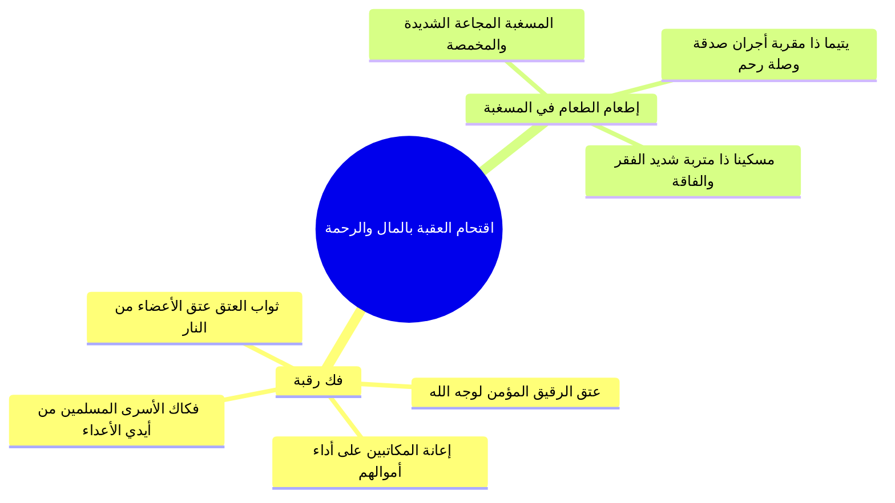

# 05 - تفسير الآيات 11 إلى 16 - حقيقة العقبة وأقوالها السبعة وفك الرقاب وإطعام الطعام

## 📝 الملخص العلمي المنظم

### 1. دلالة قوله تعالى: {فَلَا اقْتَحَمَ الْعَقَبَةَ * وَمَا أَدْرَاكَ مَا الْعَقَبَةُ}

- الاستفهام في الآية يحمل معنى التحضيض والتوبيخ: «فهلا اقتحم هذا الإنسان العقبة وجاهد هواه ليعبر وينجو؟!».
- «الاقتحام»: الدخول في الأمر الشديد بمشقة وكلفة بالغة؛ مما يدل على أن طريق النجاة يحتاج إلى عزيمة ومكابدة صالحة.

---

### 2. الأقوال السبعة للمفسرين في حقيقة «العقبة»

فصّل المحاضر سبعة أقوال جامعة لأئمة السلف في حقيقة العقبة المذكورة في السورة:

| م | القول في حقيقة العقبة | البيان والتفصيل من المجلس |
|:---:|:---|:---|
| **1** | **جبل وعر في جهنم** | جبل شاهق في النار يتكلف الكافر والمفرط صعوده واقتحامه. |
| **2** | **عقبة دون الجسر** | مفازة وهول شديد يعترض العباد قبل الوصول إلى الصراط. |
| **3** | **سبعون دركة في جهنم** | دركات ومنازل العذاب التي لا ينجو منها إلا أهل التقى: {ثُمَّ نُنَجِّي الَّذِينَ اتَّقَوا}. |
| **4** | **الصراط المضروب على متن جهنم** | جسر أحد من السيف وأدق من الشعرة، ذو دحض ومزلة وخطاطيف وكلاليب، وتفاوت سرعة الناس وأنوارهم عليه بحسب أعمالهم. |
| **5** | **نار دون الجسر** | حاجز ناري قبل الصراط يتعين على العبد تجاوزه. |
| **6** | **طريق النجاة (طريق الجنة)** | الطريق الصعب المحفوف بالمكاره؛ لحديث: «حُفّت الجنة بالمكاره وحُفّت النار بالشهوات». |
| **7** | **مجاهدة النفس والهوى والشيطان** | مثل ضربه الله لمكابدة الطاعات ومخالفة الشهوات في الدنيا. |

- قاعدة التوفيق والجمع:
  - هذه الأقوال ليست من باب اختلاف التضاد، بل هي من «اختلاف التنوع»؛ فعقبة الدنيا هي مجاهدة النفس والهوى، ومن اقتحمها في الدنيا هانت عليه عقبات البرزخ والصراط والنار يوم القيامة.

---

### 3. الأعمال المادية الكبرى لاقتحام العقبة

بيّن القرآن الكريم العملين الاجتماعيين والماليين العظيمين اللذين تقتحم بهما عقبات الآخرة:

1. **فك رقبة:**
   - عتق الرقيق، وإعانة المكاتبين، ومن باب أولى فكاك أسرى المسلمين.
   - الفضل النبوي: من أعتق رقبة مؤمنة أعتق الله بكل عضو منها عضواً منه من النار.
   - الاقتداء بالصحابة: كصنيع الصديق أبي بكر رضي الله عنه في شراء المستضعفين (كبلال بن رباح) وعتقهم لوجه الله.

2. **إطعام الطعام في يوم ذي مسغبة:**
   - «المسغبة»: المجاعة الشديدة وأوقات الغلاء والشدة والاضطرار؛ فالصدقة فيها أعظم أجراً من غيرها.
   - «يتيماً ذا مقربة»: يتيم يجمع بين اليتم والقرابة والرحم؛ فيحوز المنفق أجرين: أجر الصدقة وأجر صلة الرحم؛ لقول النبي ﷺ: «الصدقة على المسكين صدقة، وهي على ذي الرحم ثنتان: صدقة وصلة».
   - «أو مسكيناً ذا متربة»: المسكين المعدم الذي من شدة جوعه وحاجته التصق بالتراب وعفر به وجهه (الفقير المدقع).

---

## 🗣️ نص المتحدث الكامل (الأسطر 637–740)

> ولكن هذا الانسان لم يفعل ذلك لم يشكر الله عز وجل على نعمته فقال سبحانه فلا اقتحم العقبه اي لم يقتحمها ويعبر عليها لانه متبع لهواه وهذه العقبه وهذه العقبه شديده عليه العقبه فيها سبعه اقوال اكتب بقى العقبه فلا اقتحم العقبه المعنى طبعا افلا اقتحم العقبه يعني هل لاقتحم هذه العقبه وجاوزها ف ما هي العقبه التي يحتاج الانسان الى ايه؟ الى ان يتجاوزها وان ينجو من ايه العقبه دي فلاقتحم العقبه هل لا تجاوز هذه العقبه هل لا اقتحمت ايها الانسان هذه العقبه ايه العقبه دي اول حاجه جبل في جهنم والعياذ بالله اقتحمت هتقتحم العقبه دي ازاي ازاي هتعدي الجبل ده ازاي في جبل في جهنم هتقتحم ازاي او هتعدي وتنجو من الجبل ده ازاي اثنين عقبه دون الجسر في عقبه هتقابلك قبل ما تعدي على الجسر هتعديها ازاي وتنجو منها ازاي ثلاثه سبعون دركه في جهنم والعياذ بالله في 70 درجه او دركه في جهنم هتعديهم ازاي عشان تدخل الجنه وان منكم الا الا ودي كان على ربك حتما مقضيا ثم ننجي الذين اهو ثم ثم ايهجي ثمجي ثم ننجي ثم ننجي الذين اتقوا ونذروا الظالمين فيها جثيه لا خليك ده في ناس ايه هتفضل لا خليك وفي ناس هتعدي الناس دي هتعدي بقى كل العقبات تعدي وتدخل الجنه طب انت انا وانت هنعدي العقبات دي ازاي وهنقتحم العقبات دي ازاي في المشهد اللي احنا هنكابده وهنعانيه ده طيب الرابع ان العقبه هي الصراط هتقتحم الصراط ازاي وهو دحضه مذله عليه خطاطيف وكلاليب وشوك وحسك شوك مثل شوك السعدان خططف كلاليب تخطف من يمر عليه قال عليه الصلاه والسلام صلى الله عليه وسلم فناج مسلم وناج مخدوش ومكدوس في نار جهنم انت واقف كده صرات قدامك احد من السيف وادق من الشعر وكله ظلمه ظلام وقبل الصراط طبعا هيعطى الناس انوارهم على قدر اعمالهم فمنهم من نوره الشمس كالشمس ومنهم من نوره كالنخله ومنهم من نوره ومنهم من نوره ومنهم من نوره على قدر ابهامه يضيء مره ويطفئ مره هو طب هو جاب النور ده منين عمله من عمله اللي في الدنيا ومنهم من وهكذا كل واحد هياخد نوره علشان يعدي منين من على الصراط ده بالنسبه للنور اللي انت هتعدي طب السرعه كام؟ كام كيلو؟ منهم من يمر كلمح البصر لسه انت بتقول هو فلان ده فين؟ عدى هناك يا نهار ايه ده ده عدى فلت امر الله كده تعمل كده تلاقيها عد الله اكبر ومنهم يمر كالريح ومنهم من يمر كالبرق ومنهم من يمر كاجاويد الخيل والركاب عمال يجري هو بيعاني بس معاناته مش زي اللي عمل زي انت عملت كده لقيته ايه ما هو انت بربشت بعينك لقيته عدى ما ده كان عمال بيعاني في الدنيا بيعاني بيعاني شغل بقى واعمال وواحد لسه هيدخل الصراط عمال يقوم مره ويكب ويخر على وجه مره ومنهم من يمر على الصراط زاحفا طب اللي بيمر زحف ده ياخد الصراط كله زحف والخطاطيف والكلاليب تحت منه عماله ايه عماله تقطع فيه واخر ما يعدي يبص على النار يقول لها تبارك الذي نجاني منك لقد اعطاني الله ما لم يعطي احدا من العالمين بعد ما اتشرح وبعد ما عدى ده كله على النار والقمر عدى دههو كله قول لها ايه ده انا اخدت ايه واحده من العالميه غلبان مسكين تعلم شكر النا اللهم عنا على شكر بنعمك يا رب. الخامس نار دون الجسر. في نار قبل الجسر هتعديها ازاي؟ هتعبرها ازاي؟ فلاقتحم العقبه. السادس طريق النجاه. السابع ان ذكر العقبه ها هنا مثل ضربه الله تعالى لمجاهده النفس والهوى والشيطان في اعمال البر. ذكر العق اقتحمت عقبه نفسك هل اقتحمت عقبه الشيطان والنفس والهوى عمال تعافر في الدنيا وتجاهد نفسك وتحارب في نفسك وفي الشيطان كل ده علشان تقوم تصلي ايه تقوم تصلي الفجر تقوم تصلي قيام الليل وانت عمال تقوم ايه تعافر وتعاني وتقول ده انا ده انا بطل ان انا بقوم اصلي قيام الليل واقوم اصلي الفجر واجي احضر الدرس وبعمل وبتصدق في سبيل الله وب بصوم ده انا عمال تعافر وتعاني بس المعاناه دي هتلاقي هتلاقي جزائها وعاقبتها فين؟ في الاخره فلما اقتحمت عقبه نفسك في الدنيا سهل عليك المرور يوم القيامه السبعهاني السابع ان هذا مثل ضربه الله تعالى لمجاهده النفس والهوى والشيطان السادس ايه يا سيد السادس يا مولانا طريق النجاه هل اقتحمت طريق النجاه هتقول لي ازاي الشيخ عايز يقول هو ايه اقتحم طريق النجاه هو انت ما سمعتش قول النبي صلى الله عليه وسلم صلي عليه وسلم ان حفه الجنه بالمكاره انت داخل طريق الجنه وطريق الالتزام وانت عمال ايه بتجاهد عشان تصلي ما دي طريق الجنه اهو عشان كده سيدنا جبريل قال يا رب لقد خشيت الا يدخلها احد سبحان الله لما خلق الله عز وجل الجنه وبعدين حف طريقها بالمكاره فقال يا رب لقد خشيت الا ادخل احد اما طريق النار فطريق ايه؟ محفوف بالشهوات وال المحبوبات للنفس والملذات النوم طريق النار النوم عن الصلامه بقى اتباع الهواء والملذات والشهوات المحرمه ده النفس اصلا بتحب كده فهو ماشي متبع هواه سيبني انا حر اصرف زي ما انا عاوز خدت بالك يقول اهلكت مالا لبدا ما حدش يحكمني فلوسي واصرف زي ما انا عاوز واجيب واعمل وابقش و افرتك اللي انا عاوزه لا مش فلوس دي فلوس ربنا ولازم تؤدي حق الله في الفلوس اللي معاك دي لان انت هتتسئل جبتها منين وصرفتها في ايه فما تفكرش ان انت تقول اهلكت مالا لبا عرفت يعني ايه اقتحم طريق النجاه اقتحم طريق الجنه اللي هو طريق صعب ثم قال فلاقتحم العقبه وما ادراك ما العقبه دي العقب طب احنا اتكلمنا دلوقتي عن العقب كيف نقتحم وعلى فكره زي ما اكلمنا قبل ذلك ان هذه الاوجه ليست من باب اختلاف التضاد وانما هو اختلاف تنوع ففي عقبه في الدنيا اللي هي عقبه ايه النفس النفس والهوى والشيطان فاللي يعاني ويكابد وينتصر على نفسه واما من خاف مقام ربه ونهى النفس عن الهو فان الجنه على قدر معاناتك ومكابدتك ومجاهدتك وحملك على نفسك في مخالفتها وفي الزامها بطاعه الله عز وجل على قدر ما تسهل عليك عقبات الاخره سبت نفسك في الدنيا هتلاقي برض تعاني فين؟ هتعاني في الاخره كيف نقتحم هذه العقبات عايزين حاجات بقى نقتحم بقى العقبات دي ازاي؟ قال الله عز وجل فك فك رقبها اي فكها من الرق بعتقها او مساعدتها على اداء كتابتها ومن باب اولى فكاك الاسير المسلم عند الكفار لذلك سيد لذلك جاءت الشريعه مساله تحرير الرقابه وتلاقي الاحاديث كثيره جاءت في ايه الايات تلاقي في الكفارات ايه فتحريره رقبه المؤمن في الظهار رقبه في كفاره اليمين رقبه في مش رقبه كل ده في فك الرقاب ومن اعتق رقبه مؤمنه اعتق بكل عضو منها عضوا منه من النار اعتقت رقبه يبقى الايد اللي اعتقت في العبد اللي انت اعتقته تعتق قباله ايد من عندك رجل رجل من عندك عين عين من وهكذا لذلك كان الصحابه يكثروا من مساله ايه؟ عتق الرقاء ابو بكر سيدنا واعتق سيدنا اعتق سيدنا بلال وكتير من الصحابه اه صليت على الرسول صلى الله عليه وسلم صلى الله عليه وسلم فك رقبه فك رقبتك بقى اعتق رقبتك من النار او اطعام في يوم ذي مسغبه المسغبه اللي هي المجاعه الشديده ان تطعم وقت الحاجه اشد الناس ح حاجه يتيما ذا مقربه يعني يفضل ان ان يكون اطعامك وان يكون عطاؤك ليتيم وان يكون قريبا لك لذلك انا دايما اما يجي حد من الاخوه او حد من الناس يقول لي انا معايا صدقه او معايا الكلام ده كله اقول له انظر في اقاربك وذوي رحمك لان النبي صلى الله عليه وسلم اخبر ان الصدقه على المسكين صدقه وعلى ذي الرحم ثنتان صدقه وصله يبقى انت بتاخد اجر اجر ايه؟ اجرين في ايه؟ في صدقه واحده اقول له اول حاجه دور كده شوف في قرايبك شوف في ارحامك شوف كده عمامك خلانك ابن عمك ابن خالك حد من قرايبك كده والدتك تكون عارفاهم دور وهتلاقي لان انت كده تاخد ايه تاخذ بذلك اجرافك رقبه او اطعام في يوم ذي مسغبه يتيما ذا مقربه يعني ذا قرابه او مسكينا ذا متربه يعني يا ولدا من شده حاجته قد الصق جنبه بالتراب بالارض زي المثل البلدي اللي عندنا يقول لك دفقير بيكح تراب بايه بيكح يعني ايه بيكحوا تراب يعني ما فيش معدم او مسكينا ذا متربه يعني قد لزق بالتراب من الحاجه والضروره يبقى كده كم عمل هتقتحم به العقبه اول حاجه فك رقبه اثنين اطعام الطعام اليتيم والمسكين

---

## 🧭 الانتقال بين الأجزاء

- **الجزء السابق:** [[04 - تفسير الآيات 8 إلى 10 - نعم الدنيا والدين وطرق شكر النعم وحديث العابد|➡️ الجزء 04: تفسير الآيات 8 إلى 10 - نعم الدنيا والدين وطرق شكر النعم]]
- **الجزء التالي:** [[06 - تفسير الآيات 17 إلى 20 - الإيمان والتواصي وجزاء الفريقين والفوائد الإيمانية السبع|الجزء 06: تفسير الآيات 17 إلى 20 - الإيمان والتواصي وجزاء الفريقين ⬅️]]

---

> [!info] الفترة المرجعية
> الأسطر 637–740 من التفريغ المصدر (`تفريغ سورة البلد.md`) — التفريغ بلا توقيت زمني.
> - **إجمالي عدد الأجزاء:** 6 أجزاء تفصيلية.
> - **الجزء الحالي:** الجزء 05.
> - **الأجزاء المتبقية:** جزء واحد (06).
