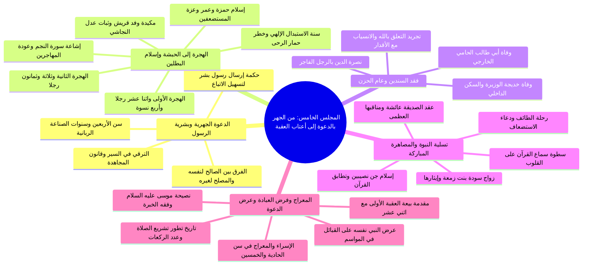

# 00 - الفهرس والخطة: المجلس الخامس من شرح الأرجوزة المئية

> [!info] بيانات المجلس الخامس
> - **المادة:** دراسة وشرح **[[الأرجوزة المئية]]** في ذكر حال أشرف البرية للإمام [[ابن أبي العز الحنفي]].
> - **الموضوع العام:** من انطلاق الدعوة الجهرية في السنة الرابعة، إلى الهجرتين إلى الحبشة ومكيدة وفد قريش وثبات النجاشي، وإسلام حمزة وعمر رضي الله عنهما وسنة الاستبدال، ووفاة أبي طالب وخديجة، ورحلة الطائف وإسلام جن نصيبين، وزواج سودة وعقد عائشة، وحادثة الإسراء والمعراج وتاريخ فرض الصلوات الخمس وتطورها، وانتهاءً ببدء عرض الدعوة على القبائل في مواسم الحج ومقدمات بيعة العقبة الأولى.
> - **المصدر المعتمد:** [[تفريغ المحاضرة 5]] — يعتمد التقسيم المنهجي على أرقام أسطر التفريغ لعدم وجود طوابع زمنية مسجلة بالتسجيل الصوتي.

---

## 📋 خطة الأجزاء وتوزيع الأسطر والمحاور العلمية

| رقم الجزء | عنوان الجزء | نطاق الأسطر بالتفريغ | الأبيات المشروحة والمحاور الأساسية |
|:---:|:---|:---:|:---|
| **01** | [[01 - الدعوة الجهرية وحكمة بشرية الرسول والفرق بين الصالح والمصلح]] | 1 – 126 | البيت 19 (ثم دعا في أربع الأعوام)، سن الأربعين وسنوات الصناعة، حكمة بشرية الرسل لتسهيل الاقتداء والواقعية، التدرج والترقي في السير إلى الله، والفرق الجوهري بين الصالح في نفسه والمصلح لغيره وسر عداوة أهل الباطل له |
| **02** | [[02 - الهجرتان إلى الحبشة ومكيدة قريش وثبات النجاشي]] | 127 – 150 | الأبيات 20-22: الهجرة الأولى (12 رجلاً و4 نسوة)، إشاعة إسلام قريش بعد سورة النجم وعودة المهاجرين، الهجرة الثانية (83 رجلاً و18 امرأة)، مكيدة وفد قريش (عمرو بن العاص وعبد الله بن أبي ربيعة)، وموقف النجاشي العادل وحمايته للمسلمين |
| **03** | [[03 - إسلام حمزة وعمر وسنة الاستبدال وفقه نصرة الدين]] | 151 – 162 | البيت 23: إسلام حمزة الأسد وعمر الفاروق في السنة السادسة واستعلاء المسلمين، سنة وقوانين الاستبدال الإلهي ﴿فسوف يأتي الله بقوم يحبهم ويحبونه﴾، التحذير من دوران المرء كحمار الرحى، والصدق والجدية في الالتزام |
| **04** | [[04 - وفاة أبي طالب وخديجة والانسيابية مع أقدار الله]] | 163 – 247 | البيتان 24-25: وفاة أبي طالب والسيدة خديجة في عام واحد بعد حصار الشِّعب، حقيقة تسمية «عام الحزن» عند أهل السير، تجريد التعلق بالله وسلب الأسناد الأرضية، الانسيابية مع أقدار الله وتغيير المسار الإجباري، وسنة نصرة الدين بالرجل الفاجر |
| **05** | [[05 - رحلة الطائف وإسلام جن نصيبين وزواج سودة وعائشة]] | 248 – 354 | الأبيات 26-28: رحلة الطائف ودعاء الاستضعاف، إسلام جن نصيبين في بطن نخلة وتطابق سورتي الجن والأحقاف مع الحدث، سطوة القرآن على القلوب الصادقة، زواج سودة في رمضان وإيثارها يومها لعائشة، وعقد عائشة في شوال وفضائلها وخصائصها |
| **06** | [[06 - الإسراء والمعراج وفرض الصلاة وتاريخ تشريعها]] | 355 – 439 | البيتان 29-30: الإسراء والمعراج في سن 51 سنة، فرض الصلوات الخمس بخمسين، تاريخ تطور الصلاة (من ركعتين بالغداة والعشي، إلى فرض الخمس، إلى زيادة ركعات الحضر بعد الهجرة)، مراجعة موسى وفقه الاستفادة من خبرات السابقين وتأمل التاريخ |
| **07** | [[07 - عرض الدعوة على القبائل وسنن المغالبة ومقدمة بيعة العقبة]] | 440 – 495 | البيت 31: عرض النبي ﷺ نفسه على وفود العرب في مواسم الحج والتجارة، مفهوم «مراد المقدر الذل للأقدار»، عقوبة الاستكبار وحول البصيرة (حيي بن أخطب)، قانون البلاغ الإنساني والتمام الرباني، ومقدمة بيعة العقبة الأولى مع 12 رجلاً |
| **08** | [[08 - ملخص المراجعة السريعة]] | مراجعة شاملة | جداول علمية مكثفة وخلاصات مركزة لمذاكرة كامل محاور المجلس وضبط تواريخه وأرقامه |
| **09** | [[09 - أسئلة المراجعة والاختبار الذاتي]] | تقييم الفهم | بنك أسئلة موضوعية ومقالية شاملة لجميع مسائل المجلس مع إخفاء الإجابات النموذجية داخل تبويبات مطوية |
| **10** | [[10 - خطة تطبيق الدروس]] | ملحق تطبيقي | جدول زمني ومسارات تنفيذية بمربعات اختيار للمهام المنهجية والسلوكية والدعوية المستنبطة من المحاضرة |
| **—** | [[سيرة_5_الارجوزة_المئية_ملف_مجمع]] | ملف شامل | التجميع الكامل والشامل لجميع نصوص وتفريغات وجداول أجزاء المجلس السبعة دون أي اختصار |

---

## 🗺️ خريطة المفاهيم العامة للمجلس

---

## 🔑 المفاهيم والكلمات المفتاحية (WikiLinks)

- [[الأرجوزة المئية]]
- [[ابن أبي العز الحنفي]]
- [[الدعوة الجهرية]]
- [[بشرية الأنبياء]]
- [[الصالح والمصلح]]
- [[الهجرة الأولى إلى الحبشة]]
- [[الهجرة الثانية إلى الحبشة]]
- [[النجاشي]]
- [[عمرو بن العاص]]
- [[حمزة بن عبد المطلب]]
- [[عمر بن الخطاب]]
- [[سنة الاستبدال]]
- [[أبو طالب]]
- [[خديجة بنت خويلد]]
- [[عام الحزن]]
- [[رحلة الطائف]]
- [[جن نصيبين]]
- [[سورة الجن]]
- [[سودة بنت زمعة]]
- [[عائشة بنت أبي بكر]]
- [[الإسراء والمعراج]]
- [[فرض الصلاة]]
- [[موسى عليه السلام]]
- [[بيعة العقبة الأولى]]

---

## 🔗 التنقل السريع

- **البدء بالجزء الأول:** [[01 - الدعوة الجهرية وحكمة بشرية الرسول والفرق بين الصالح والمصلح]]
- **الملف المجمع الكامل:** [[سيرة_5_الارجوزة_المئية_ملف_مجمع]]
- **ملخص المراجعة السريعة:** [[08 - ملخص المراجعة السريعة]]
- **الاختبار الذاتي:** [[09 - أسئلة المراجعة والاختبار الذاتي]]
- **خطة التطبيق:** [[10 - خطة تطبيق الدروس]]

---

> [!note] توثيق المصدر
> تم إعداد الفهرس استناداً إلى الشرح المفرغ في [[تفريغ المحاضرة 5]] ضمن سلسلة شرح الأرجوزة المئية في السيرة النبوية.
