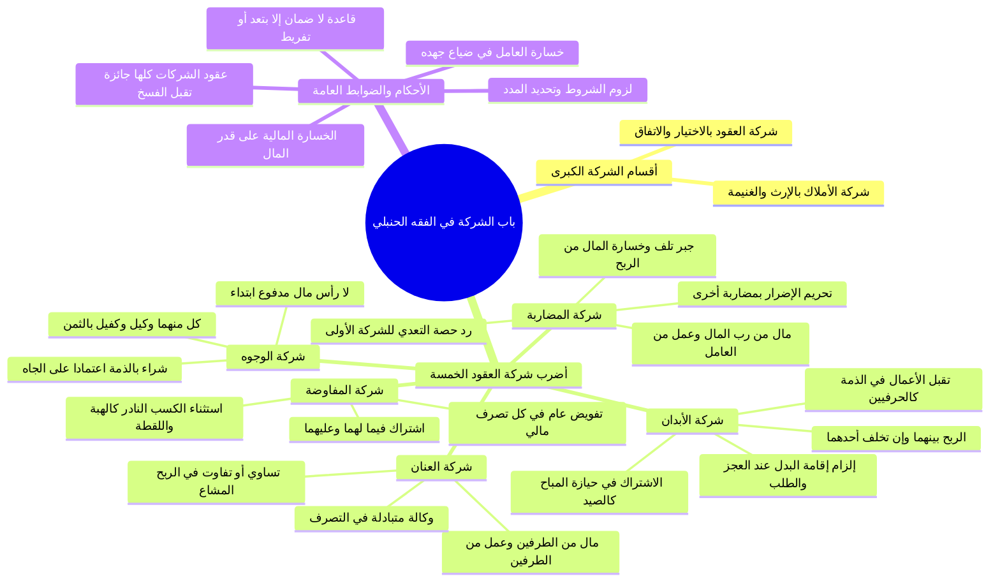

# 00 - الفهرس والخطة: المحاضرة 13 من شرح باب البيع (باب الشركة)

> [!info] بيانات المحاضرة
> - **المادة:** دراسة وشرح كتاب البيع من **[[أخصر المختصرات]]** للإمام [[ابن بلبان الحنبلي]] رحمه الله.
> - **الموضوع العام:** فصل الشركات في العقود وأنواعها الخمسة في المذهب الحنبلي: شركة العنان، شركة المضاربة وأحكام التعدي وجبر الخسران، شركة الوجوه، شركة الأبدان، وشركة المفاوضة، مع بيان أحكام جواز الفسخ والشروط الملزمة وقواعد الضمان وتوزيع الخسائر.
> - **المصدر المعتمد:** [[تفريغ المحاضرة 13]] — لا توجد توقيتات زمنية مسجلة بالتفريغ، المرجع المعتمد هو أرقام الأسطر.

---

## 📋 خطة الأجزاء وتوزيع الأسطر والمحاور الفقهية

| رقم الجزء | عنوان الجزء | نطاق الأسطر بالتفريغ | المتن المشروح والمحاور الأساسية |
|:---:|:---|:---:|:---|
| **01** | [[01 - مقدمة الشركات وشركة العنان وضوابط رأس المال والربح المشاع]] | 1 – 50 | فصل: «والشركة خمسة أضرب»، التمييز بين شركة الأملاك وشركة العقود، أهمية فقه المعاملات لفض المنازعات، تعريف شركة العنان، شروط جائز التصرف، حضور رأس المال نقداً، وعقد العمل المشترك واقتسام الربح بنسبة شائعة معلومة |
| **02** | [[02 - شركة المضاربة وضوابطها ورد حصة التعدي وقواعد جبر الخسارة]] | 51 – 182، 532 – 621، 788 – 799 | تعريف المضاربة (دفع مال معلوم لمن يتجر فيه بجزء من ربحه)، تحريم مضاربة العامل لآخر إن أضر بالأول، حكم رد حصة التعدي وتضمينها للشركة الأولى، أحكام تلف رأس المال بعد التصرف وجبر النقص من الربح قبل القسمة، والفرق بين العنان والمضاربة |
| **03** | [[03 - شركتا الوجوه والأبدان وأحكام الوكالة والكفالة وتقبل الأعمال]] | 183 – 464 | تعريف شركة الوجوه (الشراء في الذمة بالجاه)، الوكالة والكفالة المتبادلة وتوزيع الخسارة؛ تعريف شركة الأبدان ونوعاها (حيازة المباح كالصيد، وتقبل الأعمال في الذمة كالخياطين والمبيضين)، لزوم العمل لكليهما، حكم غياب أحدهما بعذر أو بدونه، وإلزام إقامة البدل |
| **04** | [[04 - شركة المفاوضة وجواز العقود وقواعد الضمان وتوزيع الخسائر]] | 465 – 531، 622 – 787 | تعريف شركة المفاوضة وتفويض التصرف المالي واستثناء الكسب النادر، حكم جواز عقود الشركات وحق الفسخ، أثر اشتراط المدة والوفاء بالشروط، قاعدة «لا ضمان إلا بتعدٍ أو تفريط»، توزيع الخسارة المالية على رب المال وخسارة الجهد على العامل، والتحذير من فتنة المال |
| **05** | [[05 - خطة تطبيق الدروس]] | ملحق تطبيقي | مسارات تنفيذية عملية بمربعات اختيار للمهام الفقهية والتعاقدية والسلوكية لتنظيم الشراكات الواقعية |
| **—** | [[ملخص المراجعة السريعة]] | مراجعة شاملة | جداول مقارنة مركزة وخلاصات فقهية محكمة لضبط أضرب الشركات الخمسة وشروطها وأحكامها |
| **—** | [[أسئلة المراجعة والاختبار الذاتي]] | تقييم الفهم | بنك أسئلة موضوعية ومقالية شاملة لجميع مسائل الباب مع إخفاء الإجابات النموذجية داخل تبويبات مطوية |
| **—** | [[باب_البيع_المحاضرة_13_ملف_مجمع]] | ملف شامل | الجمع الكامل لكافة الأجزاء مع نص الشارح الحرفي كاملاً وبدون أي اختصار أو اختزال |

---

## 🗺️ خريطة المفاهيم العامة لباب الشركة

---

## 🔑 المفاهيم والكلمات المفتاحية (WikiLinks)

- [[أخصر المختصرات]]
- [[ابن بلبان الحنبلي]]
- [[باب البيع]]
- [[باب الشركة]]
- [[شركة الأملاك]]
- [[شركة العقود]]
- [[شركة العنان]]
- [[شركة المضاربة]]
- [[شركة الوجوه]]
- [[شركة الأبدان]]
- [[شركة المفاوضة]]
- [[جائز التصرف]]
- [[جزء مشاع]]
- [[جبر الخسارة]]
- [[أمانة الشريك]]
- [[التعدي والتفريط]]
- [[العقود الجائزة]]
- [[المسلمون عند شروطهم]]
- [[كفالة الثمن]]
- [[تقبل الأعمال]]

---

## 🔗 التنقل السريع

- **البدء بالجزء الأول:** [[01 - مقدمة الشركات وشركة العنان وضوابط رأس المال والربح المشاع]]
- **الملف المجمع الكامل:** [[باب_البيع_المحاضرة_13_ملف_مجمع]]
- **ملخص المراجعة:** [[ملخص المراجعة السريعة]]
- **الاختبار الذاتي:** [[أسئلة المراجعة والاختبار الذاتي]]
- **خطة التطبيق:** [[05 - خطة تطبيق الدروس]]

---

> [!note] توثيق المصدر
> تم إعداد الفهرس استناداً إلى الشرح المفرغ في [[تفريغ المحاضرة 13]] ضمن دورة شرح أخصر المختصرات في الفقه الحنبلي.
