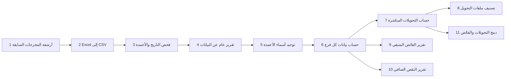

# تتبّع حساب الصنف 91756 من الإدخال إلى المخرجات

## الصنف المختار ومصدر البيانات

اخترت صنفًا موجودًا فعلًا في ملف الإدخال:

- **الكود:** `91756`
- **الاسم:** `ACETYL-C CORCEPT 20CAPS`
- **الوحدة:** علبة
- **موضعه في Excel:** الصف 23
- **فترة المبيعات في الملف:** من 22 يناير 2026 إلى 22 أبريل 2026 الساعة 17:32؛ وتحسبها الشيفرة **90 يومًا**.

الملف الأصلي هو:

`data/input/مبيعات الأصناف فى جميع المخازن.xlsx202604220522.xlsx`

تُظهر بيانات الإدخال أن مجموع المبيعات `148.5` ومجموع الأرصدة `70`. عمود «متوسط المبيعات» في Excel مقرب إلى منزلتين؛ حساب التوزيع يعيد حساب المتوسط من إجمالي مبيعات الفترة وعدد الأيام، لذلك سأستخدم القيم غير المقربة مثل `43.5 ÷ 90`.

## مسار الصنف عبر خطوات التشغيل

في المشروع 11 خطوة مرتبة. الخطوة 1 تتعامل مع المخرجات السابقة، والخطوة 2 هي إدخال ملف Excel.

### 1. أرشفة المخرجات السابقة

قبل تجهيز تشغيل جديد، تحفظ خطوة **Data Archiving** (أرشفة البيانات) نسخة من المخرجات السابقة ثم تفرغ مجلد المخرجات. هذه الخطوة لا تحسب كمية الصنف ولا تغير ملف Excel.

### 2. إدخال ملف Excel وتحويله إلى CSV

تقرأ خطوة `IngestData` ملف Excel وتحوله إلى **CSV** (ملف جدول نصي تستخدمه بقية المعالجة):

`data/output/converted/csv/مبيعات الأصناف فى جميع المخازن.xlsx202604220522.csv`

في هذا الملف يظهر الصنف بالقيم نفسها الموجودة في Excel: مبيعات الإدارة `0` ورصيدها `25`، ومبيعات الفروع الأخرى وأرصدتها كما في الجدول التالي. التحويل هنا يغيّر صيغة الملف؛ لا يحسب التحويلات.

### 3. التحقق من التاريخ والأعمدة

تتأكد خطوة `ValidateInventory` من وجود نطاق تاريخ صالح ورؤوس الأعمدة اللازمة. سجل المشروع يذكر نجاح فحص التاريخ وفحص الأعمدة لهذا الإدخال. الفحص لا يعدل المبيعات أو الأرصدة.

### 4. تحليل المبيعات

تنتج خطوة `AnalyzeSales` تقريرًا عامًا عن الملف، ولا تحدد احتياج الصنف للتحويل. التقرير الفعلي يسجل `4746` صفًا و`25` عمودًا و`0` خلية فارغة، ويحفظ نطاق التاريخ. لذلك لا يظهر في هذه الخطوة جدول تحويل لهذا الصنف؛ الحساب التفصيلي يأتي لاحقًا.

التقرير:

`data/output/sales_analysis/csv/analysis_مبيعات الأصناف فى جميع المخازن.xlsx202604220522.csv`

### 5. توحيد أسماء الأعمدة

تبدّل خطوة `NormalizeSchema` أسماء الأعمدة العربية إلى أسماء ثابتة تقرؤها الشيفرة. مثلًا:

- `مبيعات العقبى` ← `okba_sales`
- `رصيد العقبى` ← `okba_balance`
- `مبيعات النجوم` ← `star_sales`
- `رصيد النجوم` ← `star_balance`

تحفظ النسخة الموحدة في:

`data/output/converted/renamed/مبيعات الأصناف فى جميع المخازن.xlsx202604220522_renamed_20260422_174259.csv`

أسماء الأعمدة تغيرت، أما قيم الصنف فلم تتغير.

### 6. حساب الاحتياج والفائض والنقص لكل فرع

تقرأ خطوة `SegmentBranches` الصف الموحد، وتحوّله إلى سجل مستقل لكل فرع. في هذه الخطوة تستخدم قاعدة المخزون `StockCalculator` القيم الافتراضية للمشروع:

- **20 يومًا** لتحديد مخزون الاحتياج المستهدف.
- **60 يومًا** لتحديد مستوى الفائض.
- **30 يومًا** لتحديد مستوى النقص.

معاني المصطلحين المستخدمين في المعادلات:

- `ceil`: تقريب إلى العدد الصحيح الأعلى.
- `floor`: تقريب إلى العدد الصحيح الأدنى.
- المتوسط اليومي = مبيعات الفترة ÷ 90.

| الفرع | مبيعات الفترة | الرصيد | المتوسط اليومي | هدف 20 يومًا | الاحتياج بعد قواعد النظام | هدف 60 يومًا | الفائض | هدف 30 يومًا | النقص قبل التوزيع |
|---|---:|---:|---:|---:|---:|---:|---:|---:|---:|
| الإدارة `administration` | 0 | 25 | 0.0000 | 0 | 0 | 0 | 25 | 0 | 0 |
| العشرين `asherin` | 17 | 10 | 0.1889 | 4 | 0 | 12 | 0 | 6 | 0 |
| العقبى `okba` | 43.5 | 8.5 | 0.4833 | 10 | 2 | 29 | 0 | 15 | 7 |
| الشهيد `shahid` | 23.5 | 9.5 | 0.2611 | 6 | 0 | 16 | 0 | 8 | 0 |
| النجوم `star` | 54.5 | 9 | 0.6056 | 13 | 4 | 37 | 0 | 19 | 10 |
| الورداني `wardani` | 10 | 8 | 0.1111 | 3 | 0 | 7 | 1 | 4 | 0 |

مثال حساب العقبى:

1. متوسط البيع اليومي = `43.5 ÷ 90 = 0.4833` تقريبًا.
2. هدف الاحتياج = `ceil(0.4833 × 20) = 10` علب تقريبًا.
3. الاحتياج الخام = `ceil(10 − 8.5) = 2`.
4. هدف النقص = `ceil(0.4833 × 30) = 15`؛ والنقص = `ceil(15 − 8.5) = 7`.

والنجوم:

1. متوسط البيع اليومي = `54.5 ÷ 90 = 0.6056` تقريبًا.
2. هدف الاحتياج = `ceil(0.6056 × 20) = 13`.
3. الاحتياج = `ceil(13 − 9) = 4` علب.
4. هدف النقص = `ceil(0.6056 × 30) = 19`؛ والنقص = `19 − 9 = 10` علب.

تطبق الشيفرة بعد حساب الاحتياج قواعد إضافية: تمنع الاحتياج إذا بلغ الرصيد `30`، وتكبح الاحتياج الأقل من `10` عندما تكون **كمية هدف الاحتياج** `15` وحدة أو أكثر، ثم تحده بحيث لا يتجاوز الرصيد بعد الإضافة `30`. في هذا المثال هدف العقبى `10` وهدف النجوم `13` وحدة؛ لم تنطبق قاعدة الاحتياج الصغير، فبقي الاحتياج `2` و`4` كما هو.

تحفظ النتائج المحسوبة لكل فرع في ملفات مثل:

- `data/output/branches/analytics/okba/main_analysis_okba.csv`
- `data/output/branches/analytics/star/main_analysis_star.csv`
- وبقية الفروع في المجلد نفسه باسم كل فرع.

### 7. توزيع الكمية على الفروع المحتاجة

تستخدم خطوة `OptimizeTransfers` الاحتياج المحسوب في الخطوة السابقة، ثم ترتب الفروع المحتاجة وفق **Priority Score** (درجة أولوية تجمع مقدار الاحتياج والرصيد ومتوسط البيع). أوزان الحساب في المشروع هي: `0.60` للرصيد، و`0.30` للاحتياج، و`0.10` لمتوسط البيع اليومي:

`الدرجة = 0.60 ÷ (الرصيد + 0.1) + 0.30 × الاحتياج + 0.10 × المتوسط اليومي`

- النجوم: `0.60 ÷ 9.1 + 0.30 × 4 + 0.10 × 0.6056 ≈ 1.3265`.
- العقبى: `0.60 ÷ 8.6 + 0.30 × 2 + 0.10 × 0.4833 ≈ 0.7181`.

لذلك يبدأ النظام بالنجوم ثم العقبى. الفائض المتاح للمصدرين هو الإدارة `25` علبة والورداني `1` علبة؛ في كل دورة يختار النظام الفرع ذي الفائض الأكبر، ثم يخصص وحدة واحدة للفروع المحتاجة حسب ترتيب الأولوية. وتستمر الدورات حتى تغطى الاحتياجات أو ينفد الفائض.

في هذا المثال:

| الدورة | إلى النجوم | إلى العقبى | فائض الإدارة بعد الدورة |
|---|---:|---:|---:|
| 1 | 1 | 1 | 23 |
| 2 | 1 | 1 | 21 |
| 3 | 1 | 0 | 20 |
| 4 | 1 | 0 | 19 |

إذن مخرجات التحويل المباشر هي **4 علب من الإدارة إلى النجوم** و**علبتان من الإدارة إلى العقبى**. يتبقى فائض قدره `19` في الإدارة و`1` في الورداني؛ لم يحتج الصنف إلى مزيد من النقل بعد تلبية الاحتياجين.

تظهر الكميتان في ملف التجميعة حسب مصدر الإدارة وفئة الأقراص والكبسولات:

`data/output/transfers/csv/transfers_from_administration_to_other_branches/from_administration_all_transfers_collection/from_administration_all_tablets_and_capsules_20260422_174302.csv`

| الصنف | الكمية المحولة | الفرع المستلم |
|---|---:|---|
| `ACETYL-C CORCEPT 20CAPS` | 2 | العقبى `okba` |
| `ACETYL-C CORCEPT 20CAPS` | 4 | النجوم `star` |

قيمة `sender_balance` المسجلة في الملف هي `25` لكلا الصفين؛ إنها رصيد المصدر قبل اعتبار التحويلات، وليست الرصيد النهائي بعد إرسال الكمية.

### 8. تصنيف ملفات التحويلات

تأخذ خطوة `ClassifyTransfers` التحويلات المباشرة وتقسم ملفاتها بحسب الفرع المرسل والمستقبل وفئة الصنف. مثال ملف العقبى:

`data/output/transfers/csv/transfers_from_administration_to_other_branches/administration_to_okba/administration_to_okba_20260422_174304_tablets_and_capsules.csv`

وفي ملف النجوم تكون الكمية `4`. التصنيف ينظم الملفات، ولا يعيد توزيع الوحدات أو يغير الكميتين `2` و`4`.

### 9. إنشاء تقرير الفائض المتبقي

تعيد خطوة `ReportSurplus` حساب نتيجة التوزيع، ثم تسجل الفائض الذي لم يُستخدم في تحويل مباشر:

- الإدارة: `25 − 6 = 19` علبة.
- الورداني: `1` علبة بقيت بلا تخصيص.

وتظهر القيمتان في:

- `data/output/remaining_surplus/csv/administration/remaining_surplus_administration_tablets_and_capsules_20260422.csv`
- `data/output/remaining_surplus/csv/wardani/remaining_surplus_wardani_tablets_and_capsules_20260422.csv`

### 10. إنشاء تقرير النقص الصافي

قبل التحويل كان نقص العقبى `7` والنجوم `10`، أي `17` علبة. بعد التحويل المباشر:

- العقبى: `7 − 2 = 5` علب نقص.
- النجوم: `10 − 4 = 6` علب نقص.
- مجموع النقص غير المغطى: `5 + 6 = 11`.
- الفائض غير المخصص في الشبكة: `19 + 1 = 20`.

تحسب الشيفرة النقص الصافي هكذا: `max(0, 11 − 20) = 0`. لذلك لا يظهر الصنف في ملفات تقرير النقص؛ فالتقرير لا يكتب الصنف عندما يكون النقص الصافي صفرًا.

### 11. دمج التحويلات مع سجلات الفائض

تجمع خطوة `ConsolidateTransfers` التحويلات المباشرة مع فائض الفروع غير الإدارية المرسل إلى الإدارة. لذلك تظهر المخرجات النهائية:

- في ملف الإدارة المدمج: تحويلان مباشران، `2` إلى العقبى و`4` إلى النجوم، ونوعهما `normal` (تحويل لتغطية الاحتياج).
- في ملف الورداني: `1` علبة إلى الإدارة، ونوعها `surplus` (نقل فائض متبقٍ).
- فائض الإدارة `19` لا يسجل كتحويل إلى الإدارة نفسها.

مثال المخرج:

`data/output/combined_transfers/merged/csv/combined_transfers_from_administration_20260422_174311/administration_combined_tablets_and_capsules.csv`

أما تحويل فائض الورداني فيظهر في:

`data/output/combined_transfers/merged/csv/combined_transfers_from_wardani_20260422_174311/wardani_combined_tablets_and_capsules.csv`

## كيف تظهر النتيجة في صفحة الصورة؟

الإعداد في `src/presentation/gui/config/file_browsers.py` يربط صفحة **«التحويلات المجمعة بدون نقل الفائض المتبقي»** بفئة `collections` ومجلد `data/output/transfers/csv`. لهذا تعرض صفّي الخطوة 7 (2 إلى العقبى و4 إلى النجوم). لا تعرض الصفحة سجل فائض الورداني إلى الإدارة الذي يُنشأ لاحقًا ضمن مخرجات الخطوة 11.

## ملاحظة عن تواريخ الملفات

سجل التشغيل في `data/logs/log.txt` يوثق نجاح خطوات المعالجة الـ11 يوم 22 أبريل 2026 قرابة 17:43. كما يحتوي الأرشيف `data/archive/archive_20260422_185815.zip` على مخرجات ذلك التشغيل المؤرخة `17:43`، ومنها صفوف الصنف أعلاه. الملفات الموجودة حاليًا في `data/output` تحمل أختامًا زمنية قرابة `18:58`، وقد تحققت أن صفوف الصنف فيها تطابق الكميات نفسها: `2` إلى العقبى و`4` إلى النجوم، والفائض `19` في الإدارة و`1` في الورداني.

هذه بيانات تشغيل مؤرخ في **22 أبريل 2026**؛ توضح طريقة الحساب في ذلك التشغيل، ولا تمثل بالضرورة أرصدة اليوم.

## ملفات الشيفرة التي تحدد هذا المسار

- `src/application/pipeline/pipeline_config.py`: ترتيب الخطوات من 1 إلى 11.
- `src/application/use_cases/ingest_data.py` و`src/infrastructure/converters/converters/excel_to_csv.py`: إدخال Excel وإنشاء CSV.
- `src/application/use_cases/validate_inventory.py`: فحص التاريخ ورؤوس الأعمدة.
- `src/application/use_cases/analyze_sales.py` و`src/infrastructure/services/analysis/sales_analyzer.py`: التقرير العام عن جودة بيانات المبيعات.
- `src/application/use_cases/normalize_schema.py` و`src/infrastructure/converters/mappers/column_mapper.py`: توحيد أسماء الأعمدة.
- `src/infrastructure/repositories/mappers/mappers.py` و`src/domain/services/inventory/stock_calculator.py`: تحويل صف الصنف إلى احتياج وفائض ونقص لكل فرع.
- `src/application/use_cases/optimize_transfers.py` و`src/domain/services/distribution_service.py` و`src/domain/services/priority_service.py`: ترتيب الفروع وتحديد التحويلات.
- `src/infrastructure/repositories/persistence/transfers_persistence.py`: حفظ التجميعات والتصنيفات.
- `src/application/use_cases/report_surplus.py` و`src/application/use_cases/report_shortage.py`: تقريري الفائض والنقص.
- `src/domain/services/consolidation_service.py` و`src/application/use_cases/consolidate_transfers.py`: إضافة سجلات الفائض وإنتاج الملفات المدمجة.
