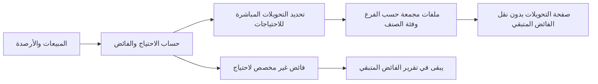

# شرح التحويلات المجمعة بدون نقل الفائض المتبقي

هذه الصفحة هي الخيار الظاهر في الصورة: **«التحويلات المجمعة بدون نقل الفائض المتبقي»**.

## الفكرة باختصار

الصفحة تعرض ملفات التحويلات المباشرة التي نتجت من **الخطوة 7: تحسين التوزيع**. تجمع كل ملف حسب **الفرع المرسل** وفئة الصنف، وتضع وجهة كل كمية في صف داخل الملف.

كلمة **مجمعة** هنا تعني أن الملف الواحد قد يحتوي على أصناف محولة من فرع مصدر واحد إلى عدة فروع مستقبلة. الصفحة نفسها عارض للملفات الناتجة؛ لا تنفذ التوزيع عند فتحها.

أما **بدون نقل الفائض المتبقي** فتعني عدم إضافة تحويل إضافي للفائض الذي بقي بعد تلبية الاحتياجات إلى الإدارة. قد يستخدم النظام فائض الفرع لتغطية احتياج الفروع في التوزيع المباشر، لكن الكمية التي لا تُخصص لاحتياج لا تتحول في هذه الصفحة إلى شحنة فائض إضافية.

## كيف يحدد النظام التحويلات المباشرة؟

1. يقرأ بيانات المبيعات والأرصدة لكل صنف في الفروع.
2. يحسب الاحتياج والفائض وفق إعدادات أيام التغطية. القيم الافتراضية في المشروع هي 20 يومًا للاحتياج، و60 يومًا للفائض، و30 يومًا للنقص.
3. يرتب الفروع المحتاجة حسب درجة الأولوية؛ ثم يوزع وحدات الصنف من الفرع الذي لديه أكبر فائض متبقٍ على الفروع المحتاجة، جولةً بعد جولة، إلى أن ينفد الفائض المتاح أو تُغطى الاحتياجات.
4. يحفظ نتائج التحويل المباشر في ملفات الخطوة 7، مجمعة حسب الفرع المرسل وفئة المنتج. يظهر الفرع المستلم والكمية في كل صف.

### مخطط المسار

## مثال حقيقي من ملفات المشروع

وجدت المثال التالي في ملف تحويلات الإدارة لفئة الأقراص والكبسولات:

`data/output/transfers/csv/transfers_from_administration_to_other_branches/from_administration_all_transfers_collection/from_administration_all_tablets_and_capsules_20260422_185824.csv`

الملف مؤرخ **22 أبريل 2026**؛ أستخدمه لشرح شكل البيانات، وليس على أنه يعكس الأرصدة الحالية.

| كود الصنف | الصنف                   | الكمية المحولة | الفرع المستلم | رصيد المرسل المسجل | رصيد المستلم المسجل |
| --------- | ----------------------- | -------------: | ------------- | -----------------: | ------------------: |
| 91756     | ACETYL-C CORCEPT 20CAPS |              2 | okba          |               25.0 |                 8.5 |
| 91756     | ACETYL-C CORCEPT 20CAPS |              4 | star          |               25.0 |                 9.0 |

**قراءة المثال:** الملف يعرض الصنف نفسه في صفين لأن الكمية موزعة على وجهتين: وحدتان إلى `okba` وأربع وحدات إلى `star`؛ أي ست وحدات مجموعًا في هذين التحويلين. العمودان `sender_balance` و`receiver_balance` يعرضان الأرصدة المسجلة في البيانات. لا ينبغي اعتبار رصيد المرسل 25.0 رصيدًا نهائيًا بعد التحويل أو طرح الست وحدات منه لاستنتاج الرصيد النهائي.

## أين يظهر الفائض الذي لم يتحول؟

توجد صفحة منفصلة اسمها **«الفائض المتبقي»**، وملفاتها تحت `data/output/remaining_surplus`. وهي مخصصة لعرض الأصناف التي بقي لديها فائض بعد حساب التوزيع. لذلك:

- صفحة الصورة: تعرض تحويلات الخطوة 7 المباشرة؛ ويمكن أن يذهب الصنف إلى أكثر من فرع، كما في المثال.
- صفحة الفائض المتبقي: تعرض كميات الفائض التي لم تُخصص لاحتياجات التحويل المباشر.
- صفحة **«التحويلات المجمعة مع نقل الفائض المتبقي»**: تعرض نواتج الخطوة 11 التي تدمج التحويلات المباشرة مع سجلات تحويل الفائض المتبقي.

## مراجع من الشيفرة

- `src/presentation/gui/config/file_browsers.py`: يربط الصفحة بفئة `collections` ومجلد ملفات التحويلات والخطوة 7، ويشرح أنها بدون نقل الفائض.
- `src/infrastructure/repositories/persistence/transfers_persistence.py`: يجمع التحويلات بحسب الفرع المصدر وفئة الصنف، ويكتب وجهة كل تحويل في صف.
- `src/domain/services/distribution_service.py`: ينفذ توزيع وحدات الصنف من الفروع ذات الفائض إلى الفروع ذات الاحتياج.
- `src/domain/services/consolidation_service.py`: يضيف في تقرير الدمج سجلات الفائض المتبقي للفروع غير الإدارية باتجاه الإدارة؛ وهذا مسار مختلف عن صفحة الصورة.
