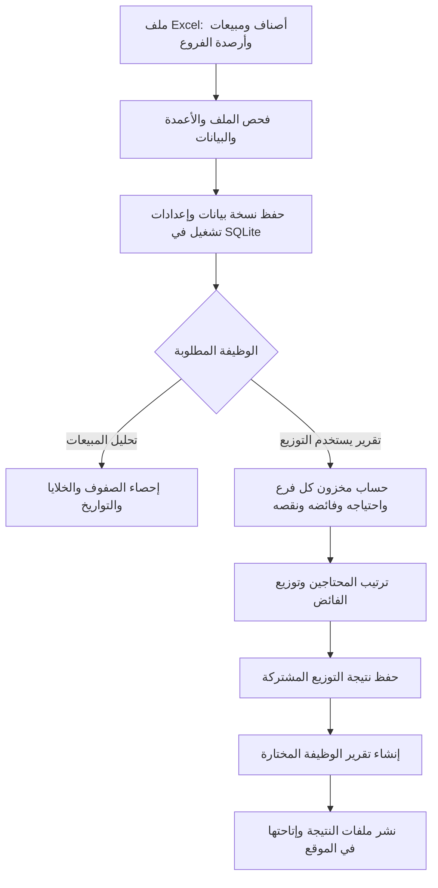

# رحلة الصنف من ملف Excel إلى تقارير التوزيع

هذا الشرح يصف تنفيذ البرنامج الحالي في المستودع عند النسخة `bd57a23`، باستخدام الإعدادات الافتراضية ما لم يُذكر غير ذلك. المثال الرئيسي مأخوذ من بيانات الاختبار الموجودة في المشروع للصنف **91756 — ACETYL-C CORCEPT 20CAPS**. هي عينة اختبار موثقة، وليست وصفًا للمخزون الحالي.

## 1. الصورة الكاملة



**الوظائف مستقلة في الطلب.** مثلًا، عند طلب «تقرير النقص»، يحسب البرنامج بيانات التوزيع إذا لم تكن محفوظة لهذا التشغيل، ثم ينشئ تقرير النقص. لا يشترط إنشاء تقرير تحليل المبيعات أو ملفات التحويلات أولًا. النتيجة المشتركة تُحفظ لإعادة استخدامها ما دامت تطابق ملف الإدخال والإعدادات وإصدار حساب التوزيع.

## 2. ما البيانات التي يدخل بها الصنف؟

يختار المستخدم ملف **Excel**، وهو ملف جدول بيانات. يقرأ البرنامج أول ورقة منه. يمكن أن تكون عناوين الأعمدة في الصف الأول إذا كانت أول خلية هي `كود`؛ وإلا يتوقع عنوان الفترة في الصف الأول وعناوين الأعمدة في الصف الثاني.

تتضمن البيانات المطلوبة رمز الصنف واسمه، ومبيعاته ورصيده لكل فرع. يحوّل البرنامج أسماء الأعمدة المعروفة إلى أسماء داخلية موحّدة؛ مثل `مبيعات العقبى` إلى `okba_sales` و`رصيد العقبى` إلى `okba_balance`. يحوَّل رمز الصنف إلى نص. إذا أدخِل الرمز في Excel كرقم، فقد تكون الأصفار الأولى قد فُقدت بالفعل؛ أدخله كنص عندما تكون هذه الأصفار جزءًا من الرمز.

قبل بدء التشغيل يتحقق البرنامج من وجود الأعمدة المطلوبة، وألا تكون أسماؤها فارغة أو مكررة بعد تحويلها، وأن يكون للصنف رمز واسم، وألا يتكرر رمز الصنف في الملف. ويتحقق أن مبيعات ورصيد كل فرع أرقام موجودة ومحدودة. إذا فشل الاستيراد لا ينشر تشغيلًا جديدًا ناقصًا.

### بيانات المثال

فترة العينة من **22/01/2026 00:00** إلى **22/04/2026 17:32**. يحسب البرنامج الفرق بالأيام الكاملة، فتكون المدة **90 يومًا**. الأرقام التالية تخص صف الصنف نفسه:

| الفرع | اسمه داخل البرنامج | المبيعات خلال الفترة | الرصيد في الملف |
|---|---|---:|---:|
| الإدارة | `administration` | 0 | 25 |
| العشرين | `asherin` | 17 | 10 |
| النجوم | `star` | 54.5 | 9 |
| الشهيد | `shahid` | 23.5 | 9.5 |
| العقبى | `okba` | 43.5 | 8.5 |
| الورداني | `wardani` | 10 | 8 |

مجموع مبيعات الفروع في العينة **148.5** ومجموع أرصدتها **70**. يحسب البرنامج متوسط كل فرع من مبيعاته وعدد الأيام؛ لا يعتمد في هذا الحساب على عمود «متوسط مبيعات» وارد في الملف.

إذا كان صف الأعمدة الأول يبدأ مباشرة بكلمة `كود`، فلا يوجد رأس فترة، ويستخدم المستورد **90 يومًا** افتراضيًا. أما إذا وُجد رأس فترة غير فارغ ولم يتمكن من استخراج تاريخي البداية والنهاية منه، فيرفضه. يحسب الفرق الصحيح بالأيام الكاملة، وبحد أدنى يوم واحد للتاريخين الصحيحين المتساويين؛ ويرفض تاريخ نهاية أسبق من البداية. هذه قواعد مسار SQLite الحالي، ولا ينبغي الخلط بينها وبين مدقق ملفات CSV الأقدم في المشروع.

## 3. كيف تُحفظ المدخلات؟

ينشئ البرنامج **run**، أي تشغيلًا له معرّف مستقل `run_id`، ويحفظ بيانات الملف وإعدادات التغطية في **SQLite**، وهي قاعدة بيانات محلية داخل ملف. يحفظ اسم الملف وبصمته **SHA-256**، أي قيمة تُستخدم لتمييز محتواه، والفترة وعدد الأيام وصفوف الأصناف ومبيعات الفروع وأرصدتها.

مكان القاعدة الافتراضي هو `data/sqlite/inventory.sqlite3`. وعند حساب النتائج يستعيد البرنامج بيانات التشغيل المحفوظة؛ لذلك يمكن اختيار تشغيل سابق حتى لو تغيّر ملف الإدخال الأصلي لاحقًا. تغيير الملف أو الإعدادات في الواجهة ينشئ تشغيلًا مختلفًا عند تنفيذ وظيفة جديدة.

الإعدادات الافتراضية للتشغيل هي:

| الإعداد | قيمته | الغرض |
|---|---:|---|
| أيام الاحتياج `need_days` | 20 | تحديد هدف الرصيد المستخدم لحساب الاحتياج للتحويل المباشر. |
| أيام الفائض `surplus_days` | 60 | تحديد رصيد التغطية الذي يُحتفظ به عند حساب الفائض. |
| أيام النقص `shortage_days` | 30 | تحديد هدف آخر لحساب النقص في تقرير النقص. |

## 4. معادلات مخزون كل فرع

لصنف واحد وفرع واحد، نستخدم الرموز التالية:

| الرمز | معناه |
|---|---|
| `S` | مبيعات الصنف في الفرع خلال الفترة. |
| `B` | رصيد الصنف في الفرع كما ورد في ملف الإدخال. |
| `D` | عدد أيام فترة المبيعات. |
| `A` | متوسط المبيعات اليومي. |
| `ceil(x)` | التقريب إلى العدد الصحيح الأعلى؛ مثل `ceil(8.1) = 9`، و`ceil(8) = 8`. |
| `floor(x)` | التقريب إلى العدد الصحيح الأدنى؛ مثل `floor(1.9) = 1`. |
| `max(0, x)` | استخدام الصفر إذا كانت `x` سالبة، وإلا استخدام `x`. |

### أ. متوسط المبيعات وأهداف التغطية

```text
A = S ÷ D
هدف الاحتياج = ceil(A × أيام الاحتياج)
هدف الفائض   = ceil(A × أيام الفائض)
هدف النقص    = ceil(A × أيام النقص)
```

كل هدف يُقرَّب إلى أعلى **قبل** طرح الرصيد. يستخدم الحساب القيمة الفعلية للمتوسط، حتى لو عُرضت في الشرح بعد التقريب لتسهيل القراءة.

### ب. القيم الأولية

```text
الاحتياج الأولي = ceil(max(0, هدف الاحتياج - B))
الفائض الأولي   = floor(max(0, B - هدف الفائض))
نقص الفرع الأولي = ceil(max(0, هدف النقص - B))
```

الفائض والاحتياج والنقص المحسوبون هنا كميات صحيحة. قد يكون الرصيد الأصلي كسريًا، مثل رصيد العقبى `8.5`، فتظهر أهمية التقريب بعد طرحه.

### ج. قواعد تعديل الاحتياج للتحويل

بعد حساب الاحتياج الأولي يطبّق البرنامج هذه القواعد بالترتيب:

1. إذا كان رصيد الفرع `B ≥ 30`، يصبح الاحتياج للتحويل صفرًا.
2. إذا كان **هدف الاحتياج بالوحدات** `≥ 15` وكان الاحتياج الأولي `< 10`، يصبح الاحتياج للتحويل صفرًا. العدد 15 هنا كمية الهدف المحسوبة، وليس عدد أيام التغطية.
3. إذا بقي احتياج موجب، يحدّه البرنامج بالمساحة الصحيحة المتاحة قبل رصيد 30: `min(الاحتياج الأولي, int(max(0, 30 - B)))`. الدالة `int` هنا تحذف الجزء الكسري للقيمة غير السالبة.

هذه القواعد تُطبّق على **الاحتياج للتحويل**؛ حساب نقص الفرع الأولي له معادلة منفصلة.

## 5. تطبيق المعادلات على الصنف 91756

الجدول يستخدم المبيعات والأرصدة في القسم 2 والمدة 90 يومًا. «المتوسط» مقرب لأربعة منازل للعرض فقط. الأهداف بالترتيب هي أهداف 20 و60 و30 يومًا.

| الفرع | المتوسط اليومي | هدف الاحتياج 20 | هدف الفائض 60 | هدف النقص 30 | احتياج التحويل بعد القواعد | فائض مبدئي | نقص الفرع الأولي |
|---|---:|---:|---:|---:|---:|---:|---:|
| الإدارة | 0 | 0 | 0 | 0 | 0 | 25 | 0 |
| العشرين | 0.1889 | 4 | 12 | 6 | 0 | 0 | 0 |
| النجوم | 0.6056 | 13 | 37 | 19 | 4 | 0 | 10 |
| الشهيد | 0.2611 | 6 | 16 | 8 | 0 | 0 | 0 |
| العقبى | 0.4833 | 10 | 29 | 15 | 2 | 0 | 7 |
| الورداني | 0.1111 | 3 | 7 | 4 | 0 | 1 | 0 |

### حساب النجوم خطوة بخطوة

```text
المتوسط = 54.5 ÷ 90 = 0.605555… وحدة يوميًا
هدف الاحتياج = ceil(0.605555… × 20) = ceil(12.1111…) = 13
احتياج التحويل = ceil(max(0, 13 - 9)) = 4
هدف الفائض = ceil(0.605555… × 60) = 37
الفائض = floor(max(0, 9 - 37)) = 0
هدف النقص = ceil(0.605555… × 30) = 19
نقص الفرع الأولي = ceil(max(0, 19 - 9)) = 10
```

لا تُصفَّر حاجة النجوم بقاعدة الهدف 15، لأن هدفها 13. والفرق بين **4 للتحويل** و**10 للنقص الأولي** ناتج عن هدفَي 20 و30 يومًا.

### حساب العقبى والورداني

في العقبى: `43.5 ÷ 90 = 0.483333…`، وهدف الاحتياج `ceil(0.483333… × 20) = 10`. إذن الاحتياج `ceil(10 - 8.5) = 2`. وهدف النقص `ceil(0.483333… × 30) = 15`، فيكون نقص الفرع الأولي `ceil(15 - 8.5) = 7`.

في الورداني: `10 ÷ 90 = 0.111111…`، وهدف الفائض `ceil(0.111111… × 60) = 7`. الرصيد 8، إذن الفائض `floor(8 - 7) = 1`. وفي الإدارة المبيعات صفر والرصيد 25، فيكون فائضها المبدئي 25.

## 6. كيف يختار البرنامج المستلِم والمرسِل؟

يجمع البرنامج احتياجات الصنف وفوائضه بين الفروع. إذا كان للفرع احتياج للتحويل أو نقص أولي موجب، يوضع ضمن قائمة المحتاجين؛ وإلا يُضاف إلى مصادر الفائض إذا كان فائضه موجبًا. قد يوجد فرع في قائمة المحتاجين بسبب النقص مع أن احتياجه للتحويل صفر؛ لكنه لا يستلم في دورة التحويل ما دام احتياجه للتحويل صفرًا.

يرتب البرنامج الفروع ذات الاحتياج للتحويل حسب **درجة الأولوية**؛ الدرجة الأكبر تأتي أولًا:

```text
إذا كان احتياج التحويل ≤ 0: الدرجة = 0
وإلا:
الدرجة = 0.60 × (1 ÷ (الرصيد + 0.1))
       + 0.30 × احتياج التحويل
       + 0.10 × متوسط المبيعات اليومي
```

العدد `0.1` في مقام الرصيد هو معامل موجود في الكود لتجنب القسمة على صفر. في العينة درجة النجوم تقريبًا **1.3265**، ودرجة العقبى **0.7181**؛ لذلك يبدأ الدور بالنجوم.

### توزيع الوحدات في المثال

1. يبدأ الفائض المتاح بالإدارة **25** وبالورداني **1**، والاحتياج **4 للنجوم** و**2 للعقبى**.
2. يمر البرنامج على المحتاجين بترتيب الأولوية. في كل مرور يعطي وحدة واحدة لكل فرع ما دام يحتاج، ويختار في كل مرة المصدر ذا الفائض الأكبر **في تلك اللحظة**.
3. في المرور الأول: الإدارة ← النجوم وحدة، ثم الإدارة ← العقبى وحدة. وفي الثاني يتكرر ذلك. بعده اكتمل احتياج العقبى، وبقي للنجوم وحدتان.
4. يرسل البرنامج وحدتين أخريين من الإدارة إلى النجوم في مرورين لاحقين. عندها يصبح الاحتياج للتحويل صفرًا.

الناتج: الإدارة ← النجوم **4**، والإدارة ← العقبى **2**. بقي فائض الإدارة `25 - 6 = 19`، وفائض الورداني **1**؛ مجموع الفائض المتبقي **20**. لا تُحوَّل وحدة الورداني مباشرة في هذه العينة لأن الإدارة كانت المصدر الأكبر فائضًا طوال الجولات الست.

قد يعرض ملف التقرير صف العقبى قبل صف النجوم بعد ترتيب الصفوف، رغم أن النجوم بدأت دورة التوزيع بسبب أولويتها. ترتيب عرض الصفوف لا يغير كميات التحويل المحسوبة.

عند تساوي درجات الأولوية أو تساوي الفائض، يعتمد الاختيار على ترتيب الإدخال المحفوظ في التنفيذ: ترتيب الفروع الحالي هو الإدارة، العشرين، النجوم، الشهيد، العقبى، الورداني. التوزيع يدور وحدة بوحدة، وليس إرسال احتياج الفرع الأعلى كله دفعة واحدة.

## 7. ماذا يعني النقص المتبقي؟

بعد التحويل المباشر، يحسب البرنامج للصنف:

```text
المستلم للفرع = مجموع التحويلات المباشرة الواردة إليه
الاحتياج المتبقي = مجموع max(0, احتياج التحويل للفرع - المستلم للفرع)
النقص الإجمالي بعد التحويلات = مجموع max(0, نقص الفرع الأولي - المستلم للفرع)
فائض الشبكة المتبقي = مجموع الفائض المتبقي في فروع الإرسال
النقص الصافي = max(0, النقص الإجمالي بعد التحويلات - فائض الشبكة المتبقي)
```

في مثالنا، بقي للنجوم من نقصها الأولي `10 - 4 = 6`، وللعقبى `7 - 2 = 5`. إذن النقص الإجمالي بعد التحويلات **11**، وفائض الشبكة المتبقي **20**، والنقص الصافي `max(0, 11 - 20) = 0`. لهذا لا يظهر هذا الصنف في تقرير النقص الذي يصدّر الأصناف ذات النقص الصافي الموجب فقط. لا يعني ذلك إرسال 11 وحدة إضافية؛ المعادلة تخص حساب النقص الصافي على مستوى الشبكة.

## 8. الفرق بين تقارير التحويل والفائض والدمج

| الوظيفة | ماذا تفعل للصنف؟ | أين تُنشر النتيجة داخل مجلد التشغيل؟ |
|---|---|---|
| تحليل المبيعات `sales_analysis` | يفحص جدول بيانات الأصناف المحمّل: صفوف البيانات والأعمدة والخلايا الفارغة والفترة؛ لا يحصي صف الفترة والعناوين ضمن صفوف البيانات، ولا يصدر توصية تحويل لكل صنف. نسبة الخلايا الفارغة = الخلايا الفارغة ÷ جميع خلايا جدول البيانات × 100، وتُقرب إلى منزلتين. | `sales_analysis` |
| بيانات الفروع `branch_analytics` | ينشئ لكل فرع جدولًا يحتوي مبيعات الصنف ورصيده ومتوسطه واحتياجه وفائضه ونقصه المحسوبة. | `branches/analytics` |
| التحويلات المباشرة `direct_transfers` | يصدر التحويلات المحسوبة بين المرسل والمستلم. | `transfers` |
| ملفات التحويلات `transfers` | يصدر التحويلات المباشرة ويضيف تقسيمها بحسب نوع المنتج. | `transfers` |
| الفائض المتبقي `remaining_surplus` | يصدر الفائض الذي بقي في كل فرع بعد التوزيع المباشر، إذا كان موجبًا. | `remaining_surplus` |
| تقرير النقص `shortage_report` | يصدر الأصناف ذات النقص الصافي الموجب، مع بيانات منها إجمالي المبيعات وأرصدة الفروع. | `shortage` |
| التحويلات المجمعة `combined_transfers` | يجمع التحويلات المباشرة وسجلات إرسال فائض الفروع إلى الإدارة في تقارير مجمعة وأخرى منفصلة حسب الوجهة. | `combined_transfers/merged` و`combined_transfers/separate` |

في تقرير الدمج للصنف `91756` يبقى سطرا الإدارة إلى العقبى 2 والنجوم 4 بنوع `normal`، أي تحويل مباشر. وتظهر وحدة فائض الورداني إلى الإدارة بنوع `surplus`، أي نقل فائض. **فائض الإدارة 19 لا يُضاف كتحويل من الإدارة إلى نفسها.** هذه السجلات تقارير مقترحة؛ إنشاء التقرير لا يثبت أن التحويل تم تنفيذه فعليًا في المخزن.

يصنّف البرنامج اسم المنتج بالكلمات المفتاحية. في المثال تحتوي `20CAPS` على `cap`، لذلك تصنف ضمن `tablets_and_capsules`، أي الأقراص والكبسولات. توجد فئات أخرى مثل الحقن والشراب والكريمات والأكياس، وفئة `other` لما لا يطابق؛ توجد قواعد خاصة للشامبو و`amp` في المصنف. التصنيف بحسب الاسم، لذا يجب مراجعة الأسماء غير المعتادة.

تظهر خمس وظائف في لوحة المشتريات: تحليل المبيعات، وملفات التحويلات، والفائض، والنقص، والدمج. أما `branch_analytics` فهي وظيفة إضافية لتجهيز بيانات الفروع. و`direct_transfers` وظيفة منفصلة يمكن استدعاؤها من واجهة الأوامر أو بالرقم القديم 7، لكنها ليست زرًا مستقلًا في اللوحة، ولا تُشغَّل كعملية مستقلة في أمر إنشاء كل التقارير؛ لأن وظيفة `transfers` تصدر التحويلات المباشرة ضمن مخرجاتها أيضًا.

## 9. أين أجد ملفات النتيجة؟

مسار الملفات المنشورة للتشغيل الحالي يأخذ الشكل:

```text
data/runs/<run_id>/generations/<generation>/output/<اسم التقرير>/
```

`generation` تعني نسخة منشورة من مخرجات التشغيل. تنشئ الوظيفة نسخة جديدة وتحدّث مؤشر النتائج بعد نجاح العمل. إذا فشل التصدير، تُحفظ النسخة المنشورة السابقة. تعرض صفحات الموقع تقارير التشغيل المختار بعد التحقق من جاهزية وظيفتها.

يُنشأ ملف **CSV**، وهو جدول نصي مفصول بفواصل، وملف Excel للتقارير التي تحتوي بيانات بحسب نوع التقرير. إذا لم توجد صفوف موجبة لتقرير الفائض أو النقص، فقد تنجح الوظيفة دون إنتاج ملف لذلك التقرير؛ غياب الملف في هذه الحالة لا يعني وجود عطل بمفرده.

الأرصدة المعروضة مع التحويلات هي أرصدة ملف الإدخال التي استخدمت في الحساب؛ كمية التحويل هي التوصية المنفصلة عنها. لا تفترض أن الأرصدة في التقرير تحدّثت تلقائيًا بعد النقل الفعلي.

## 10. كيف تعمل صفحة نسبة التحويل؟

هذه صفحة مقارنة مستقلة بعد تجهيز ملفات التحويل المتوقعة وملفات التحضير النهائي. تجمع الصفوف المتكررة بحسب مفتاح المقارنة. يستخدم المفتاح رمز الصنف، أو اسم الصنف عند غياب الرمز، والفرع المصدر والفرع المستهدف عندما تتوفر بيانات الفروع. تتحول المقارنة كلها إلى أساس الصنف وحده إذا كانت **كل** الصفوف النهائية في وضع المقارنة بالرمز فقط؛ وعندها لا يُعرض تفصيل الفروع. إذا اختلطت صفوف الوضعين فلا يُفعّل وضع الرمز وحده على المقارنة كلها، ولذلك قد لا تتطابق مفاتيح الصفوف التي تحتوي الرمز فقط مع المفاتيح التي تحتوي الفرعين.

```text
كمية المطابقة لكل مفتاح = min(الكمية المتوقعة، الكمية الفعلية)
نسبة الأصناف = عدد المفاتيح المتوقعة التي لها كمية فعلية موجبة ÷ عدد المفاتيح المتوقعة × 100
نسبة الكميات = مجموع كميات المطابقة ÷ مجموع الكميات المتوقعة × 100
```

تُقرب النسب إلى منزلتين؛ إذا كان المقام صفرًا يعيد البرنامج 0%. مثال اختبار مشروع: صنف واحد متوقع بكمية 10 وموجود في النهائي بكمية 4 يعطي نسبة أصناف **100%** ونسبة كميات **40%**. الزيادة على الكمية المتوقعة لا ترفع الكمية المطابقة فوق المتوقع لأن البرنامج يستخدم القيمة الأصغر.

## 11. مراجع الشفرة والاختبارات

- قراءة Excel وحفظ لقطة التشغيل: `src/infrastructure/sqlite/snapshot_store.py`.
- المعادلات وقواعد الاحتياج: `src/domain/services/inventory/stock_calculator.py` و`src/domain/services/inventory/inventory_rules.py`.
- ترتيب الأولوية والتوزيع: `src/domain/services/priority_service.py` و`src/domain/services/distribution_service.py`.
- حساب الاحتياج والنقص والفائض المتبقي: `src/domain/services/distribution/metrics_service.py`.
- دمج التحويلات وإرسال الفائض للإدارة: `src/domain/services/consolidation_service.py`.
- اختيار العمليات وحفظ النتائج: `src/application/pipeline/operations.py` و`src/application/pipeline/sqlite_pipeline.py`.
- عينة الصنف والأرقام المرجعية: `tests/test_integration/test_sqlite_pipeline_real_flow.py`.
- معادلات نسبة التحويل واختباراتها: `src/presentation/gui/services/transfer_ratio/comparison/` و`tests/test_gui/test_transfer_ratio_service.py`.
